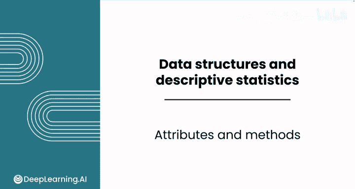
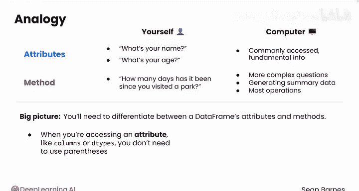

# 吴恩达《Python数据分析（数据分析第3课）｜Python for Data Analytics》中英字幕 - P31：30_属性与方法.zh_en - GPT中英字幕课程资源 - BV1rp5yzjEgn

Data frames， store data and rows and columns。 They also come with some extra information。

 attributes or characteristics and methods which allow you to perform actions on the store data。

 What do you notice about the different commands you learned in the previous video。

Columns and D types do not need parentheses while info does these commands are different because columns and D types are attributes while info is a method an attribute describes something the data frame has or characteristic of the data frame like its column names a method describes something the data frame can do Like generate a summary of its data method is just a fancy word for function。

 They are technically slightly different but the difference is out of scope for this course。

 the commands sum Max and Ly all have parentheses because these are actions in the case of some the computer has to go and add up all the values In the case of Df do D types and attributes in general。

 the data frame has that information already stored and the computer just needs to fetch it and show it to you No calculation needed as a real world analogy。

 Think about how you answer different questions about yourself Que like what's your name What's your age。

 you probably don't need to think to answer those They your attributes or characteristics But let me ask you another question。

 How many days has it been since you last visited a park。

I doubt you have the answer memorized just in case someone asks you probably had to think about when that was。

 then count up the number of days it's been since then you have to do some calculation to get the answer。

 which is more similar to using a method or function。

 The computer takess the same kinds of shortcuts as you do for commonly accessed fundamental information about a data frame Python stores that information as an attribute which is fast to access for more complex questions like generating summary data or in general most operations like finding unique values。

 summing values， generating a histogram and so on。 Those are methods。

 The computer has to take some action or do some calculation to get you the answer。 So big picture。

 you'll need to differentiate between a data frame's attributes and methods。

When you're accessing an attribute like columns or D types， you don't need to use parentheses。

 when you're using a method， you will use parentheses and often arguments to the method as well。

Luckily there aren't too many attributes， you'll probably find yourself using columns。

 D types and just a couple of others like the dimensions of the data frame the number of rows and columns Now that you've explored your data as a data frame you'll likely want to narrow your analysis to a few columns follow me to the next video to see how to select columns。

