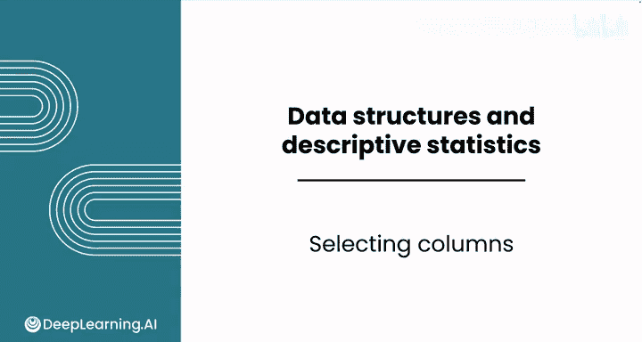
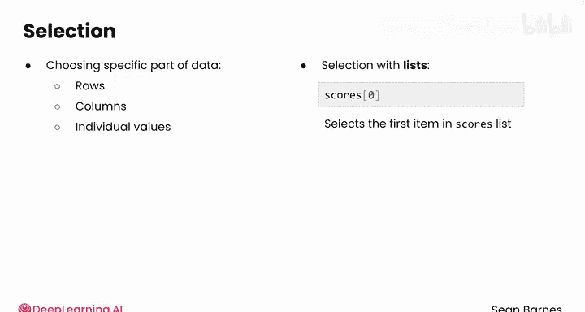
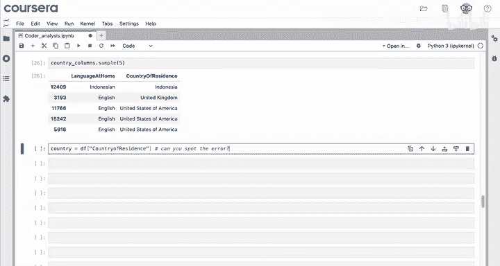
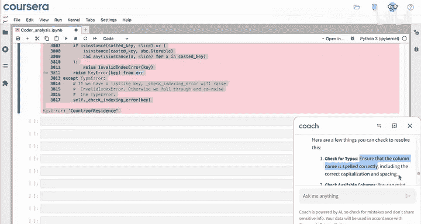
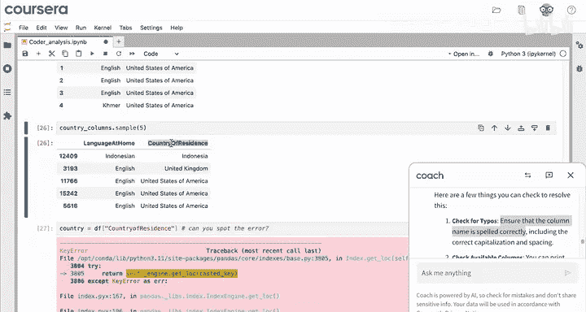
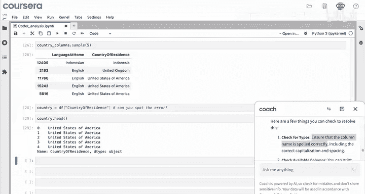
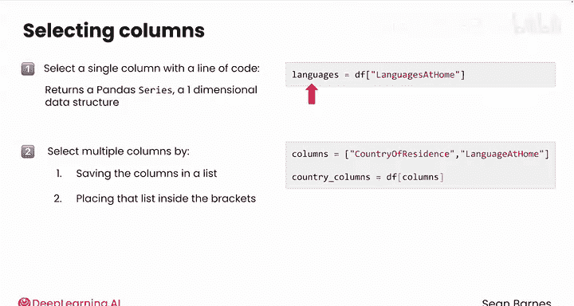

# 吴恩达《Python数据分析（数据分析第3课）｜Python for Data Analytics》中英字幕 - P32：31_列选择.zh_en - GPT中英字幕课程资源 - BV1rp5yzjEgn

In your data analytics journey so far you've often cut down a large data set to work with only one feature you can do this operation at Python as well。

 and it's called selection choosing a specific part of the data like rows。

 columns or individual values is called selection you've already seen selection a few times such as with lists using code like scores zero This command selects the first item in the scores list using the name of the list with brackets selecting a column from a data frame uses a similar command at this point in your analysis you've loaded in your data into the variable Df and just taken a look at the columns in some sample rows say you're working on the geographic distribution section of your report you want to see how many unique languages are spoken at home you may only be interested in the language at home column in order to select the language at home column Start with the name of the data frame D select a column using square brackets just like you would from a list inside the brackets use the name of the column you want to select as a string In this case language at home If you want to use the result later assign it into a variable languages。

Run that code。 Let's take a look at languages。 What is the type of languages。

 Remember you can use the type function to see the data type Laguages is a series。

 so each column in a data frame is a series of one dimensional list like data structure just like data frames。

 you can view some of the values using dot head or dot sample languagens dot head gives you four English and one K response Cool。

 What do you expect to be the length of the languages variable using the lens function。

 you get 15620 the same as the number of responses in the data That makes sense。

 One response for each row。 Do you remember how to get a list of the unique languages。

 You can use PDd dot unique languages Store that in a variable for later and print。And w。

 there's really a lot of unique languages here and some languages that are spoken by relatively small populations in the world。

 it looks like a pretty diverse global survey L of unique languages gives you 149。

 you can also select multiple columns。 For example。

 maybe you want to analyze both country of residence and language at home together to see how they're related you'll use a similar command as you did to select language at home on its own。

 but you'll use a list of column names rather than a single column name make a new variable columns containing the names of the columns you're interested in as strengths remember。

 type of columns is just a list and the length of columns is two to select those two columns from the data frame。

 use Df columns assign the result into a variable like country columns。Run that cell。

What do you think is the type of country columns？This is the data frame， why is it not a series。

 well， take a look at countryrycols。head。Now you have two dimensions， two cons。

Each row has both a country and a language spoken at home。

 you could also sample country columns to check out some different responses。Cool。

 looks like there's some different respondents from Indonesia。

 the UK and the USA now that you've been working with data frames for a while。

 can you spot the error in this code？I'll give you a hint。 It's a  typepo。

Writing this code you get an error。Scrolling down， it's a key air。

Let's ask the LLM to help debug because this is a very common error。

 especially with long column namess like this one， you could ask what is the source of this error and then paste in the error？

The LLM says that you've encountered a key error and then it tells you that this happens commonly when you try to access a column in a data frame that doesn't exist in this case。

 the column country of residence is not found in a data frame Df。

 then it gives you a few suggestions of things that you can check it tells you to check for typos and ensure that the column name is spelled correctly so going back to your country of residence。

 you can see that you did have a typo in the code and that the O and of is actually capitalized。

 so just a tiny little typo here breaks the code。

Like variable names， column names are case sensitive。

To play that back， you can select a single column with the line of code like DF language at home。

 which returns a panda series， a onedial data structure containing each respondent's answer for language spoken at home。

 You can then save what's return in a variable like languages you can also select multiple columns by saving the columns in a list then placing that list inside the brackets Remember that column names are case sensitive so they'll need to match exactly what the names in the data frame you're working with So thats selecting columns。

Let's get into some counts， songs and visualizations to generate insights for your report。

 I'll see you in the next video。😊。