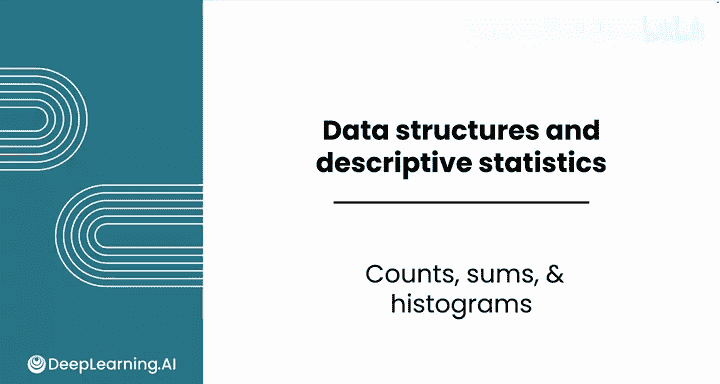
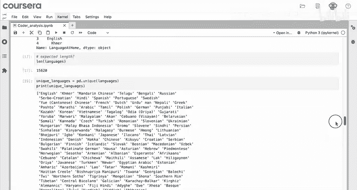
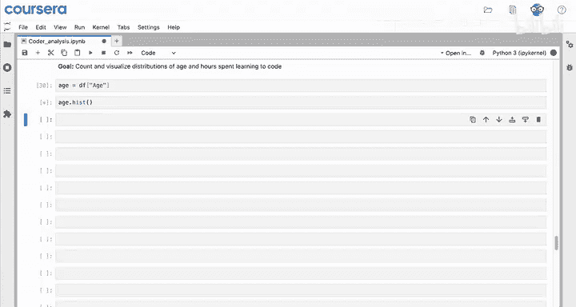
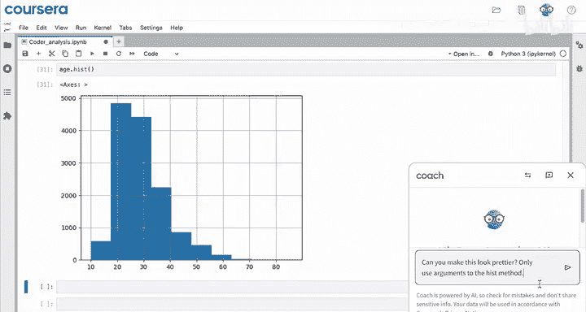
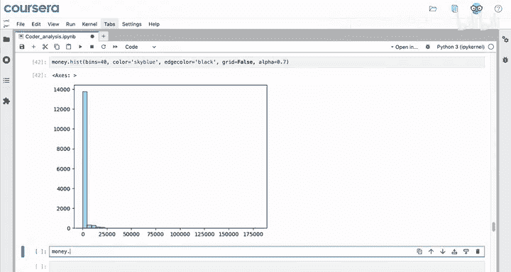
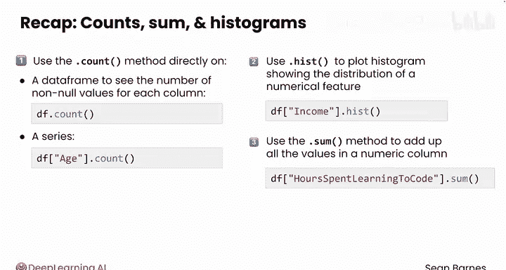

# 吴恩达《Python数据分析（数据分析第3课）｜Python for Data Analytics》中英字幕 - P33：32_计数、求和与直方图.zh_en - GPT中英字幕课程资源 - BV1rp5yzjEgn

Let's get into some of your core descriptive statistics。

 You can get far with foundational analyses like counts and sums。

 You're picking up where you've left off with the notebook from the previous video。😊。

You've loaded in the data， viewed it and done some preliminary analysis on the languages spoken at home。

 you want to count and visualize the distributions of age and hour spent learning to code。

 start by selecting the age column directly， save that in a variable called age。

To visualize this distribution， you can use the method do hisst for histogram。Running that cell。

 you get a nice visualization of the distribution of this feature。

So most respondents are in their 20s and 30s and is more of a skewed distribution。

 you will learn how to customize these histograms in the next module for now though you can always ask your LLM。

 sayCan you make this look prettier， only use arguments to the hist method。

 you don't want the LLM to start importing new modules。

Cool， try this code out， why not？Looks nice。 Remember that it was possible in a survey for a respondent to leave these questions blank For that reason。

 there are different numbers of null values in each column to count the number of people who included age in their survey。

 that is the number of non null values， you can say age do count。 that gives you 13613。

 This N do int64 is an integer。 You've seen float 64 before and N is an under the hood module used to build pandas called nuy。

 you don't need to worry too much about nuy for now。

 but that's what this N means count is different from L because it does not include null values。

 L does include null values。 although you often want to examine a feature in detail。

 you can actually use count on the entire data frame。

 This shorthand will tell you the number of non null values for every column At a glance it looks like a resource books which indicates people who learned a code using books had the least responses presumably because not everyone learns via books。

 You can also see that marital status studentode and income had relatively few responses as well as number of children。

 likely because。Not as many respondents had children or wanted to share that info say you're interested in helping to inform pricing and feature strategy for your educational product。

You might want to calculate the total number of hours spent learning to code and money spent learning to code。

 check out their distributions first， save the hours spent learning to code column in the variable hours。

 Then you can plot this data with the dot hist method if you'd like。

 you can use the same pretty arguments the LLM gave you earlier。

You can see that more than half of people spend between zero and 20 hours learning the code each week。

 by the way， if you set bins to save 40， you can see an interesting pattern emerge where many answers were exactly 10。

 15， 20 and so on with fewer more precise answers。Now。

 to sum the total hours spent learning the code， use hours。 sumum。You get an NP。 floatat 64。

 so a decimal number， which is over 200，000， collectively people are spending a lot of time learning the code for money spent learning the code。

 save that column in a variable money， plotting this series with dot hist。

 you'll get a super skewed distribution。Increase the bin size to 40。

 and you can see the vast majority of people spend relatively little。

 but that there are a few very high outliers。 Money do sum tells you that collectively respondents have spent over $16 million。

 So a lot of money overall。

To play that back， you can use the dot count method directly on your data frame to see the number of non- null values for each column or you can use it on a series。

 You also saw that you can use the hisT method to quickly plot a simple histogram showing the distribution of a numerical feature and finally。

 you can use the sum method to add up all the values in a column as long as that column is numeric counts and sums are the foundation of any analysis and the hist method from pandas will help you quickly visualize your numerical features。

 Excel work with data frames and series Com up， you'll complete the practice assignment for this lesson as well as a practice lab to test your panda skills。

 Once you're done， I'll see you in the next lesson on sorting and filter。😊。

