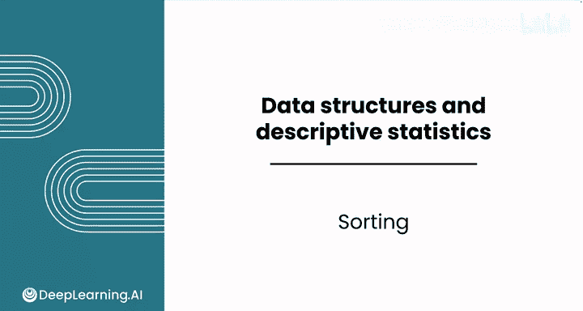
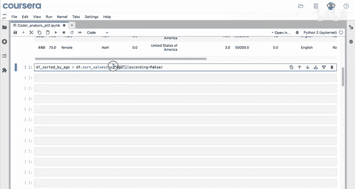
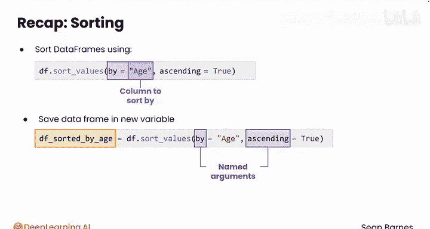

# 吴恩达《Python数据分析（数据分析第3课）｜Python for Data Analytics》中英字幕 - P34：33_数据排序.zh_en - GPT中英字幕课程资源 - BV1rp5yzjEgn

Sorting is an incredibly powerful operation that you can complete quickly and flexibly with Python。

 Let's take a look。 starting with a fresh notebook， you'll want to import pandas as PDd。

 then read in the survey data again。 Your first goal is to sort the respondents by their age from oldest to youngest。

 Start with your data frame。 you'll use the method sort values Now by default。

 sort values is not going to change your existing data frame。 It's going to create a new one。

 You need to store the result of this sorting operation in a variable。

 You can call this one Df sorted by age。 sort values takes at least one argument because you need to tell Python what column you want to sort by。

 So you might say by equals age。 This command looks a little different than some of the other arguments you've used before。

 by here is called a name argument。 You'll learn more about these in a moment。 writing this code。

 what type do you expect this result to be。😊。

Well， this should be a data frame， which it is That's great。

 and you can check whether the length of this data frame is the same as the original。

 which should be true， you didn't remove any rows， you just changed the order。

 Take a look at the head of this resulting data frame。These are the youngest respondents。

 A couple who were 10 and a few who are 11。 There are some very young people in this survey。

 You're not quite done， though， You'd like to sort in descending order。

 How you can ask the LM how you can modify this code to accomplish that task。

 How can I modify this code to sort in descending order。Then paste in your code。

So the LOM says that you can sort the data frame into sendingending order using the age column。

 then it says you can set the ascending parameter to false and it gives you the code to achieve this task。

 Try it。 it's okay to overwrite this variable Now you can see the oldest respondents 186 year old180 year old and so on so to do that you added a secondname argument ascending and set it a false by default。

 ascending equals truth so by adding this argument ascending equals false。

 you're overriding the default value by the same token if you want to sort an ascending order you don't need to include the ascending argument you can stick with just by a quick note about name arguments like by and ascending the main benefit is that you can provide them in any order so you can have written this line of code with ascending equals false then by equals H that works just the same。

To quickly recap， you learn that you can sort data frames using the sort values method。

 you need to use the named argument by equals and provide it with the name of the column you want to sort by the sort values method creates a new data frame。

 so you save that data frame in a new variable sorted by age。

 by and ascending are called named arguments Na arguments allow you to give your arguments in any order you'll often see them when working with pans。

Now you're comfortable with the fundamentals of sorting in pandas in the next video。

 you'll learn how to sort by multiple columns at once， I'll see you there。

