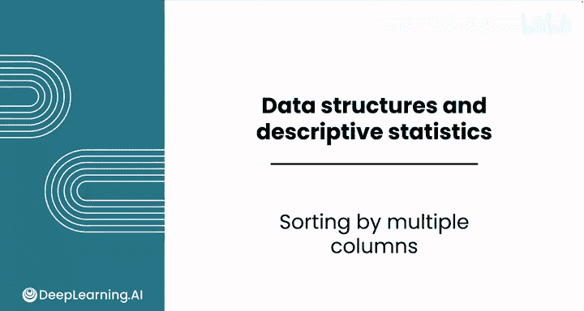
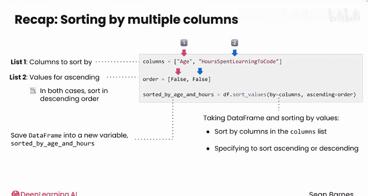

# 吴恩达《Python数据分析（数据分析第3课）｜Python for Data Analytics》中英字幕 - P35：34_多列排序.zh_en - GPT中英字幕课程资源 - BV1rp5yzjEgn

If you need to sort by multiple columns in pandas， you'll use a similar approaches before。

 but you'll provide sort values with a list of columns。

 picking up where you left off after loading in the data and creating a new data frame sorted by age for your report you may be interested in investigating the people who study the most for each age say you want to sort the data by age descending。

 then hours spent studying descending to find the highest study years by age First make a list of the columns you want to sort by the order matters so the first column should be what you want to sort by first first age then hours spent learning to code。

Then you'll need a list for the ascending argument as well。 You want these both to be descendending。

 So you need a list of booles。 call it order false and false。 Then Df got sort values。

 by equals columns。 ascending equals order。 Here， you're sorting by a list of columns。

 which is the list of length2。 Then you're also telling pandas that you want to sort these both descending。

 So you provide it with another list of length2。 Sa this into a variable like sorted by age and hours。

 This is a really funky looking piece of code。 You'll go through it step by step in a moment。

 But let's just hit shift enter for now。 And what type do you expect this value to be。

It should be a data frame。And again， the length should be exactly the same as the original。

 You didn't add or remove anything。 You're just moving things around。

 What do you expect to see when you look at the top five values。Running that cell。

 the first two rows are in fact the same as before。

 but now you have descending 75 rows with row 1846 having the highest hours spent learning the code per week at 6。

 Let's break down these lines of code together because there is a lot happening。

 First you're creating two lists the first list columns contains the columns you want to sort by in this case。

 age than hours。 the second list contains the values for ascending in both cases you want to sort in descending order with higher values at the top。

 So both values are false。 The third line starting on the right hand side of the equal sign。

 you're taking the data frame and sorting its values。

 you're sorting by the columns in the columns list So first by age and then by hours spent learning。

 then you're specify whether you want to sort ascending or descending using the list order。

 So first age is sorted in descending order and then hours is sorted Also in descending order。

 The sort values method creates a new data frame。 So you save that data frame in a new variable sorted by age and hours。

Excellent work with sorting。 Next up， you'll learn how to filter your data to only select rows you're interested in。

 I'll see you in the next video。

