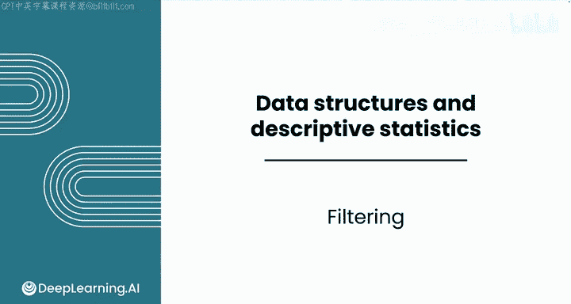
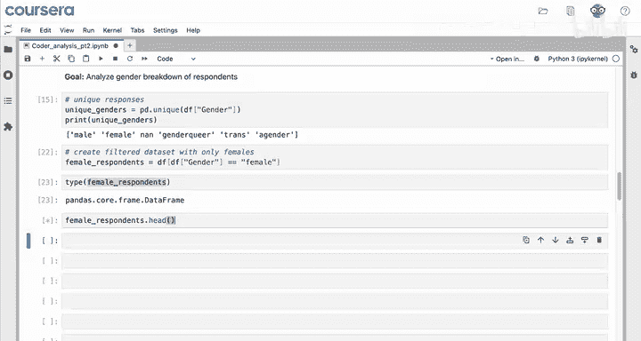
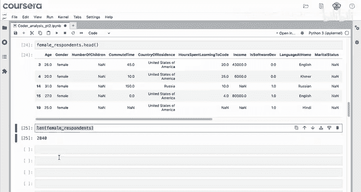
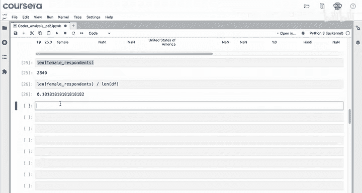
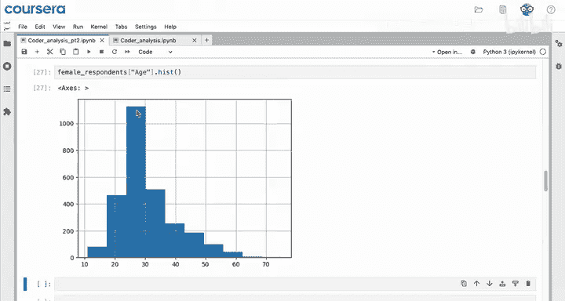
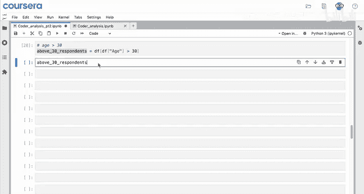
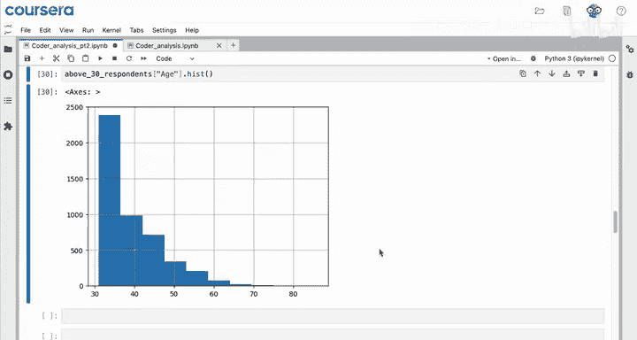
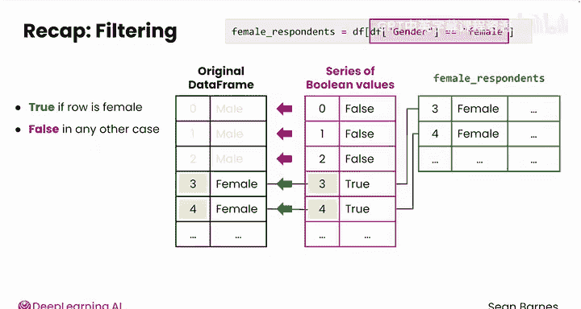

# 吴恩达《Python数据分析（数据分析第3课）｜Python for Data Analytics》中英字幕 - P36：35_数据筛选.zh_en - GPT中英字幕课程资源 - BV1rp5yzjEgn

You've seen how to filter your data and spreadsheets selecting rows that only meet a certain condition how can you accomplish that task in Python for the next section of your report。

 you're interested in analyzing the gender breakdown of respondents understandingsating this breakdown will help you target marketing and product features Start by analyzing the unique responses for gender PD。

 unique and select the gender call。

Then you can print the result。The options included male， female， gender queer， trans， and a gender。

 and NAN， which is not a number， these are empty values where people left the field blank。

 you may notice that these are in single quotes， but they're still strings in Python you can also use single quotes to define strings if you want to compare the coding habits of say males and females you could create a filter data set with only females。

So you want to select from the data frame the respondents whose gender equals female。

Start with the data frame DF， you're going to select from the data frame using brackets。

 you're looking for rows where the gender column Df gender equals equals the strain female。

 so what is this line of code going to do？It goes through each response in the data frame for each response。

 it looks at the value in the gender column。 If the gender is equal to female。

 then it will include that row in the filter data frame， If not。

 then it won't include that row in the sorted by age and hours data frame， for example。

 only the third and fourth rows will be included。Save that result to a variable， for example。

 female respondents。What is the type of female respondents？It is a data frame。

Let's take a look at the first five rows of that data frame。

You can see that you've successfully filtered for only female respondents noticeice that the original integer index is maintained。

 so you know that rows 01 and 2 had a different value for gender and so on if you want to just do an analysis on the female respondents now you can do that so for example。

 the length of female respondents2840 This value was the number of rows in the data frame so not a whole lot out of 15。

000 there were about 3000 female respondents you could also graph a histogram of their ages。

If you remember the histogram from the previous lesson with all ages。

 you can see that there's more FM respondents in this late 20s bin。

If you're working with a numer column， you can select using other conditional operators like greater than or equal to。

 for example， to select rows where hours spent learning to code is greater than 30。

 start with the data frame DF， and select rows in that data frame where the column。

 hour spent learning to code is greater than 30， then store that result in above 30 respondents。

If you're working with the newmer column， you can select using other conditional operators like greater than or equal to。

 for example， to select rows where age is greater than 30。

 start with the data frame Df and select rows in that data frame where the column age is greater than 30。

 then store that result in above 30 respondents， G the age column in a histogram。

 What should you see。

Well， the lower bound of the X axis should be 30， looks perfect in a spreadsheet。

 this would be a much more complicated operation requiring a kind of custom filter。

To summarize in order to filter your data， that is to select the rows that match a certain condition。

 you'll select from your data frame with the Boolean expression， For example。

 you saw how to select only responses where the survey taker answered female for gender using the command D Df gender equals equals female you're selecting from the entire data frame only the rows where the value in the column gender matches the string female you also saw that the Boolean expression inside the brackets can be equal to greater than it can also be less than you'll see even more options for filtering in the next video。

Take a look at this piece of code right here。 You're selecting rows that match this boolean expression。

 So what does that actually do for the first five rows of the original data frame。

 The genders were male， male， male， female， female， the type of this expression on the right。

 Df gender equals equals female is a series。 It's a series of Boolean values。

 which starts with the values false， false false true true。

 Each value is true if the gender in that row is female and false in any other case。

 When you select from your data frame using this expression。

 the computer is going to look at each value in the series one by one。

 If the value in the series is false。 It's not going to include that row， it's going to throw it out。

 If the value is true， it is going to include that row in the selection。

 and that's why in female respondents， the first two indices were3 and4。

 Those are the indices of the first two rows where the series had the value true。

Filtering gives you a lot of flexibility for analyzing subsets of your data in the next video you'll filter using multiple conditions I'll see you there。

