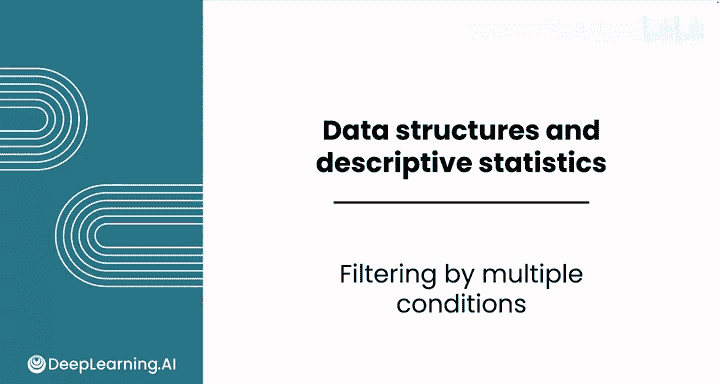
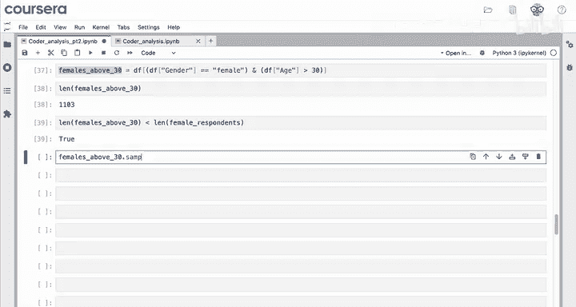
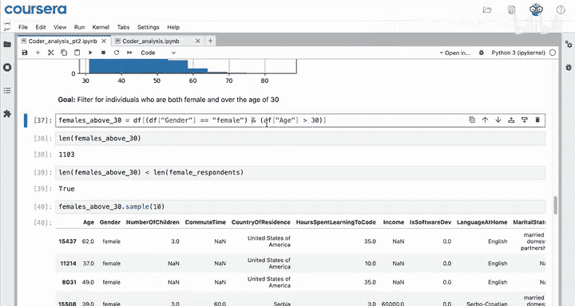
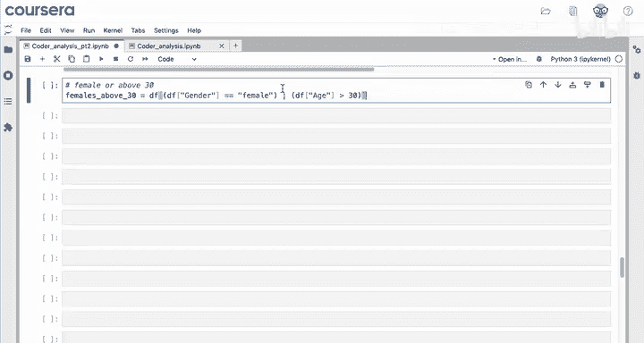
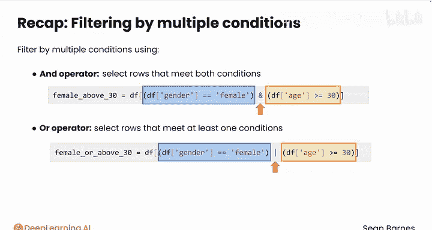

# 吴恩达《Python数据分析（数据分析第3课）｜Python for Data Analytics》中英字幕 - P37：36_多条件筛选.zh_en - GPT中英字幕课程资源 - BV1rp5yzjEgn

Using pandas， you can also filter based on multiple conditions。

 which allows you to select more complex slices of your data。

 say you're working on your user personas for your report and you'd like to run analysis on individuals who are both female and over the age of 30。

To get some help you can ask the LLM how you might go about combining these filters Try the prompt I've created two separate data frames in my code。

 one with only females and one with only those above the age of 30。

 how can I combine these filters to get a data frame with only respondents who are both female and above the age of 30。

 then share the code for these two data frames。So the LLM says that you can combine the conditions directly with a single data frame filter。

 and then it tells you how to do it with the code shown here。Try the code out yourself。

Though you might change the variable name to something shorter， like female is above 30。

Notice that the LLN used a greater than or equal to condition， but you actually want greater event。

Now， what do you expect this variable to look like。

 it should have a length that's shorter than the female respondents data frame since it's a subset of those。

 which it does only 1100 or some if you sample 10 rows。

 it looks like this filter applied correctly There are a couple of new aspects to this code but starting with the similarities。

 you can see the same two conditions as before gender as female and age greater than 30 they're each contained within parentheses and there's an ampersand between them。

 the ampersand represents that both of these conditions must be true for a row to be selected。

 you can also select for rows where either condition is true。 For example。

 if you are interested in respondents who were female or above 30。

 you could just change one character in this code。 the ampersand to a pipe character the pipe character is read as or and it's often located right above the return key on the keyboard call this females or above 30 and sample some rows to see the results Here you can see there are some male respondents above 30 There are some female respondents below 30 and there are some female respondents who are above。

All of these respondents fit at least one of the criteria that you specify。To recap。

 you can filter by multiple conditions using the and as well as or operators。

 your conditions should be surrounded by parentheses。

 use Ampersand to select rows that meet both conditions and the pipe character to select rows that meet at least one condition。

Now that you're comfortable with both sorting and filtering your data。

 you may want to select individual rows or slices of rows in your data。

 I'll see you in the next video to learn how。😊。