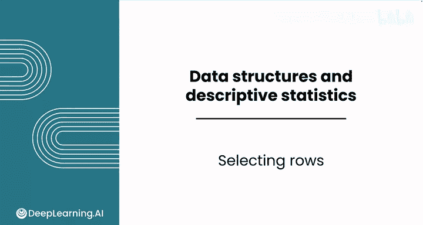
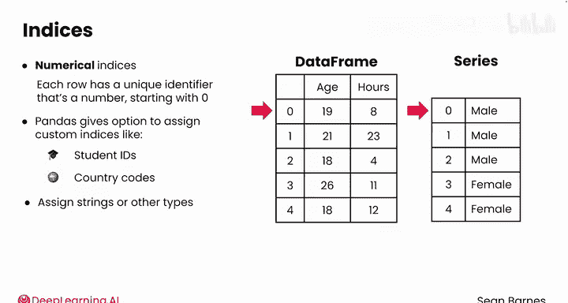
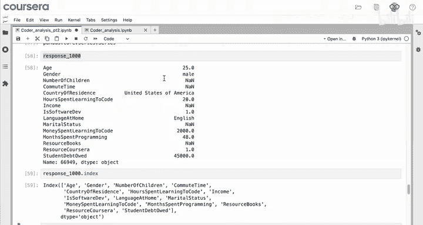
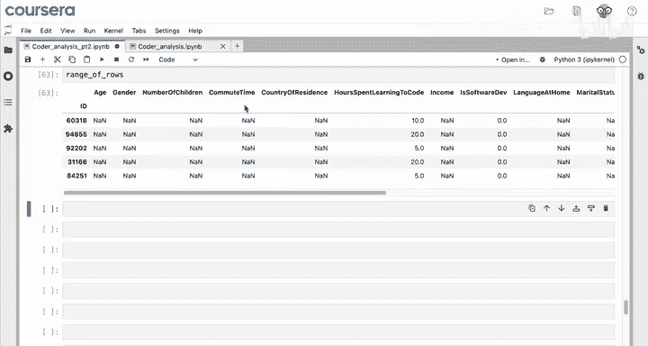
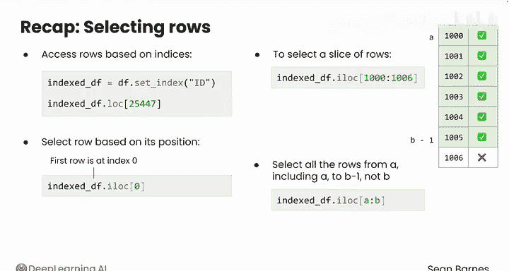
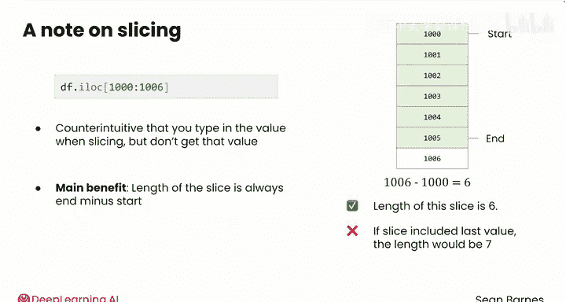

# 吴恩达《Python数据分析（数据分析第3课）｜Python for Data Analytics》中英字幕 - P38：37_行选择.zh_en - GPT中英字幕课程资源 - BV1rp5yzjEgn

While it's common to work with a subset of columns。

 you may also want to analyze a subset of rows in your data frame。

 you can also update the indices in your data frame to create more flexibility for selecting rows。

 So far you've been working with data frames and series with numerical indices。

 That is each row has a unique identifier that's a number starting with zero however。

 pandas also gives you the option to assign your own indices It's common practice to assign custom indices if your data has unique identifiers like student IDs or country codes you can also assign strings as indices or even other types like date times for time series。

 You may have noticed that this survey data set contains an ID column a unique identifier for each respondent in the survey you can replace the numerical indices on the left with the unique ids which allows you to select individual rows based on the I of the respondent In addition to the numerical indices。

 By the way， this column isn' an original to the public dataset We've created it for this demonstration The original survey was anonymous to add the unique Is as the indices you can use。

index with one argument。 the name of the column as a string In this case。

 you'll want to use Df set index ID saveve this new data frame into a new variable index D check out the first five rows of the data frame now you no longer have an integer but the ID as the index and the ID column has been removed from the data frame Now if your team says they're interviewing I 25447 and they'd like you to pull that person's information to help generate some interview questions you can select their row using index Df Lo allows you to access rows in your data using the indices so index Df25447 will pull up the information for this individual a 35 year old mail from Bangladesh no matter what you can always select rows based on their position in the data frame using index df i or integer location even though you set the index to be the ID column a moment ago。

 this data frame still has integer row number starting at zero So for example。

 if you were asked to find the row at index 100。You could say index Df the IO 1000。

 and here you see that respondent was a 25 year old male from the USA。

 You can save this value into a variable like Repon 1000。

 remember these rows are counted starting from0， so this is actually the 1000 and first row Now you have that response saved into this variable response 1000。

 What do you expect to be the type of Re 1000 hitting Shi enter This is also a series。

It's relatively short because there's only one value for each column and there are 16 columns。

 So this response was submitted by a 25 year old male who lives in the USA， speaks English。

 and they spend about 20 hours learning the code a week， and so on。

 This looks a bit unusual for a series， doesn't it。

 The column names on the left are actually the indices of the values on the right。

So here's a case of strings being used as embesies。

Because of the way this series is structured you can select this person's age， for example。

 using age as an index that gives you the number 25 directly one of your colleagues has asked you to investigate the five rows starting an individualte location 8664 because they believe there may have been an issue with those responses they contain a lot of missing values to do that you can use the colon operator to slice your data which you use with lists in the previous module use indexdf。

 IO 8664 colon 8669 to select the 5 rows starting with 8664 but not including 8669 you can save the selection in a variable like range of rows What is the type of range of rows。

It's a data frame。😊，That's because you have two dimensions。

 You selected all the columns of multiple rows。 Looking at the responses here。

 your colleague was right that there's an odd chunk of responses that contain a lot of missing values。

 This operation is called slicing the data frame because you're cutting out a section of it to examine further。

 It's almost like cutting a slice of cake for yourself。

 you make two cuts to define the start and end of the slice and you give back the whole slice after you cut it selecting rows can feel complicated as you're getting used to it So to recap if you have used the dot set index method with a column name。

 you can use Lo to access rows based on their indices。

 you can also use i Lo to select a row based on its position in the data frame。

 similar to lists data frames are0 index So the first row is that index 0 to select a slice of rows or range of rows。

 you'll use a very similar command This time with the colon to select the range So if you have a line of code like index Df do i Lo1 thousand0 colon 1 thousand06 it will select rows 1000 through 105 not including 1006。

More generally， if you have a command like indexdf Io a colon B。

 that will select all the rows from a， including a to B-1， So not including B。

 It might seem counterintuitive that you would type in the value 106 when slicing。

 but you don't get that value。 Why is the last value not included in the slice。

 There are a few benefits， but one of the main ones is that the length of the slice is always n minus star。

 So for example，106 minus-1000 equals6。 So the length of the slice is 6。

If the slice included the last value， the length would be 7， which is more awkward。

Great work。 slicing and dicing your data frame。 That brings you to the end of this lesson。

 You know your way around data frames and series now， including sorting。

 filtering and selecting both rows and columns。 You'll test your skills in the upcoming practice lab and practice assignment。

 Once youve finished， follow me to the final lesson in this module on descriptive statistics。

 I'll see you there。😊。