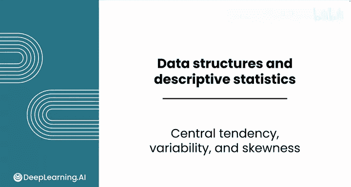
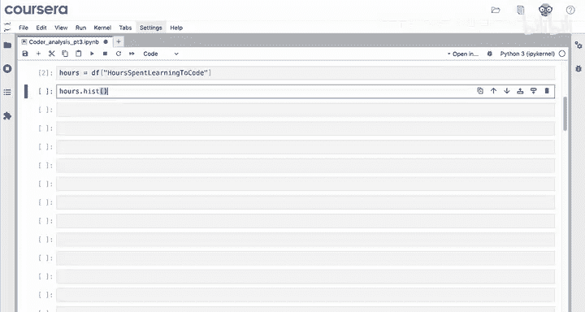
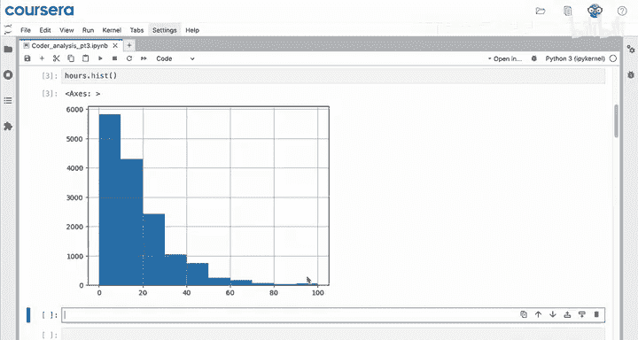
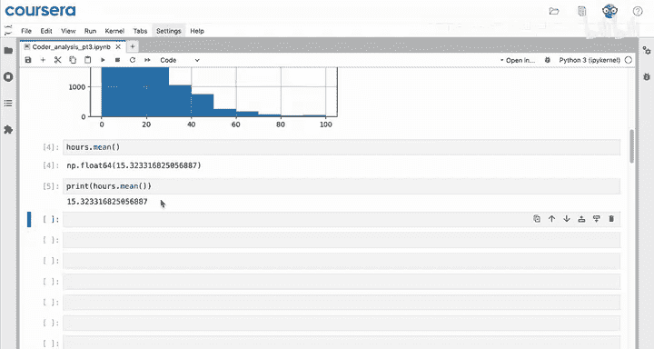
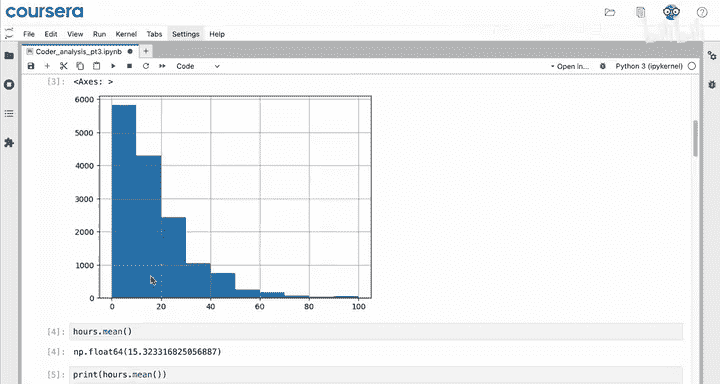
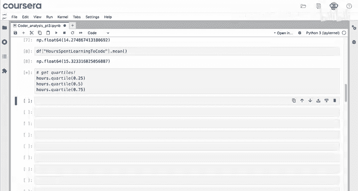
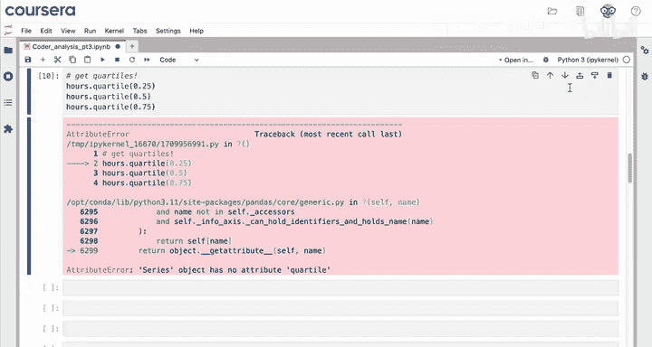
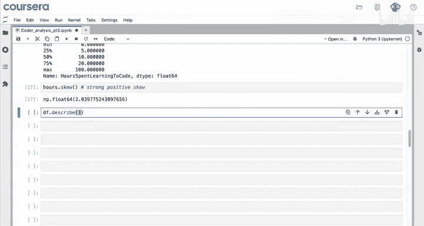
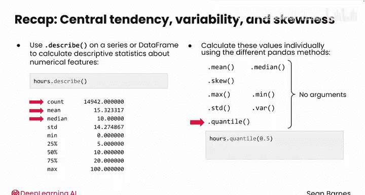

# 吴恩达《Python数据分析（数据分析第3课）｜Python for Data Analytics》中英字幕 - P39：38_集中趋势、离散度与偏态.zh_en - GPT中英字幕课程资源 - BV1rp5yzjEgn

Now that you've investigated countsing sums in your data， done some graphing and created filters。

 you'll likely want to get more information about the distribution of each feature。

 Start with the numerical features。 Let's start a fresh notebook。 importport pandas as。

 Read in the data and set the index I Just housekeeping。

 The next step in your analysis might be to describe the distribution of the hours spentler into code feature。

 Remember that dot his allows you to generate a histogram。

 This distribution is strongly positively skewed。 You can see most of the respondents spend less than 20 hours coding and fewer and fewer respondents spend more and more hours of coding。

 You can now calculate your descriptive statistics。 Now you can calculate the mean hours mean。

 It's around 15 hours per week。 That's like a part time job。

 So the survey seems to be capturing people who are learning the code generally on the side rather than studying it formally。

 noticeice that the type of this value ismp dot float 64。 So there's nu cropping up again。

 It's just a number with a decimal。 You can avoid seeing themp dot flow part by using print if you like。

😊。

You can also check the median using dot median， which is 10。

 That value makes sense because in a skewed distribution。

 the mean is pulled more towards the tail of the distribution in this case towards the higher values。

 you also have hours STd to get the standard deviation which is around 14 not quite as meaningful with the skew distribution as it would be for data that was a little more normally distributed All of these common descriptive statistics are very。

 very straightforward to calculate you don't need any arguments in these functions you can just call them directly on your series As a quick reminder。

 all of these calculations will generate the same results as using the name of the column on directly。

 You may also want to get your quartiles。 The values at 2550 and 75% of the data how can you do that if you try hours quartile with those three values like you might in the spreadsheet。

 You get an error。 series object has no attribute quartile。

 Let's ask the LM for some help debugging I tried this code to get the 25th50th and 75th percentiles of the series but I get the error below What is the corrected code。

And then paste in the error， notice that you don't need to copy in the code because that line is already part of the error message。

So the LLM corrects your code， you needed to use the quantntile， not quartile method。

 try the provided code and you get these nice round numbers 5， 10 and 20。

As you saw in an earlier video， most people answer round numbers for this question。

 so these values check out， you can also get multiple quantiles in one by passing in a list as the argument rather than a single number。

For example， you might want to get all three quantiles together。Looking at the type of this result。

 you can see that a series is returned。You can access each quantile by referencing the associated index。

 You can calculate all these descriptive statistics as you just saw。

 or you can get them pretty easily with hours do describe。

 This method is similar to Df do info and that it gives you a lot of useful statistics right away。

 How many values did you have What was the mean standard deviation the min max the different quantiles including the median that's a super nice shorthand。

 You may notice that Skewness is not included in dot describe。 However。

 you can use the dot Sw method。 This method gives you a value with the same interpretation as the skew function in a spreadsheet for hours dot Sw your result is around two。

 So this value indicates a strong positive ske in the data。

 You've now seen the describe method applied to a series。

 remember that the type of any given column is a series。 It's one dimensional。

 you can also use describe on a data frame。 Df dot describe。😊，That's a lot of information。

DF dot describe gives you a really nice looking table of all of the features and their distributional statistics as long as they were numerical features you can't calculate the standard deviation of a categorical feature。

 so there's a lot to investigate here， and you can get a lot of information quickly Let's recap the tools you have available for central tenancy。

 variabilityability and skewness for numerical features you can use dot describe on either a series or an entire data frame to quickly calculate descriptive statistics about the numerical features in your data。

 including count mean， median and so on。 you can also calculate these values individually using the different pandas methods available to mean median。

 S， Mac， min， standard deviation， variance and quantile Most of these methods take no arguments except for the quantile method for which you'll specify either one number or a list of numbers to get multiple quantiles at once。

😊。

You can get so much information about the features in your data and just a snap of your fingers Once you've dealt with your numerical features。

 you'll want to move on to your categorical ones。 followow me to the next video to see how。😊。

