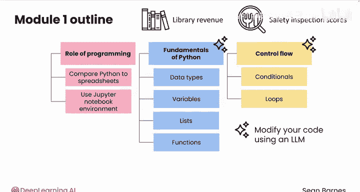

# 吴恩达《Python数据分析（数据分析第3课）｜Python for Data Analytics》中英字幕 - P3：2_模块1 简介.zh_en - GPT中英字幕课程资源 - BV1rp5yzjEgn

Welcome to Module 1， Programing Fundamentals for Data Analytics。

In this module you'll explore the exciting world of Python programming and discover how it can make your data analysis workflow more efficient and effective Throughout this module you'll be working with real worldor examples。

 including public library revenue and restaurant safety inspection scores。

This handson approach will help you see how these programming concepts apply directly to data analytics tasks。

 You'll also take a look at how the programs you write。

 compare and contrast with the spreadsheetbased approach In lesson1 you'll learn the role of programming and data analytics including why Python is such a powerful tool and how it compares to spreadsheets you'll also get started right away with the Jupyter notebook environment you'll be writing and running your code Le two is all about the fundamentals of Python you'll learn about different data types how to store information and variables and how to work with lists you'll also cover essential programming tools like running functions to perform calculations on your data by the end of this lesson you'll be able to write your first Python programs to manipulate data in lesson3。

 you'll learn the core concept of control flow The logic that determines how your program runs you'll learn how to make branching decisions in your code using conditionals and how to repeat actions using loops in Python there are typically many ways of accomplishing a task while you'll see。

One way in the videos often the most direct route to a solution， the more you program。

 the more solutions you'll discover， you'll also explore ways to modify your code using an LLM。

 I know you'll find coding both challenging and rewarding。

 Foow me to the first lesson to learn the roller programming in the data analytics workflow。

 See there。

