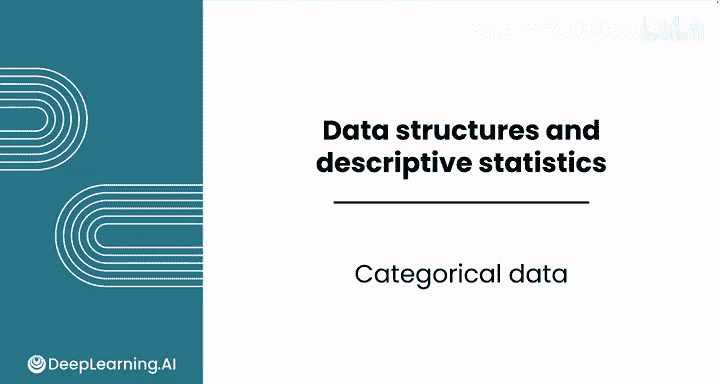
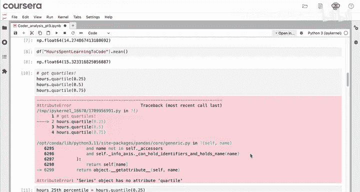
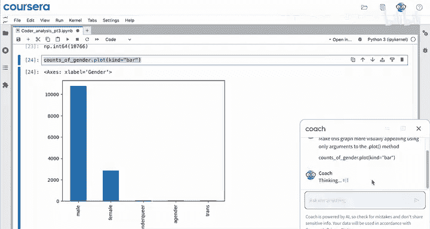
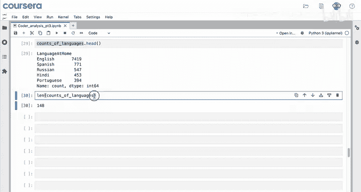
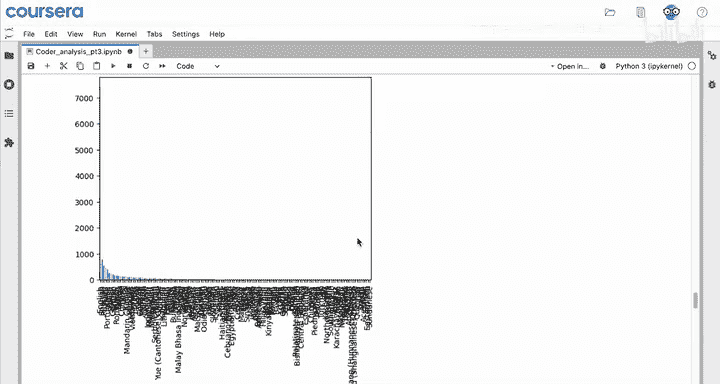
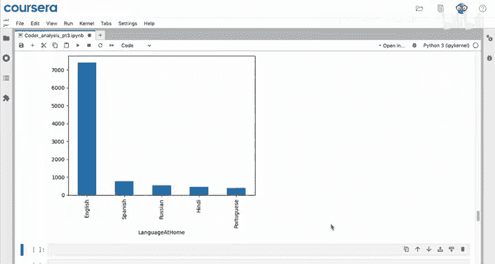
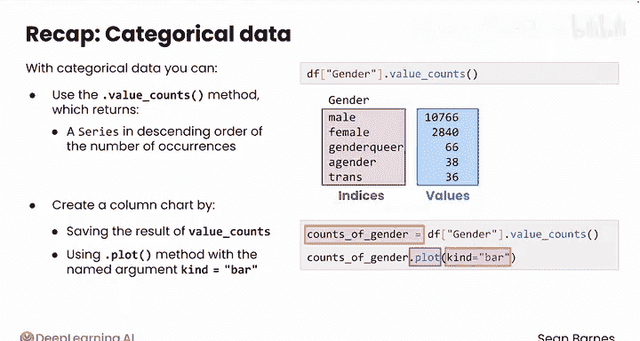

# 吴恩达《Python数据分析（数据分析第3课）｜Python for Data Analytics》中英字幕 - P40：39_分类数据处理.zh_en - GPT中英字幕课程资源 - BV1rp5yzjEgn

You'll often be working with categorical data， which is analyzed differently for numeric data。

Python gives you a couple of key tools to perform those analyses including the value counts method and plotting。

 Pick up where you left off。 you've just loaded in your dataset and calculated a ton of descriptive statistics on the hours spent learning the code feature Next up for your report you've been asked to describe the distribution of gender in the survey respondents and find the top five languages that are spoken at home Now if you don't have all the columns memorized。

 you can use Df doD types to remind yourself which columns are actually categorical which includes any objects。

 remember that object is pretty much going to mean text in this context。

 So gender country of residence language at home a software developer and marital status you'll want to first select the column you want to do some analysis on which is the gender column your main angle of attack for categorical data is going to be the value counts method value counts gives you every unique value in the series and how many times it occurred because you're going to be using these value counts to generate plots and maybe do some other analyses you'll want to save those two variables so you can use them later So for Df gender。

Value counts say that to a variable counts and。Looking at the distribution。

 males made up about 78% of non null responses， females made up about 21%。

 and the three gender diverse answers made up around 1%。 Look at the type of counts of gender。

It's a series。 Can you tell what the indices are in the series。

The emdices are the different possible genders， male， female， and so on。

 the values are the counts for each one， one thing you can do with the series is plotted in a bar plot。

So when you had a numeric column， you did something like dfh。ht for nonnumeric column。

 you're going to take countagegenner。 plotot now you need to tell Pams a little more information than that。

 specifically with a name argument， what kind of plot you want to make。In this case， a barp。

So running that code cell， you get this straightforward graph showing exactly the information you just saw。

 but in a very digestible way， again， you can ask the LLM to jazz this up a bit。

 make this graph more visually appealing， using only arguments to the plot method。

Then paste in the code。

Try it out。All right， that's a nice looking graph。You can see that the LLM placed each named argument on a separate line。

 This is a very common practice。 It makes the code much more readable and easy to modify later。

 You might say， well， this is a column chart， not a bar chart。 Yeah， I'm with you。

 That's just what it's called。If you try to say kind equals column。

 you get this scary looking red text。 column is not a valid plotid for this method。 You can use line。

 bar and all these other options that you'll take a look at in the next module。 Remember。

 if you get an error like this， you can always ask an LM or try to read through and debug that error yourself。

 Errrors are a completely normal part of coding。 Next up。

 youll want to find the top five languages spoken at home。

Let's say counts of languages equals DF language at home dot value counts。

 You're selecting the column you want to work with language at home dot value counts。

 remember the type of counts of languages It's a series You can do anything with counts of languages that you would do with the series。

For example， you can take a look at count of languageguages。head。

You can see that English is by far the most commonly spoken language at home。

 almost 10 times more common than the second most common answer， Spanish， with Russian。

 Hindi and Portuguese rot out the top five， What else can you do with the series？Well。

 you can check the link of it， what would the length of this series tell you？Well。

 it would tell you how many different languages appear in this column，148。

 So there are 148 different languages that were entered into this survey as the language spoken at home。

 That value should match your intuition because you already saw the length of unique languages was 148。

 Now， if you want to visualize counts of languages， you might think to run dot plot kind equals bar。

 check it out。

Okay， it gave you exactly what you asked for， which is this huge bar chart of 148 different languages。

 It's really challenging to come to any kind of conclusions from this graph。

 although it is kind of cube that pan has tried。 Since you're just interested in the top five languages here。

 You can use dot head and call dot plot directly。 If you just want the top five languages。

 you don't even need any arguments to do head。 And there you go。

 you have a top five languages spoken at home， The type of top five languages is also a series。

 After all， a slice of cake is still cake。 So now you can go ahead and plot it。

 top five languages dot plot。

Kim equals bar， and now you get a nice simple bar chart showing the conclusions about the languages spoken at home。

So with categorical data， you can use the value counts method which returns a series in descending order of number of occurrences。

 the unique values of that categorical feature are the indices of the series and the counts are its values。

 you can also create a column chart by first saving the result of value counts。

 then using the dot plot method with the main argument kind equals bar。

Once you've wrapped your mind around the distributions of your categorical features。

 you can dig deeper into the relationships in your data。

 Follow me to the next video to see how to do that。😊。

