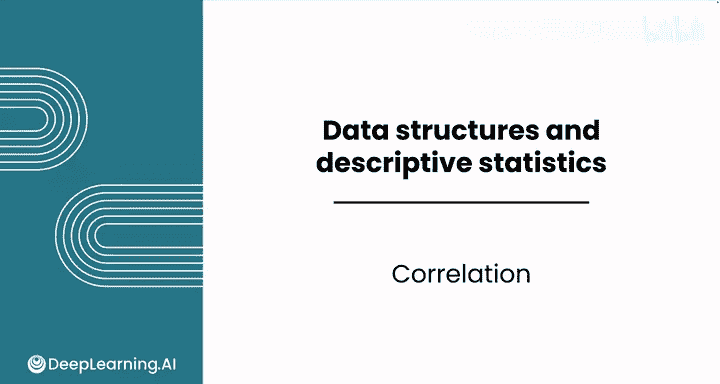
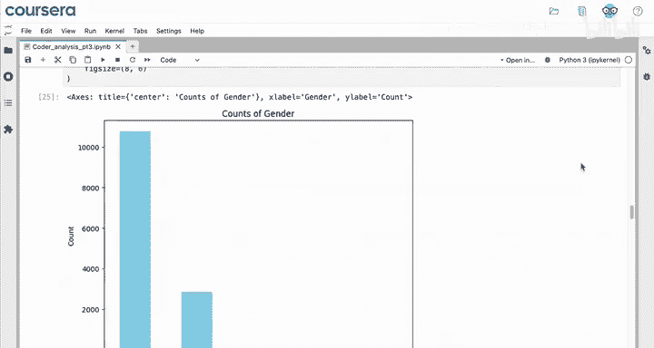
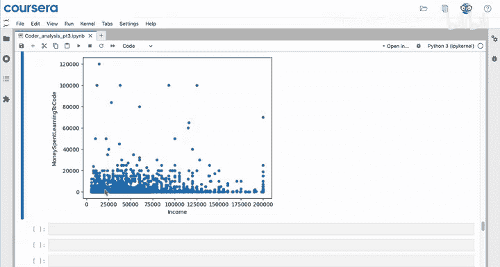
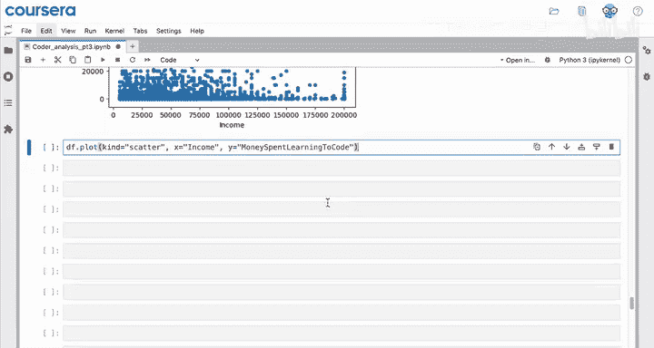
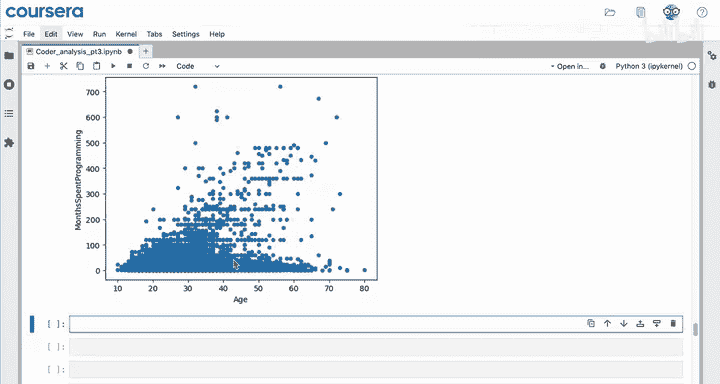
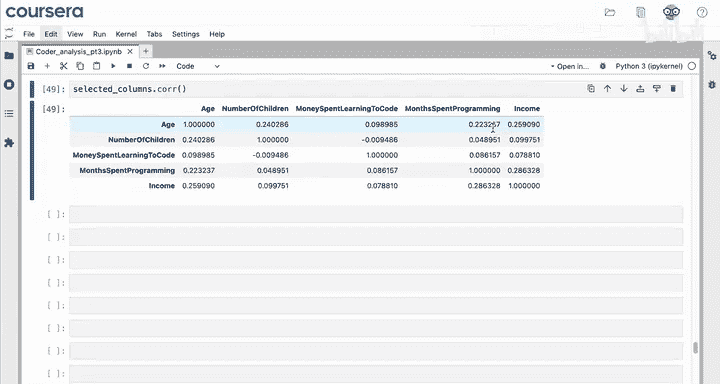
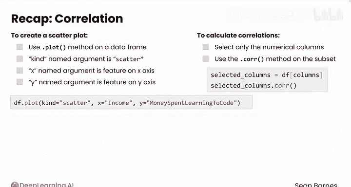

# 吴恩达《Python数据分析（数据分析第3课）｜Python for Data Analytics》中英字幕 - P41：40_相关分析.zh_en - GPT中英字幕课程资源 - BV1rp5yzjEgn

Correlation is your go to for quantifying the strength and direction of the relationship between two numerical features。

 Padas allows you to quickly calculate correlations between multiple features。

 as well as create scatter plots。 Pick up where you've left off。

 you've loaded in the data and done some analysis on a few different features。

 both numerical and categorical。😊。

Say you want to find the correlation between income and money spent learning a code。

Maybe you think that the more money someone has， the more money they are able to spend on programming。

 you may also be interested in the correlation between age and month spent programming。

 maybe the older someone is the more time they spent programming typically when you're looking at correlations the first thing you want to do is look at a scatter plot you can remind yourself of the columns that you're working with here previously when you were plotting a histogram and a bar chart。

 you started with the series like the column because you only need it to plot one column in a scatter plot you need to plot two columns so you want to start with the data frame that way you have a reference to multiple columns。

 Df do plot same function as you use for a bar chart Co is going to be scatter and here comes the new part you have two newname arguments。

 X is income and y is money spent learning to code So X is whatever column is going to be on your X axis and you just need to specify the column name you don't need to select the column using a command like Df income because you're calling this method on the data frame so just pointing the computer to which columns you want to graph looking at the resulting plot。

 Maybe this is not the pattern。You were expecting it doesn't seem like income on the X axis has too much of an effect on money spent learning to code on the Y axis。

 Most of the values of money spent learning to code are relatively low for the second scatter plot you were interested in。

 just copy and paste that code Df dot plot kind equal scatter and now you want to visualize the relationship between age and month spent programming This plot also has quite an interesting relationship you can see that a lot of people have zero monthth spent programming they're just starting out but there does seem to be some kind of positive relationship here there is a group of respondents where the older they are the more months they've spent programming but there is another large group of people just starting out across all age groups。

In order to calculate the Pearson correlation coefficient。

 you're going to use the panda's dot core method， The dot core method is used with a data frame。

 not an individual column， because you need two columns to find the correlation。

 similar to the describe method， when you call dot core on a data frame。

 it will show you the correlations between all pairs of features you might think to call dot core directly on the data frame。

 however， as you can see that causes an error， unlike dot describe which automatically removes new rare columns。

 dot core just does an error。To avoid that， you can just select all the numerical features you want。

 then see how they all correlate with each other。 So first。

 create a list of the numerical columns you're interested in。Maybe age， number of children。

 just for fun so you can see what's there。Money spent learning to code。

 month spent programming and income， so the type of the variable columns is a list you're just creating a list of columns Now you want to select those columns from your data frame。

Use the technique you learned previously， just like you would select any individual column with this command by saying DF age。

 you also saw that you can select a list of columns， the type of selected columns as what？Well。

 it's a data freak。And that's because if you look at the first five rows。

 you have both rows and columns， so you have two dimensions， it's not just one column。

 and because selected column is a data frame with only numerical data， you can use the core method。

Shift enter and you get this big table of results。Diaagonally， down the middle。

 all the features have a correlation of one with themselves。 So age and age or 100% correlated。

 But there's some more interesting results here。 You were first interested in income and money spent learning a code is a pretty weak correlation of about 0。

08。So the more your income goes up， the more money you spend learning to code。

 but it only explains about 8% of that relationship。

 Remember that correlation is a symmetric operation。

 So the correlation between money spent learning to code and income is also 0。08。

 You are also interested in age and months spent programming。

 Heres the result showing the correlation between age and month spent programming。

 That has a stronger but still weak correlation。 about 22% of the variability in months spent programming can be explained by age。

 So as your age goes up， you spend more time programming on average。 But remember。

 this survey was targeted towards new programmers。 So it makes sense that older respondents who have been coding for longer would be underrepresented。

😊。

When investigating relationships to create a scatter plot。

 you'll want to use the dot plot method on a data frame， the kind named argument is scatter。

 the xname argument is whatever feature you want on the x axis and the y named argument is whatever feature you want on the y axis to calculate correlations you call dot core on a data frame If you try to use a data frame with categorical columns you'll get an error so you'll first want to select only the numerical columns of interest from a data frame。

 then you'll use the dot core method on that new data frame。

 the subset and that will give you this table of correlations。

 noticeice that some of the correlations are redundant。 more than half of them to be precise。

 Yeah the perfect correlation of each feature with itself plus correlation is a symmetric operation so it doesn't matter the order in which you select the columns the correlation calculated is the same and each result is shown twice in the correlation table and think about how much effort this correlation table saves you from manually entering this formula in so many different cells。

You're almost to the end of this module you've learned so many useful methods in pandas from reading in data to selecting。

 sorting， filtering， and calculating descriptive statistics， as well as plotting histograms。

 column charts and scatter plots now that you've learned so many calculations and visualizations in Python。

 you may want to apply them to segments in your data。

Follow me to the final two videos in this module on segmentation。

