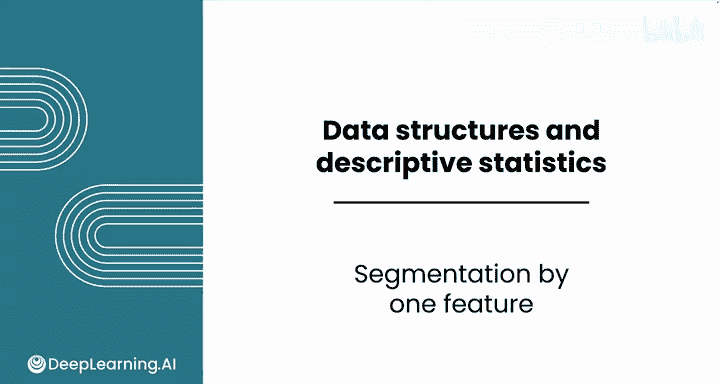
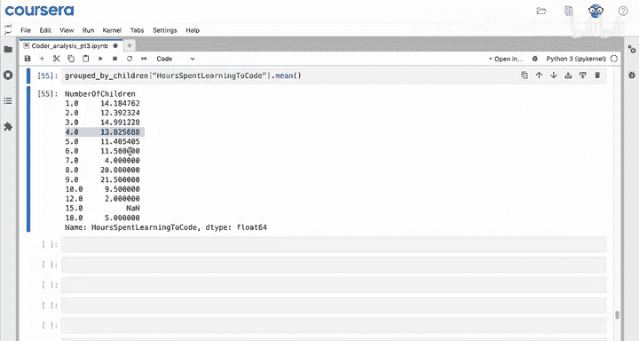
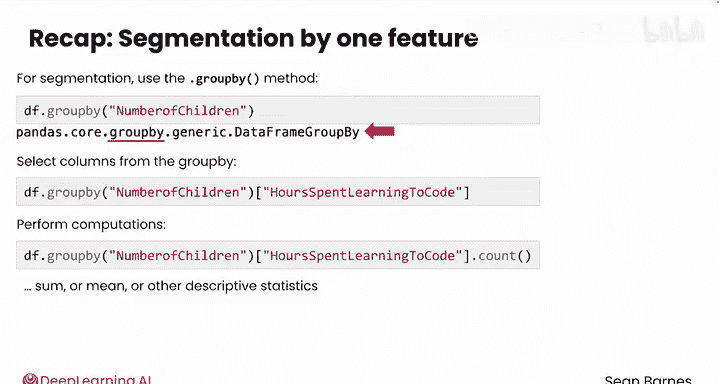

# 吴恩达《Python数据分析（数据分析第3课）｜Python for Data Analytics》中英字幕 - P42：41_单特征分群.zh_en - GPT中英字幕课程资源 - BV1rp5yzjEgn

Segmenting your data allows you to see patterns in one feature based on another。

 it's a powerful tool for analyzing how features interact。

 Let's take a look at segmentation and Python with pandas。

For one of the final sections of your report， you're interested in determining whether hours spent learning to code varies by the number of children that a person has said they had。

So you want to segment by one feature， take a look at your data frame。

You want to segment by one column， the number of children and then analyze hours spent learning to code Since you need access to both of these columns。

 you're going to start with the entire data frame。 You don't want to start with a series because then you'll be missing one of the columns you need。

 So you're going to say Df dot group by number of children。

 This line of code Cu your data into subsets based on the values for number of children。

 save that into a variable group by children。 So what happens when you run this code block and look at the result。

 You think you might be able to see a table like you did with your data frame。

 but you just get this pandas dot core dot group by do generic blah bh blah。

 there's nothing to display yet because group by doesn't actually compute anything yet。

It sections out your data， but there's nothing to C until you take the next step to run some calculation from this group by result。

 select the hour spent learning to code column your outcome of interest。

 and then maybe you want to do account。 so you need to execute a couple of intermediate steps here to generate any results including selecting the column you want to explore and applying a function to calculate some type of descriptive statistics here you have the hours spent learning to codes segmented based on the number of children。

 there were about100 survey respondents who had one child。

938 people whove had two children and so on After four children。

 the responses are pretty sparse And after6， you may as well have had no responses since there aren't any meaningful insights to conclude from one or two responses。

 What may be more interesting to you is the mean hours spent learning to code for someone with one child。

 it was 14。1 for two children， it was a little lower to 12。4 then about 15 and went back up then 13。

8 and after four children， maybe there's a little bit less valuable information to evaluate due to the small sample。

izes within these categoriesFor segmentation， you can use the group by method starting with your data frame The type of the result of this call is called a group by object。

 so it's not a data frame， but it does have some similarities。 For example。

 you can select columns from the group by object like the hour spent learning to code column you saw in the demo a moment ago Once you've selected a column you can perform computations like calculating the count sum mean or other descriptive statistics。

 which will then be displayed summarize by each group group by doesn't cal any means or counts or even the different groups until you actually take the next step to perform some calculation like selecting a column and calculating the mean or song yourself。

So that's segmentation by one feature， which is useful in its own right。

 If you want to segment by multiple features， however， you'll need to use a different method。

 a pivot table and Python follow mes the next video to see how。😊。

