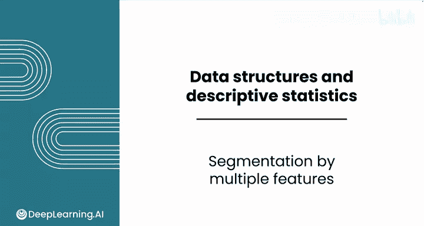
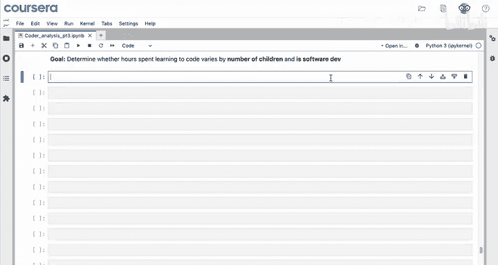
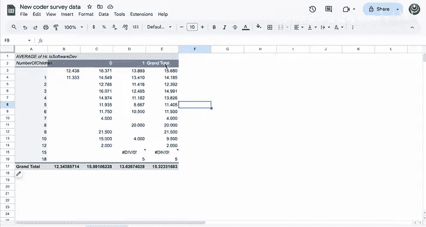
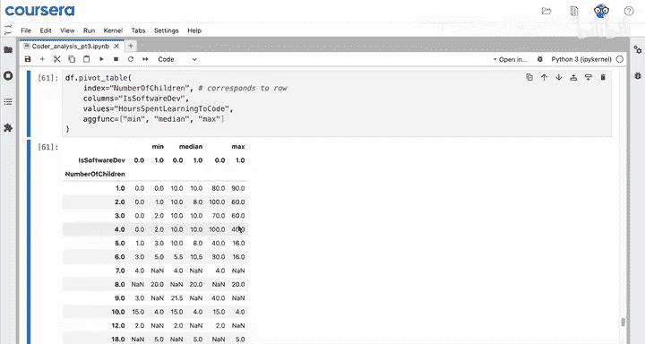
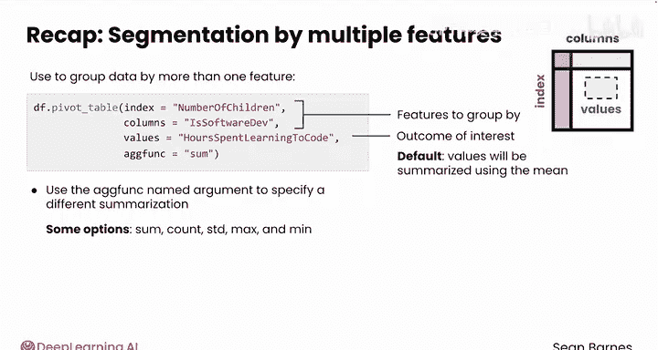

# 吴恩达《Python数据分析（数据分析第3课）｜Python for Data Analytics》中英字幕 - P43：42_多特征分群.zh_en - GPT中英字幕课程资源 - BV1rp5yzjEgn

As a final task for describing your data， you may be interested in segmenting by multiple features at once。

 let's take a look at how to do that in Python with Pandas。

 Pick back up where you left off you group your data by one feature number of children for the final section in your report。

 you'd like to determine if the hour spent learning the code varies by the number of children and whether that person is a software developer now you want to segment by two features number of children and is software dev If you want to segment your data by two categorical features。

 you're going to want to use a pivot table。

Coming back to the spreadsheet just to refailiarize yourself， you have two categorical features。

 number of children and is software deaf， select your data， insertert pivot table。For rows。

 you want the number of children and that gives you the same values you just saw in the previous video。

 one， two，3， and so on。For columns you have is software depth， false or true。And for values。

 hours spent learning a code。The default summarization function is sum。

 but you're more interested in the average。Focusing on the first four rows where you have the most data。

 you have the mean value for people who are not software developers and have one child。

 people who are software developers and have one child。

 as well as the overall mean which is a little more heavily weighted towards the non softwareware developers。

 There's probably more of them you can carry out a very similar process very quickly in Python using canvass I'll just show you that method Pivo table Pivo table works very similarly to how it does in a spreadsheet you assign rows。

 columns and values。 remember， you're interested in segmenting by the number of children and is software dev。

 The first argument of the pivotvo table method is called indexex but a corresponds to the row index will be the number of children。

 Then for columns you have is software depth and for values you're interested in hours spent learning to code go ahead and run that cell。

The default aggregation function is the mean， so you're seeing the mean value for each combination of the number of children and whether someone is a software developer。

 So if someone was not a software developer with one child。

 they were spending about 14 and a half hours a week learning to code if they were a software developer they were spending about 13。

4 hours The sample size for this segment is pretty high for this data So it's possible this difference is significant you'll see the same pattern pretty much across all the data where if you are not a software developer you're spending a little more time on average coding。

Going back to your pivot table and a spreadsheet， you had all these options for the summarization function。

The pivot table method also has different options for summarization。

 and these are in the named argumentAg funk， funny。

 I know it means aggregation function and the default is the name。

So if you say mean you get the exact same result， you can also do some and instead you get the total number of hours grouped by these two features。

 or you could do STD for standard deviation。There doesn't seem to be quite a clear pattern here。

 but it does weed up the groups with only one respondent。

 these are the missing values in this result table。Finally， if you're interested in multiple values。

 for example， maybe you're interested in the min， median and Macs for each of these groups。

 you could create a pivot table with all those ag functions because ag funk can be a list。

 so run that code cell Now you get the different minimum values so for each group the minimum time spent learning the code for the most common groups with0。

 then you have the median in the center two columns it's roughly similar for these distributions suggesting that some extreme or outlier values were shifting those means in different directions。

And then you have the maximum。 This is interesting overall， because if you are a software developer。

 your minimum is slightly higher， but your maximum is slightly lower than if you are not a software developer。

 Reapping the pivot table method， youll put it to use when you want to group your data by more than one feature。

 just like a pivot table and a spreadsheet has rows， columns and values。

 The pivot table method has index columns and values。

 valuesue should be your outcome of interest and index and columns should be the features you want to group by by default values will be summarized using the mean。

 However， you can use the agfc name argument to specify a different summarization function or aggregation。

 Some options include some count STD for standard deviation Max and min you also saw that you can provide a list for the agfk argument。

 which gives you a pivot table containing multiple summarization functions。

That takes you almost to the end of this module。 You've seen how to read in。

 analyze and visualize your data to produce powerful summaries。 cominging up。

 you'll complete the graded assignment and lab for this module in the graded lab。

 you'll expand your analysis of the retail sales data from the previous module。

 I can't wait for you to put into practice all the cool Python methods you've learned in this module。

 Once you're done， I'll see you in the next module data visualization。😊，See you there。😊。

