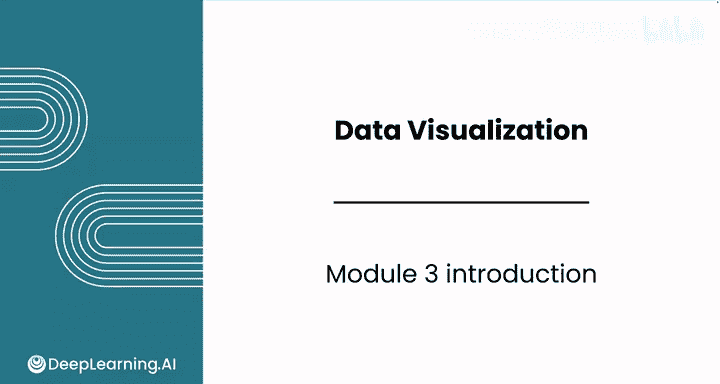
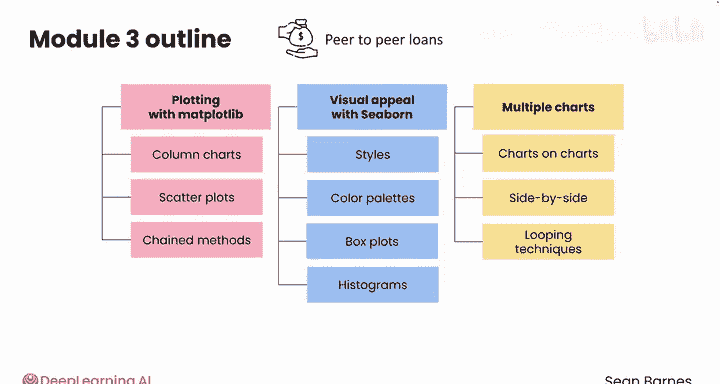

# 吴恩达《Python数据分析（数据分析第3课）｜Python for Data Analytics》中英字幕 - P44：43_模块3 简介.zh_en - GPT中英字幕课程资源 - BV1rp5yzjEgn

Welcome to module 3 Data visualization and this module you'll master two essential libraries for data visualization MaplotL for customized plots and Cborn for enhanced visual appeal throughout this module you'll analyze a real data set of peer-to-peer loans to help a new startup develop their product strategy The first lesson covers plotting fundamentals with the module Mapllootlib you'll learn to create beautiful charts including column charts。

 individual grouped and stacked as well as scatterpls you'll also learn how to read chain methods or many methods that are linked together in the same command the second lesson focuses on creating visually appealing plots using CBborn you'll enhance charts through styles and color palettes plus master specialized plots like box plots。

 histograms and more in the final lesson you'll develop skills for plotting multiple charts at once including on top of each other and side by side you'll learn advanced looping techniques to create many plots with just a few lines of code By the end of this module you'll be able to create professional quality visualization。

To derive meaningful insights from your data， follow me to the first lesson to begin exploring clotting with the MaplL module See there。

