# 吴恩达《Python数据分析（数据分析第3课）｜Python for Data Analytics》中英字幕 - P45：44_Matplotlib绘图.zh_en - GPT中英字幕课程资源 - BV1rp5yzjEgn

One of the most commonly used visualization libraries in Python is called Maplotlib programmers especially value its flexibility and customizations。

 Mapllootlibb is a visualization module you can import into your code。

 it allows you to expand on the basic plots you've created so far with pandas with customization features like titles annotations colors axis limits label formatting and more like pandas Matplotlibb contains hundreds of thousands of liness of code that have already been written for you when you're conducting exploratory data analysis or developing beautiful visualizations for a report you're likely to turn to Maplotlib Mapllootlib visualizations are made up of a few core components First the figure which you can kind of think of like a canvas for drawing a figure can hold one plot or multiple plots It's essentially a container plots are called axes in Maplotlib Each axes has its own set of plot elements like labels。

 data legends， a grid and so on you can create a figure directly though you don't have to for example。

 you may want to control the size of the canvas or set other options。

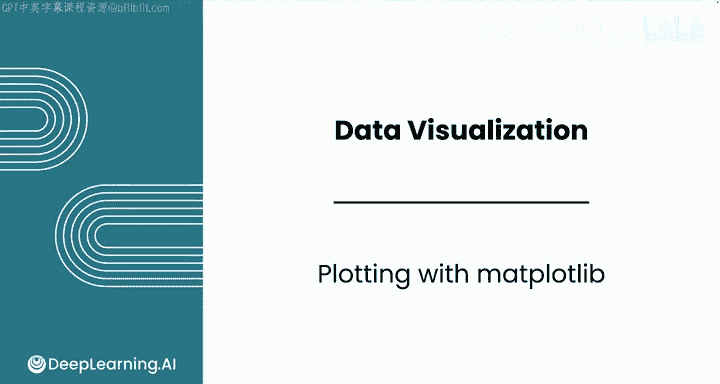

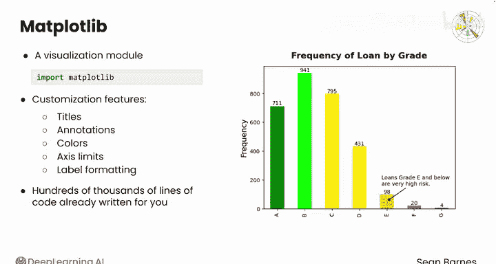

Like the background color you'll create a set of axes using different functions that create what you think of as graphs or charts like dot plot dot scatter do hisist and so on These functions also have named arguments where you can specify the data for plotting as well as the data ink for that chart type like the boundaries。

 markers， colors， line style and other arguments then you can also layer on additional chart elements with functions for adding a title。

 X and Y axis labels， annotations， a legend and so on。

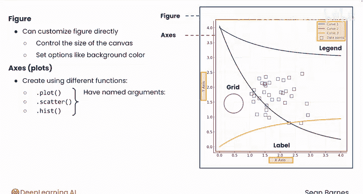

In this exercise， you're working with a startup looking to disrupt peer-to-peer lending with a new product。

 Their plan is to develop a state of the art risk management strategy for providing loans to different communities across the United States。

 You're working with the data set of loans from lending tree。 a peertopeer lending platform。

 which you may remember from the previous course。 you've been tasked with conducting exploratory data analysis to better understand the characteristics of loans with different levels of risk。

 You'll need to develop a report with your findings to share with the bank。

 your plan is to develop insightful visualizations to help your client understand the different risk profiles。

 A picture is worth a thousand words After all。 Start by importing this data set from the file loan data csv。

 remember this works because the CSsv file is in the same folder as your notebook。

 You won't have to do any file management during the labs in this course。

 but you should be able to explain why this line of code works。

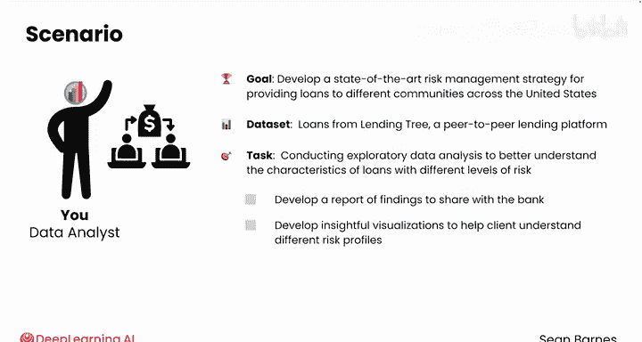

The data looks pretty clean overall， with wellformted column names。

 there doesn't appear to be a unique identifier so you can leave the numerical indices for this analysis。

 start by visualizing the loan grades so you can better understand the composition of the entire portfolio of loans。

 loans are assigned a grade from A to G with a grade loans having the lowest expected risk of loss and typically the lowest interest rates。

 use PD。 uniqueique on the grades column to double check the values that appear in the dataset。

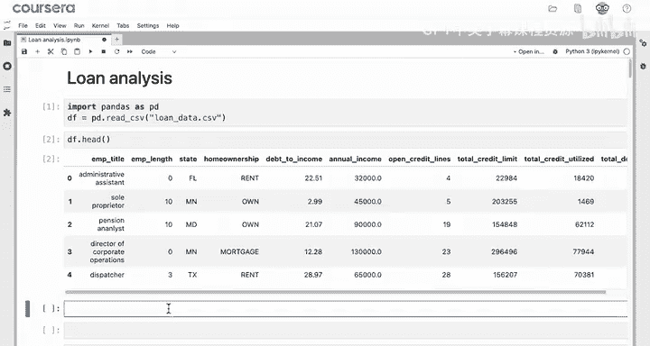

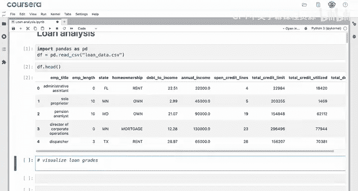

To graph the frequency of the different loan grades。

 you can use the dot value counts method to create a series with the count of each grade in the dataset。

 then use the dot plot method with kind equals bar to create a chart。 remember。

 there's no column chart。 you can see that B grade loans are the most common followed by C。

 then a with only a few loans of grades E F and G。 This visualization might be a great option for helping your stakeholders understand how risk is balanced throughout the portfolio。

 However， its usefulness could be improved significantly。 First。

 the grades column has an order to it。 So it would help to order these grades appropriately。

 you can use the sort index method， which as you may guess， sorts the data by the index。

 It's a lot like sort values except that sorts by the index instead。

 if you call the sort index method on the result of value counts。

 which is a series you'll sort this series by the letter grades A to G。

 save that in a variable called sorted grades or whatever name makes the most sense to you。😊。

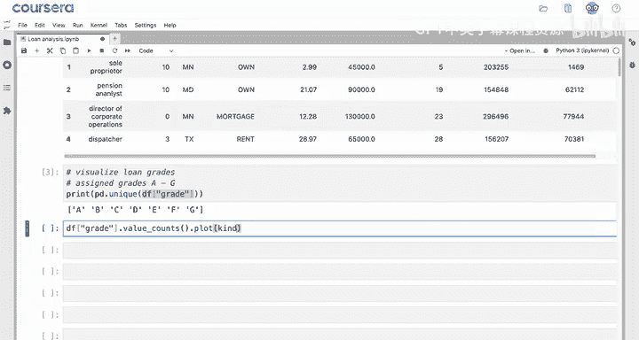

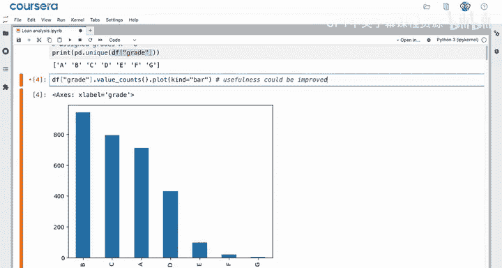

Now， if you use the command sorted grades plot kind equals bar。

 you get a nicely sorted graph that better visualizes the distribution of grades。

 so your client may conclude they should be cautious about giving out loans that would receive a grade of E F or G Since these are rarely given out by their competitor lending tree Now this is a pretty bare chart you can enhance it using matplotlib first。

 you'll need to import matplotlib piplot as PLt。 remember， as PLt creates a nickname。

 you'll commonly see PLt as the alias for matplotlib piplot you can add import commands anywhere on your notebook。

 though you'll see many programmers groupeding together at the top。 just make sure you run them。

 you can start with the same chart as you had before and now add more layers to it。

 If you look at this chart， there's already a figure here or a canvas where you can draw plot and there's already a plot。

 you can enhance this plot using， for example， plot do title This command will stack a title on top of this graph。

 Almost as another layer How about frequency of loan by grade。

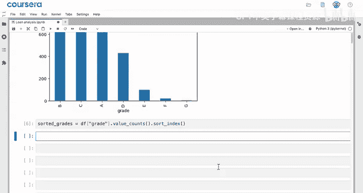

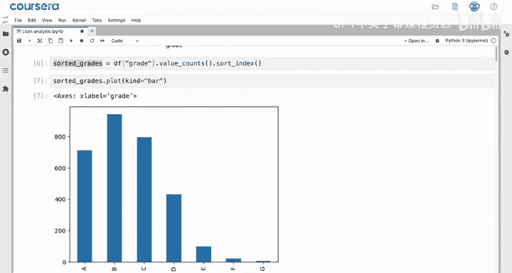

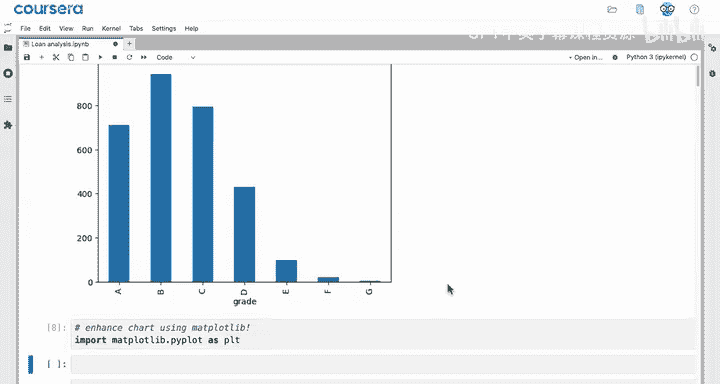

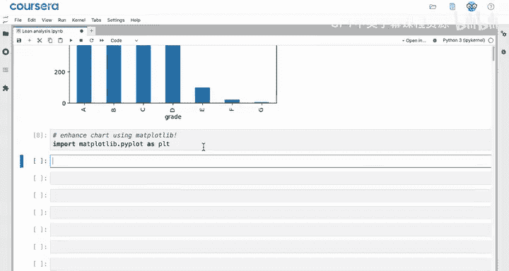

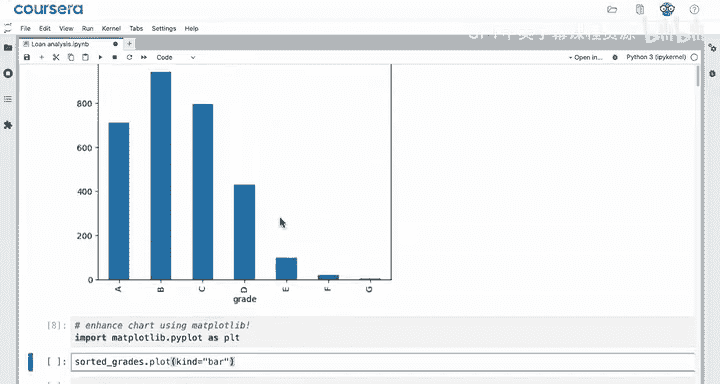

You can also label your axes using plot dot X label and plot dot Y label。

 Lo grade is kind of selfexplanatory。 Maybe a label is redundant， so you can add an empty string。

 just quotes to remove the X label。 plotot dot Y label could be frequency。

 notice that when you run this code， you get a nicely labeled chart。

 but you also get this line of output that says text blah， blah， blah when working with Matplotlib。

 you'll also want to add the dot show command。 This command explicitly tells the computer to display the plot。

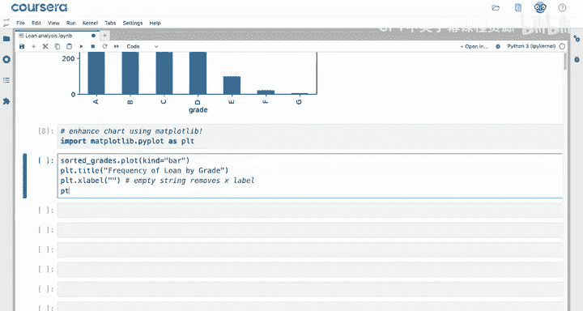

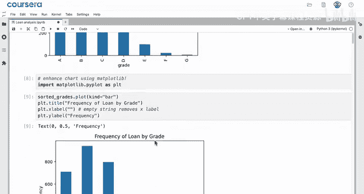

It has two side effects。 First， it hides this extra output that you get in a Jupyter notebook showing whatever the last item in the cell was。

 And second， it displays the plot Matpllibb is currently working on。

 then clears that plot from the computer's memory so you can start over if you'd like So plot show allows you to show multiple plots in the same cell if you need to It's a good habit to use plot do show after each plot to make your code easier to read to recap you started your analysis by selecting the data you wanted to plot in your column chart and ordering it using sort index a pandas method。

 then you learn how to stack matpllibib commands onto a chart to enhance your visualizations。

 you imported matplotlib pipl with the nickname Pt。

 Then you created a chart using the pandaspl method。

 Then you use the xla Y label and title functions for matplotlib to make your visualization clear。

 Finally， you learn to use the plot show function to clean up the output of each code cell。

 you can use plot show multiple times in a cell if you want to display multiple plots。

 Maplotlib as a lot of utility and power to。😊。

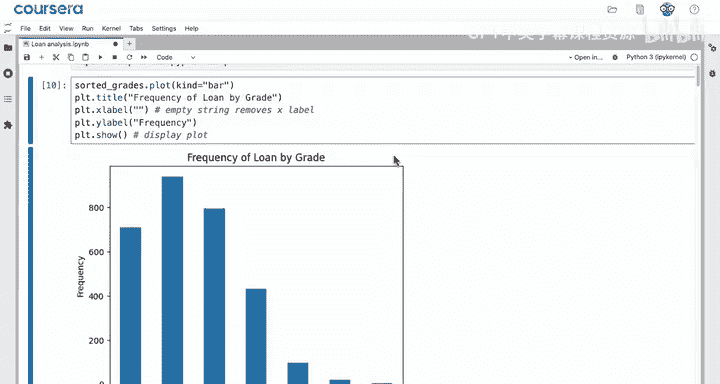

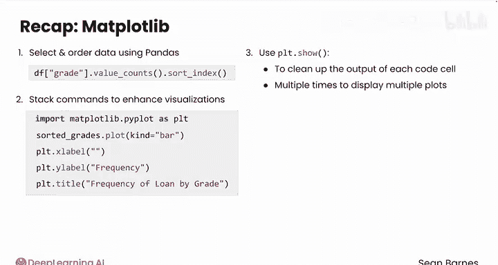

YourViization it's great for customization， whereas your panda's only visualizations were great just for getting the chart on the page follow me to the next video to see some great enhancements for column charts。

