# 吴恩达《Python数据分析（数据分析第3课）｜Python for Data Analytics》中英字幕 - P46：45_颜色、网格与保存.zh_en - GPT中英字幕课程资源 - BV1rp5yzjEgn

Once you've created and labeled a basic plot， you can enhance its interpretability using additional features like color and grids。

 Pick up where you've left off。 you imported your data alongside pans and Maplotlib。

 and you've created a column chart of the frequency of grades。

 You want to improve its readability and save this plot as an image to add to your report。

 You can add additional named arguments to that plot to enhance the look of your chart。😊。

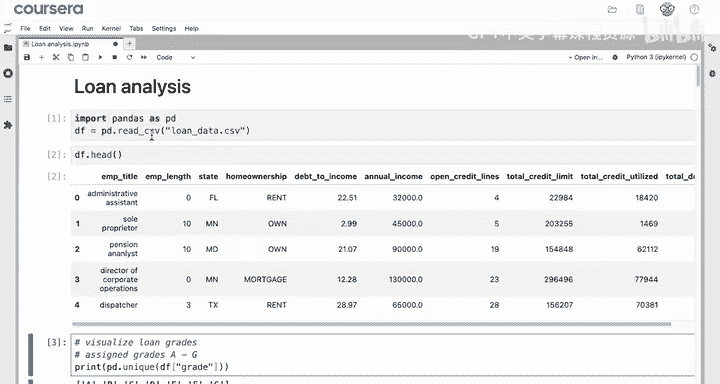

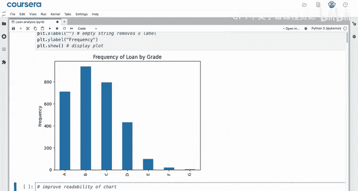

For example， if your client's major brand color is purple。

 you could pick that color for your chart Dottht has potentially a lot of arguments so you can separate each one onto its own line if you prefer。

 like this， you have a lot of options for the color named argument you can provide hex codes or you can use any HTML color HTMLcol codes co maintains a list of available color names like salmon and Deep pink。

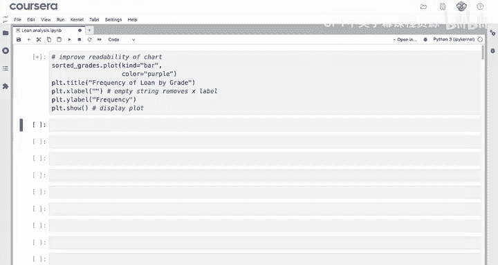

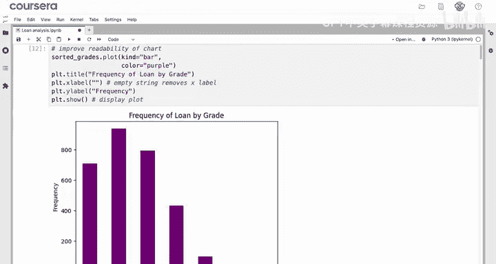

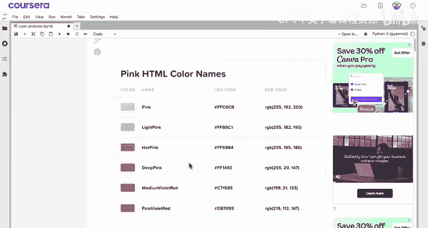

Color can also take a list of colors。 If you could pick a gradient of colors to use in this graph。

 what would you pick。

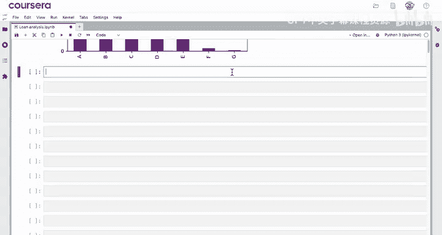

A gradient of green to red or blue to orange could be useful to add double encoding for the lone green to do that。

 you can create a list of color names or hex codes that sounds a bit tedious so you may want to ask your LLM。

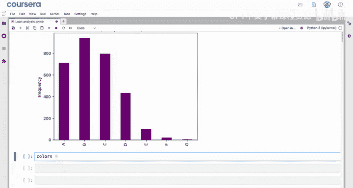

Use HTML color names to create a list of seven colors and Python code that progress from green to red。

 passing through orange and yellow。Then the list colors。Cool。

 this gradient will help your clients quickly interpret the chart。

 Add the colors list to your notebook and change the value of the name argument color to the list colors。

 This gradient will help your clients quickly interpret the chart。

 You may notice it's a bit challenging to read values from the Y axis for bars that are further to the right to improve the readability of this chart even more。

 You could add a grid。 It's as short and sweet as plot dot grid。😊。

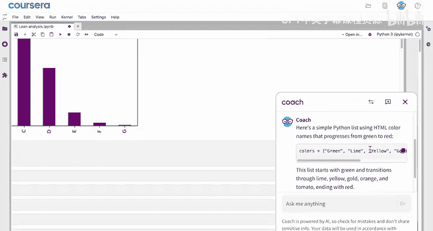

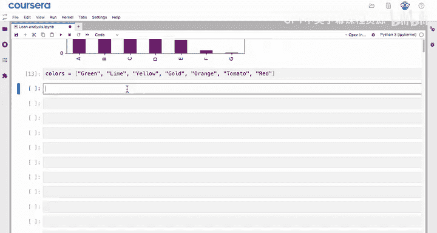

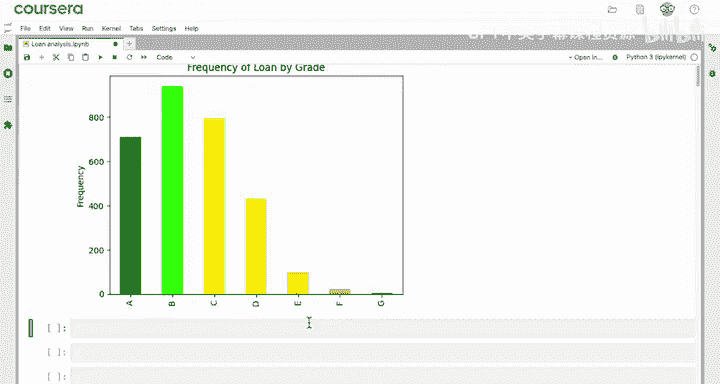

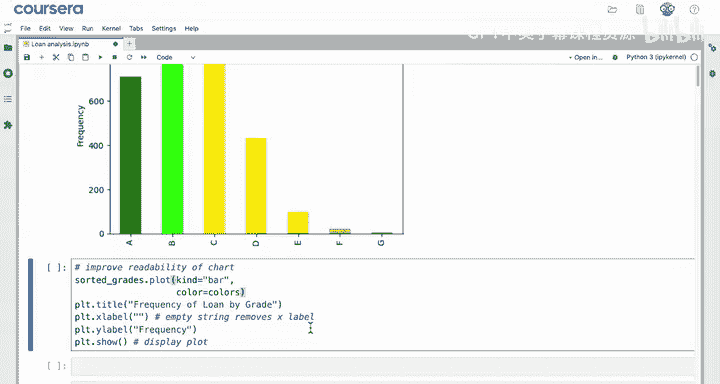

Now， grid also has a lot of named arguments you can use。 First off。

 it's pretty redundant to have a grid on the X axis since the bar color and the labels help the viewer understand the loan grade。

 so you can use the name argument， access equals y to remove the Xax grid lines the default value for this function is actually both which is why both sets of grid lines appeared originally you'll notice a theme with these matpllib functions。

 you can customize just about every aspect。 So for example。

 you might want to make the lines a little bit darker。 say black。

 but with an alpha or transparency of 0。7 you can also change the line style。

 a dash line is written as dash dash if you want to customize this plot even further。

 you can always ask your LLM for ideas One last cool thing about Matpllib is you can now save your figure to a file using the function plot do save Fig The only argument you need is the file name you want to save it to including the file extension which indicates the type of file you're saving like Pf or Jpeg and so on。

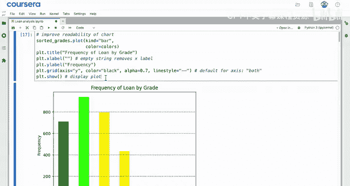

The figure will be saved as an image in the same location as your notebook。

 Maybe you want to save this image to a file called lo column chart do P&G shift enter。

 and now you have this nice image that you can include in the report for your client。

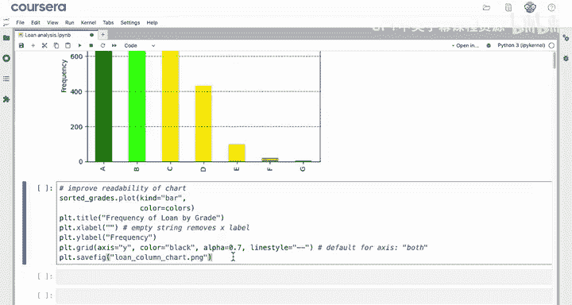

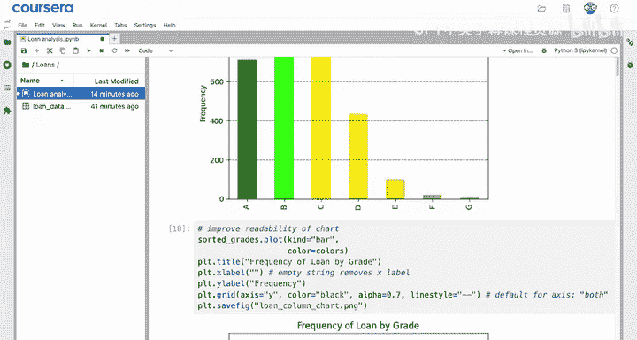

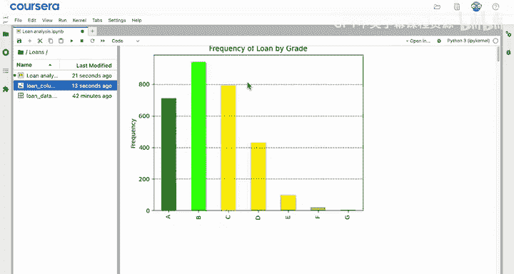

To play that back， you use the colorname argument to the plot method to specify color for your chart。

 You can use hex codes or HTML color names like salmon or medium C green as values for the color argument。

 You also learn how to use a list of colors to give each bar's own color and you use an LLM to generate that list You also use plot dot grid to add grid lines to your plot。

 The accessname argument allows you to specify the X or Y axes or both you can also customize the line style color and more features using the named argument to the grid function。

 Finally， you learn how to save an image using plot do savefi。

 The argument to this function is the file name you'd like to use。

 You also need to include an extension。 You saw P and G used but any common image format will work like Jpeg SvG Pdf and more you've already created a significantly improved chart with excellent readability。

 followow me to the next video to see how to improve the legibility of text in your charts as well as add text annotations。

😊。

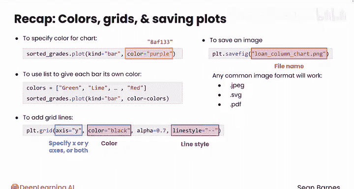