# 吴恩达《Python数据分析（数据分析第3课）｜Python for Data Analytics》中英字幕 - P47：46_文本标注.zh_en - GPT中英字幕课程资源 - BV1rp5yzjEgn

You've seen how to create and customize a chart in Matpltlib， I its visual design and organization。

 However， you also have capabilities for improving the readability of the text in your charts and for adding useful annotations。

 in the previous video， you develop this column chart showing the frequency of different loans by grade。

 Let's finesse the text of this graph and add some useful annotations to help your clients come to the right conclusions based on a graph。

 First， for any text element like title X label and y label。

 you can control different aspects of the text with name arguments， like font size and font weight。

 For example， you can use font size equals 16 for the title。

 and maybe font size equals 14 for the Y label。 you could also make the title bold using font weight equals bold。

😊。

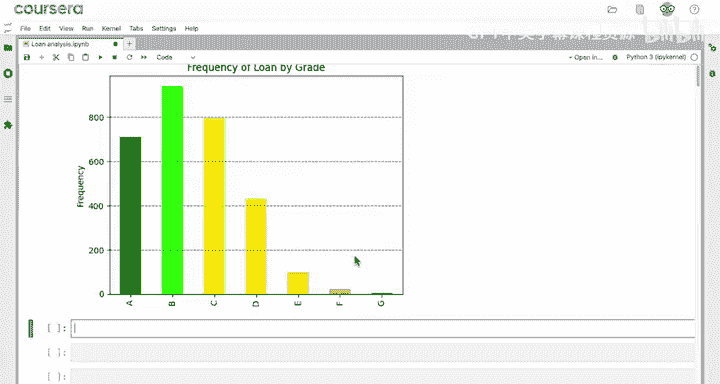

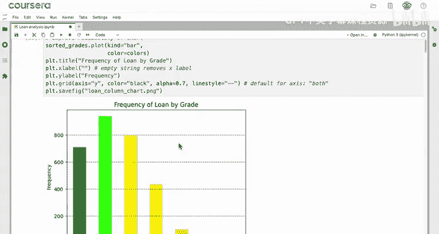

God looks much more legible。

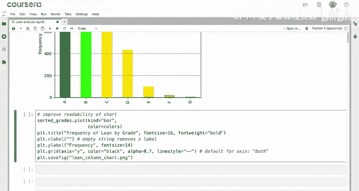

You can also use the Pa option to add more space around an element。

 like the title PaD stands for padding， which is just another word for extra space around an element。

For example， you could say pad equals 15 to give a bit of breathing room to the title。 That's better。

 By the way， if the orientation of these X axis labels is bothering you， just be patient。

 You'll get to that option in the next video。 Now， if you want to make the biggest takeaway on this chart as clear as possible。

 you could add an annotation。 For example， through your research。

 you may have discovered that loans that are below grade D are at a very high risk of default。

 You can add this information to the chart to help your clients understand why there is a sharp drop off for loans below grade D。

 you can use plot do annotate。 This function takes several named arguments。 Start with text。😊。

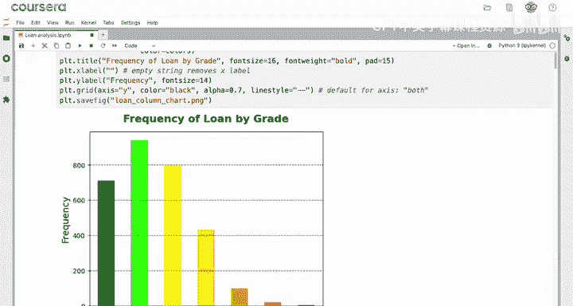

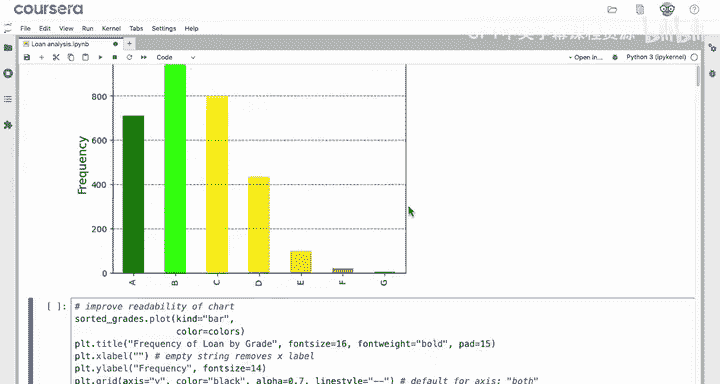

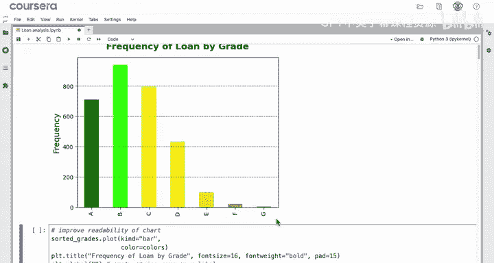

Loans， grade E and below are very high risk。The backslash n add a new line。

 It's like hitting answer within the text。 You'll also need to specify the point you're labeling using Xy coordinates for X。

 use the number of the column。 These are0 indexed。 So to point out the e column use 40，1，2，3，4。

 Then for the y value。 maybe you like a value around 50。 try that out。 So clearly。

 the annotation is overlapping the data， which degrades readability， you can also specify an offset。

 essentially how far away from the point you're labeling that you want the label to be。

 Think about the point you're labeling and the text itself is being located in two different places。

 you can point at something from close up or from far away。 right now。

 Mattpllibb is using this bottom left corner of the annotation to position it。

 So you can see that corner is directly above the bar you're labeling。 It's essentially left aligned。

 say you want the annotation directly above the bar。 So you'll want to do two things。 First。

 use the X Y text argument to move the text around。 You're going to use this as an offset。

 So you want to move this point left by a tiny bit。 maybe by10。

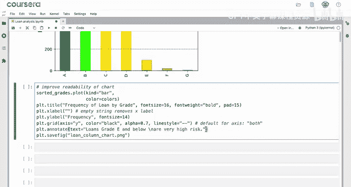

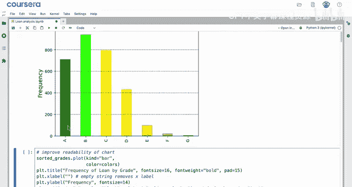

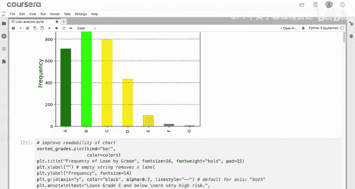

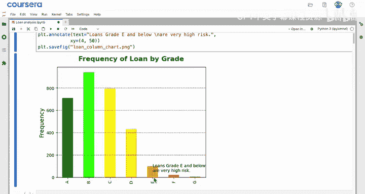

And up a bit。 say around positive 30。 This unit is in points， by the way， which is a very small unit。

 Next， you want to use the argument。 T chords equals offset points。

 So this X Y text argument is interpreted as an offset rather than an absolute value。 Now。

 let's make the grid lines a little lighter。 It's a little hard to read the text with the grid lines being as dark as they are。

 Don't worry too much about memorizing all these different arguments。 This is just a demonstration。

 So you understand how each argument operates。 Okay， that looks much nicer。

 Now you can also add an arrow here by always forget this argument。 Remember。

 you can always use your LM。 So you can try the prompt Add a black solid arrow pointing from the annotation to the point It's annotating。

 and then paste in your code。😊。

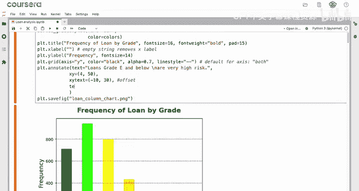

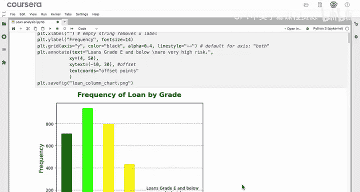

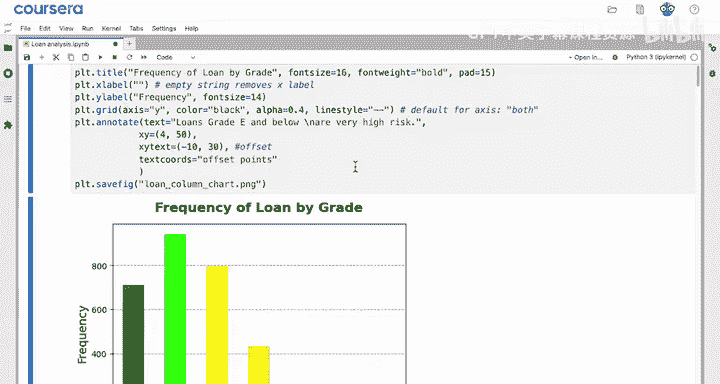

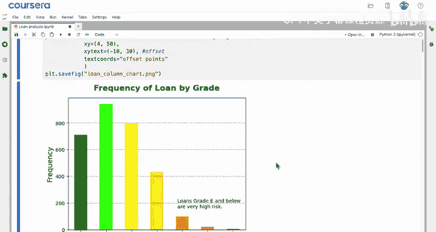

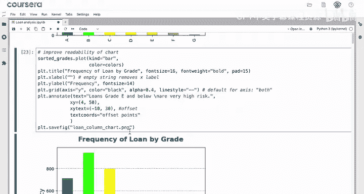

So it looks like you can use the arrow props argument。Arero Pros stands for error properties。

 and it uses a dictionary of properties， hit copy code， head back over to your notebook。

 and paste down the expanded code。

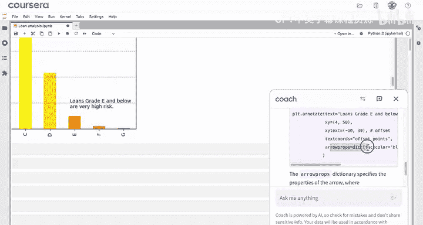

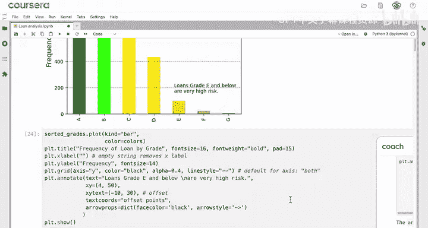

Awesome， that's a nice looking annotation。 Maybe youll want to save this new version to show your clients。

 P do save fake and just add with annotations to your file name。 Finally。

 a common use of annotations and column charts is to add labels to the top of each bar。 Again。

 you can ask your LLM for help with a simple prompt like write code to label each bar with its frequency。

😊。

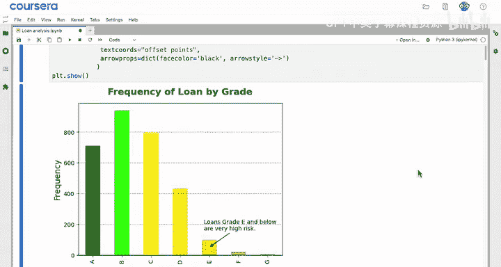

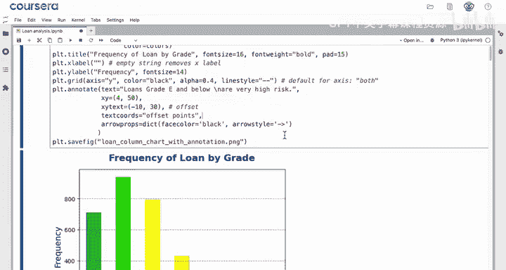

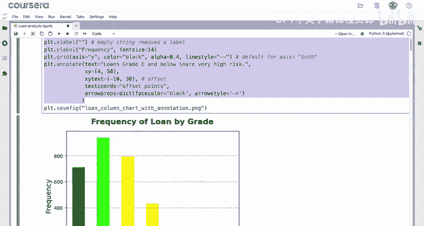

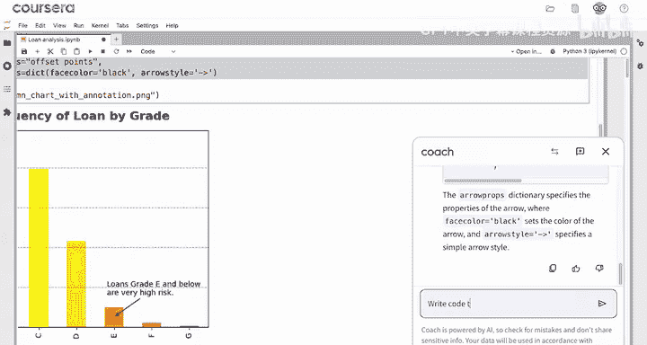

Why not copy the code and try it， especially for visualization。

 if the output looks like what you're expecting， you don't need to worry too much about the code the LLM is writing。

 noticeice that it's using a for loop or the text function to add the annotations to each bar in the chart。

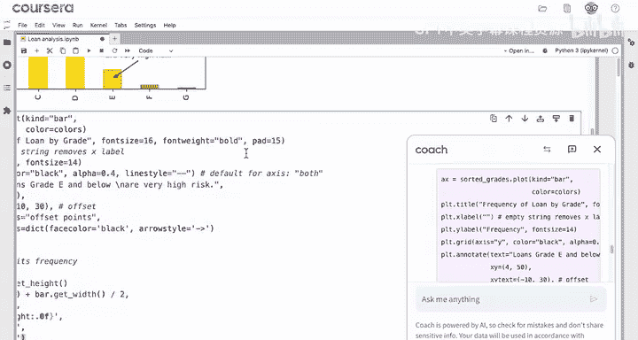

Awesome， this is a clean graph that's highly legible with double encoding for the frequency with both bar height and the label。

 you'll see more options for improving the cell graph in the next video to recap。

 you saw some methods for stling text， as well as for creating annotations for text。

 you saw that methods like title X label and others with text have options like font size and font weight to adjust the size and style of the font。

 You use plot dot annotate to add a text annotations to your graph using the Xy named argument to specify position for the text。

 you learn that you can move the annotation text independently of the point you're annotating to do that。

 you use the Xy text argument to specify how you wanted to move the text relative to that point。

 In this case，10 points to the left and 30 points up。

 You needed to specify that the text coordinates argument was offset points。

 So you didn't end up setting an absolute value for the text location。

 and you use an LLM to create a nice looking arrow to point to the annotated location on the graph。

 You also use an LLM to label each bar with its frequency。😊。

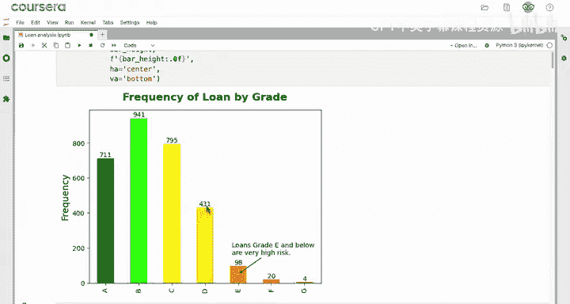

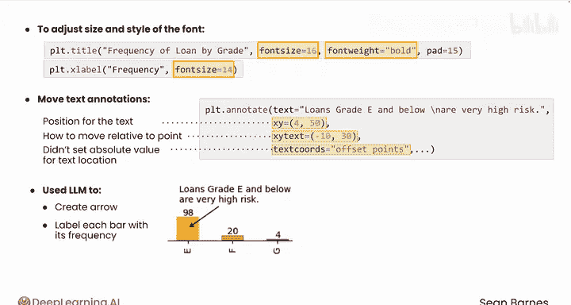

Once you've labeled your graph nicely and created visually appealing annotations。

 you'll want to customize your axes to better show the data you're working with。

Follow me to the next video to see how。