# 吴恩达《Python数据分析（数据分析第3课）｜Python for Data Analytics》中英字幕 - P48：47_刻度与轴线.zh_en - GPT中英字幕课程资源 - BV1rp5yzjEgn

Maapplotlib gives you options for formatting the boundaries of your plot。

 what you might traditionally call the axes。

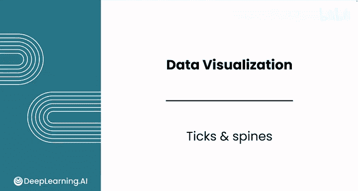

These options include customizations for ticks and spines， picking up where you've left off。

 you've read in your data and you've created a couple of charts。

 say you're working again with this simpler bar chart for a moment。

 just so you're not working with as much code at once where these rotated lo grade labels bothering you。

 they are bothering me。 you can use the plot dot X Ts function to adjust these labels。

 You can start with rotation equals0。That looks better Now。

 if you're expecting your clients to read more specific numbers from the graph。

 you may want to add additional ticks at every hundred0th value of frequency。

 noticeice that in the annotation code generated by the LLM earlier。

 it save this plot to a variable AX saving your plot as aX is a very common pattern you'll encounter in matplotlib AX stands for axes。

 Remember that a Matplotlib axes essentially means a plot。

 This strategy allows you to access attributes and methods specific to the plot that you're working with running the cell。

 the same plot is displayed， but now you can change aspects of the plot more easily So for example。

 you may want to add additional minor ticks。 you can use a mappllib tool called automin locator。

 It helps to automatically locate the minor ticks on your axis。 So to put everything together。

 and remember you don't need to memorize all of these commands focus on how they fit together and how to understand what each line is doing。

 First， import the automin locator from matplotlib ticker and port automin locator Remember this type of import grabs one item from this module。

😊。

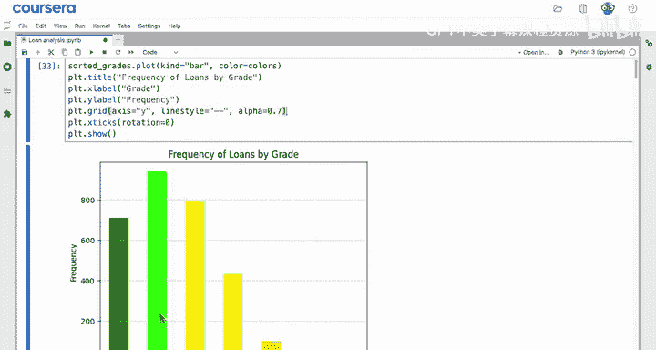

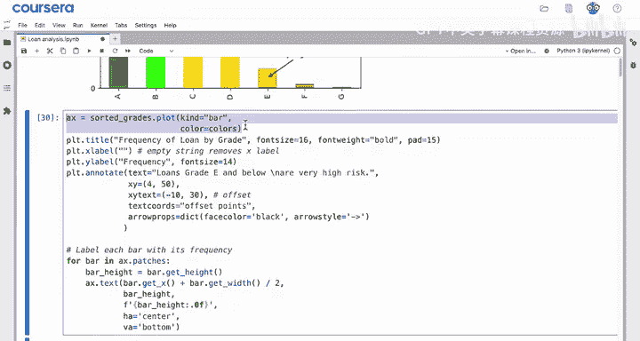

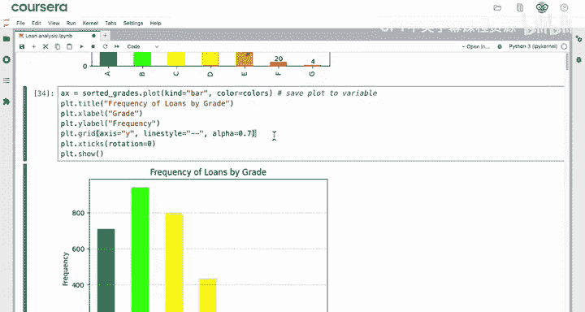

Rather than all of them， then you can use the code AX， so starting with your plot。

 you want to modify this plot dot y axis， you're doing something to the Y axis dot set minor locator。

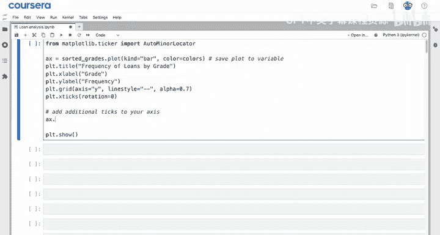

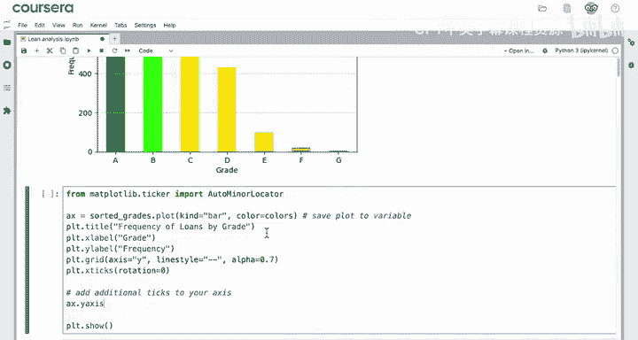

This is a new method。 So take a look at the name。 It tells you a lot。

 Se allows you to change what is actually on the axis as opposed to just getting some information about it。

 Minr refers to the minor tick marks。 right now， the plot doesn't have any minor tick marks Locator means you're looking to change where the information is displayed。

 So you're actually saying here is where I want those minor access ticks to be for that。

 you're going to use automin locator with the argument too。

 you want to divide each major tick into two pieces。

 Try it out now you get nice evenly spaced ticks with shorter minor ticks notice that there were not grid lines created at the new minor ticks。

 If you want to add grid lines to the minor ticks。 you can add a new named argument to the grid function。

 which equals both This will create grid lines for both your major and minor ticks。

 you can always ask the LLM for help explain a new code， by the way。 So for example。

 you can ask explain each line of code one by one in plain language。😊。

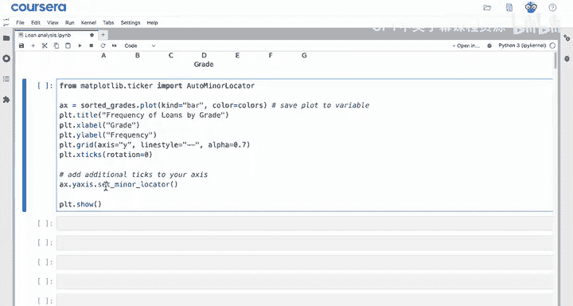

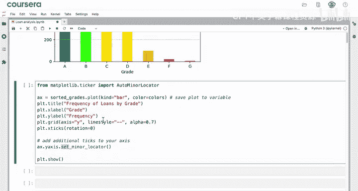

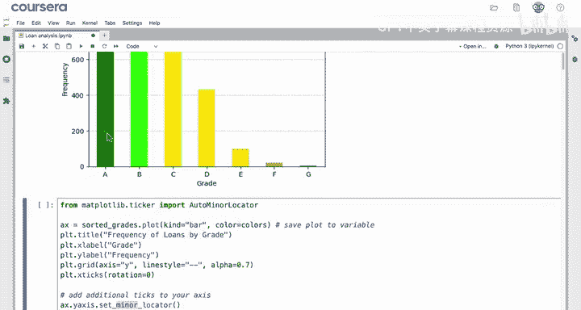

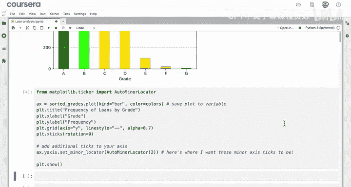

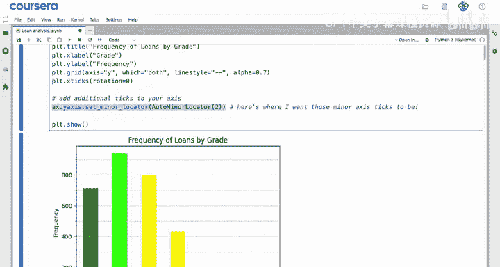

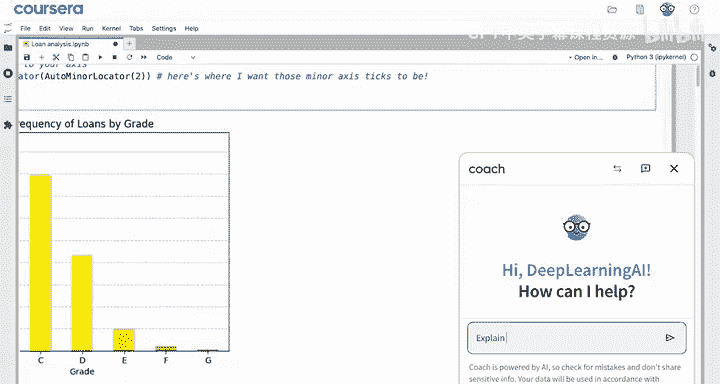

Then paste in the code。So it starts by explaining your import statement。

 and then it goes on to explain each line in the code cell。

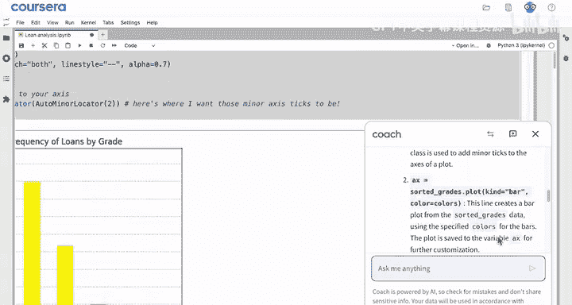

Now， say you're working with the more minimalist graph from earlier。

 you might want to modify this graph even more to remove the spines or the boundaries here。

 as well as the Y label。 you've already seen how to remove the label。

 just change this value for Y label to an empty string。

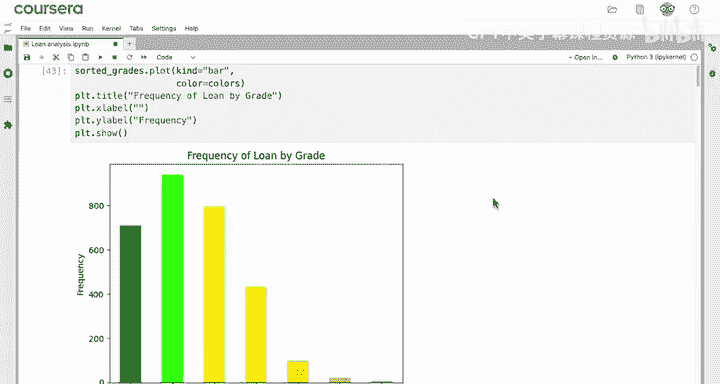

Now to remove the spines or boundaries。

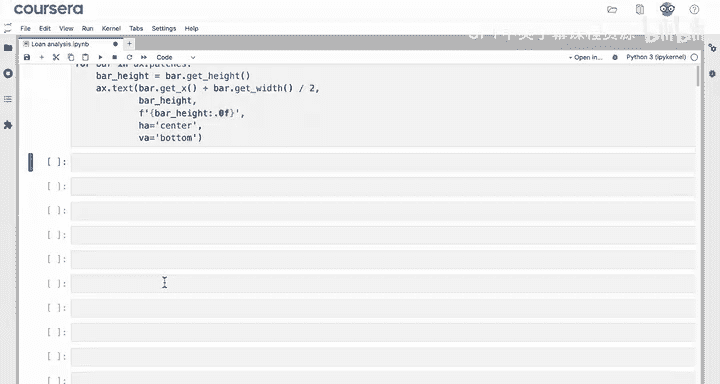

Make sure your plot is already saved as AX， then use AX。 spines。

These are the four boundaries of your plot， left， right， top and bottom。

 select top just like you would select a column from a data frame and use dot set visible with the argument false。

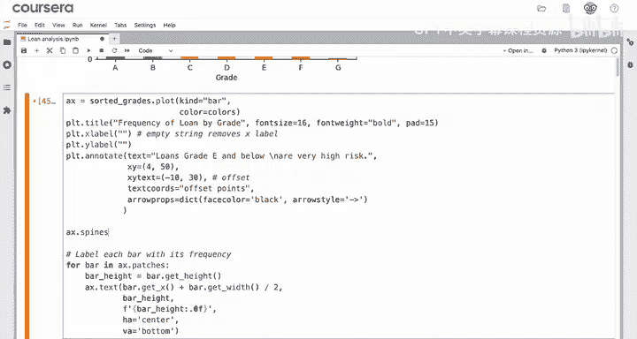

So this command， if you run it， remove the top spine， great。

 now you can do the same for right and left。

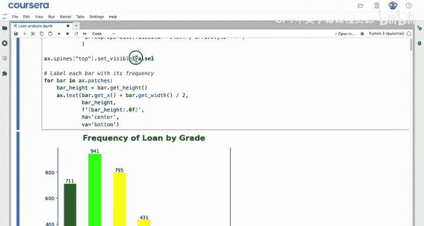

Finally， you have these ticks remaining to remove these， you can use AX。yax。

ettics and use an empty list as an argument。

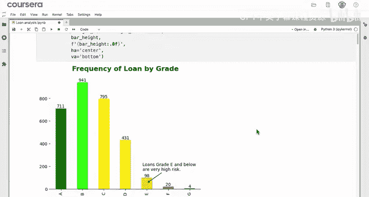

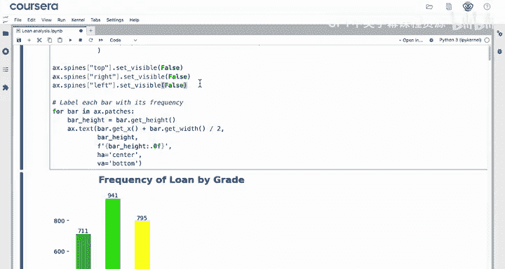

An empty list is represented as just an empty set of brackets running that code。

 you get this super clean plot that helps tell an important story for your stakeholders One more thing。

 let's rotate the X axis labels back to horizontal。

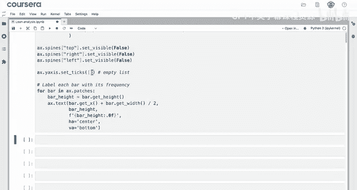

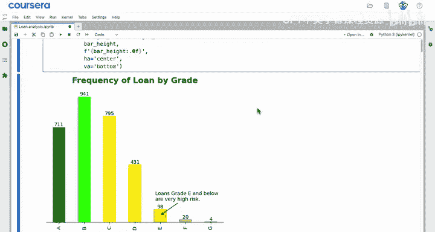

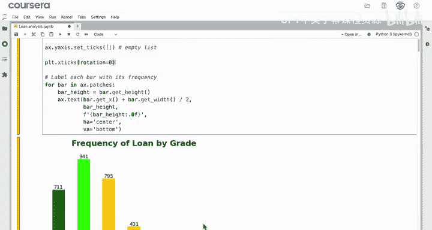

Suming up you use the plot do Xts method to rotate the X axis labels you also learn how to save the result of a plot method into a variable so you can change aspects of the plot later This variable is typically called AX。

 which stands for Axius you can use it to access parts of the plot like the Y axis or the spines you use the autominor locator tool from mappllib to add more ticks to your plot which can enhance its readability and prompted an LLM to help explain the code to you in order to better understand it Finally you use commands like AX dot spines left dotet visible false to remove the spines or outer boundaries from the plot。

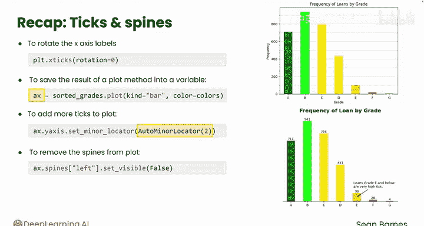

You've learned a lot about matPot Live functions in order to unlock more complex plots。

 you'll need to get familiar with reshaping your data， in other words。

 preparing the right rows and columns for plotting。

 follow me to the next video to see how to do that with a group column chart。

