# 吴恩达《Python数据分析（数据分析第3课）｜Python for Data Analytics》中英字幕 - P49：48_分组柱状图.zh_en - GPT中英字幕课程资源 - BV1rp5yzjEgn

Grouped column charts allow you to compare a numerical feature across multiple categorical ones。

 you'll need to take some time to set up your data first before plotting as part of your exploratory data analysis and visualization。

 your clients have asked you to identify key characteristics of loans from the states with the highest average loan amount The top three states are the district of Columbia Alaska and Hawaii you've decided to plot the loan amount by grade across these three states using a grouped bar chart。

 you'll first need to set up your data to facilitate this analysis and visualization。

 Think about the steps you'll need to accomplish in order to set up your data。

 you'll first need to filter your data to only include the top three states you're interested in。

 then you'll need to group by state and grade。 These groups should look like Alaska A Alaska B Hawaii A and so on。

 then you'll need to select the loan amount column and calculate the mean for each group。

 Finally you can plot this data to create a group column chart showing the mean value of loans of each grade。

 Let's take this over to the notebook tokota police steps。

 remember that in this notebook you've already imported pandas and Mattpllibb and read your data SDf。

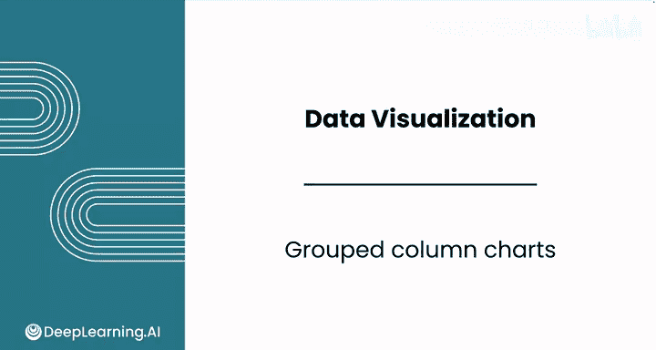

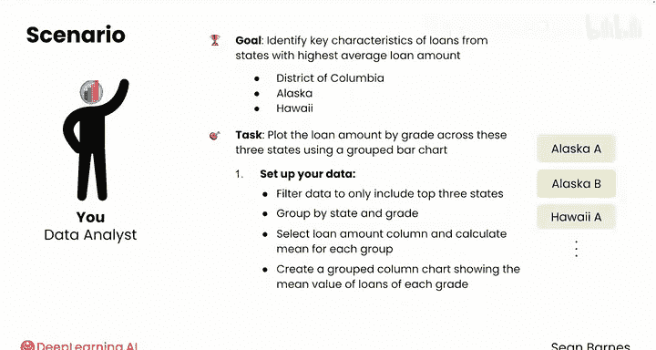

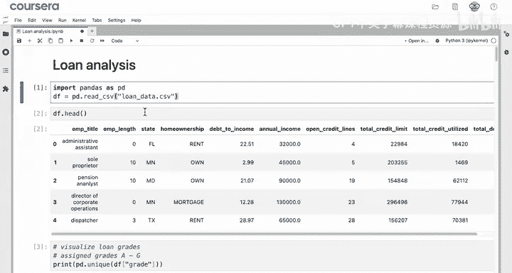

Start by filtering your data frame to loans from the three states。

 you can call this result filter Df so you don't have to list out all the states in avariably you can take Df where the state is in this list of states right here。

 the is in method is commonly used with lists。 It returns true if the state on the left is in the list of states So if it's either Dc Alaska or Hawaii you can then use filter Df sample 5 to check out the resulting data frame Now you just have this filter data frame of loans from those selected states。

 You can see the sample loans are from Dc Hawaii and Alaska your next step is to group by each state and grade。

 just call this grouped data。 that's going to be filter Df group I。

 and now you want to group by two columns you can actually put a list here as the argument to group by not just a single string。

 You want to group by the state and you want to group by the grade This is a group by object if you remember and so you can't actually see it It's an intermediate data structure。

 you'll need to do the next step first。 aggregate the loan amount by averaging it。

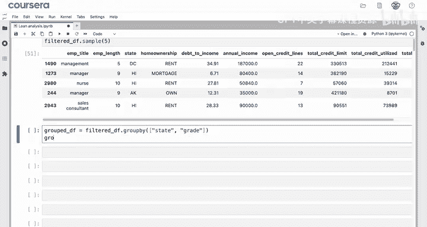

Select the loan amount column and then add dot mean。 It's a rather short series。

 If you look at it now。 If you take a look at it， you have the state and the grade and the average loan amount for that state grade。

 This feature is called a multi indexdex and canvasdas。

 If you try graphing this directly dot plot kind equals bar。

 Now you get these double indices and they're all separated into their own columns。

 This chart isn't a true group bar chart， although you're quite close。

 What you'll need to do is unstack this data。 Not that you have two layers of indices here。

 The state and the grade。 you want to use the unsted method to separate out the grades into columns。

 Check out group Dft unst on its own。

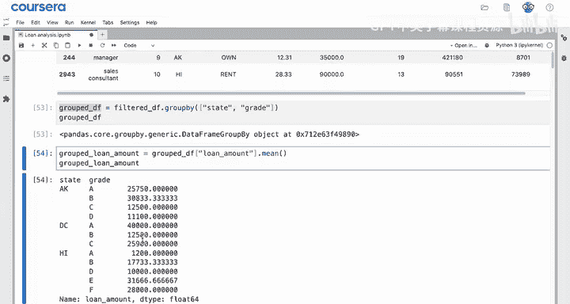

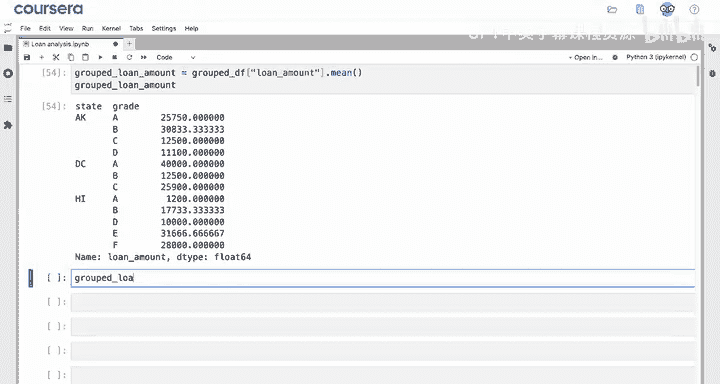

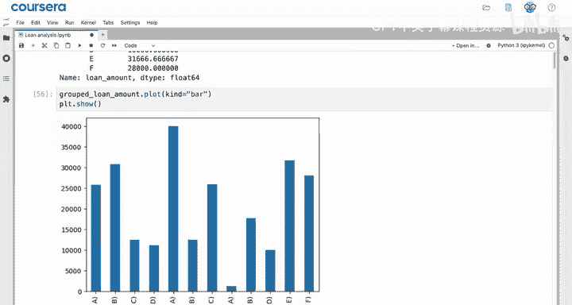

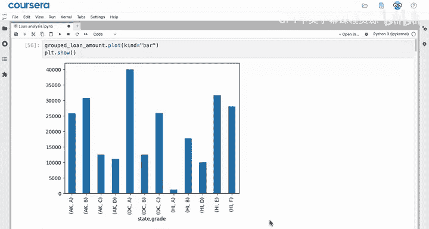

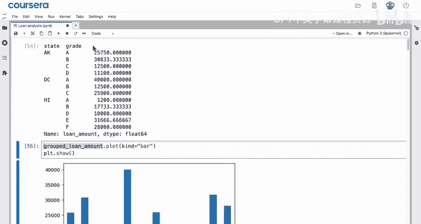

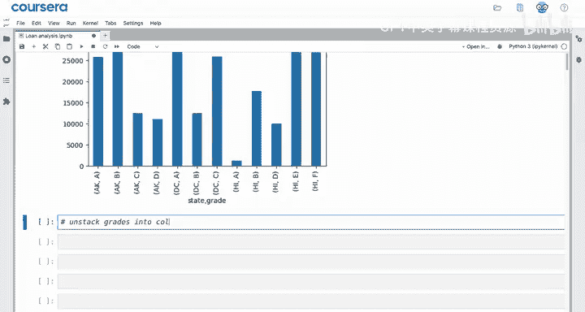

You have this really nice setup where each state has an average loan amount for each grade。

 Some of the values are N。 And because for some of these combinations， there wasn't a single loan。

 But now you're back to having just a single index。 The state。

 If you go ahead and plot this unstacked result as a bar chart。

 Now you get this nice chart of the loan values for each state。 Nice may be a little generous here。

 You'll definitely need a title and access labels。 There are a lot of colors happening and maybe these labels can be rotated to be horizontal。

 The legend should be moved outside the chart， it's obscuring the data。

 So let's get started with that。 here's some of the low hanging fruit to improve the chart。

 with the title axis labels and rotating the X ticks。😊。

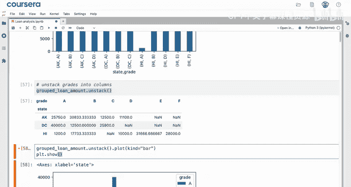

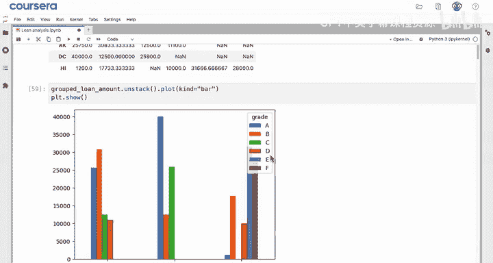

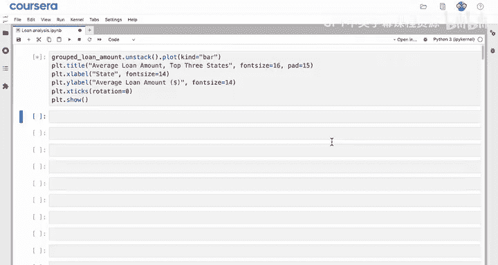

In order to move the legend outside the chart， you're going to say plot。 legend。

 which is a new function right now the title is grade， you can capitalize it。

Then use the argument B box to anchor。 B box stands for bounding box or the invisible box that contains the legend。

 So the question is， where do you put this box relative to the axes or relative to the plot。

 This function takes in an argument that specifies a point of X Y coordinates。 Let's try11。

You can think of this whole bottom spine as having values from0 to 1 and same for the left spine。

 So putting the legend at coordinates 11 puts it outside the plot on the right。

 Now you get a nicer location for your legend。 You can also apply the same colors and grid as you used previously to liven up your chart。

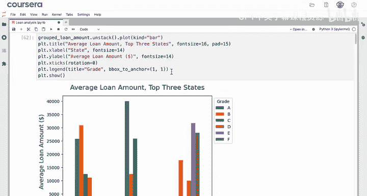

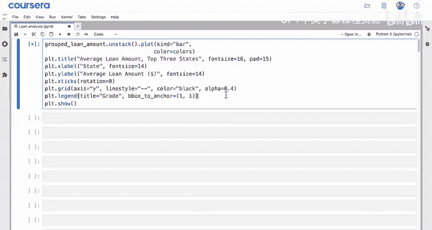

Now the interpretation is pretty interesting check out how different Hawaii looks from both Alaska and DC while Alaska and DC had primarily low risk loans。

 Hawaii had large but higher risk loans suggesting that there are different patterns in these different states DC also seems to have a high average value for its A grade loans。

 suggesting that may be a profitable strategy for your client。

 you may want to save this graph using plot。afiig to include in your report for your clients。

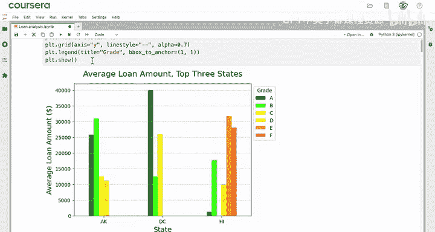

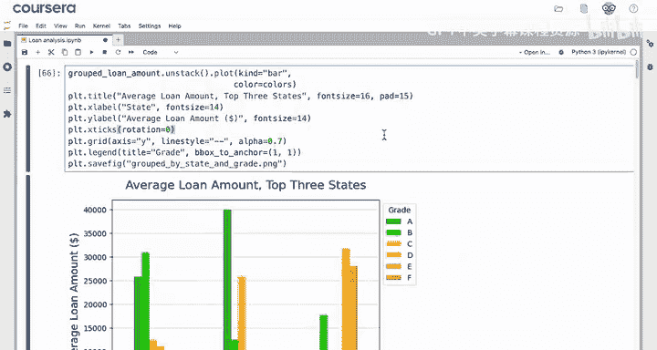

You saw the successive steps used to create a group column chart。 First。

 you selected the rows of interest。 Then you grouped by two features， state and grade。

 then you calculated the mean of the loan amount column for each state and grade combination。

 That sequence of steps gave you a series with a multi indexdex。 In other words。

 it has two stacks or layers of indices。 Both the state and the grade the multi indexdex feature gives you a lot of flexibility to create unique rows in your data。

 but in order to plot it correctly， you'll need to use the unsted method。

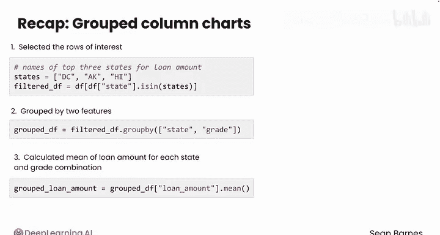

Unstacked behave similarly to the pivot methods you've seen already。

 If you have two rows of indices like state and grade。

 it moves this second set of indices out to become columns instead。 Now。

 you end up with a single index and the rest of the data captured in the columns of the unstacked data frame。

 Once you've unstacked your data， you can use that plot。

 kind equals bar and the columns are grouped by the index automatically。

 Now that you've covered grouped column charts。 stacked charts aren't much more complex。

 You've already done the data preparation required。

 So follow me to the next video to create a stacked column chart。

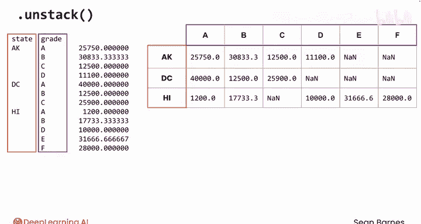