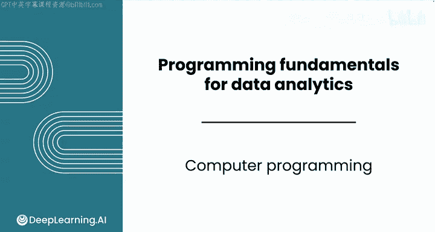
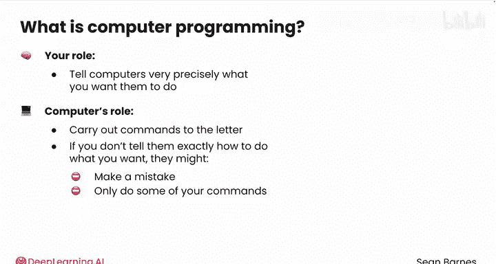
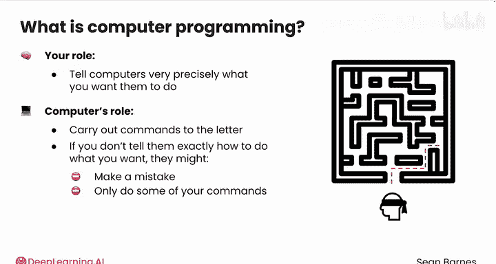
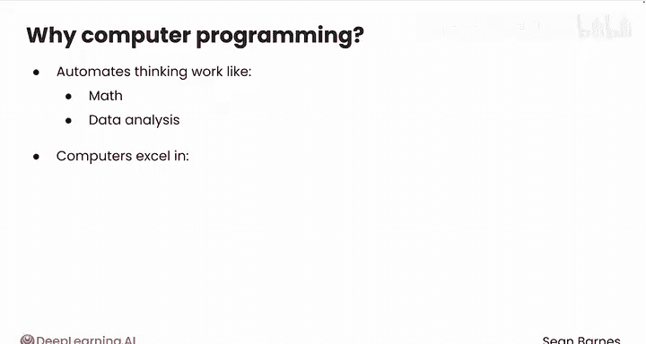
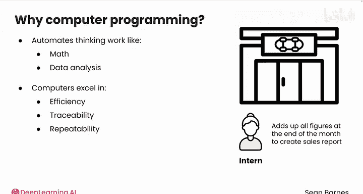
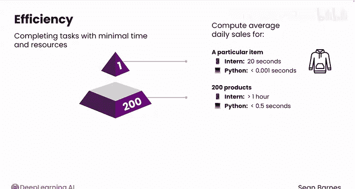
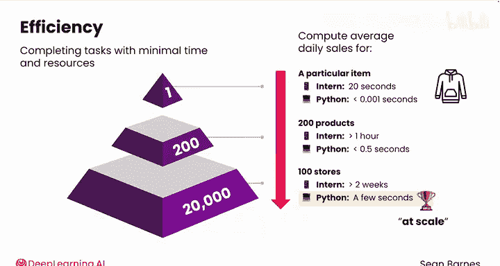
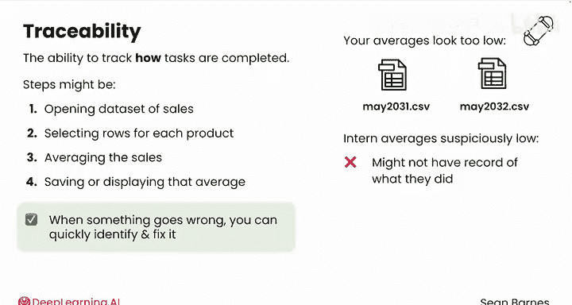
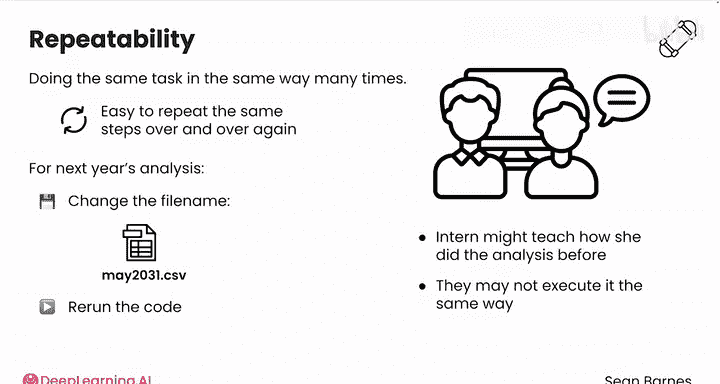
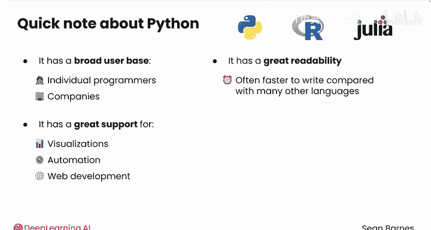

# 吴恩达《Python数据分析（数据分析第3课）｜Python for Data Analytics》中英字幕 - P4：3_计算机编程.zh_en - GPT中英字幕课程资源 - BV1rp5yzjEgn

Welcome to the first lesson of this course。 Computer programming。

 Computers are uniquely powerful at performing a series of instructions that you provide。

 and there are so many tasks that you can complete with computers。

 Comp programming means getting a computer to do your bidding through commands。

 your role is to tell computer is very precisely what you want them to do。

 And in a way they can understand Through a language like Python。

 Then the computer's role is to carry out these commands to the letter。

 If you don't tell them exactly how to do what you want。

 They might make a mistake or only do some of your commands。

 It's a bit like guiding someone who is blindfolded through an obstacle course。

 you'll need to tell them exactly what to do where to turn how far to walk since they can avoid the obstacles on their own。

 And if they trip is your fault。 Comp programming automates thinking work like math and data analysis。

 compare with other tools for analytics。 computers excel and efficiency。

 traceability and repeatability。 say you're working with the skateboardshop to analyze their sales figures。

 Usually one of the interns adds up all the figures at the end of the month。😊。

Create a sales report。 Let's see how programming could benefit your analysis by comparing it with the baseline。

 your intern first efficiency。

Completing tasks with minimal time and resources say you need to compute the average daily sales for a particular product like a hoodie。

 It takes your intern 20 seconds to calculate the statistic using their phone。

 That doesn't seem like a big deal but for the same task Python would likely take less than1 thousandth of a second If you have 200 products in stock your intern will spend over an hour calculating average daily sales while Python gets it done and less than half a second if you're calculating sales for 100 stores。

 your intern will spend more than two full weeks adding up numbers while Python might spend a few seconds you can see that as the task is larger Python's advantage growth。

 This growth in task size is what's typically meant by at scale。

 If you've ever heard that piece of jargon speed is valuable in general even for a single product but when you have millions of sales。

 that advantage makes analysis possible Next traceability the ability to track how tasks are completed the process of programming involves defining each step needed to complete a task for the skateboard shop。

 those steps might be opening a data。

OfSa， selecting the rows for each product， averaging the sales。

 then saving or displaying that average。 You have an expectation of how each step should work。

 So when something goes wrong， you can quickly identify and fix it。 if your averages look too low。

 for example， you might check step1 and find that it reference last year's data accidentally。

 using May 2031 csv instead of May 2032 csv。 you can quickly change the file name and rerun your code。

 Meanwhile， if your intern's numbers look suspiciously low。

 it might take a while to figure out why unless you were looking over those shoulder。

 you might not have any record of what they did。 you'll probably just have to redo the analysis all over again。

 traceability saves time and reduces errors by creating a clear record of what steps were taken。

 Lastly， repeatability doing the same task in the same way many times programming languages make it easy to repeat tasks。

 They don't get bored or tired and a few small changes allow you to adapt your code to complete related tasks like averaging yearly sales or graphing the sales as well。

 For example。

Say you're running next year's analysis at the S workshop。 If your data is formatted the same way。

 you can just change the file name in your code to May 2033 csv and rerun the code。 That's it。

 Meanwhile， your intern might have to teach the new guy how she did the analysis before。

 and they may not execute it the same way。 manual processes are vulnerable to variation and interpretation based on who's completing them Python isn't the only program and language out there。

 you'll commonly also see languages like R or Julia used for data analytics。

 Python is a great language to start with as a data analyst because it has a broad user base。

 both in terms of individual programmers and companies where it's used It's the industry standard。

 It also has great readability。 It's often faster to write an equivalent program in Python compared with many other languages。

 It has great support for visualization， automation web development and many other domains you can use her Python skills for many types of tasks plus it has some great technical features that you'll learn about in later modules。

 Python is the standout choice for data analytics。

In the next video， you'll see the primary Python environment where you'll work with data。

 I'll see there。