# 吴恩达《Python数据分析（数据分析第3课）｜Python for Data Analytics》中英字幕 - P50：49_堆叠柱状图.zh_en - GPT中英字幕课程资源 - BV1rp5yzjEgn

Stack charts don't require much additional code beyond what you do to create a group chart。

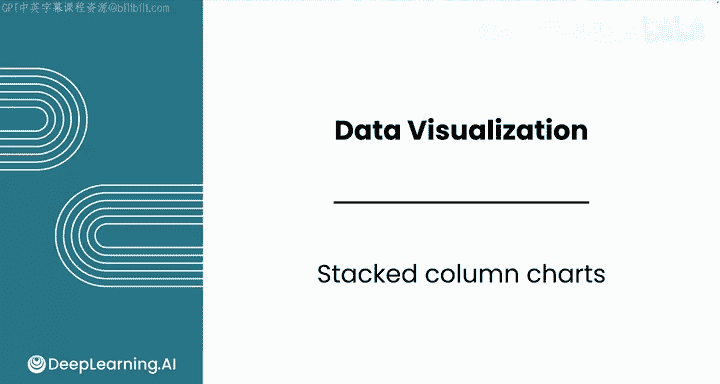

As with group charts， most of the work is in the data preparation。

 you're interested in exploring the total loan amount by grade， as well as home ownership status。

 This analysis will help you understand whether the composition of homeowner ownership changes based on the risk profile of the loan。

 In particular， you want to highlight the proportion of rents for each group。

 A stack chart is ideal because you want to compare the composition of loan amounts within each grade。

 you'll perform similar steps as with a group column chart， grouping your data， aggregating it。

 then unstacking it before plotting。 You can start with a new notebook import your modules again and read in your data。

 Let's combine all these steps into one line of code。 So start with your data frame。

 then group by both grade and home ownership。 select the loan amount column。

 that's what you want to plot。 Then use the sum method to add up the value of all the loans within each grade。

 Some makes sense here rather than mean because you're interested in seeing what proportion of money comes from customers with different profiles。

 Finally， use the unstacked method to get a data frame with both rows and columns。

 One row for grade one column for homeowner ownership。😊。

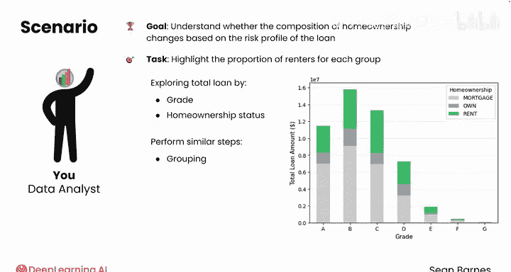

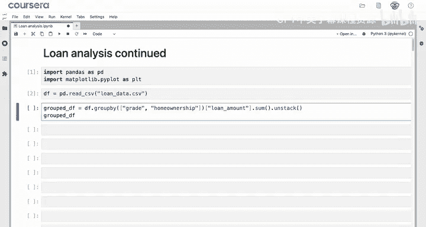

Again， you don't need to necessarily memorize all these functions and arguments。

 just try to follow along with what's happening here。

 Now use gott plot kind equals bar with one more parameter stack equals true。

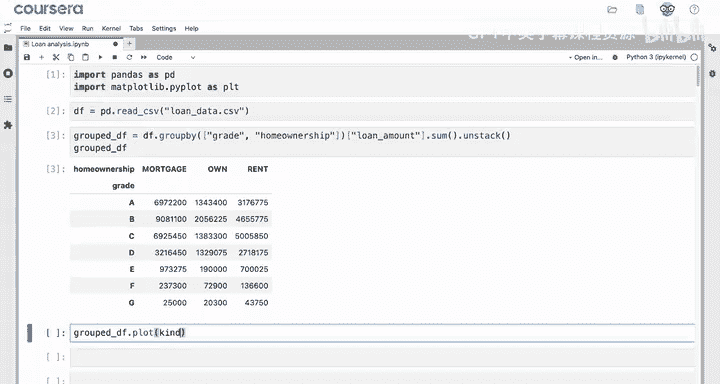

Readtning that code cell， you get this nice stack chart ownership seems to be the smallest segment with most customers having a mortgage。

 Next， you want to modify this plot further to improve readability。

 You have options like adding titles and labels， adding colors for each category to highlight renders。

 fixing the Xt rotation as before and adding a grid for the Y axis。

 It doesn't look like the legend needs to be moved for this particular plot。

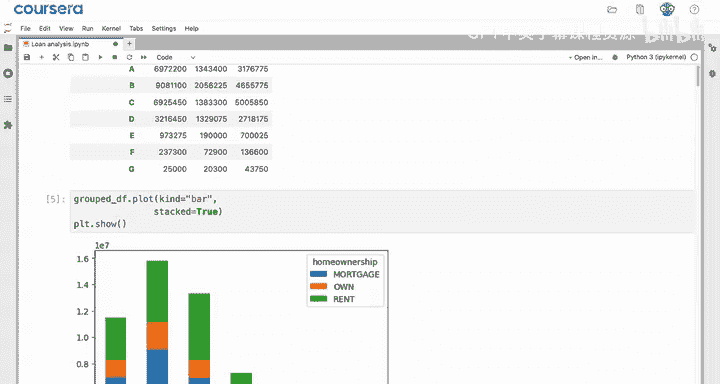

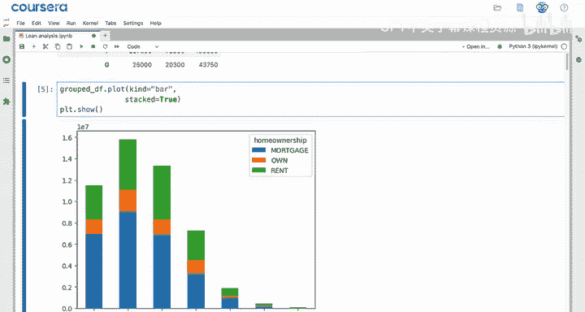

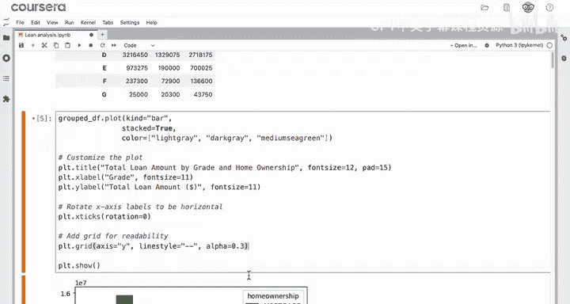

You could also capitalize the homeowner ownership in the legend title Now。

 for a more direct comparison， you could use 100% stack chart where each column is the same height。

 creating 100% stack chart is a more complex operation so you can ask your LLM。

 modify this code to create a new version of this chart as a stack column chart with proportion on the Y axis and each column the same height。

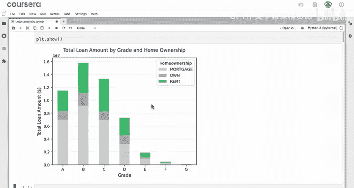

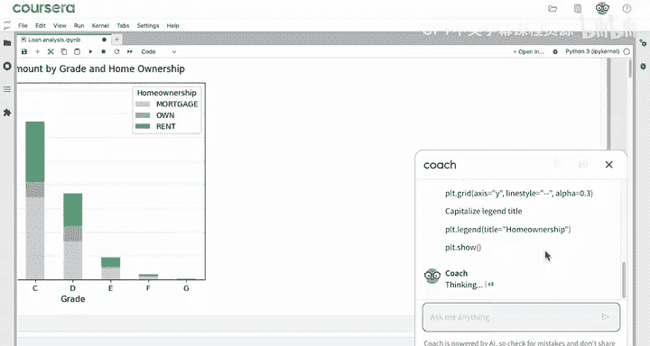

Copy the code， remember with visualization especially。

 it's completely fine to just test this code out and see if it's working。

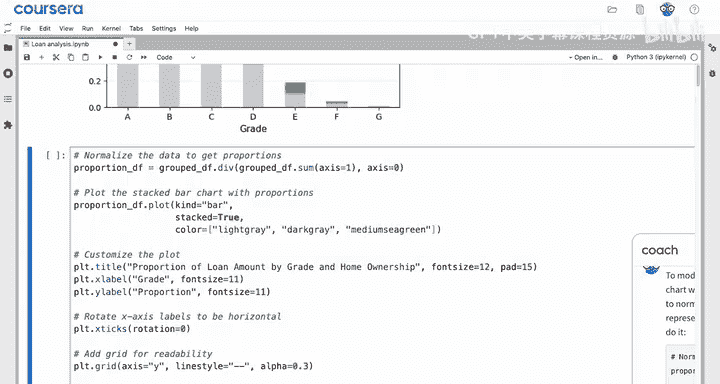

Cool， this is a nice looking chart with good labels and the colors maintained from before the LLM even changed the title。

 the only thing you may want to do is move the legend outside the chart。

You can use the exact same code as before to move it to the 11 position you may notice that the proportion of renters is relatively consistent across grades andB。

 but increases in the C and E grades that can provide your client some insights about what type of collateral their customers might have for different loan grades Finally。

 save this chart as a P&G to use in your report。

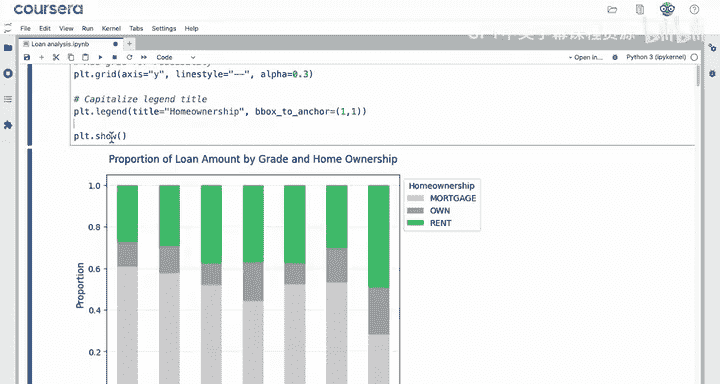

In this video， you learn that the stack equals true argument to plot will create a stack column chart rather than a group one。

 since your goal was to compare within a category rather than across them。

 this type of plot made sense to create you also worked with an LLM to develop 100% stack column chart。

 allowing easier comparison across the different categories。

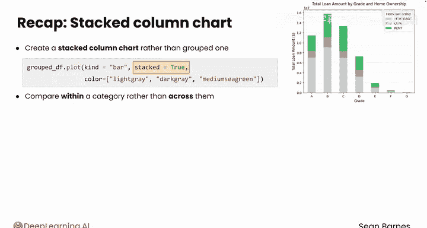

Now that you've worked extensively with column charts。

 you have most of the tools you need to create beautiful and functional visualizations in Python。

 but you'll still need to master scatter plots， box plots and histograms。

 each of which has its own unique options， follow me to the next video to create scatter plots。

