# 吴恩达《Python数据分析（数据分析第3课）｜Python for Data Analytics》中英字幕 - P51：50_散点图.zh_en - GPT中英字幕课程资源 - BV1rp5yzjEgn

MtplotLi allows you to make highly customized scatterplots that explore the relationships between features in your dataset。

 You've investigated correlations between many of the features in your dataset and you found that annual income is a moderate predictor of total credit limit with a Pearson correlation coefficient of 0。

55 you'd like to graph this relationship to help your clients understand how the income distribution of their customers might impact the amount of credit they should offer a scatterplot is an appropriate chart type for this task since you're looking to visualize the relationship between two numerical features you're also interested in visualizing the credit limits of customers who make incomes in a top5% of the distribution Pick up where you left off you've imported some modules and you've read your data to create a scatterplot use B do scatter with two arguments Df annual income and Df total credit limit。

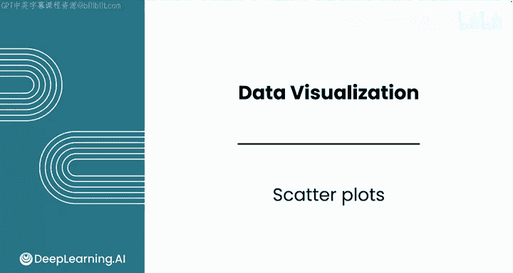

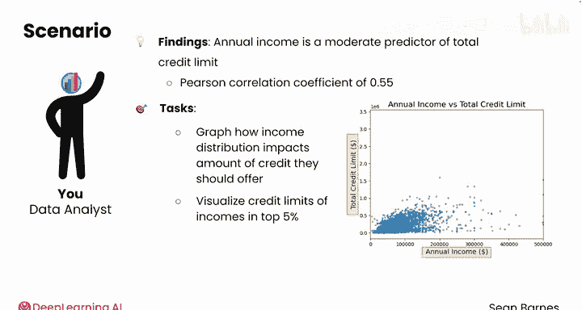

Add plot not show as per usual， that's all you need check it out you'll want to add your typical enhancements。

 including title and access labels。

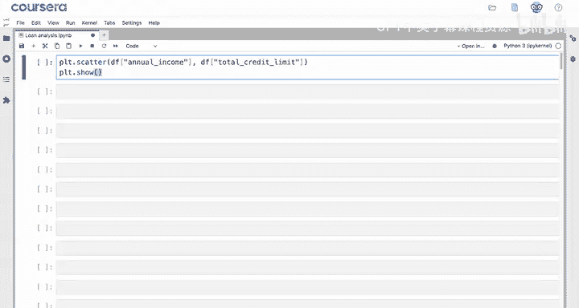

For scatter plots， you also have options to control the markers for a dense plot like this one。

 which has over 3000 points， you can set alpha to something like 0。5。

 which allows you to better see where there are denser clusters of points。 in this case， near to 0。

 you can also adjust the markers using the name argument marker。 One option is carrot for triangles。

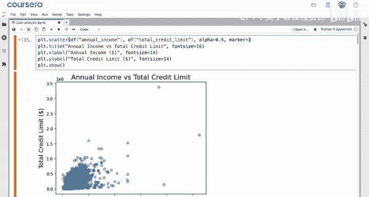

If you take a look at the documentation， there are a ton of options， circlecle is the default marker。

 but for this amount of data， the point will help most with visibility， but if you're into it。

 maybe you could try octagons for fun。

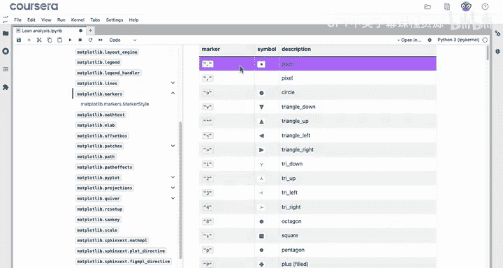

Notice this graph is pretty sparse with just a handful of outliers，3 to be precise。

 taking up the plot in my plot Lib， you can control the X and Y limits of the plot effectively zooming in on different parts of the plot。

 For example， you may want to zoom in on the X values on the left half of the chart。Now。

 be careful here because the values look like they're between 0 and 0。5。

 If you use the function plot dot x limb 00。5， you have to specify a lower and upper bound。

 you get a completely blank chart like this。 Can you tell why。

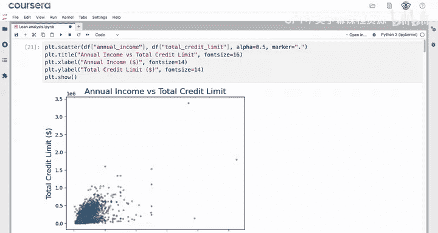

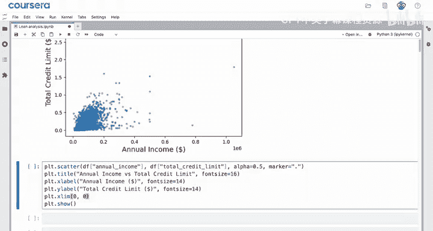

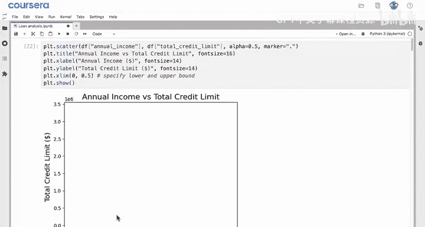

You get a blank chart because the X axis here was actually in scientific notation。

 So 1 E6 means a1 with $60s or $1 million。 So if you do 00。

5 you're looking at loans between 0 and 50 cents。 You actually want loans between 0 and $500000。

 Nice， This graph makes the positive relationship clear。 Finally。

 recall that you were interested in visualizing the credit limits of customers who make incomes in the top 5% of the distribution。

 One option is to draw a cutoff point on your scatterpl。

 A vertical line separating the distribution into 95% and 5%。

 So how would you go about finding the value of the top 5% of incomes。

 You can use the quantile method with the argument 0。95。😊。

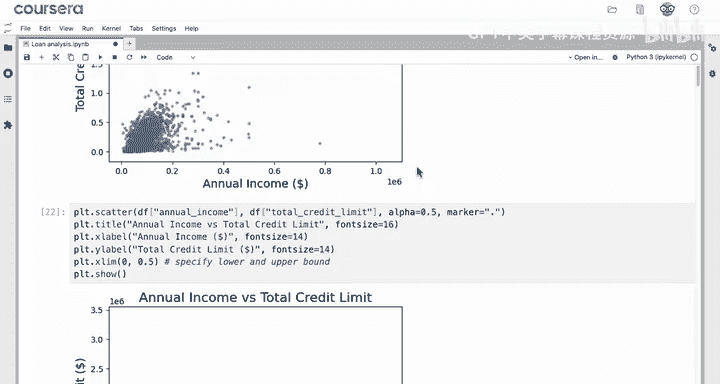

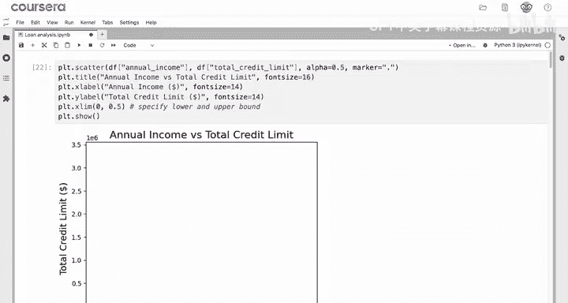

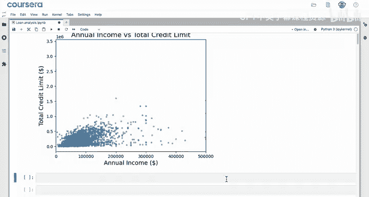

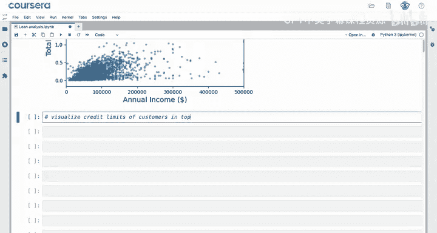

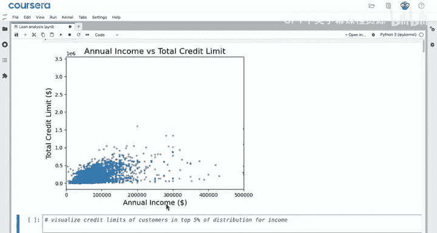

Save that in a variable top 5% income Pri that value。

 it looks like the top 5% of this data set is around $170，000。

 Now you can use the plot Axv line function， which plots of vertical line hence the name V line Give it the named argument X with the value of top 5% income running this cell you get a nice vertical line segmenting this distribution so that your clients can see what the top 5% of incomes looks like Finally。

 you can adjust the way this line looks， perhaps a black dash line would be a good approach。

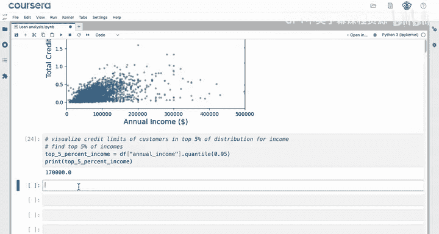

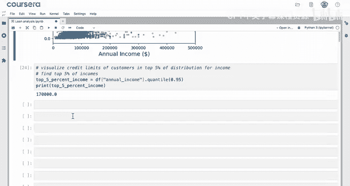

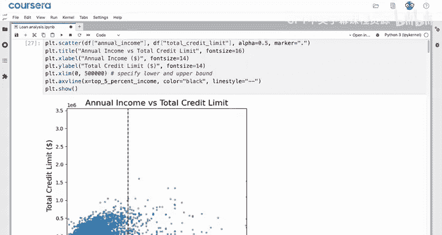

To recap， you saw how to use the plot dot scatter function with two columns of data to create a scatter plot。

 Remember， scatter plots are symmetric， so either order works。

 but the first argument will go on your x axis。 You saw that you can control the color of the markers using color。

 the transparency using alpha and the marker style using marker with options like carrot for triangle or dot for points。

 The alpha named argument can control the transparency for other chart elements as well。

 like plot dot grid which you saw previously。 You also use plot do Xlim to set the X axis limits。

 focusing on the bulk of your data in the plot。 You can also use the companion function plot do y limb to focus on a particular part of the Y axis。

 Finally， you use the plot do Axv line function to draw vertical line on your plot segment in your data。

 Can you guess the function for drawing a horizontal line。😊，You can use plot。axx Hline。

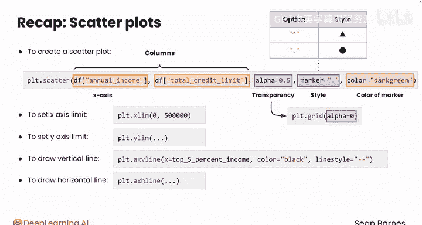

Great work with scatterpls because of the amount of customization and data manipulation they involve。

 creating high quality scatterpls often requires complex lines of code。

 though the end product is worth it。 Follow me to the next video to see how to understand this complexity。

