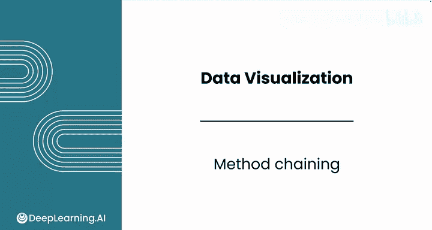
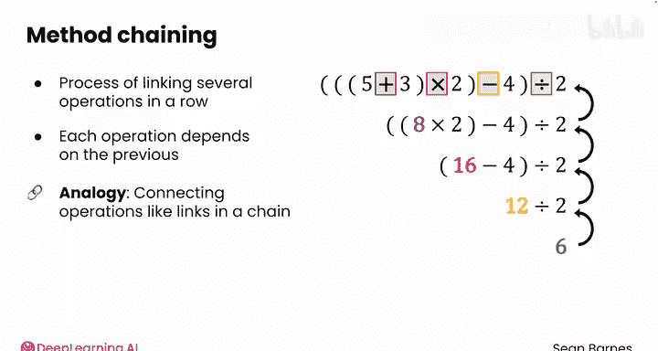
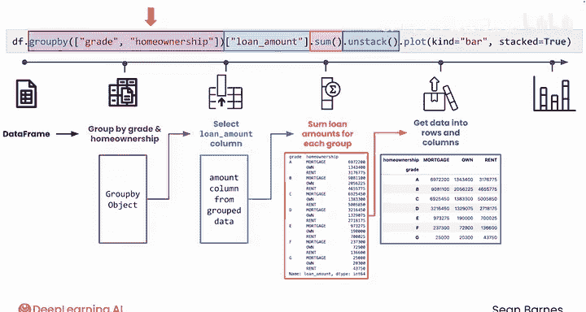
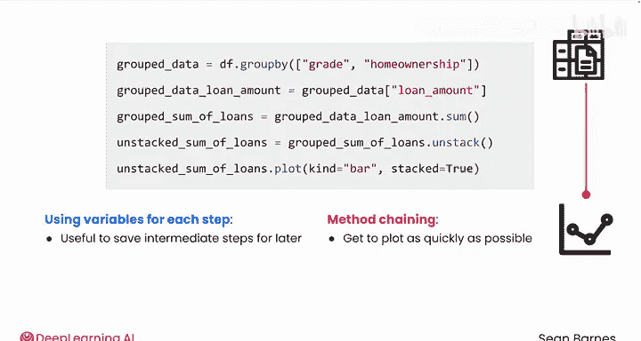

# 吴恩达《Python数据分析（数据分析第3课）｜Python for Data Analytics》中英字幕 - P52：51_方法链式调用.zh_en - GPT中英字幕课程资源 - BV1rp5yzjEgn

In the previous few videos， you saw some long lines of code that involved calling multiple methods in a row。

You'll see this strategy called Me chaining a lot as you continue to work with Python。

 check out this math expression， how would you go about evaluating it？

You have four operations you need to complete， You need to resolve the addition operation first before you can do anything else。

 so 5 plus3 equals 8， you've reduced the complexity of this expression and now you can proceed with the multiplication8 times 2 is 16。

 So again you've resolved another level of complexity and can now subtract 4 which gives you 12 and divided by two which gives you6 and code this process of linking several operations in a row。

 each of which depends on the previous one having been resolved is called method chaining it's called chaining because you're connecting operations like links in a chain。

 each length depends on the previous one。

Let's break down this line of code together， which you saw in an earlier video on stack bar charts when you're reading and trying to understand this code。

 think of it as happening from left to right。 Try to focus on your data types。

 The entire point of this line of code is to take some data execute several commands on it and end up with some type of result。

 In this case， a visualization。 You start with the leftmost data type。

 a data frame and end up with the output of the rightmost command。 a plot。

 This line of code has four steps and each one needs to be resolved before moving on to the next one。

 The first step is to group the data frame by grade and homeownership。

 There are two inputs to this step。 The data frame and the list of columns to group by。

 The output of this step is a group by object which is similar in structured to a data frame with the rows group by both grade and homeowner。

 So you have 15 groups。 That's five grades times three homeowner ownership categories。 Second。

 select only the loan amount column。 The input is a group data frame and the output is a group series。

 Just the loan amount column group by the two columns。

 You still won't be able to see this data structure yet。Until you aggregate it。

 then calculate the sum of the loan amounts for each of these 15 groups。 the input is a group series。

 and the output is a series。 This series has 15 rows， and it uses a multi indexdex。

 A pair of values as the index。 for each multi indexdex value。

 You have the total amount of all loans in that group。 Next。

 use dot unsted to get your data into rows and columns。 rather than having this multi indexex。

 The input is the multi indexex sums， and the output is the sums and rows and columns。 Finally。

 create a stacked bar chart of the resulting series。 The input is the series from the previous step。

 and the output is a plot that can be displayed。 Each step takes the data from the previous one and transforms it further。

 Here's an alternate way you could have written this code using variables for each step。 group data。

 then group data loan amount， then group sum of loans， then unsted sum of loans。

 Then you create your visualization using the plot method。

 All these variables could be useful if you needed to save these intermediate steps for later。

 For example， maybe you want to calculate the median and standard deviation of the group。

Data loan amount， but you don't really need to save these intermediate steps each time。

 think about method chaining as taking an express train In this case。

 from data frame to plot on the express train， you buy your ticket board the train at the data frame and arrive at your destination The plot that's great if you're just trying to get to the plot as quickly as possible。

 It's a less flexible approach though because if you realize later that you wanted to stop in an intermediate step。

 you wouldn't be able to the approach with variables is more like the local train that stops at each stop it's more flexible but it takes longer you can get off at any particular point if you need to like if you wanted to calculate the median and standard deviation of loan amounts per group。

 but if you don't have to stop anywhere method chaining can get the job done quickly chain methods can be challenging to read it first but the more you work with them。

 the better you'll get at understanding them， they can make your coding quick and efficient especially if you don't have a need to store intermediate results。

 that takes you to the end of this lesson up next， you'll complete the practice assignment and practice lab for this lesson once you're done。

😊。

Follow me to the next lesson to create even more beautiful visualizations。

 plus distributional plots using the popular Python library Seaborn see there。

