# 吴恩达《Python数据分析（数据分析第3课）｜Python for Data Analytics》中英字幕 - P53：52_Seaborn可视化.zh_en - GPT中英字幕课程资源 - BV1rp5yzjEgn

So far， you've encountered a variety of plots and seen how to create customizations for those plots using Maplotlib。

 There's one more data visualization tool you need to learn。 and that's Seaborn。

 Seabornne is a visualization tool that you can import into your code that works well with Matplotlib。

 It main strengths are improve visual appeal。 Red needs to manipulate the data using grouping and summarization and its additional plot types that aren't available through Mapllootlib。

 If you're wondering Cbornne's unusual name comes from a character in the Westwing。

 Seaborn's creator to creative inspiration from it。 by the way。

 great show I used to own the box set of DVDs。 At this point in your analysis。

 You're looking to level up the visual appeal of your visualizations。

 you're also realizing you've spent a lot of effort developing a few plots。

 and you'd like to include many plots of different features and relationships in your data。

 Seaborn can help you in both of these aspects。 I visual appeal and creating mini charts quickly。

 including distributional charts which are more challenging to make a Maplotlib。

 Let's compare creating a group bar chart in Maplotlib and Cborn。😊。

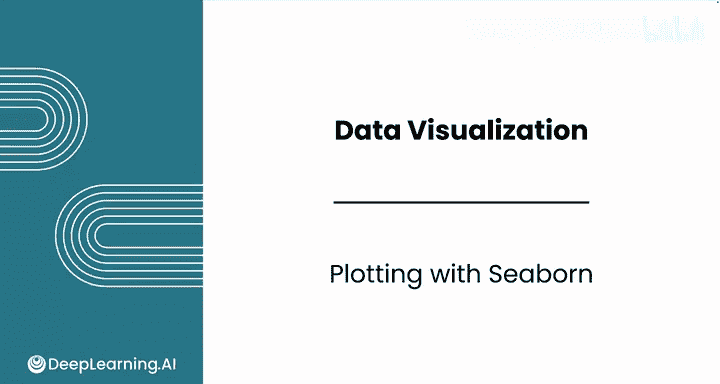

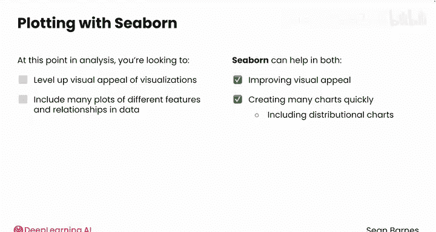

can get a sense of seaborne strength。Start with a fresh notebook。 First。

 you import all your modules at the top to get it out of the way。

 You'll need pandas and Matplotlibb plus Cborn as SNS。 It's typical nickname。

 Those are actually the initials of the CBborn character in the Westwing and nuy asmp。

 which you'll use in a moment。 then reading your data stored as Df。

 and filter the loan data down to the three states you're interested in。 previously。

 you use these three lines of code to plot the group bar chart。

 and there's a lot of data manipulation happening here。

 grouping aggregation on stacking all this stuff。 Now。

 there are a couple of things that are a little frustrating about this plot。 First。

 it's a little bit ugly。 And second， you have to do a lot of fumbling around with the data。

 in order to get it into the right format for this plot。

 which doesn't seem like that unusual of a plot。 However。

 you have other options for creating this type of plot。 Let's do so with Cborn。 First。

 you already imported Cborn as SNS up here。 So you can say SN S dot barpl。

 The first argument is always the data frame。 So filter Df。😊。

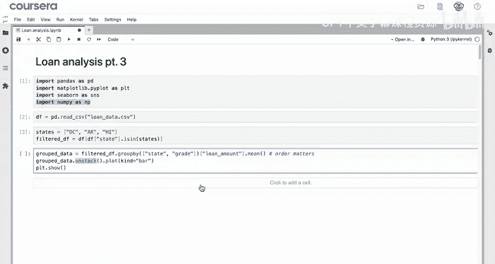

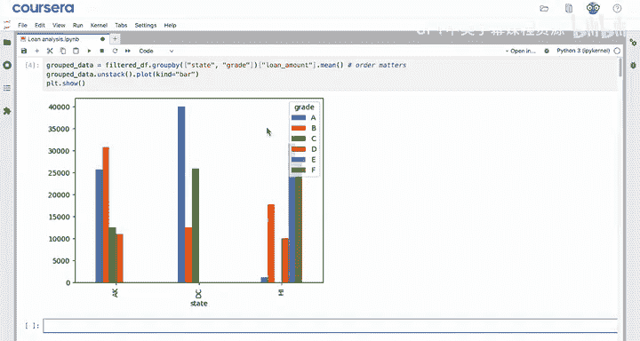

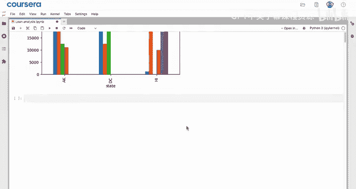

You do not need to group it in advance， which is fantastic。 Now， what do you want on the X axis。

 You want state on the la axis， you want loan amount。 Then finally， plot do show。

 there's no grouping。 there's no mean。 There's no stacking。 There're just creating a bar plot。

 Run the cell and you get this nice bar plot where the mean loan amount has already been calculated in this case。

 across all states。 In order to separate out the loan amount by grade as well。

 You're going to use the hue named argument。 Hue is another word for color。

 So just like you have here in the original mat plotlib plot。 The year isn't another axis。

 It's just the color of the bar。 Hence the hue named argument。😊。

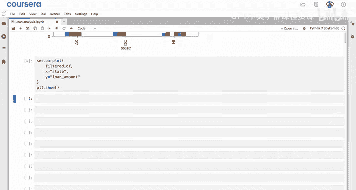

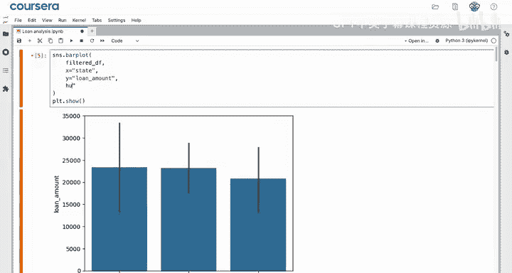

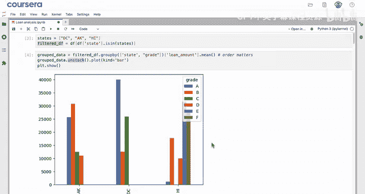

Enter H equals grade。 Now， you get this really nice looking bar plot with error bars and labels already added。

 This is the power of seaborn。 You get a really beautiful graph without too much effort。 Now。

 there's a lot you can still do here。 Of course， copypy these lines of code so you can add on them。

 Since Cborn is built on top of mapplotlib。 you can stack mapplotlib and Cborn commands together。

 So Maplotlib or plot functions like title X label and Y label work perfectly well with Cborn。

 You may also want to capitalize the title of the legend and move it outside the plot with B box to anchor。

😊。

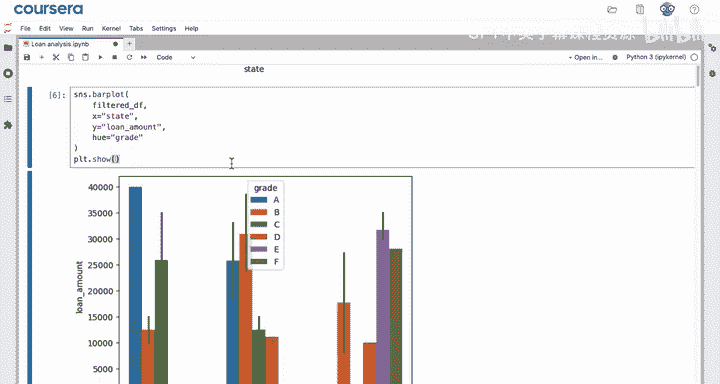

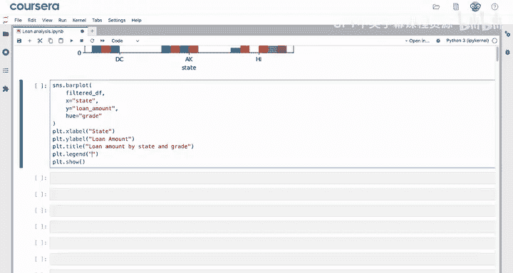

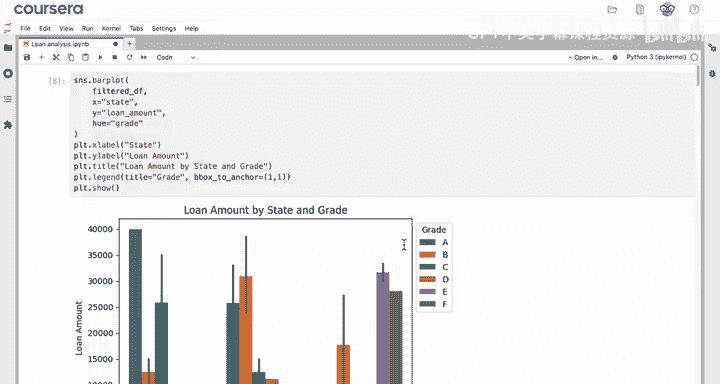

You'll adjust the colors in the next video Now， Seaborns setup also makes it easier to quickly try out some other plots instead of loan amount。

 for example， you may want to visualize interest rate and that's a quick change。

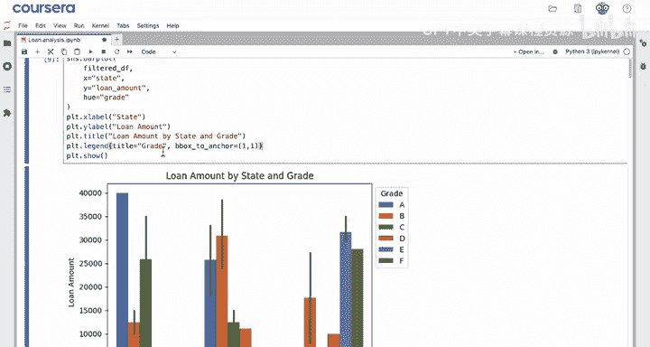

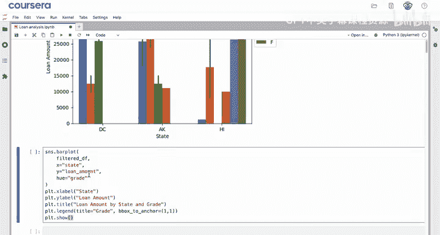

Now， by default， this function plots the mean amount or the mean interest rate。

 but you can use other estimators as well。 NumpI provides other estimators you can use。

 It turns out that way down under the hood Seaborn mappllibb pandas， they're all operating on nuy。

 So the mean max and standard deviation functions， those actually all come from nuy for the interest rate graph by default。

 the estimator ismp do mean。 If you specify it， you just get the exact same graph you had before。

 you can also domp max， which gives you the highest interest rate for each group your choice of estimator depends on what you're trying to communicate to your clients。

 to sum up Cborn has a few key capabilities。 First， it gives you additional functions for plotting。

 including barpl， which you saw in the demo as well as linepl。

 Reggplot and many others you'll see throughout this course。

 Cborn automatically summarizes your data rather than making you go through the group pi and summarization steps manually。

 you saw that the default estimator was MP mean which takes the mean of each group but that you can also set the estimate。

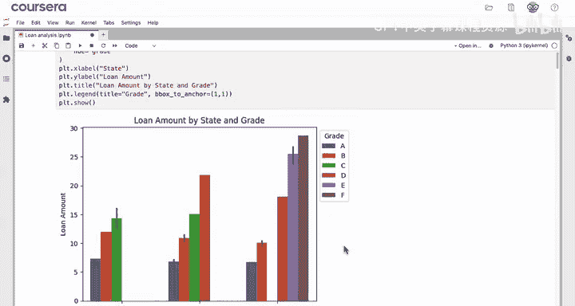

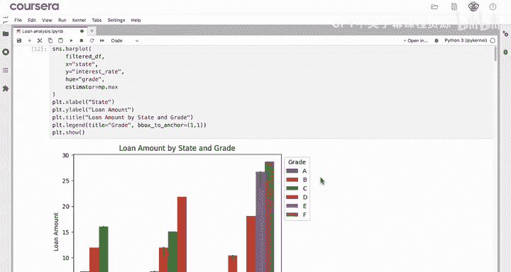

To your liking with options like NP。 max and NP。 size， you can even use N。

sD and other measures of variability and many others you'll see throughout this course。

 That's the basics of Cborn。 It saves you having to finesse your data into the right form while creating nice looking charts quickly in the next video you'll learn how to customize the look of your charts even further。

 I'll see you there。

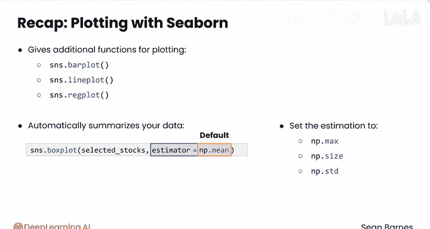