# 吴恩达《Python数据分析（数据分析第3课）｜Python for Data Analytics》中英字幕 - P54：53_主题与调色板.zh_en - GPT中英字幕课程资源 - BV1rp5yzjEgn

Seaborn has more out of the box options than matpllib when it comes to styles and colors。

 Your two main tools for styling are themes and palettes。 Conti on in this notebook。

 you've already imported your modules and read in your data to the data frame Df。

 you already created this graph of average interest rates by grade for the states with the highest loan amount in the previous video。

 you want to improve its visual appeal to include in your report。 First。

 you can use the seaborn function set theme， which you only need to use one time。

 It will apply to all your graphs after you use it。 you can still change other aspects of the plot。

 you're essentially just choosing a different set of defaults。

 If you call set theme then create the same graph as you saw previously。

 you'll notice it has been changed visually。 Each bar now has a white outline plus a darker background behind the entire plot and white or invisible spines。

 This is a great theme to use。 notice that if you create the same chart again in a new cell。

 that theme sticks。😊。

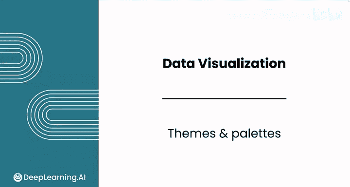

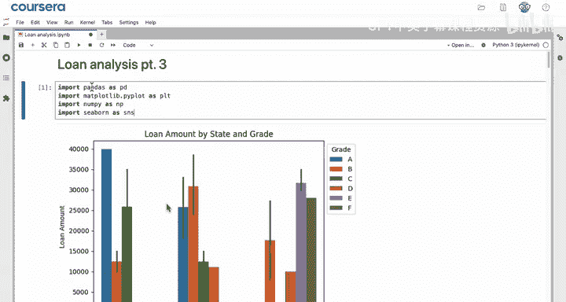

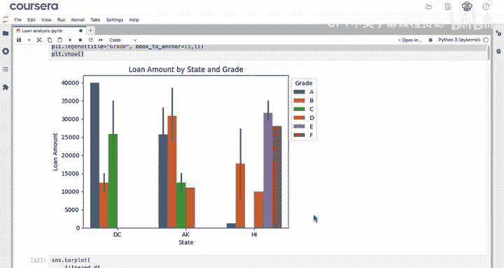

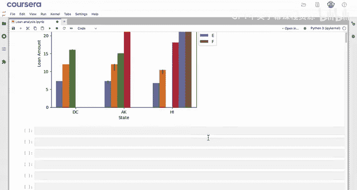

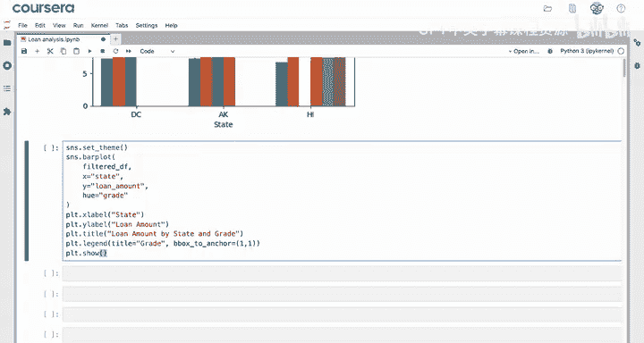

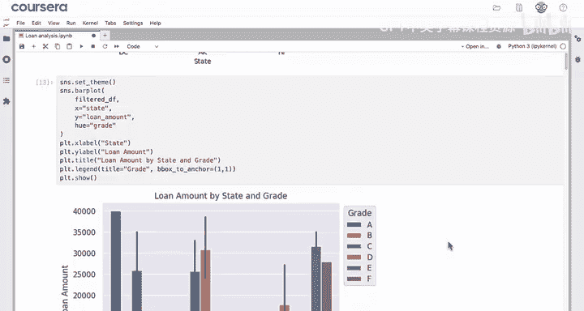

You have different options for the style named argument。

 which allows you to pick the right style for your plots to reset your theme back to the mappl lid basics。

 You can set theme with style equals white。 It's a good style for communicating dense information like this group bar chart。

 You can change the color palette in your graph as well。

 which is one of the coolest things about seaborn。 right now。

 you're using a categorical palette with many distinct colors。

 but a dirging palette like the green to red one you used before。

 will emphasize the insights in this chart。 add a new named argument to your plotting function palette。

 The value of this argument should be the name of a color palette。

 There are a ton of these available to you， but you'll need to look up their namess。

 This website from practical python for data science list the palettes available to you。

 So you have options like blues or blues reverse and so on。 Now。

 try adding the blues palette to your code。 You'll run into this error。 What's the deal。

 You get a blank chart with the value error。 blues is not a valid palette name。

 Let's check with the LLM。 I thought blues was a valid palette name。😊。

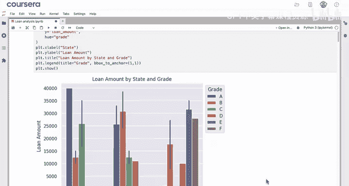

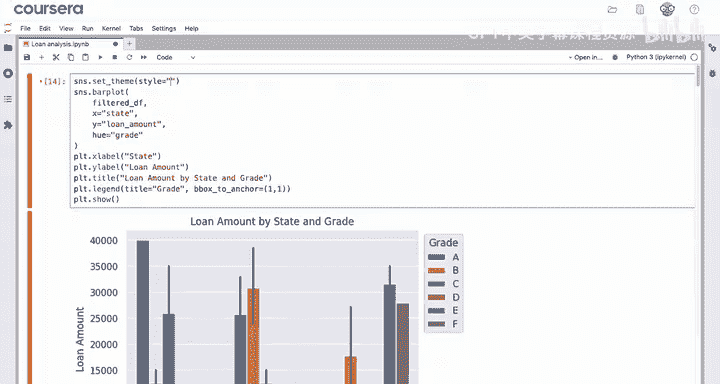

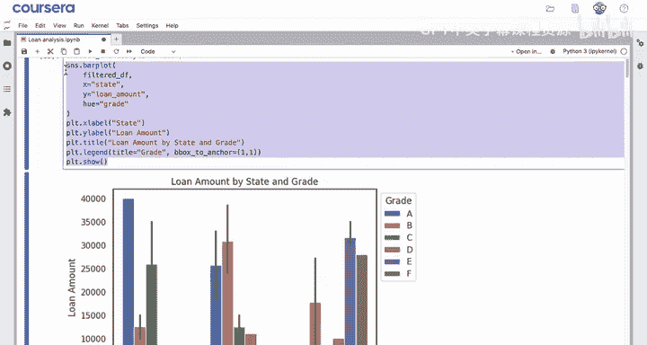

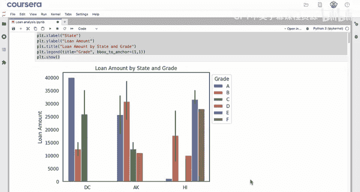

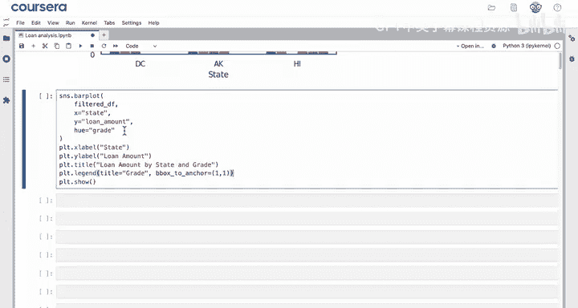

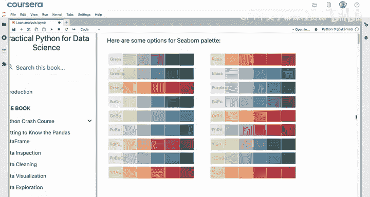

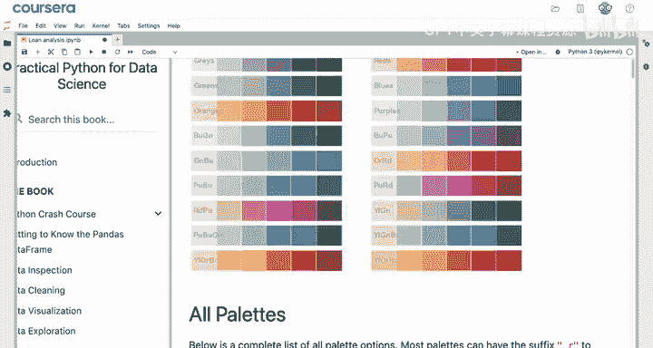

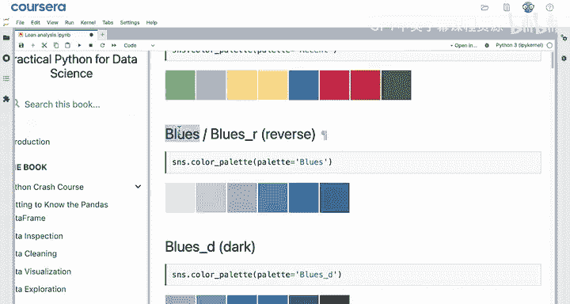

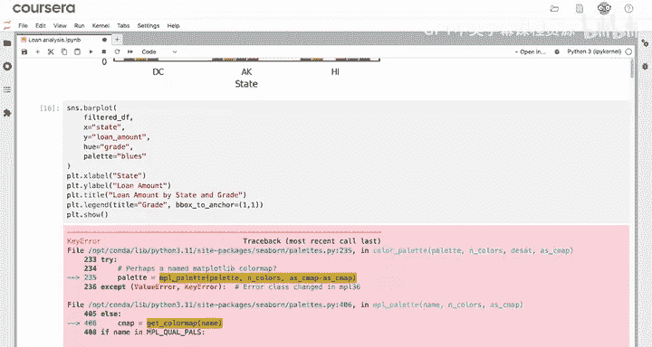

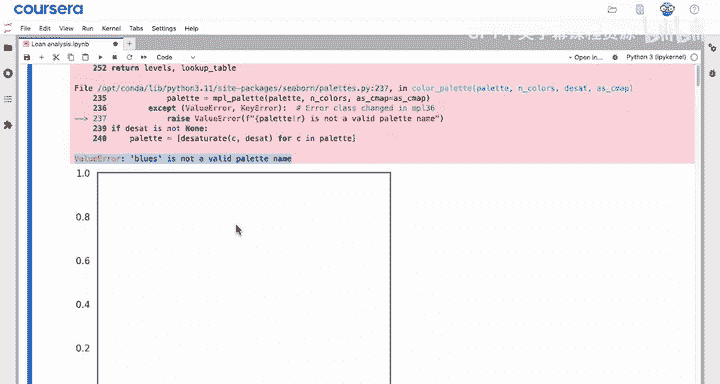

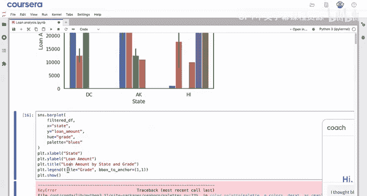

Why am I getting this here？Pate in the code and paste in the air。

So the LLM tells you that the error is probably due to a case sensitivity issue。

 the correct name for the pallet is blues with the capital B。

 so let's capitalize blues and now things look great。

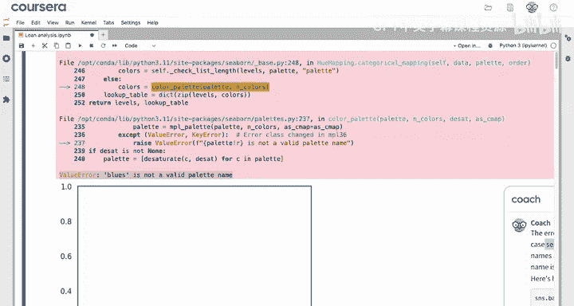

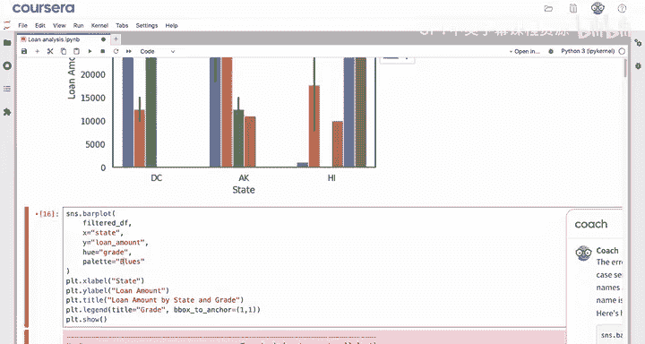

Remember， computers are pretty sensitive to capitalization in general but if you get an error you can always check with the LLM for debugging help Blues looks nice。

 but as a sequential palette it doesn't highlight the key insights as well as a palette with many colors from green to red to get that green to red look you had previously you can use the red yellow green reverse palette。

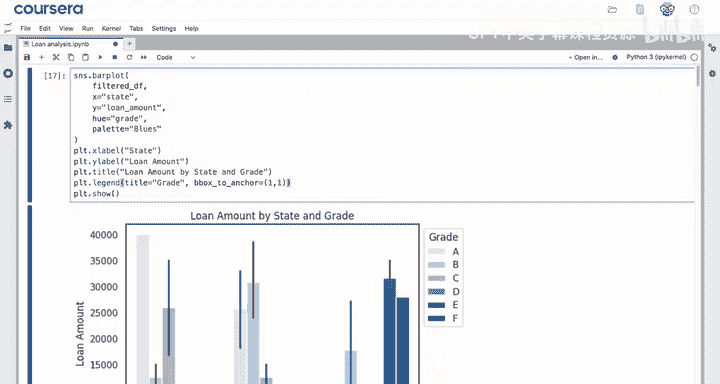

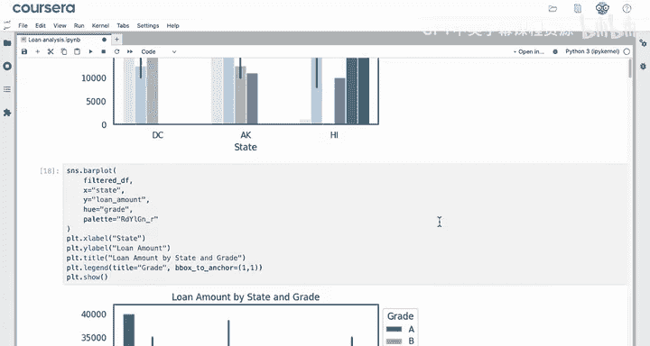

Other options， if you're looking for a colorblind friendly chart are the plasma palette。

 which goes from purple to yellow or the ice fire palette， which goes from blue to orange。

 Let's stick with the red yellow green palette。 Now you can say this plot to share with your clients。

 They can use it to help understand how interest rates vary across these three states with the highest average loan amount。

😊。

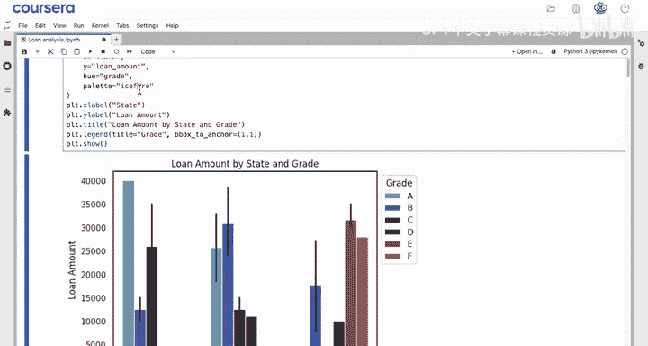

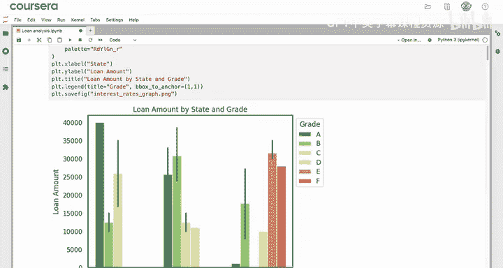

To recap， you saw how to use the SNS do set theme function to change the default styling of your plots。

 You use the style argument to choose the style White returns your plots to the default map plot lid look。

 You also saw that seaborn gives you more control of the visual style of your plots。

 you use the palette named argument with options like blues red yellow green reversed and more to improve the aesthetics of your plot With pallet。

 you can avoid manually selecting colors for your plots。

 It can be a lot of fun to create such visually appealing graphs。

 Seaborn lendents itself to experimentation。 follow me to the next video to see how to create visually striking distribution plots starting with box plots。

😊。

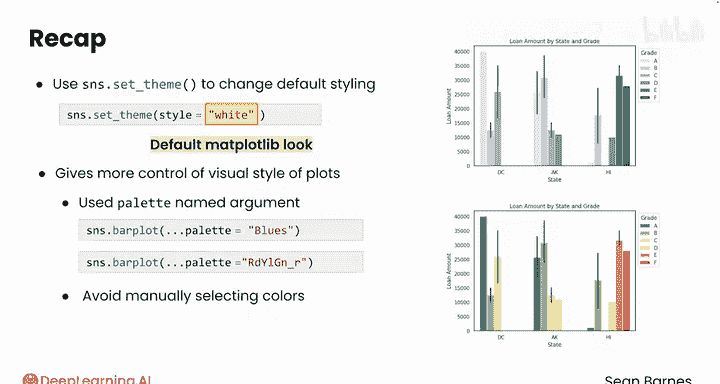