# 吴恩达《Python数据分析（数据分析第3课）｜Python for Data Analytics》中英字幕 - P55：54_箱线图.zh_en - GPT中英字幕课程资源 - BV1rp5yzjEgn

Cborn gives you some great options for visualizing the distribution of your data while Bplots would have been challenging to make with Maplotlib。

 Cborn makes them easier as part of your exploratory data analysis。

 you're interested in characterizing the different features present in the data。

 It contains both features of each person like their occupation and loan history and features of the individual loans in the data like the loan amount and interest rate Con on in this notebook。

 you've already imported your modules and read in your data to the data frame Df Seaborn makes Bpllos much easier compared with Maplotlib。

 for example， say you wanted to plot the distribution of interest rates for all the loans。

 you can use SNS doboxplloot。 your first argument is always the data frame In this case。

 Df then use the name argument X equals interest rate。😊。

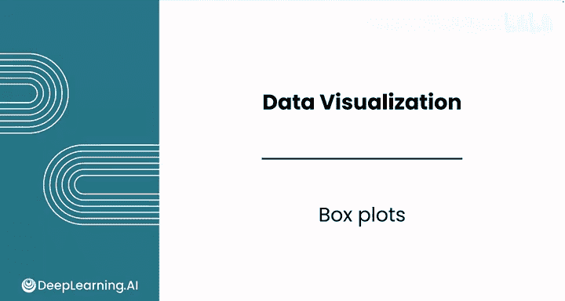

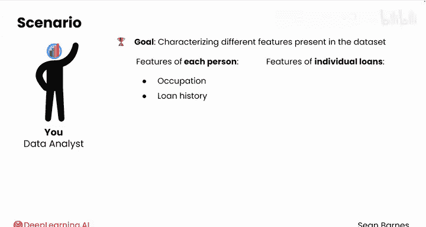

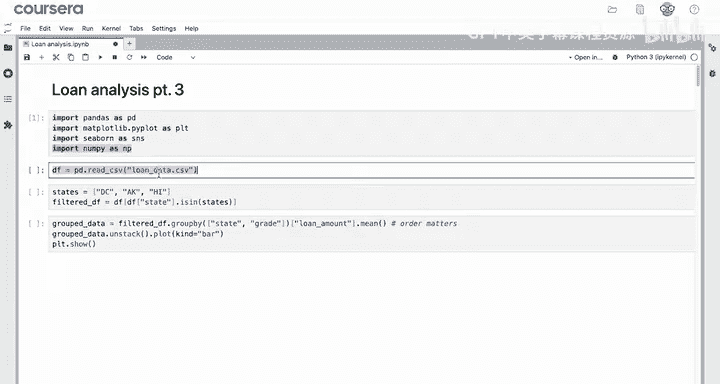

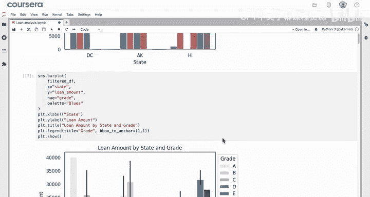

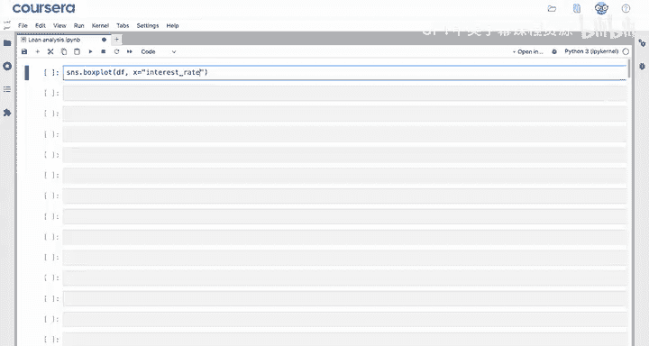

Add plot show， and it's as simple as that。 This graph shows the skewed distribution of interest rate with the median rate around 12%。

 That's pretty high。 So this distribution can help you communicate a typical interest rate for these loans。

 Now， what happens if you do Y equals interest rate。 Then you get a vertical box plot。

 As far as interpretation， there isn't a major difference？ It's a matter of personal preference。

 Let's stick with the vertical plot for now。 Next， add your title and y label to clarify the plot。

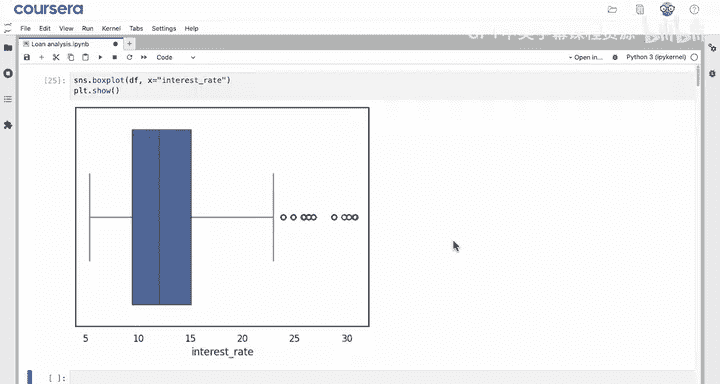

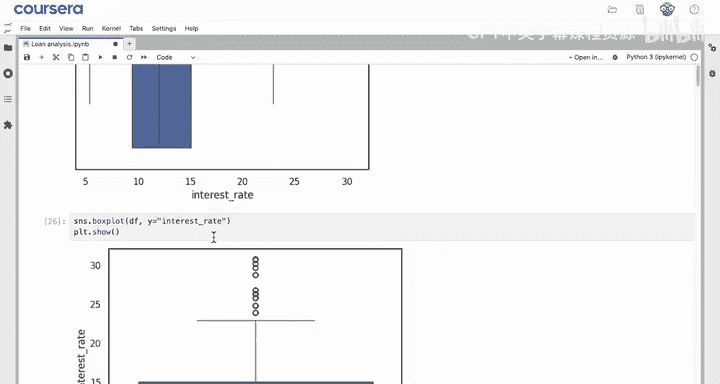

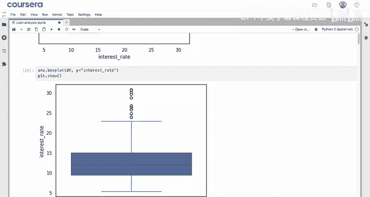

Now， what other customizations do you have here。 One really popular option is D spine。

 which allows you to remove the spines from your plot。

 It's popular because in a single vertical box plot， the x axis doesn't mean anything。

 you might as well remove it previously you use some long mat plot lid code like Ax dot spines and then you selected each one individually with Cborn。

 you can say S and S do D spine which removes the right and top spines by default。

 The named argument bottom equals true will remove the bottom boundary。

 It's a little counterintuitive but true means to remove it。 you're saying yes to D spine。

 and now you get this clean plot without any unnecessary boundaries which increases your data to ink ratio。

 you can create box plots for segmented data as well。

 just by adding an x variable in addition to your y variable For example。

 to segment interest rate by grade you can add the named argument to box plot x equals grade。

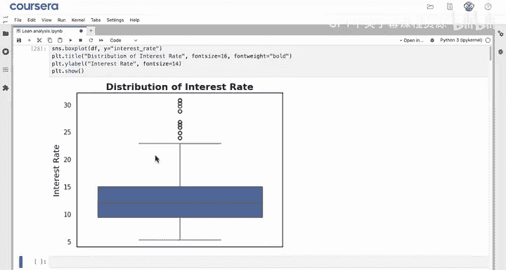

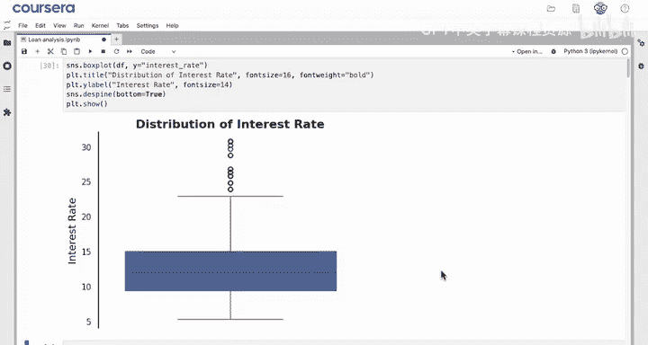

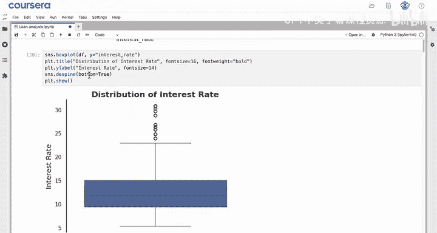

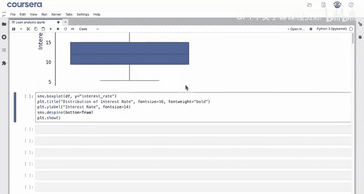

Now you see a very clear pattern where interest rates increase dramatically with a grade loans having interest rates in the single digits and E F and G loans with interest rates in the 20% range。

 you can share this graph with your clients so they can start to understand the profitability versus risk for each of these groups of books add your bottom spine back in since you have data on that axis Now。

 The orientation of this graph matches the graph you made earlier。

 loan grade on X interest rate on Y。 if you're presenting many graphs。

 your clients may benefit from seeing data laid out in a similar format each time and a Y axis grid might be nice to help read values from the axis。

 You can also assign a palette to differentiate your data。

 As with the orientation youll want to use the same pallet for representing the loan grades as you did previously。

 so let's say palette equals red yellow green reversed if that's the one you used earlier。

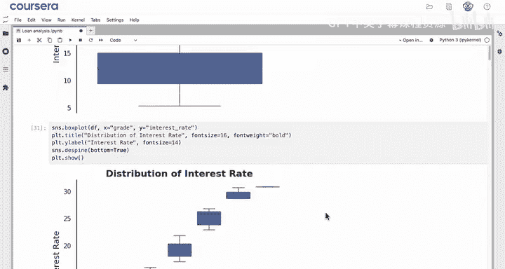

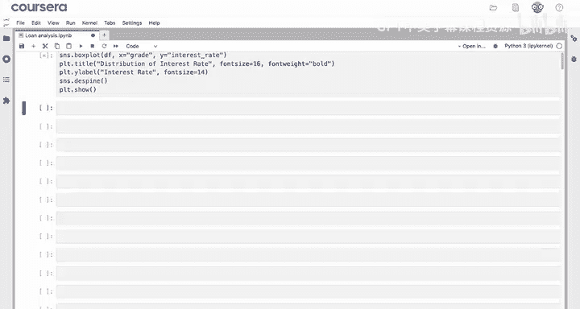

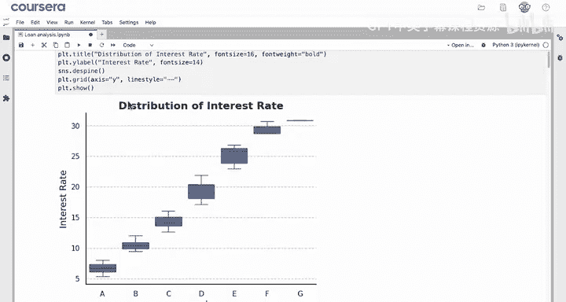

Notice you get the scary looking feature warning。 It's not an error。

 A warning in Python is often a notice from the developers of a module。

 letting you know that something may not work properly or that it might be changed in the future。

 You can ask an LLm to help you interpret these。 but in this case， it's relatively clear。

 palette without hue will be removed in a feature version。 So you can set hue as grade and set of X。

 This version seems less readable since you lose the doubleub encoding of color and label now only color differentiates between the grades。

 So you might prefer to switch back to X from hue if that option still works in your seaborn version。

 Now， finally， there is a lot of information here。 So you may want to make this graph larger。

 you can use plot dot figure to create the figure with a specific size。 It should come first。

 remember the figure is like the canvas for the plot。

 So you can say plot dot figure fig size equals and then give it width and height。

 These numbers or an inches。 Yes， it's annoying for metric users。

 but you can do the map to represent the figure size in the units that you prefer。

 and the default figure size is6 point。😊。

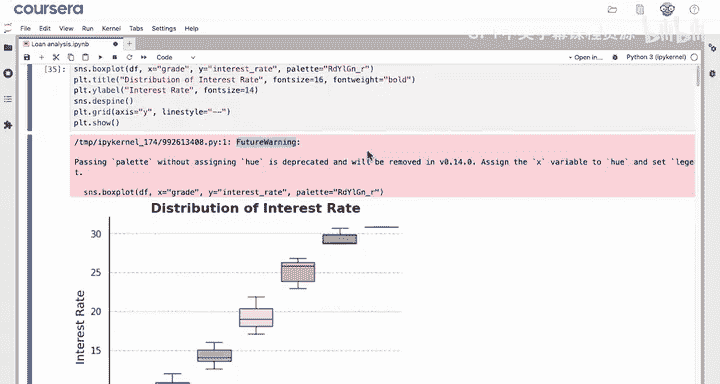

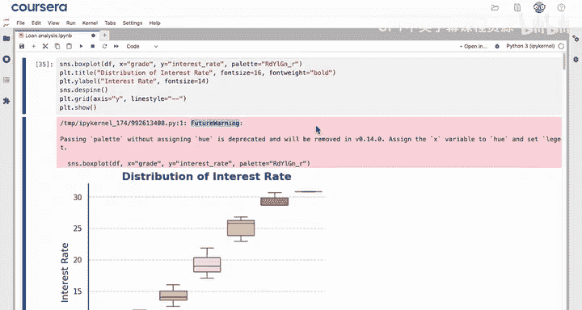

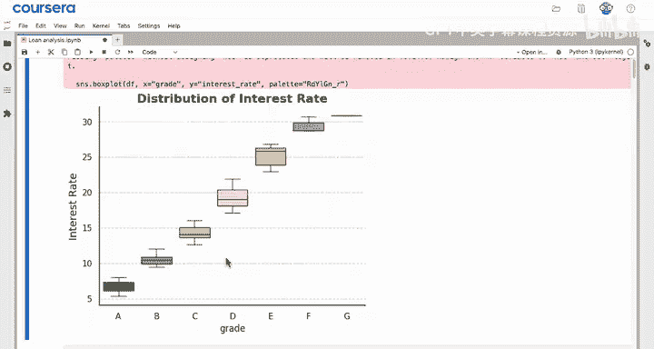

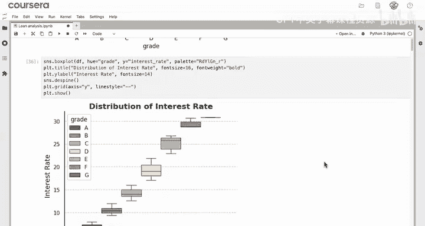

4。 inches about 16 by 12 centimeters， so something like8 by6 would be a nice increase。

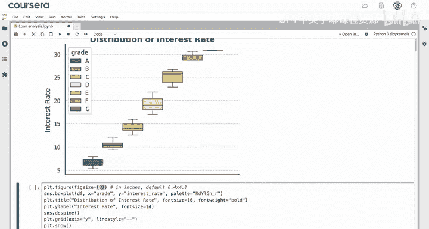

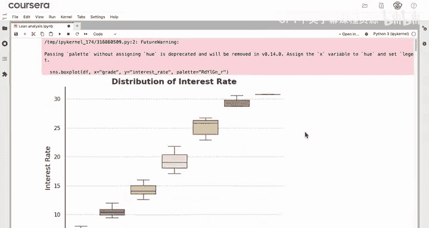

To recap you saw the SNS do box plot function， which creates a box plot。 If you set a value to X。

 you'll get a horizontal box plot and Y gives you a vertical box plot。

 you also saw that you can set both x and y to segment your distributions by another variable like grade you also saw the SNS do D spine function which works especially well with seaborn plots like the box plot it allows you to remove some boundaries from the plot and by default it will remove the top and right boundaries you can also use the named arguments left and bottom to remove other boundaries as well。

 Finally you saw how to increase the figure size using plot dot figure before you create your plot Use the named argument fig size with a pair of numbers width and height and inches。

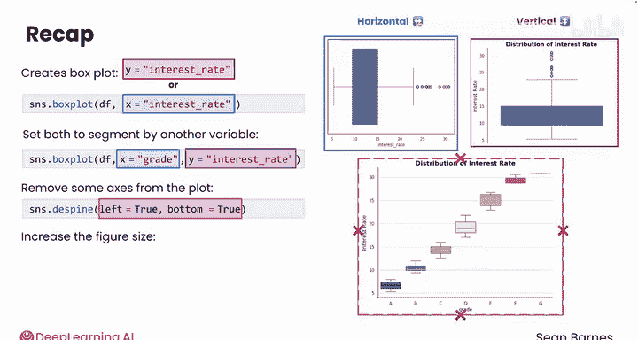

As you've learned previously， the box plot isn't your only tool for visualizing distributions。

 follow me to the next video to see how to create histograms in Seaboard。

