# 吴恩达《Python数据分析（数据分析第3课）｜Python for Data Analytics》中英字幕 - P56：55_直方图.zh_en - GPT中英字幕课程资源 - BV1rp5yzjEgn

Histograms are a goto plot type for visualizing the distributions of your features。

 Seaborn gives you great looking plots out of the box and you can use Maplot Live to further customize them based on some previous analysis you know that the loan amount feature in your data has some interesting patterns。

 You want to visualize this data using a histogram to explain its unique properties to your clients This visualization will help them identify and price common loan products based on what their competitors may offer Pick up where you left off you've imported your modules and read in your data and the Df variable to create a histogram of the loan amount feature use SNS hist plot。

😊。

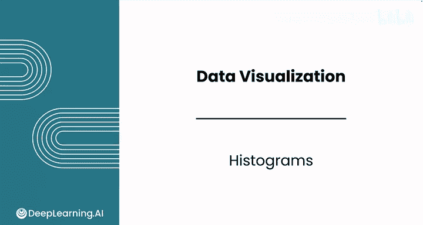

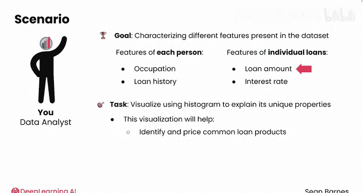

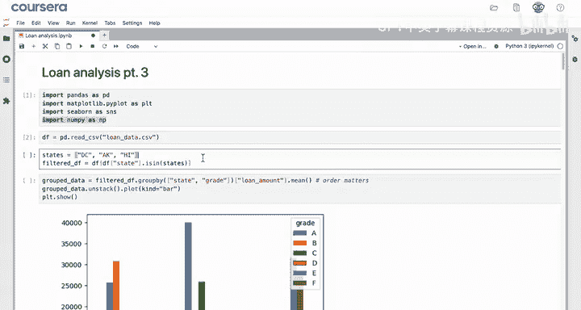

The data frame is always the first argument， so Df， then x equals lo of mouth。

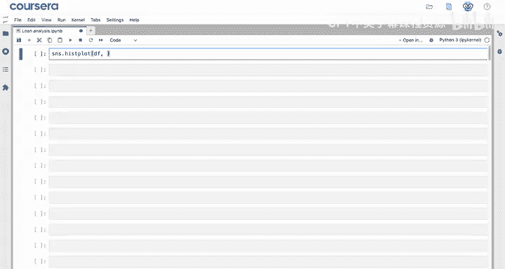

Cap it off with P dot show。And already， you've got a nice plotlo。

 Can you tell what values make up the spikes in frequency。Those values are at round numbers like 10。

00020000，25，000 and so on。 This pattern is worth investigating further to help your clients understand the psychological factors involved in taking out loans of different sizes。

 as well as the demand for them。 Next， add your title。

 X label and a grid to help read values from the graph。

 you can also remove the Y axis label since it's a bit unnecessary。 Of course。

 you can change the color of the columns as well。 Rosie Brown is a nice one。

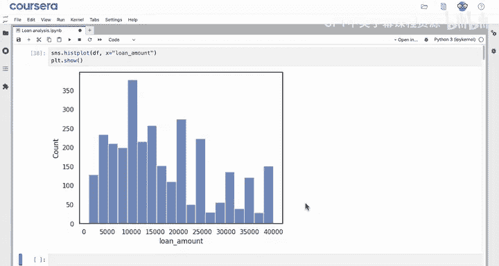

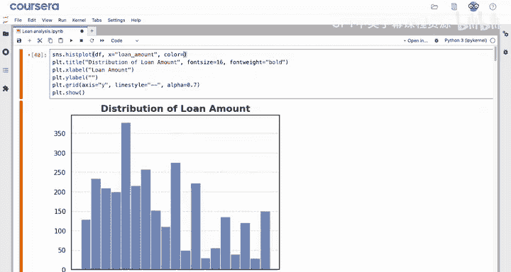

To show the spikes more cleanly， you can add the bins argument to the his plot function。 For example。

 bins equals 30。 Now， the spikes are quite clear。 You can see this one at 5000， for example。

 more easily。 Instead of setting the number of bins， you can also set the bin width argument instead。

 For example， you may be interested in having bins of size $5000 to help with interpretability。

 running that cell， you get a plot that's easier to read since you understand the weight of each bin。

 Now， that update does help with interpretability， but the ticks on the X axises aren't showing。

 You might think to ask the LLM how to add ticks to your plot。 That's a great instinct。 However。

 if you ask it and copy and paste the code。😊。

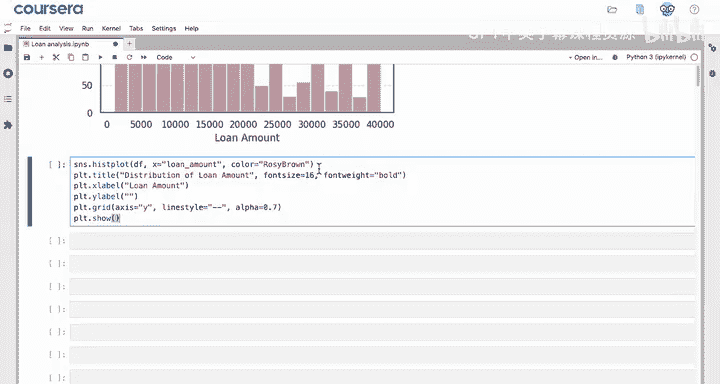

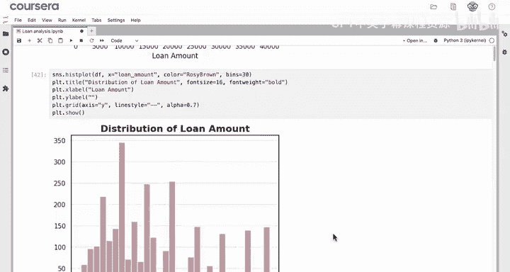

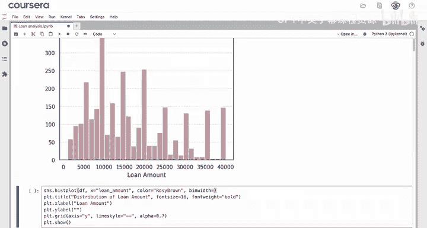

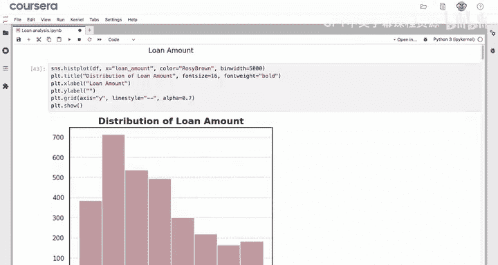

It suggests x takes visible equals true。The result doesn't have any effect。

 So this issue is a great example of how you need Python。

 Seaborn and Mapllibb knowledge to do what you want to do as a data analyst。

 The LLM won't be able to write and fix everything for you。 Coing with an LLM is collaborative。

 This issue comes from a setting that's part of the seaborn theme you're using。

 You don't need to know this。 I certainly didn't expect you to figure that out on your own。

 Some Googling would have gotten you there。 though。

 What you should take away from this exchange is that sometimes issues are caused by your theme。

 So you can try setting components of the theme to fix those issues。 In this case。

 you'll want to run S M S dot set style ticks to show the ticks。😊。

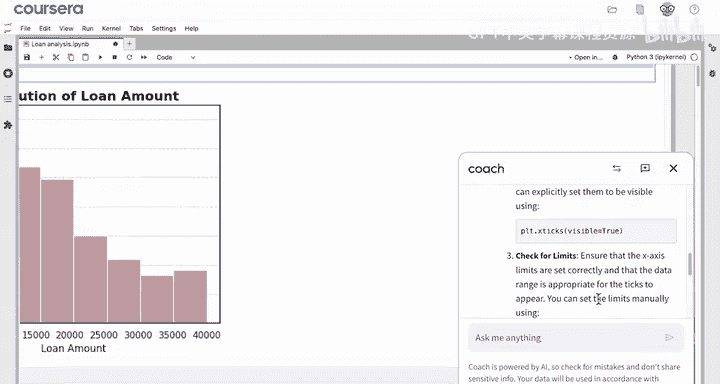

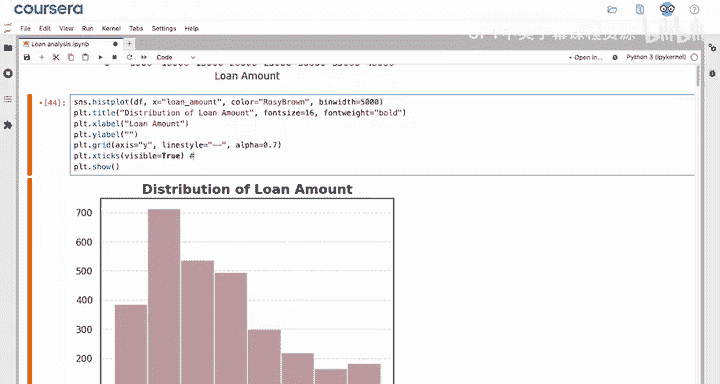

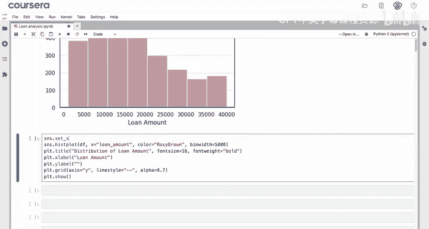

That's much betterPreviously， your theme had invisible ticks。

 a feature intended to declutter the plot Now you can help your clients understand that for example。

 loans in the 5 to $10，000 range are about twice as common as loans in the 20 to $25。

000 range Finally， you can also add an estimated density curve to your histogram using the named argument Kde equals true Kde stands for kernel density estimate。

 It's a fancy name， but it just tries to estimate a smooth curve showing the probability density of the distribution。

 So this is one option you have if you want to communicate insights about the relative probabilities across the distribution In addition to the frequencies visualized by the histogram。

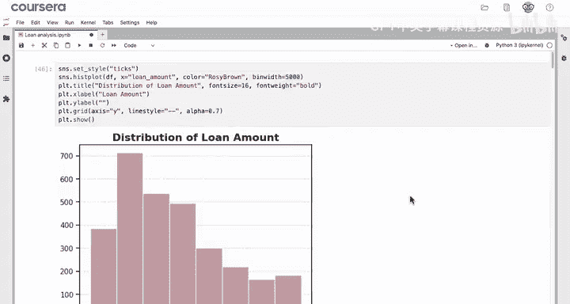

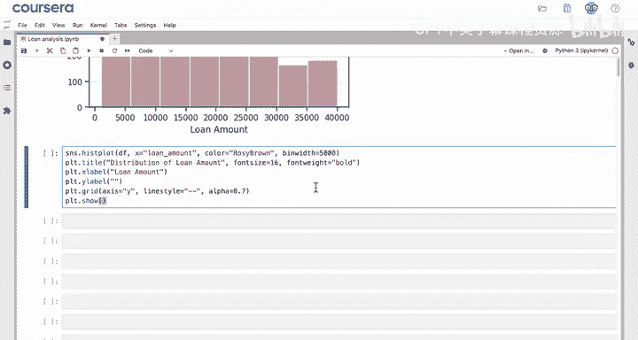

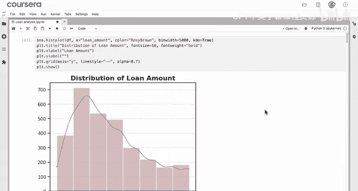

To play that back， you saw that SNS do hisplot allows you to quickly graph histograms。

 You can set the X or Y arguments for a histogram with vertical or horizontal bars。

 You can also use the bins argument to set the number of bins or Ben width to set the width of the bins instead B width overriidedes bins so youll only need to use one of them。

 you also use the Kde argument to create a density curve estimate。 Finally。

 you saw a potential visual issue introduced by the seaborn theme you were using。

 You really don't need to memorize these possible issues。

 but you should know that sometimes visual issues are introduced by the theme you're using and that you have options for controlling the theme excellent work with histograms。

 You've learned the core chart types that will make up the vast majority of your data visualization work。

 including column charts， scatter plots and histograms In the next video you'll explore some of the other weird and wonderful charts Cborn has to offer。

 I'll see you there。😊。

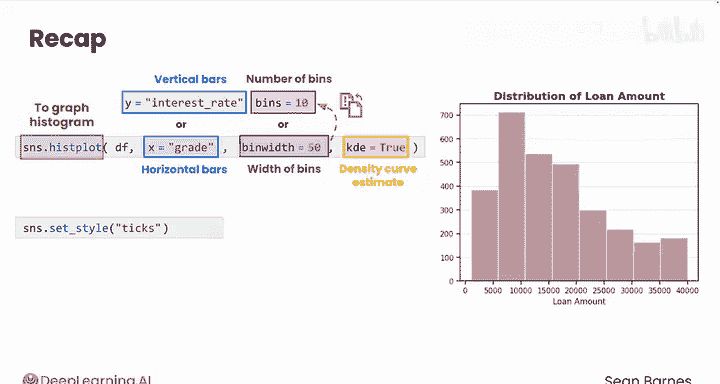