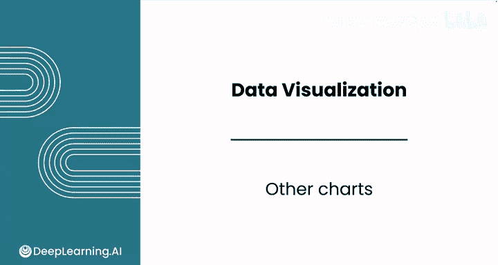
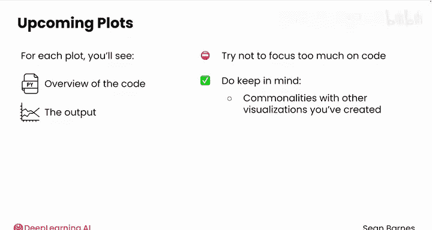
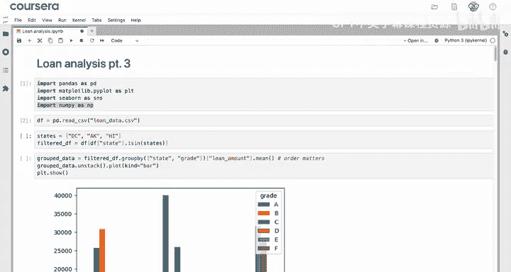
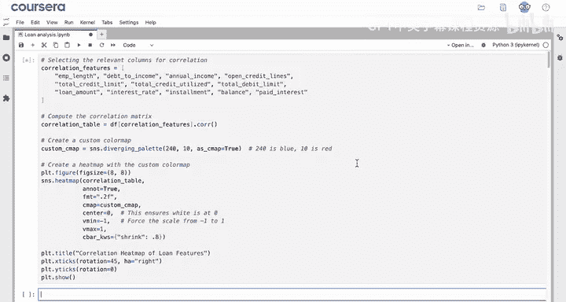
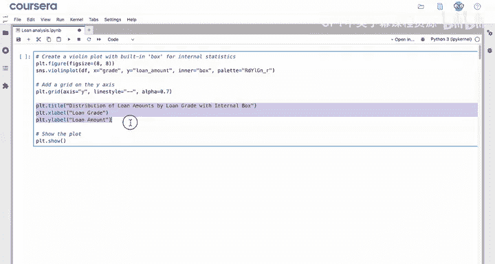
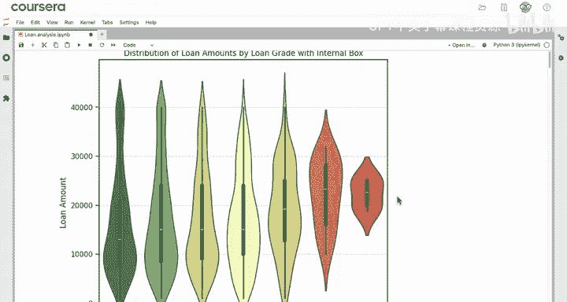
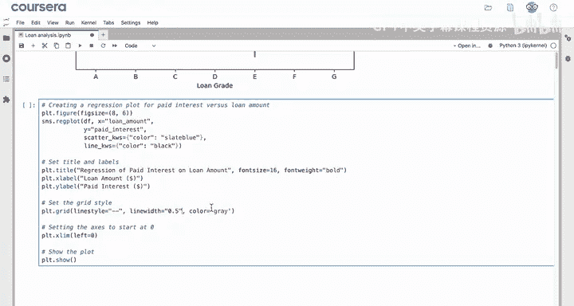
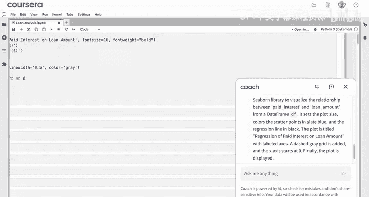
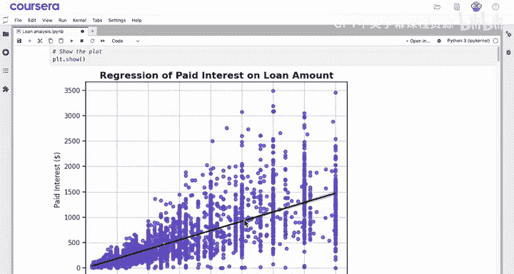

# 吴恩达《Python数据分析（数据分析第3课）｜Python for Data Analytics》中英字幕 - P57：56_其他图表类型.zh_en - GPT中英字幕课程资源 - BV1rp5yzjEgn

Cborn offers many cool plot types beyond column and distributional charts， like heat maps。

 violin plots， regression plots， and more。 You may not have a ton of occasions to use them。

 but they often serve a niche purpose in your visualization toolkit。 for each of the upcoming plots。

 you'll see an overview of the code as well as the output。

 Try not to focus too much on the code itself。 but do keep in mind the commonalities with other visualizations you've already created。

 You should also keep in mind the output you expect from each visualization。

 Pick up where you left off。 you've imported your modules and read your data in the Df variable。

 Let's start with this code to create a correlation matrix。 So what components do you recognize。

 Well， this first line of code is a list which you've created many times already。

 You've also use the dot core method before to get a table of correlations。

 The custom color map line is new。 You then create a figure to control the size of the plot。

 This heat map function is new。 And all these arguments seem new as well。

 But then the last four lines of code are all familiar， setting the title X ticks Y ticks。😊。

And then showing the plot。 So running that code， you get a cool heat map of the correlations between these different features。

 If you just look at correlation table on its own in this new blank cell。

 you have a table of a ton of numbers， and it's hard to see what matters。

 But going back up to the heat map。 You can see negative correlations are shown in increasingly darker blues with interest rate and total debt limit。

 having the strongest negative correlation。 Then positive correlations are in red。

 with many positive relationships。 You could share this visualization with your stakeholders too。

 for example， help them understand different opportunities to predict paid interest to identify the most profitable loans。

 or you could use it yourself to select a few scatter plots to create。 Now， check out this code。

 What do you think it does。😊。

Well， looking at the elements that are familiar， you've seen how to set the figure size before。

 just controlling the size of a plot 8 by 8 inches。 violin plot is new。

 but it should show the grade and loan amount with the red to yellow to green palette you've used previously。

 Then the text elements and plot out show are all familiar。 running this code block。

 This is a violin plot。 It's similar to a box plot and that it visualizes the distribution of the data。

 but it also provides additional insight about where the mass of data is located In each violin plot is a box plot of loan amount。

 So， for example， you can see that loan grades A through D have a similar median amount。

 but that the mass of the data moves upwards as the grade gets worse。

 A loans have a median around 12500 or so， and they're very skewed up。

 Aka positively skewed D loans are less skewed with the median loan amount around $15000。

 while E loans are more symmetric and F loans are actually skewed down。 Aka is skewed negatively。

 Ultimately， the measures of central tendency variability。😊。

And skewness of the loan amounts vary across the different grade categories。 Finally。

 check out this plot。 What do you recognize。

What do you think this will look like？One useful trick is to copy the code into an LLM and ask it to explain succinctly what this code does。

 So popping over to the LLM， you can see that it explains the code creates a regression plot using the seaborn library to visualize the relationship between paid interest and loan amount。

 and then it goes into some specific details about the additional annotations that you've added to the plot。

 Cool， running this code。 you get a scatter plot with an overlaid line of best fit。😊。

The line is generated automatically by this plot type， a reg plot。

 This is a pretty strong relationship， which makes sense because up here in the heat map。

 you saw that loan amount and paid interest had a correlation coefficient of $0。71。

 which is on the stronger side。 You can also see the clusters around the different loan amounts。

 like 35000 and 40000。 This type of plot might help your stakeholders understand the relationship between paid interest and the loan amount。

 Notice that the loan amount only explains about 71% of the variability and paid interest。

 So you can see on this line for $25000 loans。 For example。

 you have loans that have no interest paid。 Maybe that's a brand new loan。

 with a lot of values clustering around $1000。 So other features like the interest rate or the length of the loan will be needed to estimate the profitability of different loans more accurately。

 So those are just three of the many cool plots that you can plot with seaborn。

 Excellent work with seaborn。😊。

You've explored a lot of plots and customizations in this lesson from box plots to histograms。

 color palettes to themes coming up， you'll complete the practice assignment and practice lab for this lesson where you'll put your plotting skills to the test Once you're done follow me to the next lesson to explore plotting multiple charts at once with both MapltLb and Seaborn I'll see you in the next video。

