# 吴恩达《Python数据分析（数据分析第3课）｜Python for Data Analytics》中英字幕 - P58：57_组合图表.zh_en - GPT中英字幕课程资源 - BV1rp5yzjEgn

Once you've learned how to create beautiful visualizations。

 you'll often want to combine more than one together。 whether on the same plot or side by side。

 just like you can stack commands from both seaborn and matplotlib to create a visually appealing chart。

 you can also stack multiple plots on top of each other。

 you may want to use this technique to stack complementary plots or to plot multiple distributions together on the same axes starting fresh with a new notebook。

 importport your modules， pandas matplotlib Cborn and numpy just in case recall this histogram you previously created which shows the distribution of the loan amount feature you previously learned that one limitation of histograms is that they obscure the massive data within the bins so you lose sight of the individual values。

 So a histogram is an aggregateated plot and it's complemented well by a disaggregated plot。

 one that shows all the individual values。 One option you have is a rug plot。

 So use SNS rug plot a rug plot displays all the individual values on the specified axis typically at the base of the histogram so you get the benefit of visual。

😊。

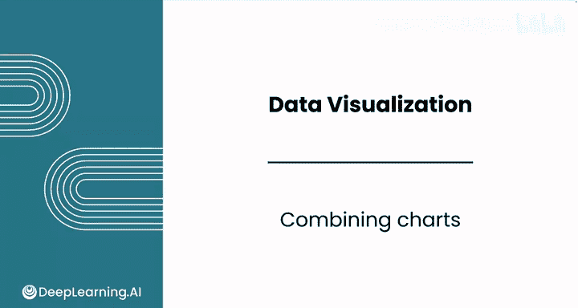

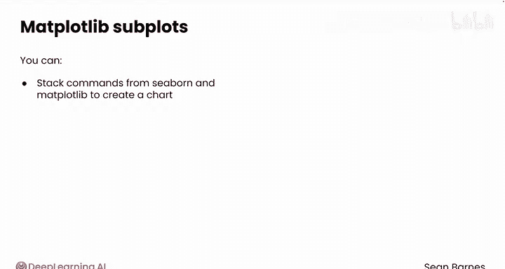

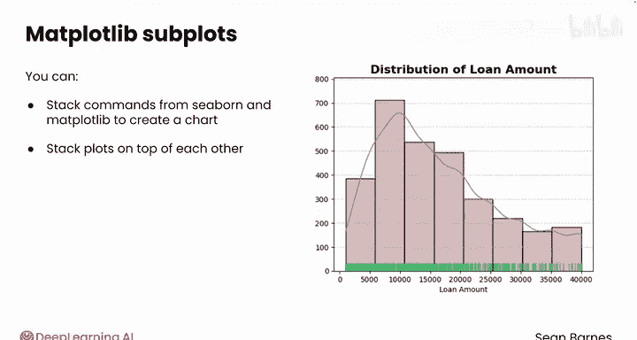

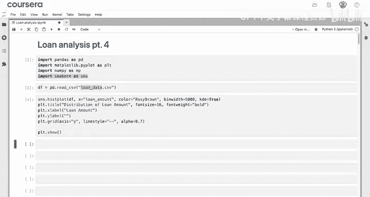

the shape of the distribution and the location of the individual data points noticeice that this is a CBborn and plot function you can just stack this plot right on top of the previous plot always start a plotting function with the data frame set X equal to the loan amount and now you can see the individual values Now what other options do you have here you can give the rug data points of color if you're not sure what an appropriate complementary color for the rug plot is to your histogram color you can try to ask your LLM for a suggestion。

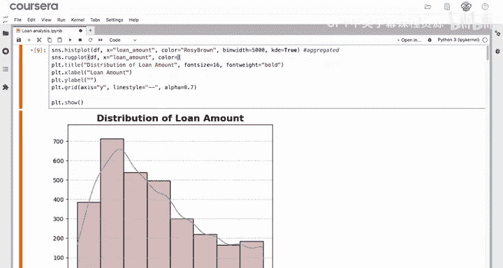

So the LLL describes some aspects of color theory， and then it gives you a couple of suggestions like pale green or medium sea green。

 let's try medium C green。

Okay， great， that looks pretty good。

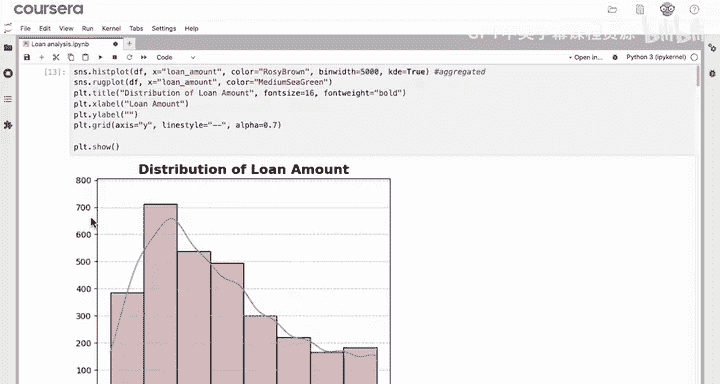

By the way， you can create a similar effect for a box plot using a strip plot。

 Here's a brief example using the segmented box plots for loan amounts from a previous video。

 The different points represent the individual values， just like the ticks in a red plot。 Again。

 this type of plot shows you the value when you combine that individual data points with the aggregated box plots。

 In this case， you can see there's a lot more observations in the data for grades A through D and fewer observations for grades E through G。

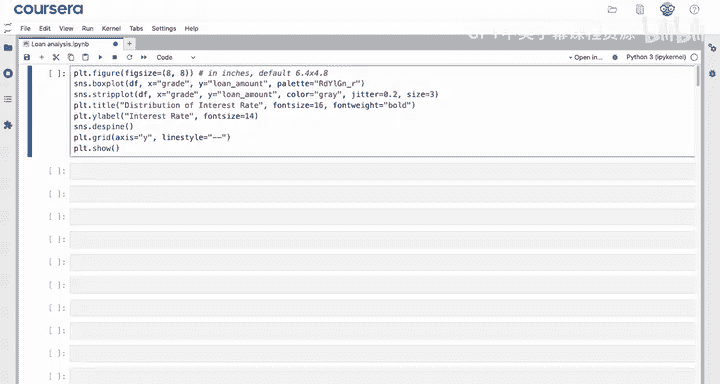

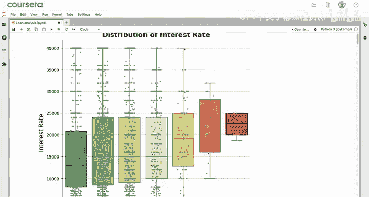

You can plot many different combinations of charts on top of each other。 For example。

 you may be interested in plotting multiple histograms together on the same axes to compare distributions。

 For example， if you're interested in comparing the distribution of loan amounts for A and D grade loans。

 you can first filter these into two separate data frames。

A's only for when the grade matches A and D's only for when the grade matches D。

 Then you can just go ahead and reuse the histogram code。

 changing this data frame to A's only plus add another hist plot。

 just like you stack the rug plot on top here， you can just stack another histogram here too。

 this time for D's only you can keep all the same parameters except the color which you can keep as the default blue for the second histogram。

 So you can see the D loanss have a less skewed distribution。 And for the most part。

 a loans appear to be more common。 since there are only a few bins where D loanss outnumber A's in the 20 to 30000 range。

 Since you have two plots， by the way， you could call plot do show twice to see each of them individually。

 if you like。

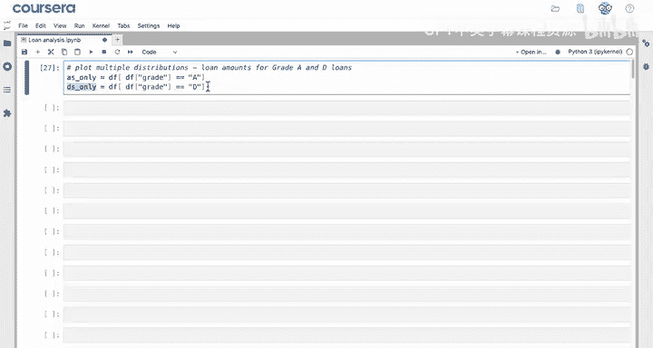

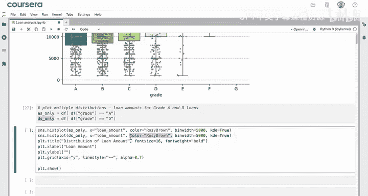

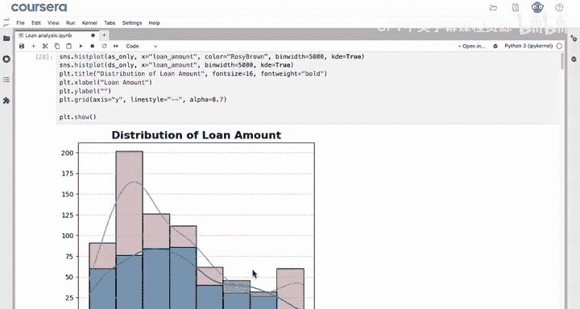

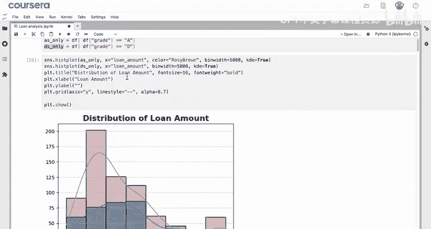

Notice that in your first histogram， you don't have any of the other editions like title， X label。

 a grades shown in that chart， you may also notice the Y limits are different between the two charts。

 which actually makes them harder to compare to each other。

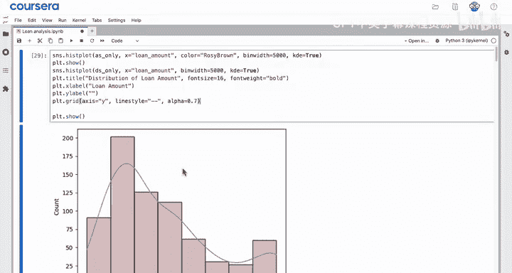

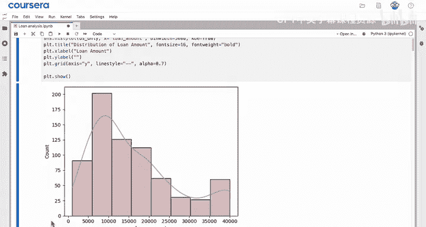

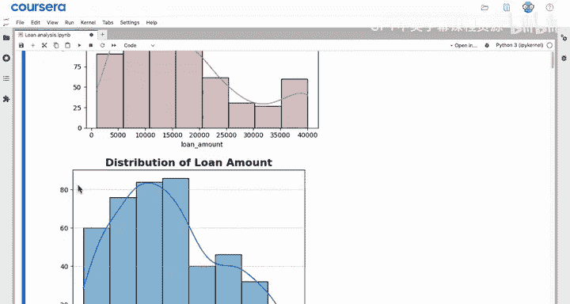

You saw how to create a rug plot and stack it on top of your existing histogram。

 The rug plot is a disaggregated plot that gives you insight into how the individual values are positioned within the aggregated distribution shown by the histogram。

 You also saw how to combine a strip plot with a box plot for the same effect。 Finally。

 you learn how to overlay multiple histograms on the same chart to compare distributions。

 This overlay effect can be accomplished just by creating two plots in the same figure。😊。

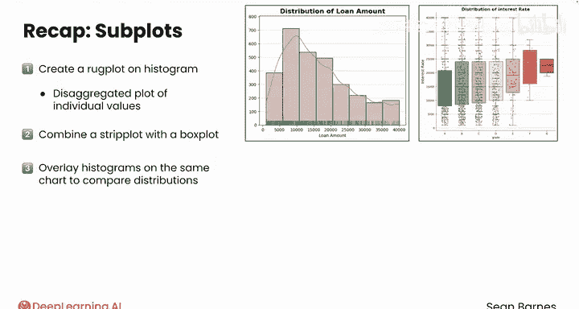

You can stack two，3 or more charts together using seaborn and Mapllib。

 Just be mindful of not overwhelming your audience。 Use some restraint In the next video。

 you'll learn how to combine many individual plots into the same figure or image。 I'll see you there。

😊。