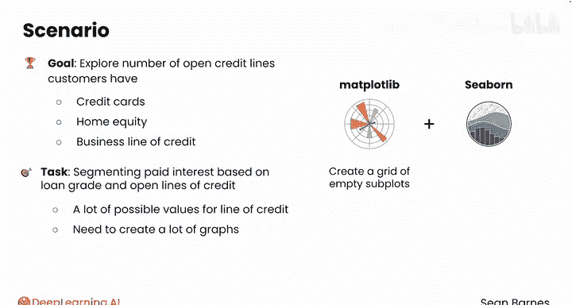
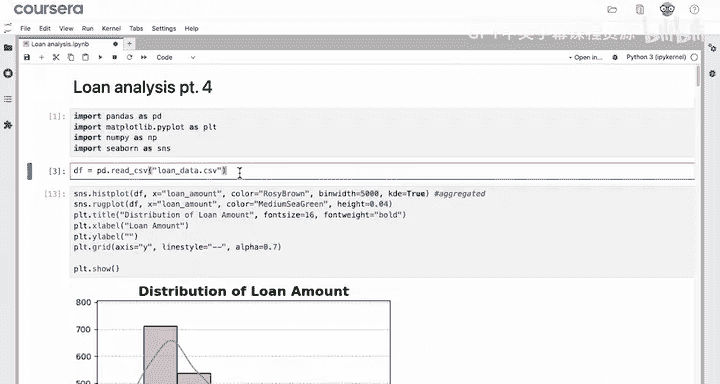
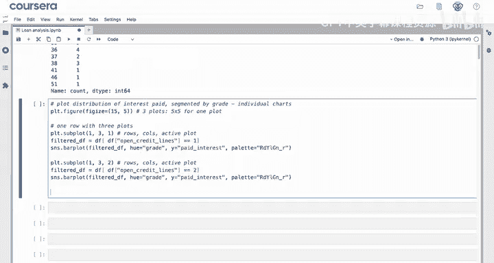
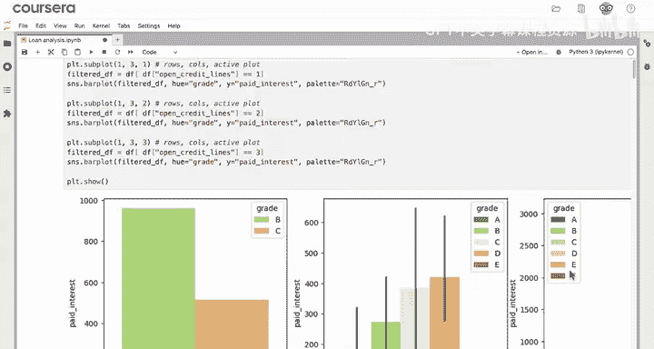
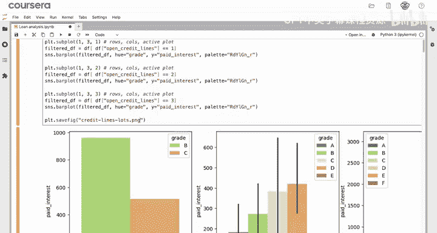
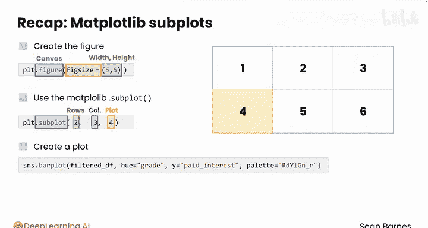

# 吴恩达《Python数据分析（数据分析第3课）｜Python for Data Analytics》中英字幕 - P59：58_Matplotlib子图.zh_en - GPT中英字幕课程资源 - BV1rp5yzjEgn

Often， one chart isn't enough。

For example， if you're segmenting by a feature with many possible values。

 you may want to create separate plots for each value to do that。

 You can use mapplotlib's subplot function。 It's very fast and flexible to better understand the profitability of different segments of the potential customer base。

 You're looking into the number of open credit lines customers have。

 A credit line allows you to repeatedly borrow money up to a certain limit。

 A credit card is the most common type of credit line。

 but others include home equity or business lines of credit。

 You're interested in segmenting paid interest based on loan grade and open lines of credit。

 The catch is that there are a lot of different possible values for line of credit。

 You'll need to create a lot of graphs。 You'll want to combine the strengths of Matplotlib and Cborn for this operation。

 You'll first want to create a grid of empty subplots using mapplotlib。

 then fill it up with appealing cborn plots。 Just to recap。

 you've imported your modules and loaded your data into the Df variable。

 taking a look at the open credit lines feature。 Let's eyeball the distribution。

 Even though this feature is numeric。 you can still use value counts to understand。😊。

Frequencies of different values running this cell， there are a lot of different possible values。

 Remember， you can use the sort index method to sort these values from one to whatever the maximum is。

 So most of these customers have between five and 15 lines of credit Now you can plot the distribution of interest paid segmenting by grade within each individual chart to create many plots in one image。

 you can use matpllibs subplot function First， manually set the figure size。

 The figure is like the canvas， and you want to make sure that the canvas is large enough to draw all these individual plots。

 supposeose you want to create three plots one for each of the first three number of credit lines。

 How do you want to arrange them。 One option is one row with three plots。 start with plot do figure。

 Then you want to say fake size equals。 and then the height and width。

 remember these values are an inches。 you can start with5 by5 for one plot。

 It's typically a good size。 and you can play around with this。 But since you have one row。

 the width can be 15 So three plots times 5 inches。

 and the height can just be5 Now you're going say plot。subplot with three arguments the rows。

 columns， and which plot you're actively creating。So there's only one row。

 there's three columns and you're creating the first plot。 Now you can filter your data frame。

 So filter Df open credit lines equals1。Then you can create SN S barpl with the filter data frame as the first argument。

 Remember， always start with the data frame。 Q equals grade Y equals paid interest。

 and for the palette， you can use red yellow green reversed。

 which you previously used to map onto grades。 Now you can copy this code and basically do the exact same thing again。

 You just need to change two things。 You're doing the second subplot。

 and you want to open credit lines equals equals 2。 That's it。 Copy this again。

 Now you're creating the third plot for open credit lines equals equals 3。

 Run this cell and you get these three bar plots next to each other， and they're all in one figure。

 Cool， if you want to save these all together， you can say plot do savefiig and then maybe credit lines plots P andG。

😊。

Now you actually have all three of those in the same plot， which is super convenient。

To recap， subplots are useful when you want to combine several plots in a graph。

 especially when those plots are similar。You'll need to explicitly create the figure which acts as the canvas with the named argument fig size。

 specifying the width and height of the entire figure。

 You saw that about 5 inches by 5 inches per plot works well。

 but you can experiment with other sizes too。 Then you saw that you need to use the matplotlib subplot function with three arguments。

 The number of rows， the number of columns and the plot you're currently creating。

 calling this function right before creating a plot will position it in the correct place in the image。

 For example， plot do subplot 2，3，4。 will position the next plot as the first in the second row with each row having three plots。

 After calling the plot subplot function。 You can create a plot as you normally would。

 you can use a combination of seaborn and matplot live functions。

 Be aware that there's a separate subplots plural function that provides more options for creating subplots。

 You can investigate that function with your LLM。 if you'd like。

 You may have noticed some repeated code in the demo for this video。

 Subplots can be created individually like you just saw， but there more powerful。😊。

When paired with loops， follow me to the next video to see how to create dozens of plots with just a few lines of code。

