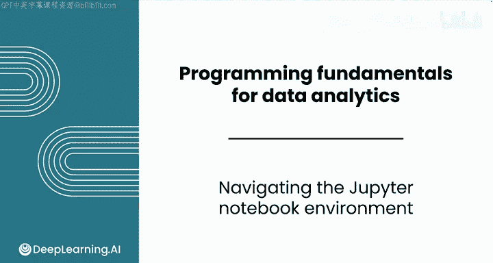
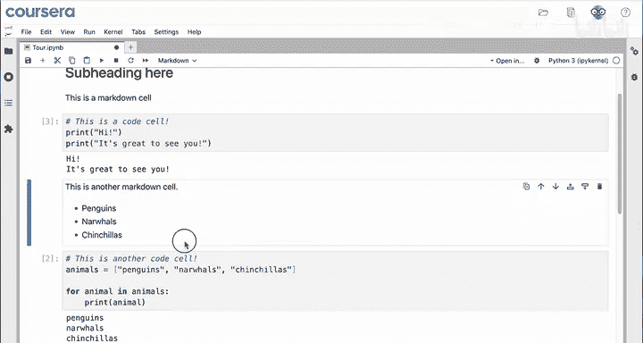
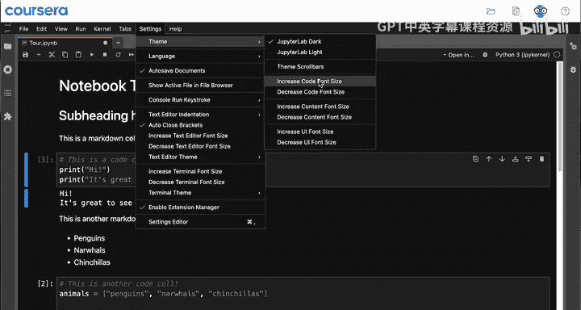
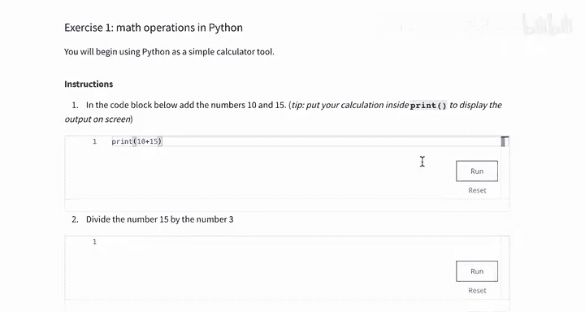

# 吴恩达《Python数据分析（数据分析第3课）｜Python for Data Analytics》中英字幕 - P5：4_Jupyter Notebook环境导航.zh_en - GPT中英字幕课程资源 - BV1rp5yzjEgn

In this course， you'll be using Jupyter notebooks for coding。

 an industry standard tool many data analysts use daily。Let's take a tour of the interface。

 Rill be Cody。This is a Jupiter notebook interface in Coursera。

 the same one you'll be using to complete the labs in this course。 This is where you'll be coding。

 It's basically a special type of text editor。 Can you see the similarities with Google Docs。

 you have the name of the file up here in the top left and a bunch of options in the ribbon。

And then you have this main area where you can edit text and code the notebook itself is essentially a text document。

These different areas of the notebook are called cells。

 and they allow you to divide up your notebook。Some of these cells are text cells。

 and they allow a type of formatted text called Markdown if you double click on the cell。

 you can edit the RA markdown， so for example you could add a subheading here。

Writing Markdown won't be the focus of this course。

 but it does enable you to provide nicely formatted context for your code pressing Shi enter a role render or display the markdown according to its formatting you'll see markdown throughout the labs in this course the other type of cell is a code cell like this one running this will print out Hi it's great to see you。

Shift En runs a code cell。 You'll need to remember this keyboard shortcut。

 It's the most important command and a Jupyter notebook。

 The output appears directly below the cell that was just run。 Here's another markdown cell。

 and here's another code cell。 Don't focus on the code too much。 But if you hint shift enter again。

 that will run the code。You can also click the run button up here in the toolbar if your code is taking a really long time to run and you need to interrupt it。

 you can press the stop button and if you want to start all over with the clean slate。

 you can hit this restart button and that will reset everything to the way it was before you ran any code This plus button allows you to add a new cell。

 You can add new cells in any of the practice or graded labs to experiment The numbers on the side of each cell indicate the order that you ran them。

 which helps you keep track of where you are in your code if you run a cell again the number changes。

 Looking at the ribbon up top you won't need to use most of these options。

 One useful option though is edit clear output of all the cells。

Sometimes output can get quite long and you may want to clean up your notebook in settings。

 you can change to the dark theme if you want to feel like a cool hacker。

 and under the theme menu you can increase the font size of the code or markdown text。

Notice this kernel menu， this notebook is basically a big text file containing your commands for the computer。

 it doesn't run the commands by itself。For that， you need the kernel。

 The kernel is essentially the engine of the notebook。

 It is the part of your computer that actually takes the commands and runs them。

 You don't need to worry about these kernel options。

 but it helps to know what the kernel isbove the notebook。

 you'll see this option for Corurseair Co which is a built- in LLM chatbot you can access at any time while coding you'll see it in action throughout the videos as well。

 So if you ask what is Python  for The coach will give you the response。

If you close the chat and reopen it， your chat history will be saved。

 so you don't have to worry about keeping that up if you want to reference it later。

 So this is all within Coursera。 The next item in this course is a practice lab containing all the notebooks you will see demoed in the lectures for this module。

 you can use them to follow along with the videos or to reference the code later。

 Many beginners find it challenging to get Jupiter notebooks set up on their own computer For now。

 you'll work with Jupyter notebooks only in Coursera and you'll learn some options for setting them up on your own computer and the final module of this course。

 This course also includes some reading items that allow you to practice your coding skills。

 These are optional but I encourage you to work through them， especially if you are new to coding。

Each code block acts like a cell in a Jupyter notebook， which you can write code in and run。

Complete the exercises and run the block to get some feedback。

Great work navigating the Jupyter notebook interface and code blockslock follow me to the next video to see some code examples in action。

