# 吴恩达《Python数据分析（数据分析第3课）｜Python for Data Analytics》中英字幕 - P60：59_子图循环绘制.zh_en - GPT中英字幕课程资源 - BV1rp5yzjEgn

As with most tasks in Python， there are many different ways to create subplots and Maplotlib。

 you can write a loop to quickly generate dozens of subplots that will save you a lot of time copying and pasting your code picking up where you left off you had read in your data into the variable Df and created a set of three subplots for the distribution of paid interest based on grade and open credit lines notice the repeated code when creating these figures if you find yourself copying and pasting like you did here typically you can use a loop instead。

 let's transform this code to use a loop to start， keep the figure size the same Now you just want a loop that goes through the numbers 1。

2 and3 which matches the lines of credit you were investigating。

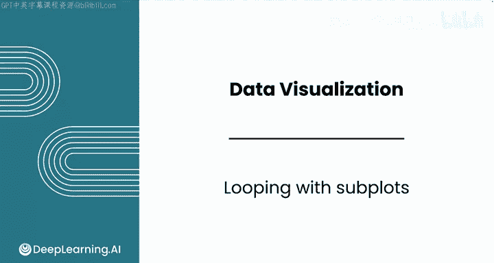

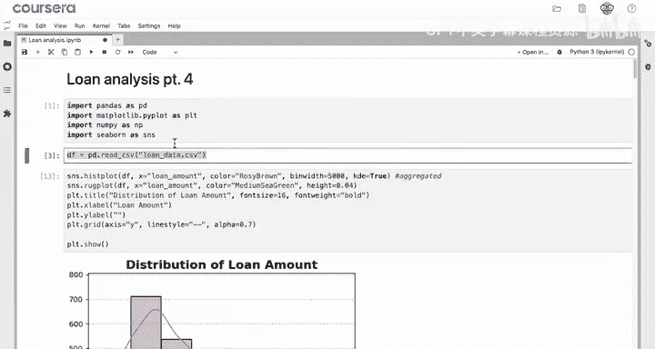

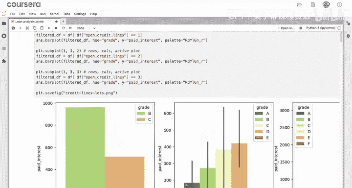

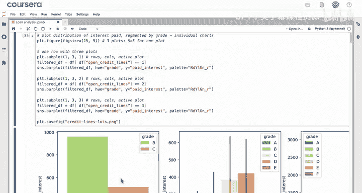

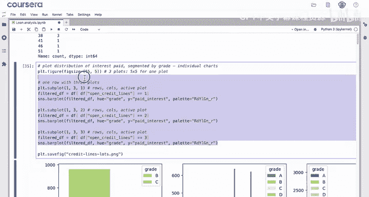

You can use the range function。 Ra can take one argument， as you've seen the end value。

 that creates a range from 0 to that value， or you can add two values， start and end。

 remember that the M value is not included in the range， it only goes to the n value minus-1。

 so you can use range 1，4 to get a range from 1 to 3。 So for I and range 1，4。 Now。

 looking at this plotting code from the previous video， what values change for each one。

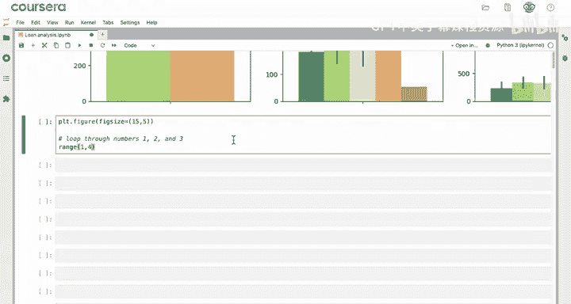

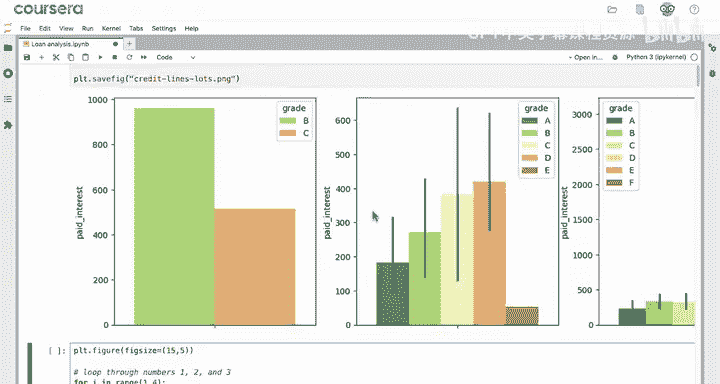

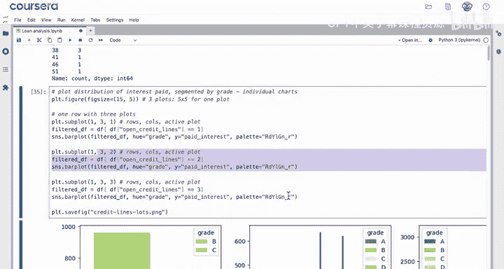

The index of the subplot you were actively creating and the value for open lines of credit That's it。

 So inside the loop， copy the code， then wherever that value was changing。

 you can use I instead there aren't any changes to the barpl of code。

 So what's going to happen here is this four loop is going to run for the values I equal to1，2 and3。

 it will select the appropriate subplot and filter the data frame to only include rows with I number of lines of credit Then you get the exact same plot you have before。

Writning this code， what should you see？Well， the exact same output as before。

 It's just that you reduce your code from 10 lines to 5。 Now。

 you can plot a ton of things with this loop。 It will work for any valid values of open credit lines。

 For example， you might want to graph distributions for credit lines 1 through 9。

 You'll need to make sure the figure size is larger，15 by 15 for 9 plots。

 Then copy and paste the same code as before。

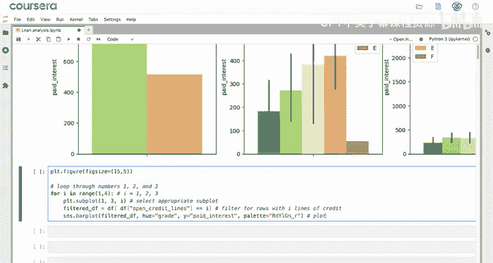

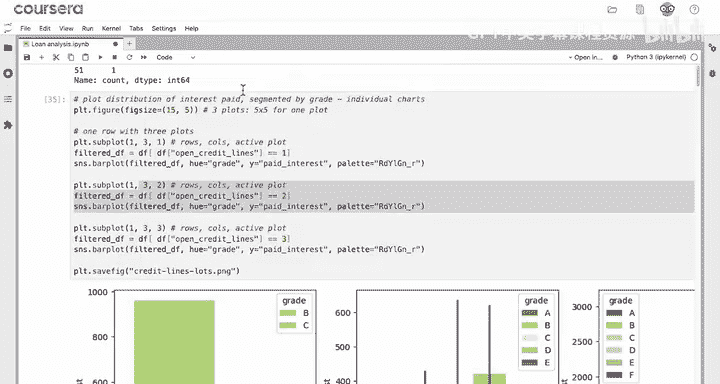

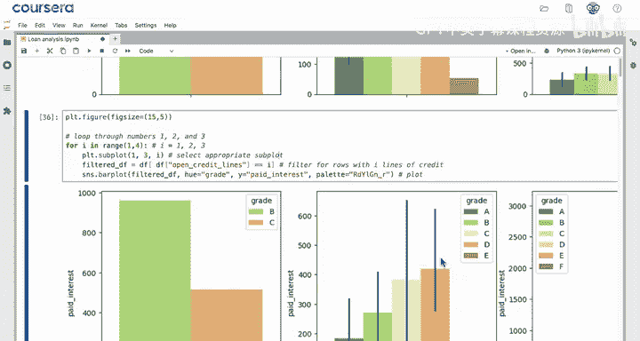

Can you tell what needs to be changed？The range for I and range 1。

10 instead of 4 and the dimensions of the subplot。 Now it's3 by3。

 That line of code gives you three plots in each row and three plots in each column。

 running this cell， you get these nice graphs here。 All nine of them together。

 you can add more things to your loop as well。 For example。

 you can use I as the plot title for each one。 that adds a much needed label。

 And if you use plot got save fig。 let's say nine graphs as the title。

 Now all nine of these are stored together。

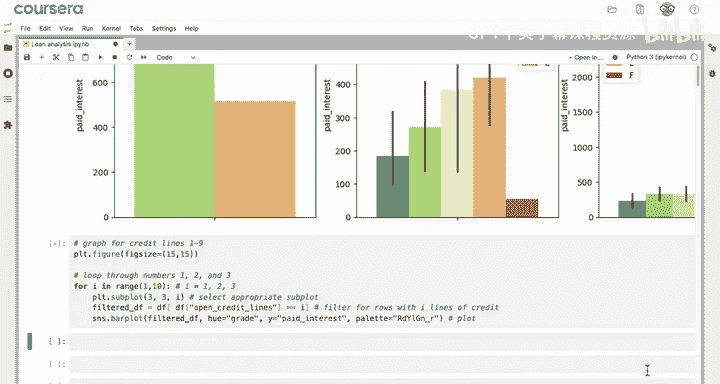

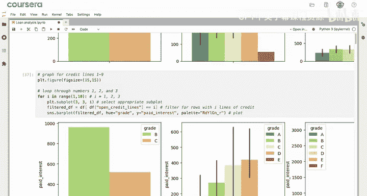

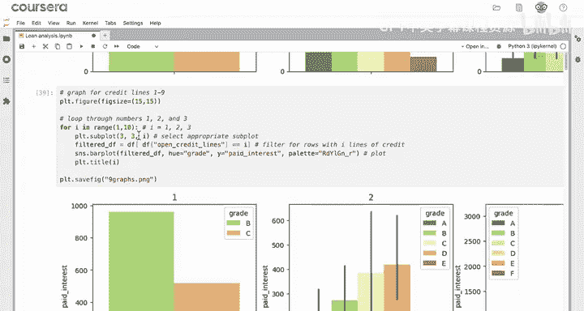

In this video you saw that you can use a four loop to iterate through the subplx。

 you used a loop through a range starting from one and ending one after the last number you were interested in。

 so you plotted the values 1 through9 for lines of credit using the code range 110 whenever you notice yourself copying and pasting that's typically a sign that you can use a control structure like a loop to help improve your code's efficiency and readability。

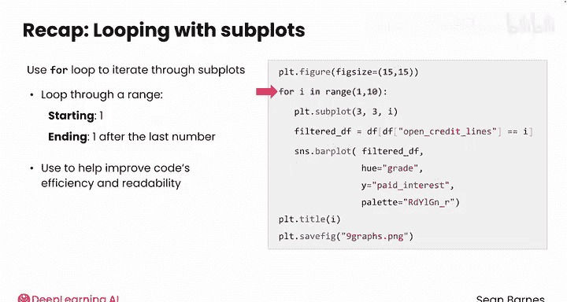

Maapplloot Live's subplot function is incredibly powerful for creating many graphs at once。

 Seaborn 2 has many useful options for creating multiple graphs together。

 followow me to the next video to learn a crucial one pairplloot。

