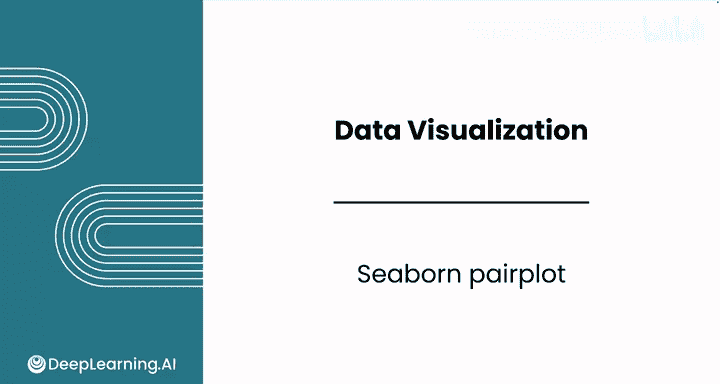
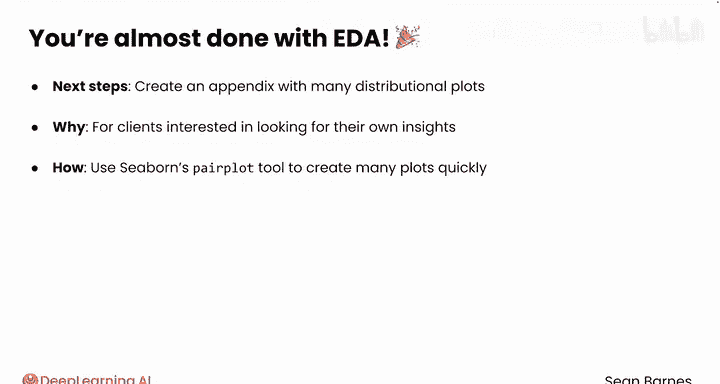
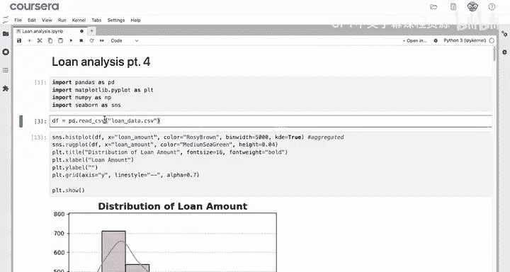
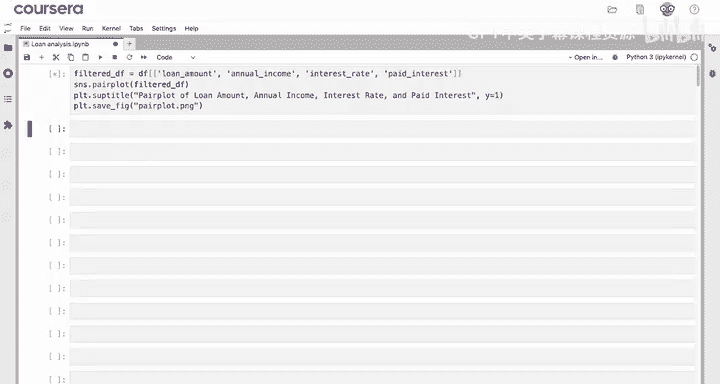
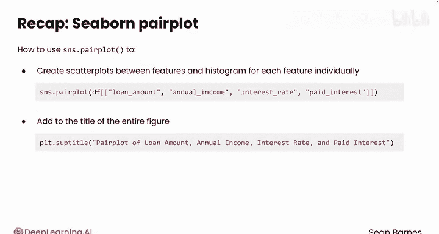

# 吴恩达《Python数据分析（数据分析第3课）｜Python for Data Analytics》中英字幕 - P61：60_Seaborn配对图.zh_en - GPT中英字幕课程资源 - BV1rp5yzjEgn

CbornN provides a special function calledPplot for creating many plots at once based on the features in your data Let's take a look at how you can use it You're almost done with your exploratory data analysis and you'd like to create an appendix with many distributional plots for your clients in case they're interested in looking for their own insights to do that。

 you can use Cborn's Peplot tool to create many plots quickly just to recap you've imported your modules and loaded your data into the DF variable。

Pairplot is useful for exploring relationships between features。

 sayy you want to look at some of the most crucial features in the dataset for predicting loan profitability。

 loan amount， annual income， interest rate and paid interest。

 select the subset of columns you're interested in。

 then use SMS pairplot with the filter data frame Add plot show and voila you get scatter plots showing the relationship between all the features as well as the histogram of each feature down the diagonal。

 So you've seen the histogram of loan amount before。

 now you can also see its relationship with annual income， interest rate and paid interest。

 you can use plot soup title to add a title to this entire figure rather than just the individual axes。

 its shorthand for supertitle say pairpl of loan amount， annual income。

 interest rate and paid interest。 you'll want to use the y named argument to move this supertit a little bit higher than the plots in this figure。

 a value of one or slightly higher should do the trick。

 Now because there are multiple plot types and plots， you don't have all the same。

For customization like you normally would like color， line style and so on。

 but you can always work with your LLM to explore additional formatting options to cap off your exploration and create your appendix。

 you can use plot。afiig with the file name Peplot。pG Now you have all these plots together。

To sum up， you learn how to use SMSS。Pplot on a data frame to create a set of plots。

 scatter plots between features， and a histogram for each feature individually。

 you also saw the option to add a plot。 soupupt to title the entire figure you work with an LLM to customize the look of your pair plot。

That's a wrap on visualization in Python You've learned all the core tools you'll need to create beautiful and functional visualizations from pandas to Mapltlibb to Seabornour These three libraries form the backbone of data visualization in Python and you'll rarely find the need to reach for something else coming up you'll complete the graded assignment and lab for this module once you finish the graded assignment and lab follow me to the next module of this course which is all about inferential statistics including confidence intervals。

 hypothesis testing and a new technique， linear regression I can't wait to see you there。

