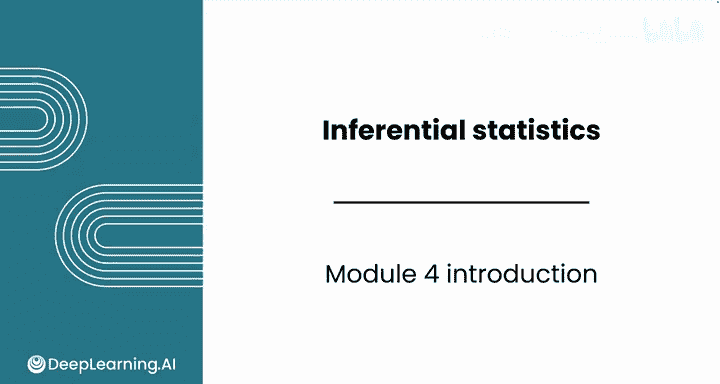
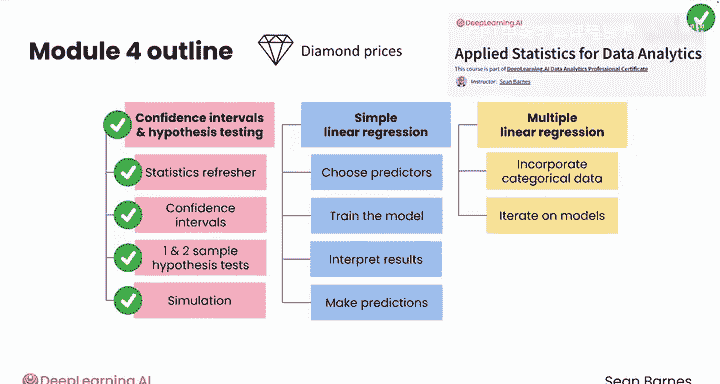

# 吴恩达《Python数据分析（数据分析第3课）｜Python for Data Analytics》中英字幕 - P62：61_模块4 简介.zh_en - GPT中英字幕课程资源 - BV1rp5yzjEgn

Welcome to module 4 Inferential statistics In this module。

 you'll learn how to make predictions and draw meaningful conclusions from data using powerful statistical techniques in Python。

 In the first lesson， you'll explore confidence intervals and hypothesis testing for means using a realworld data set of diamonds you'll refresh your understanding of standard errors and P values and learn how to calculate a confidence interval and a single line of code。

 you'll perform one sample and two sample hypothesis tests and explore techniques for simulating thousands of data points from different distributions The second lesson focuses on simple linear regression you'll learn what linear regression is and why it's useful for modeling relationships in your data you'll learn to choose the strongest predictors for your model。

 train the model， interpret the results and use it to make predictions In the third lesson you'll expand your modeling capabilities by incorporating multiple features as predictors you'll learn how to incorporate categorical data into your model and how to iterate on your models to improve accuracy。

😊。

Aside from linear regression， you should be familiar with the statistical concepts in this module if you've taken applied statistics for data analytics。

 it's okay if you don't remember every term and calculation。

 but if the terms confidence interval and hypothesis test are new to you you should make sure to go back and take that course before continuing This module will include a brief review of key concepts covered in that course but won't teach them in depth by the end of this module。

 you'll be able to apply inferential statistical methods to analyze data and build predictive models in Python follow me to the next video to begin。

