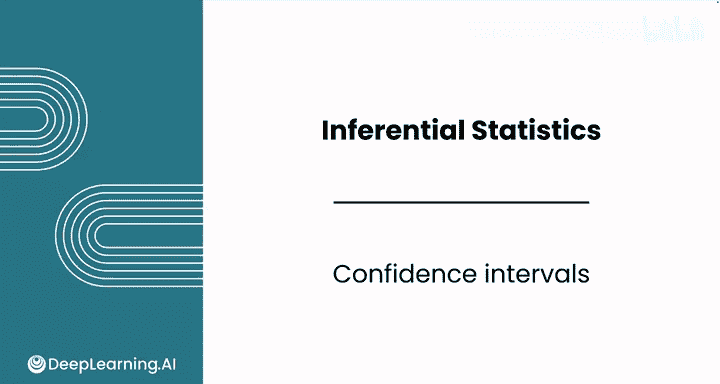
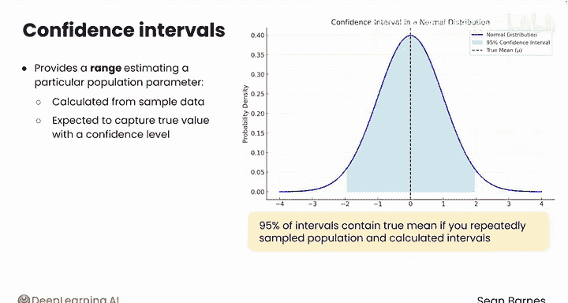
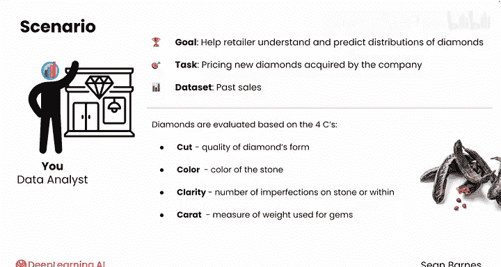
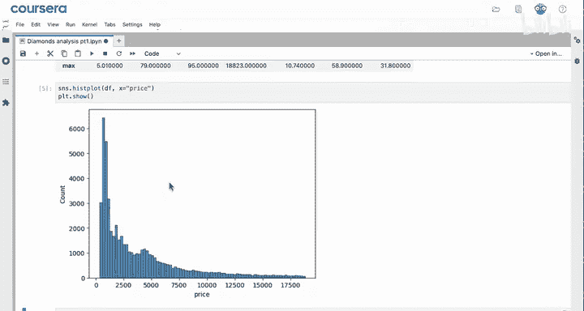
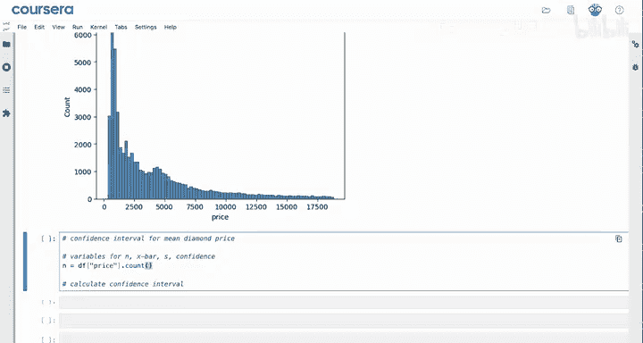
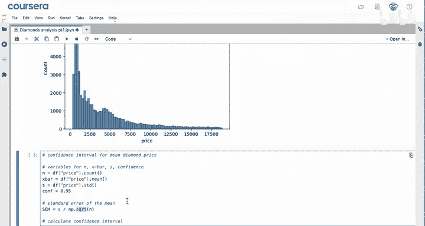
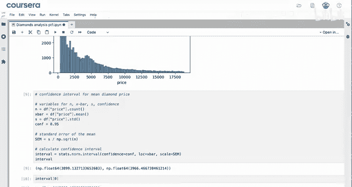
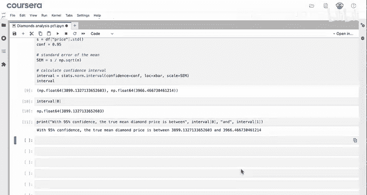
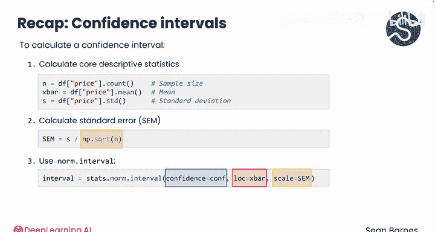

# 吴恩达《Python数据分析（数据分析第3课）｜Python for Data Analytics》中英字幕 - P63：62_置信区间.zh_en - GPT中英字幕课程资源 - BV1rp5yzjEgn

Inferential statistics underpins the rigorous analysis you conduct as a data analyst。

 Python provides powerful tools for calculating confidence intervals for means Let's see how recall that a confidence interval provides a range estimating a particular population parameter like a mean or proportion the interval is calculated from sample data and is expected to capture the true population value with a certain confidence level if the same sample process is repeated in many times at a confidence level of 95% for example。

 which is quite common you would expect 95% of intervals to contain the true mean if you repeatedly sample your population and calculated confidence intervals recall that to calculate a confidence interval you'll need four values the sample statistic you're interested in like the mean or proportion the sample size and the sample standard deviation you'll use both of these values to calculate the standard error of the sampling distribution you're investigating and you'll need the desired level of confidence such as 0。

95 for 95% confidence interval remember if these statistical concepts are new to you you should。

vissit the previous course and misspecialization App statistics for data analytics。

 which teaches the nuances of inferential statistics。

 This module only gives a brief review of each concept。

 If you're a bit hazy on the vocabulary don't worry though will step to the calculations together So you're working on a new project You're a data analyst working at an online jewelry retailer and are tasked with pricing new diamonds acquired by the company you're working with the data set of past sales to help the retailer understand and predict the distribution of diamonds they can expect to need prices for diamonds are evaluated based on a set of core characteristics known as the four Cs cut color clarity and carrot cut refers to the quality of a diamonds form Well cut diamonds are symmetrical and reflect light well giving them a sparkly appearance color is just that the color of the stone。

 the clearer the diamond the higher its color grade yellowlower diamonds are less valuable Cla refers to the number of imperfections on the surface of the stone or within it clearer diamonds are more valuable。

 Carrot is a measure of。Weight used for gems。 A one carrot roundcut diamond is about the size of a green pe。

 The term carrot actually comes from the carib seed。

 which was historically used to weigh precious stones。

 Your first task is to estimate the mean price of diamonds sold by your client。

 the retailer Start by importing all the modules you'll need The s module is typically used for inferential statistics。

 It has additional capabilities beyond what pans and nu offer a alone。 So you'll import s stats。

 the statistics part of spi as stats。 If you didn't say as stats。

 you'd have to type this entire s do stats name every time you want to use it load your data。

 which is stored in the file diamonds cv。 remember this line of code works only if your cv file is in the same folder as your notebook。

 which it is in this case。 you won' need to do any file management in the labs for this course。

 but just so you're aware of how it works。 Take a look at the first few ropes。

 Each observation is a diamond and each column is a feature of that diamond。

 You can use Df got described to learn more about each feature there are almost。

4000 rows， which is an excellent amount of data to work with to create an accurate estimate of the population of diamonds。

 The mean price is around $4000 dollars， and the largest diamond was about 5 caratts。

 which is quite large。 I'm guessing that may have been the $18000 diamond。 Finally。

 you can use S M S do his plot D F X equals price for visualization of that distribution。

 It's quite skewed。😊，That makes sense。 More expensive diamonds should be rare。 Remember。

 even though this distribution is skewed， you expect the sampling distribution of the mean to be normal。

 So a confidence interval is still appropriate here。

 use comments to set up the calculations you need to create your confidence interval。

 You're calculating a confidence interval for mean diamond price。

 You'll want to declare variables for your sample size sample mean sample standard deviation and desired confidence level。

 Then you can calculate your confidence interval。 Start with n。

 which you can find using Df price do count。 you already saw that each column is the same size。

 but it's best not to assume the mean is just df price do mean。

 Standard deviation is the column SD and desired confidence is 0。95。

 to calculate the standard error of the mean。 you'll use the S over m square root of n。

 This square root function is from nu。 Now， that standard error is quite small。

 So even though the mean price is around $3900。 the standard deviation is only around $17。

 That's in part because your sample size is so large。😊。

Wwhichch narrows your estimate Finally， to calculate the confidence interval。

 you'll use the stats do norm interval function。 Take a look at the name of this function。

 It's generating an interval from the normal distribution。 You could use the T distribution。

 but your sample size is so large that the two distributions will be nearly identical。

 Your arguments are confidence equals compf Lo， which stands for location is X bar and scale is SeM。

 save that in the variable interval running that cell。 you get a pair of floats。

3899 and 3966 This output is actually a sequence so you can access each item in this sequence just as you would with a list。

Why not clean this up with a nice print statement with 95% confidence the true mean diamond price is between then the lower bound is the first item in the sequence so you can use index0 to access it interval 0 between that and interval1 that looks much nicer。

 you can share this with your stakeholders to recap。

 you can use the stats norm interval function from the s pi module to calculate a confidence interval for your data。

 First， calculate the core descriptive statistics。 sample size mean and standard deviation。

 you saw how to use themp do square root function as part of the standard error calculation and you use the norm do interval function with the named arguments confidence look for the mean and scale for the standard error。

 So with this result， you can be pretty confident that the true mean diamond price is somewhere close to $3900。

I bet this confidence interval stuff is all coming back to you。

 don't worry too much if you're a little rusty on some of the concepts you'll have a chance to review in the upcoming practice lab For now。

 follow me to the next video to calculate one sample T test in Python。

