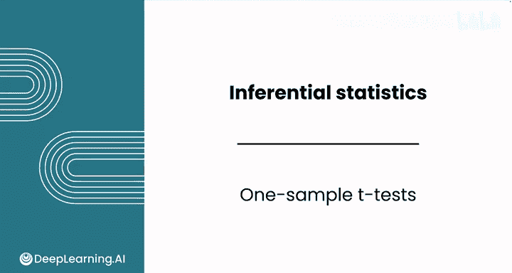
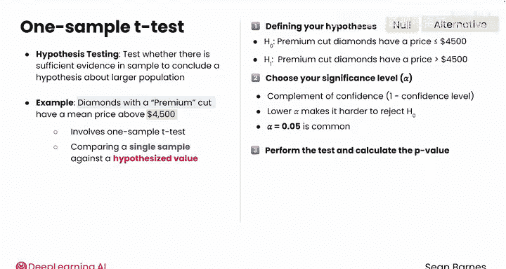
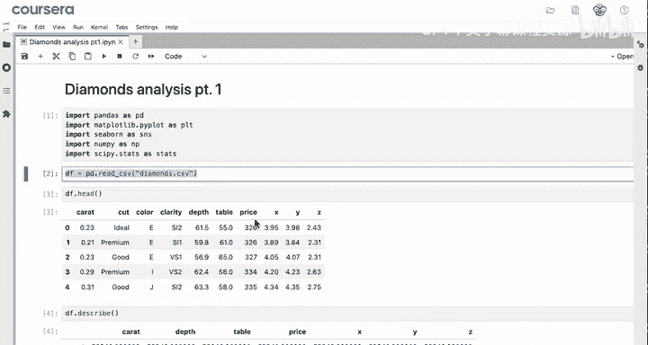
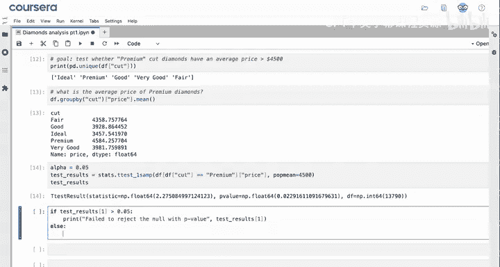
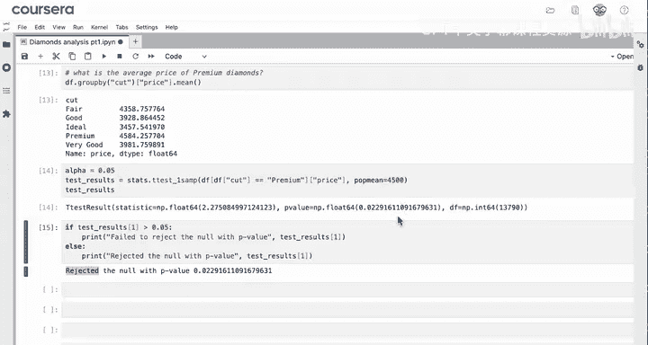
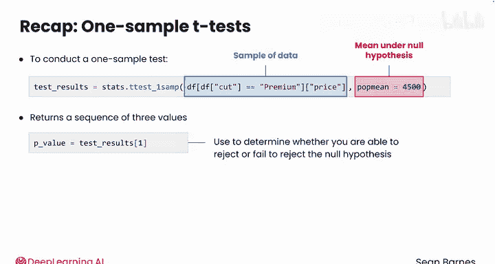

# 吴恩达《Python数据分析（数据分析第3课）｜Python for Data Analytics》中英字幕 - P64：63_单样本t检验.zh_en - GPT中英字幕课程资源 - BV1rp5yzjEgn

Now that you're feeling confident about confidence interval intervals in Python。

You can expand your inferential skills to hypothesis test。

 Let's start with the one sample T test As a reminder。

 hypothesis testing is used to test whether there is sufficient evidence in a sample of data to conclude a particular hypothesis about the larger population For example。

 say you're working on a new section of your analysis for the online jewelry retailer and you're interested in testing whether diamonds with a premium cut have a mean price above $4500 This problem involves a one sample T test because you are comparing a single sample premium cut diamonds against a hypothesisthesized value $4500 rather than comparing two samples like premium and ideal cut diamonds recall that the steps for performing a hypothesis test involve first defining your hypothesisses the null hypothesis which represents the status quo or baseline For example in the diamonds case。

 your null hypothesis would be that premium cut diamonds have a price of $4500 or lower your alternative hypothesis states the condition you're looking to test for example。

 that premium cut diamonds have a price。Greater than $4500 Next。

 choose your significance level alpha， which is the complement of confidence。

 So one minus your desired confidence。 It represents how easily you can reject the null hypothesis。

 High confidence means lower alpha which makes it harder to find evidence to reject the null alpha equals 0。

05 is common So one minus your desired confidence。 Finally。

 you'll perform the test and calculate the P value the probability of observing your data or something more extreme under the assumption that the null hypothesis is true。

 if your p value is below alpha， you can reject the null hypothesis whereas if your P value is above alpha you fail to reject your null hypothesis in the case of the premium cut diamonds test rejecting the null hypothesis would mean you have significant evidence that these diamonds are on average above $4500 Fa to reject the null would mean you don't have enough evidence for this claim while you've seen these terms before。

 you can review the materials from the applied statistics for data analytics course if you'd like a refresher continuing where you。

DsYou've imported your modules and read in the data into the variable D remember。

 you're interested in testing whether premium cut diamonds have an average price above $4500。

Start by looking at the different possible values for cut。

 Remember that filtering for specific categories is case sensitive。

 so you should take a look at exactly how premium is represented in the data。

 There are five different values and premium is capitalized。 So at this point， you may wonder， well。

 what is the average price or premium diamonds in the sample。 How could you find that。

 One strategy would be to group the data by cut and find the average price for each group。

 So Df dot group by cut。 Then select the price column and call do mean。 Inter。

 the average price for premium cut diamonds is $4584。 What's your prediction。

 Do you think this value is significantly different from $4500。Let's test it。

 start by defining alpha 0。05。Again， you'll use spi dot stats。 In this case。

 the T test underscore one sample function。 The first argument is the sample data。

 Just use a single column， the price。 Make sure to filter for only premium guidance。

 So stats do T test underscore one sample。DF Df cut equals equals premium and then select the price。

 then you'll need to specify pop mean， the mean under the null hypothesis， in this case， 4500。

Save that in a variable such as test results， which you can then print out。Running the cell。

 you get a T test result containing the test statistic， P value and Df， the degrees of freedom。

 the P value looks like 0。023。 so that's a pretty small number。 Again。

 you can print a nice output to show the results of your test and if statement would be nice to share whether you have or haven't rejected the null hypothesis。

 So taking a look at this T test result。 P value is the second item in the sequence so you can access it with the index1。

 If test results 1 is greater than 0。05， you fail to reject the null with P value test results1 else you rejected the null with the same P value。

Running this cell， you rejected the null with this relatively small P value。

 even though you can just eyeball the result based on this P value。

 the if statement will help you scale to mini test to recap you use the sip pi stats do T test1 sample function to conduct a one sample T test The first argument is the sample of your data just one column in this case the diamond prices for premium cut diamonds then you provide the mean under the null hypothesis as the argument pot mean in this case you use the value 4500 This function returns a sequence of three values with the second being the P value you can then use this P value to determine whether you're able to reject or fail to reject the null hypothesis。

Now that you've conducted a one sample T test in Python， you're ready to tackle the two sample tests。

 You'll find a lot of similarities。 Follow me to the next video to learn more。😊。

