# 吴恩达《Python数据分析（数据分析第3课）｜Python for Data Analytics》中英字幕 - P65：64_双样本t检验.zh_en - GPT中英字幕课程资源 - BV1rp5yzjEgn

You'll often want to compare two groups directly in a hypothesis test rather than comparing one group against the hypothesized value。

 Let's take a look at how to conduct a two sample T test in Python。 As your next task。

 you're interested in comparing average prices among the different diamond cuts。 Premium， ideal。

 good and so on。 This analysis will help the online retailer you're working with。

 Under which cut of diamonds to market to which customers based on their price to investigate these prices further。

 you can use a two sample T test to determine whether two groups of diamonds have significantly different prices on average。

 In particular， your client has let you know they're unsure whether good and very good cut diamonds should be priced differently。

 Conti on in the same notebook you've imported your modules and loaded the data into the variable Df。

😊。

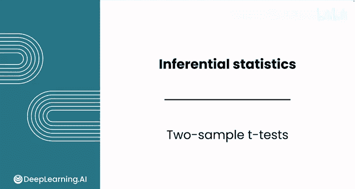

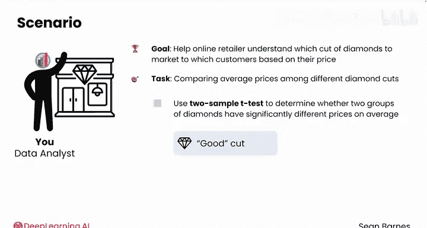

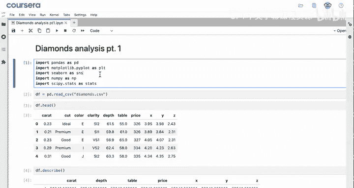

To create a nice visualization of this data， you're going to group your data by cut。

 select the price， calculate the mean， sort the resulting values。

 and then plot them using a bar chart。This first part is the exact same step that you conducted in the previous video。

 Add plot do show for hygiene purposes。 Running this cell。 hm， that's a little odd。

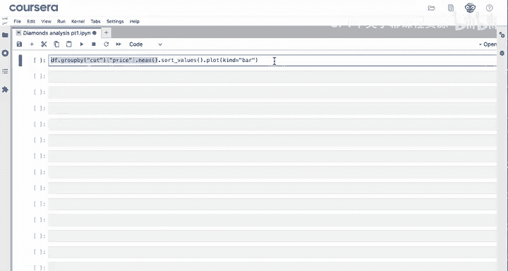

I don't know about you， but I wouldn't have expected fair cut diamonds to be on average pricier than ideal cut ones。

 would you have？Looking again at the values for average price。

 good and very good diamonds appear to have quite similar prices。

 you can use a two sample T test to determine if that similarity is statistically significant to further set your expectations。

 You can look at box bos of the distribution of price based on the cut Seaborn makes that possible in a single command。

 S andS box plot。 Remember the first argument is the data frame set X as price and Y is cut by default。

 the categories and cut are not going to be visualized in a proper order so you can ask your LLM to help you reorganize the order of the cut categories。

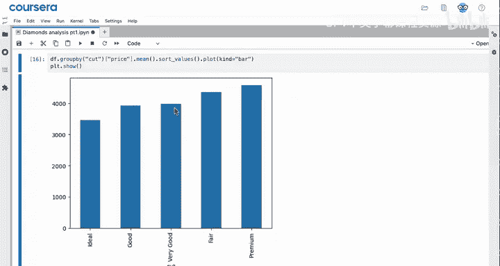

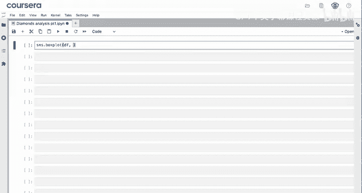

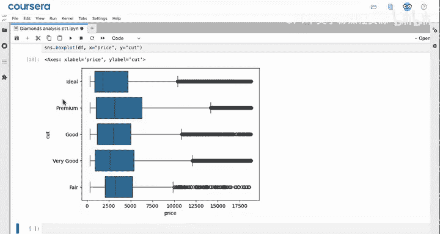

It looks like you can just copy this order named argument。

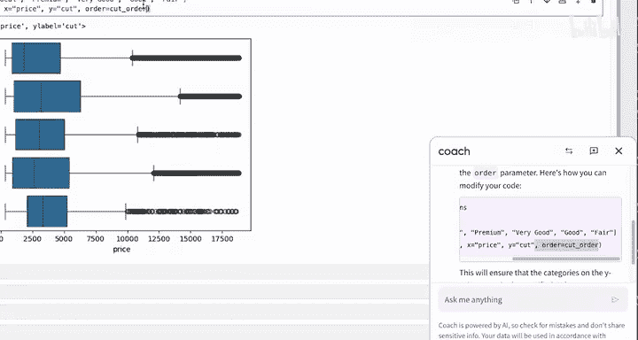

Okay， now it looks like the cut categories are in the order that you want for palette。

 you could use a sequential color map because the cut categories are an order of quality。

 You could try blues reverse for this。 You could ignore this future warning is something you've seen before。

 Don't worry too much about this。 Running that cell。

 notice that the median values for good and very good or different and very good diamonds have a larger intercorrtile range。

 indicating potentially higher variability。 but overall。

 it's not clear whether the mean price is significantly different between these two categories。

 So let's test this difference。 You can use stats dot t test end within standing for independent。

 here assuming that these diamonds are from two completely independent distributions。

 That's a valid assumption here。 There's no relationship between a diamond in the very good subset and a diamond in the good subset。

 You'll include two arguments。 First， the price column from the data frame filtered for very good cut diamonds and the same column for only good cut diamonds。

😊。

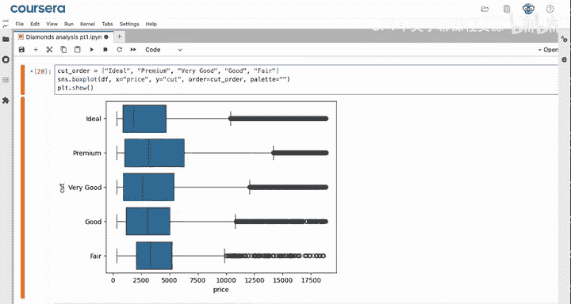

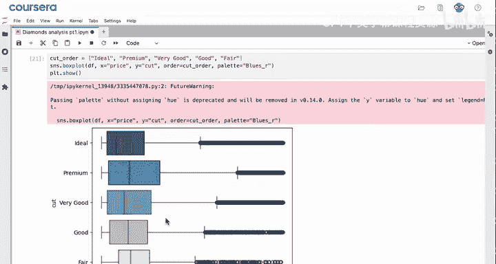

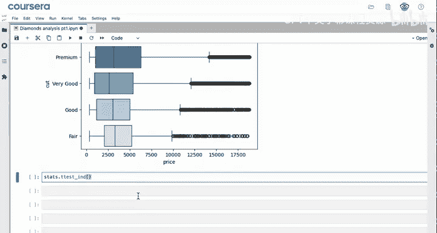

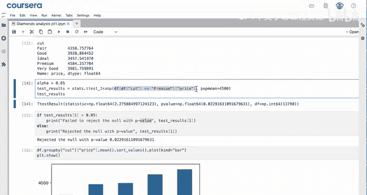

This is a long line of code， so you can save these columns into variables to make your code easier to read。

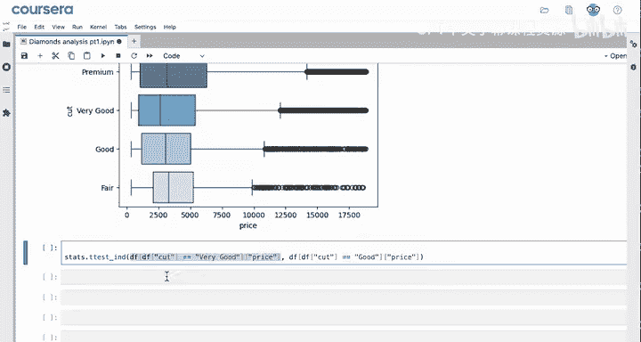

You don't use a pot mean argument like you do in a one sample T test because the goal here isn't to compare the sample mean against a particular value。

 Instead， you're comparing the means of two different groups directly against each other。 Finally。

 save all this to a variable like test results and print them out。

 What kind of values do you expect to be in this variable Test results。

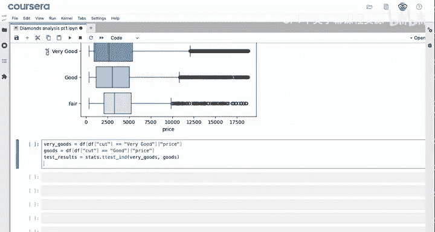

It's the same type as for the one sample test， T test results， check out that P value 0。41。

 iss that rare enough to reject the null hypothesis。

 you can borrow the same code as before to run your if statement。

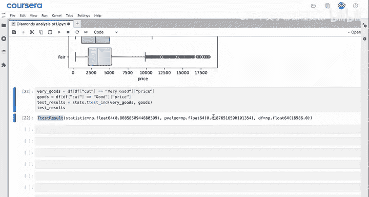

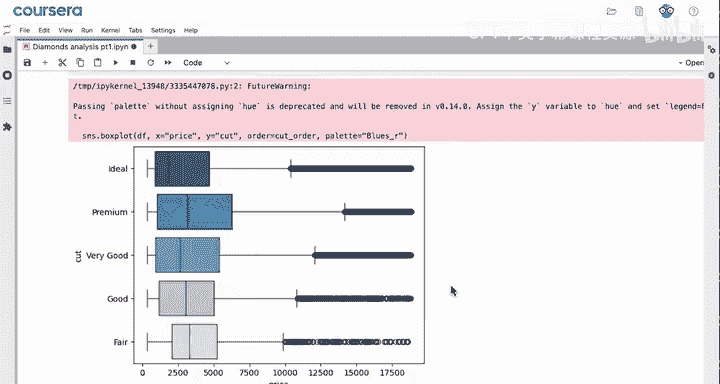

That's reusability running that cell， you get the output that you fail to reject the null hypothesis。

 That's a useful conclusion。 This test might help your clients develop a similar pricing and marketing strategy for both good and very good cut diamonds to play that back you use the sippi stats T test end function to conduct a two sample T test with independent samples this function takes two arguments。

 both series of data， one from your first sample and one from your second sample it returns the same type of results as the T test1 sample function T test results So you're able to access the P value in the same way。

 For example， if you save your results into the variable test results。

 you can access the P value with test results1。

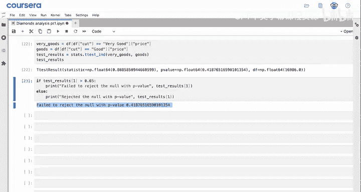

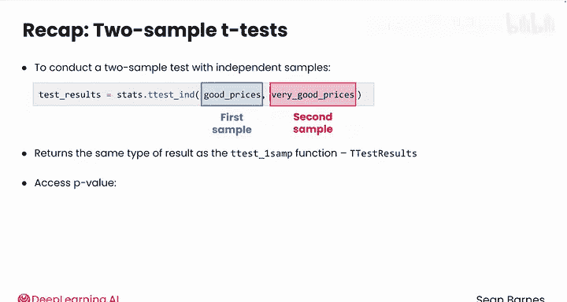

Well done， you can now conduct both one and two sample tests in Python。

 as well as write code to help interpret the results。

 Sometimes you have limited data to conduct this type of test。

 Foow me to the next video to develop code to simulate samples。 I'll see there。

