# 吴恩达《Python数据分析（数据分析第3课）｜Python for Data Analytics》中英字幕 - P66：65_均匀分布模拟.zh_en - GPT中英字幕课程资源 - BV1rp5yzjEgn

So far in this module， you've covered the fundamentals of inferential statistics in Python In this video。

 you'll learn how to use simulations to address practical challenges in data analytics。

 Sulations are a powerful tool when you face limitations in data collection by generating random samples from different distributions including the uniform and normal distributions you can model how your data behaves in the real world this approach helps you explore how factors like sample size and variability affect confidence intervals which allows you to make better informed decisions even when data is scarce in real- world scenarios collecting large data sets can be challenging due to time cost or logistical constraints For example。

 the online jewelry retailer you're working with may want to experiment with a new pricing strategy How could you simulate potential customer responses to the new prices It's often difficult to interview many customers or gather enough data from an experiment to make precise estimates for jewelry in particular these high value items have low transaction volumes gathering a representative sample of customers。

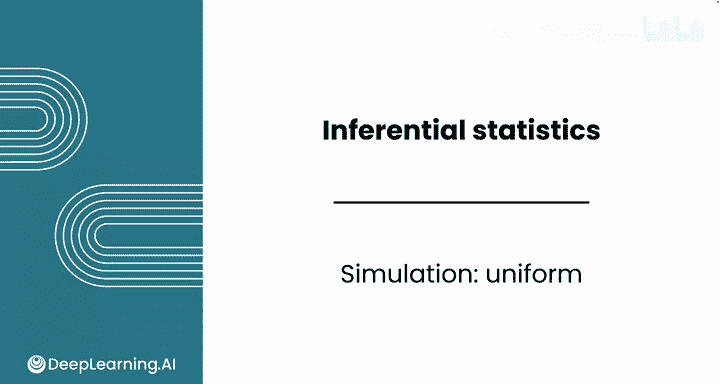

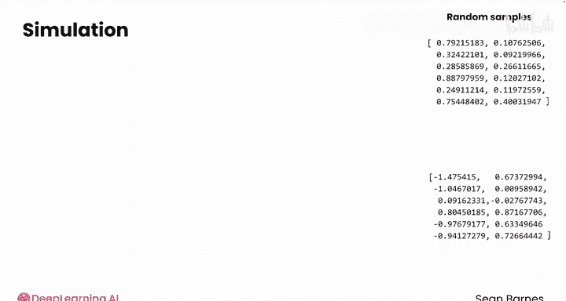

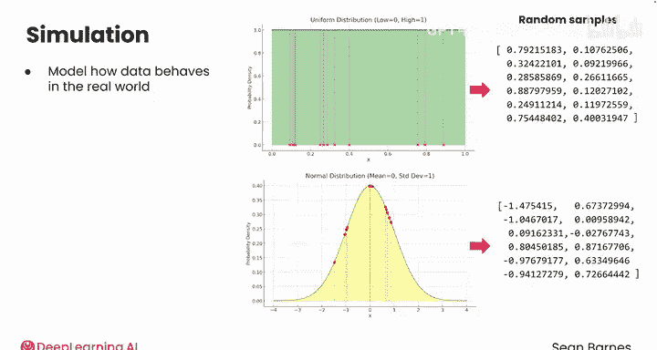

You can use simulation to overcome these limitations rather than relying solely on limited data。

 you can approximate the underlying distribution of your data by estimating parameters like the mean and standard deviation using these parameters you can then generate random samples that model possible scenarios based on your assumptions about how the data behaves this method has drawbacks in particular。

 a simulation is only as good as the assumptions it makes say you're working with the jewelry retailer to assess the potential impacts of a new pricing strategy you've been asked to develop a simulation of random discount prices within a fixed range discounts from 0 to 10% on diamonds The retailer plans to use the simulation as a first step towards assessing the impact on customer purchasing habits Pick up where you left off in the same notebook you've already imported your modules start by modeling the potential discounts You're interested in sampling random discounts uniformly from0 to 10% So in other words。

 with a low of 0 and a high of 0。1 you can create a sample of 10 discount then calculate。

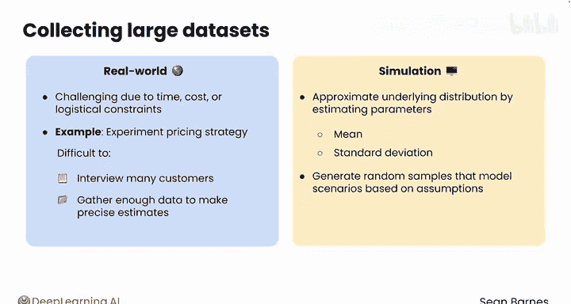

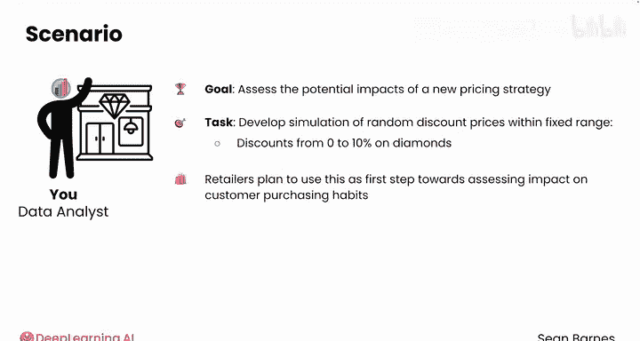

On that sample， like the mean and standard deviation， as well as graph histogram。

 so say n equals 1000。Then you'll generate a sample， so sample equals。

You'll use nup for this task N dot random uniform for three parameters， low equals 0 high equals 0。

1 size equals n。 Then you can calculate the mean。 So x bar and the standard deviation。 Finally。

 you can use his plot from seaborn to graph the distribution。 And lastly。

 plot dot show running that cell first you get a mean of around 0。

049 and a standard deviation of around 0。029。 The histogram looks roughly uniformly distributed。

 But of course， there's a natural random variation。 If you run the cell again。

 you'll get a new result。 Since MP dot random gives you random outputs each time。

 now you have a mean of around 0。051 and a standard deviation of 0。028。

 and if you run the cell many more times you get a sense of the natural random variation you might observe if you assign customers a random discount from 0 to 10%。

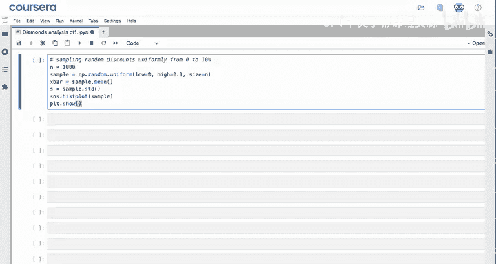

Finally， you can construct a confidence interval for the mean based on this data。

 borrow your confidence interval code from before， including the print statement。

 what do you need to modify？

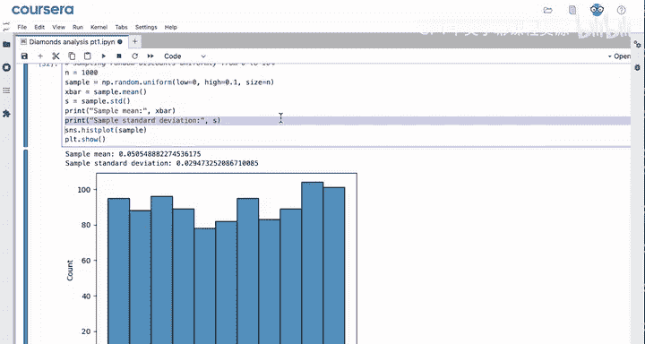

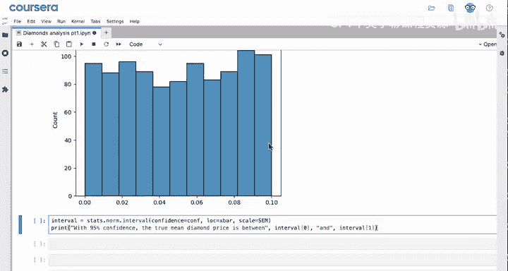

You already have X bar calculated correctly， set confidence to your desired confidence， say 0。95。

 The standard error is s over NP do square root event。 So running this cell with 95% confidence。

 the true mean value is between 0。0487 and 0。0524。 Now you and I know that the true mean for this uniform distribution is 0。

05。 The halfway point。 This confidence interval captures that value。 However。

 if you draw enough samples， you'll eventually get one that does not contain the true population mean you can also ask your LLM right code to run the simulation 100 times sum up the number of confidence intervals that contain 0。

05 and the number that don't。

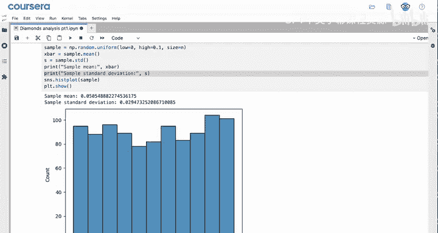

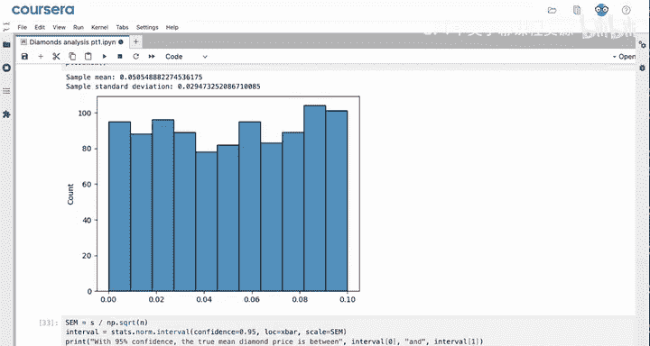

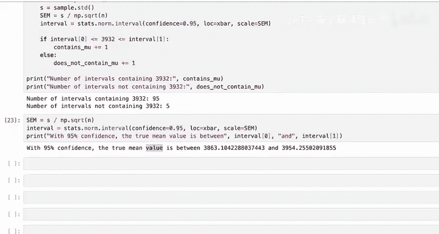

Print the result at the end。

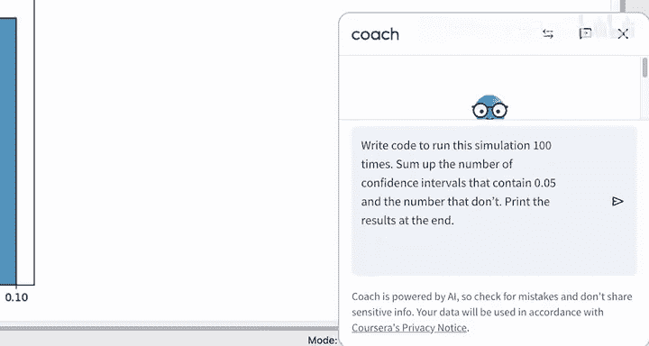

So it gives you some code， looks like it's using a for loop， copy it， and try it out。

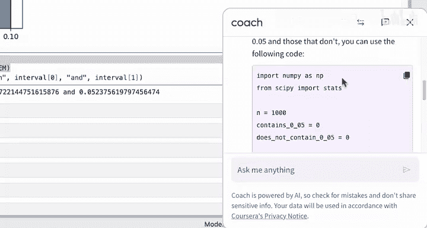

You can remove the import statements， you already have this。

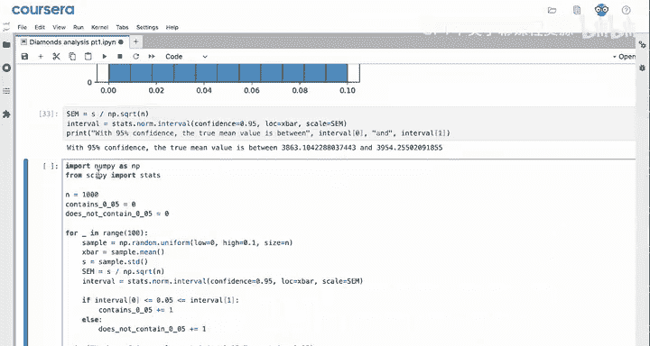

Run that cell and you get 93 intervals contain the value of 0。05 and 7 did not。

 That should line up with your expectations around how the 95% confidence interval behaves。

 so you can present the simulation to help your clients at the jewelry retailer。

 understand how the discounts might be delivered to customers and what different scenarios they should prepare for if they roll out this type of discount experiment to their customers。

 For example， the retailer may be concerned with understanding the maximum potential impact on revenue if many of the discounts cluster at the higher end。

 they can use your simulation as a starting point to understand the likelihood of hitting this threshold。

 wrapping up you use the N do random uniform function to generate a large random sample from a uniform distribution。

 you specified the parameters of the simulation using the low high and size named arguments。

 you also saw how to construct a confidence interval in your code based on the random sample you generate and you use an LLm to write code to repeat the simulation many times。

 Great work with simulation。 there's just one more video to go in this lesson。😊。

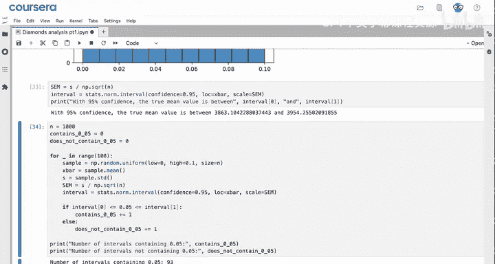

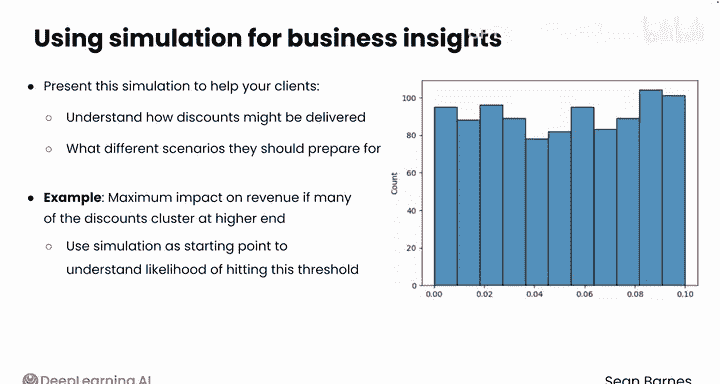

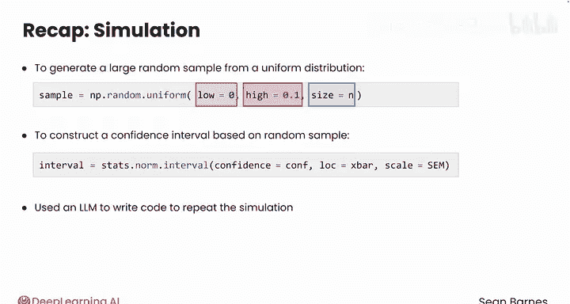

Where you'll learn to sample from the normal distribution in Python， I'll see you there。

