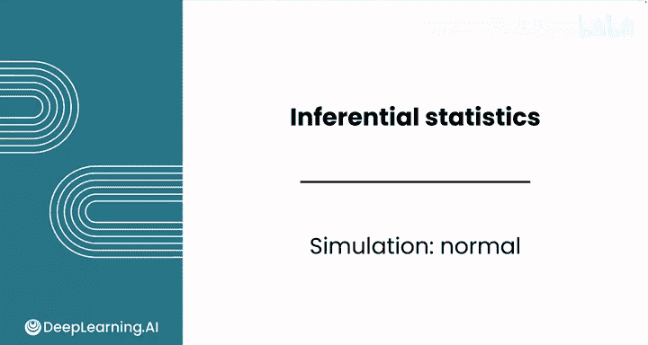
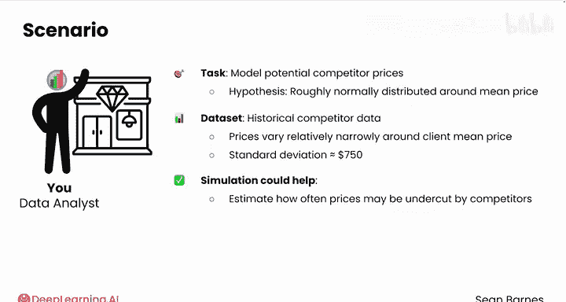
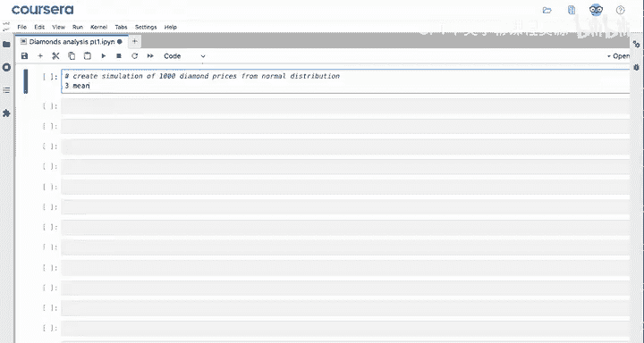
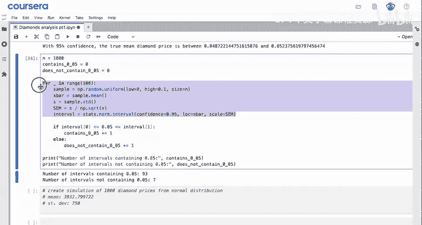
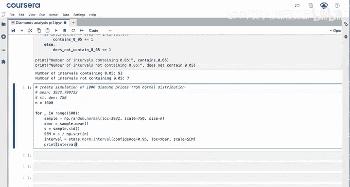
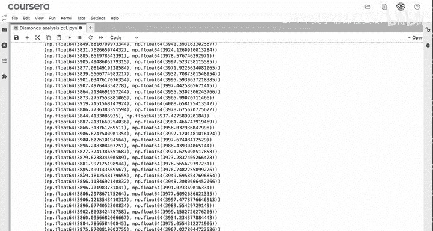
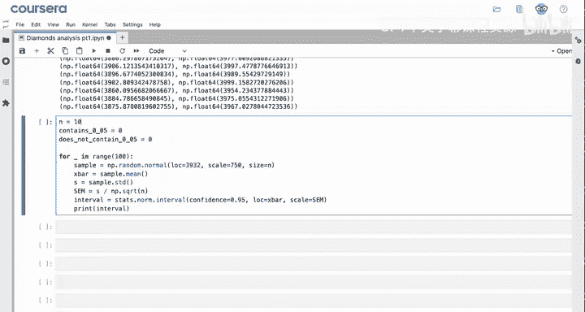
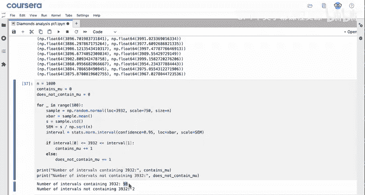
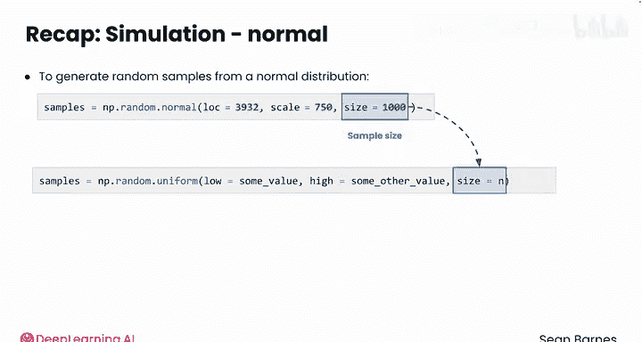

# 吴恩达《Python数据分析（数据分析第3课）｜Python for Data Analytics》中英字幕 - P67：66_正态分布模拟.zh_en - GPT中英字幕课程资源 - BV1rp5yzjEgn

While sampling from the uniform distribution is quite useful。

 you can also generate random samples from other distributions like the normal distribution。

 You're continuing your pricing strategy work with the online jewelry retailer This time。

 you've also been asked to model potential competitor prices。

 which you hypothesized to be roughly normally distributed around your own mean price。

 Some competitors' price higher some lower and increasingly higher or lower prices are increasingly more rare by analyzing historical competitor data。

 You've found that prices for similar diamonds typically vary relatively narrowly around your client's mean price。

 The distribution has a standard deviation of about 750。

 you can use this insight to simulate realistic competitor pricing scenarios using your own mean price plus the standard deviation。

 This simulation could help your client estimate how often their prices may be significantly undercut by competitors and determine optimal discount levels that maintain competitorsness Pick up where you left off in the same notebook you've already imported your modules you're interested in creating a simulation。

Of 100 diamond prices from the normal distribution with a mean of $3932 and a standard deviation of $750。

 Remember， that's the standard deviation you found based on analyzing the historical competitor data。

You've already created this simulation for many confidence intervals from the uniform distribution。

 so you can copy this code and just change a few aspects of it。

Let's start with just this section of the loop plus the n and confidence variables。

 Their processes are quite similar since they both have a sample size， confidence level， mean。

 standard deviation， and so on。 You actually only need to change one line of code here。

 Can you spot which one you'll need to change。Well， you're sampling from the normal distribution now。

 not the uniform one。 The size argument stays the same。

 still 1000 but now you have Lo and scale arguments， just like your confidence interval for Loke。

 use the mean price for your diamonds，$3932。 And for scale。

 use the historical standard deviation $750。 For now， add a line that prints out the interval as is。

Running that cell， you get 100 pairs of values。 These are all your confidence interval。

 They're quite narrow around the mean value。 Before you take these results to your client。

 you can add back in the other parts of the code that print out these pretty results。 Remember。

 the true mean is $3932。 You can change these variables to contains and does not contain you。

Then adjust the value， checking whether the mean is within the interval。 It's 3932， not 0。05。

 Run this cell and cool。 you get 98 intervals containing the true mean and only two intervals that don't plain that back。

 you use the MP do random do normal function to generate random samples from a normal distribution。

 you use the same size argument as withmp dot random uniform。

 but this time included the lo argument for the mean and scale argument for the standard deviation。

Great work。 You've seen how simulation can help address real world business problems and written Python code to repeat a simulation many times That takes you to the end of this lesson。

 You've covered the core inferential techniques， data analyst use every day and seeing how to scale them up to create hundreds of intervals at once。

 Com up， you'll complete the practice assignment and practice lab for this lesson where you'll explore housing prices in London Once you're done with the practice assignment and practice lab。

 join me in the next lesson to learn a brand new inferential technique， linear regression。

 See you there。😊。