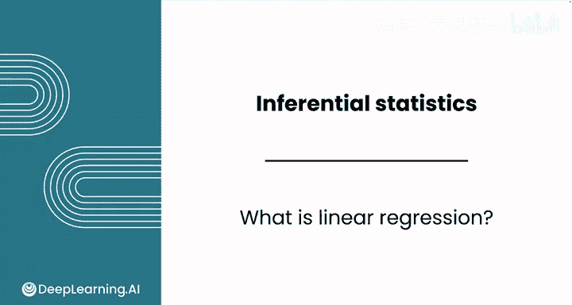
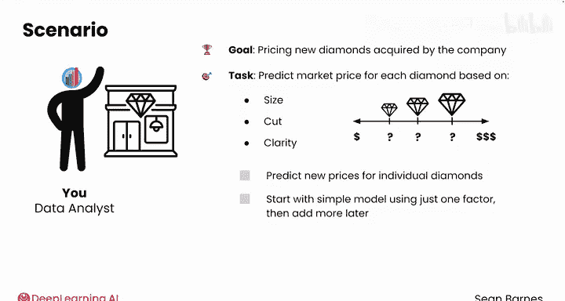
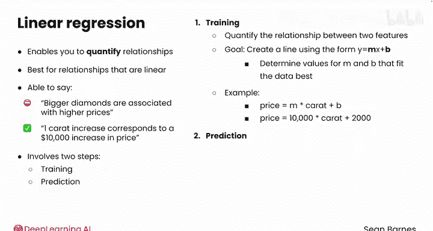
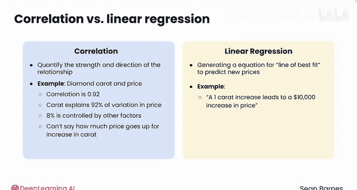
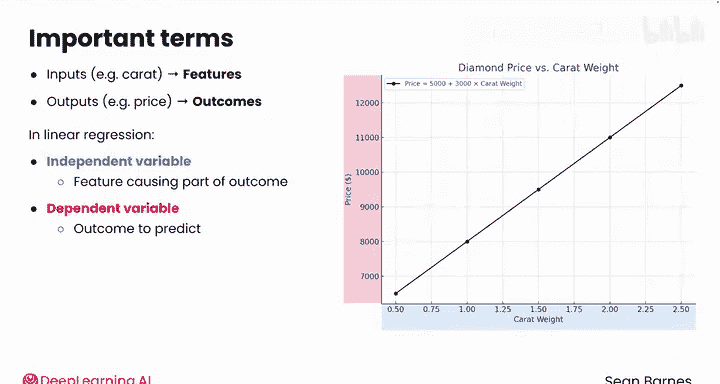
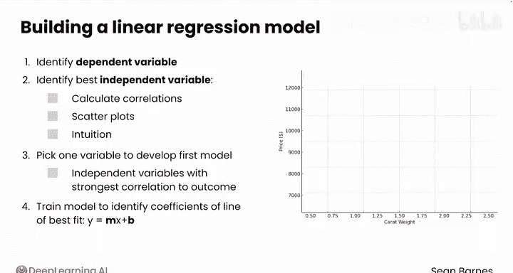

# 吴恩达《Python数据分析（数据分析第3课）｜Python for Data Analytics》中英字幕 - P68：67_线性回归基础.zh_en - GPT中英字幕课程资源 - BV1rp5yzjEgn

Now that you're familiar with confidence intervals and hypothesis tests。

 you're ready to expand your inferential toolkit。

In this lesson， you'll learn the fundamentals of linear regression。

 a powerful inferential method used to model relationships between features。 Consider this scenario。

 you're still working as a data analyst at an online jewelry retailer。

 You've been tasked with pricing new diamonds acquired by the company。

 thousandshouand of diamonds need to be priced each day and qualified experts aren't always available to determine the most accurate price。

 The jewelry retailer is interested in developing a more costeffect model for diamond pricing。

 They've asked you to predict a reasonable market price for each diamond based on its characteristics like size cut and clarity。

 Then experts will use your predicted prices as a starting point to finalize pricing more quickly。

 Neither a confidence interval nor a hypothesis test would be appropriate for this task。

 You need to predict new prices for individual diamonds。

 not just perform inference on some characteristics of all diamonds。 Of course。

 you know that larger diamonds are more valuable but by how much and which matters more。

 The cut or the clarity。 your plan is to start with the simple model using just one factor to predict the diamonds price then add more factors later。

😊。

Linear regression enables you to quantify relationships in your data。

 working best for relationships that are very linear。

 and you'll be able to say more than just bigger diamonds are associated with higher prices with regression。

 you can say something like a one carrot increase corresponds to a $10000 increase in price。

 Linear regression involves two steps。 Tra and prediction。

 First training analyzing your existing data to quantify the relationship between two features like carrot and price。

 You're looking to create a line that models the relationship using the form y equals M x plus B。

 You likely saw this equation in your high school algebra class。

 It's called slope intercept form M and B are called coefficients in math。

 The statistics behind linear regression will take your data and determine the values for M and B that best fit the data。

 For example， you may be looking for the equation。 price equals m times carrot plus B。

 This equation quantifies the relationship between price and carrot。

 say you run your linear regression and find that the equation that best fits the data is price equals $10000 times carrot plus。

😊，Now you've built your modelYour next step is prediction using this tray model to predict y based on the input X。

 which in this case means predicting price based on the input carrot。

 Imagine you've just received a new diamond and it's your job to give it an appropriate price based on its carrot If you know the diamond is 0。

5 cars。 you can plug that into your equation， giving you 10000 times 0。

5 which is 5000 plus 2000 for a final price of 7000 Linear regression might sound a lot like correlation。

 which also quantifies the relationship between two features they are indeed related techniques。

 However， correlation can only quantify the strength and direction of the relationship for example。

 the correlation between diamond carrot and price is 0。

 using that statistic you can conclude that a diamonds carrot explains 92% of the variation in its price。

 the other8% is controlled by other factors like cut color and clarity However。

 you can't say exactly how much the price goes up for an associated increasing carrot Line regression takes this。

a step further by generating an equation for the line of best fit that allows you to predict new prices with linear regression。

 you can make conclusions like a $1 carrot increase leads to a $10000 increase in price。

 a half carrot diamond is estimated to cost $7000 However。

 correlation is typically used at the start of a regression analysis to identify the most predictive features if you're using one independent variable。

 choose the one with the strongest correlation with your outcome variable to develop the most accurate linear regression model up until now you've called inputs like carrot features and outputs like price outcomes So you might have described this problem as predicting an outcome price using a feature carrot and linear regression terms both features and outcomes are typically called variables variable is essentially just another term for feature the independent variable corresponds with your input It's the feature you think is causing power to the outcome and is graphed on the x axis and this example it the carrot the dependent variable is the outcome you're trying to predict here it's the price of the diamond and the value of price。

Depenent on carrot， the independent variable。 when you're trying to determine which variable is which in your data。

 Think about cause and effect。 a diamonds price tag changing doesn't magically make that diamond bigger。

 but a diamonds carrot directly affects its price。 Therefore。

 carrot is the independent variable and price is the dependent variable to build a regression model and use it for prediction。

 first identify your dependent variable。 This is the variable you ultimately want to predict。

 Then explore the relationships in your data to identify the best independent variable for your model。

 calculate correlations between your independent and dependent variable。

 scatter plots also help with identifying the best variable for your model。

 The seaborn pairpl function can help you identify strongly correlated pairs at a glance。

 You can also use your intuition about which variable might influence your outcome of interest most strongly。

 You don't necessarily have to examine every correlation。 Third。

 pick one variable to develop your first model with typicallyy the independent variable with the strongest correlation with your outcome is your best bet And last。

 train your model using a statistics software module to identify。

Find the coefficients of the equation of the line of best fit M and B and y equals M X+ B Once you train your model。

 you can use the y equals mx plus B equation to predict new outcomes。

 This regression equation specifies the line of best fit which quantifies the relationship between a single independent variable and the dependent variable in a later lesson。

 you'll learn how to add more independent variable to your model to improve its predictive power。

 Keep in mind that linear regression can only model linear relationships。

 meaning that a change in the independent variable causes a constant change in the dependent variable。

 That's why correlation is so useful for setting up a linear regression model because it also measures the strength and direction of linear relationships。

 There are methods for modelingline relationships as well。 but linear models can still be effective。

 even if they're not perfect。 Line regression takes your inferential toolkit to the next level allowing you to make predictions for new observations in your data In the next video。

 you'll see how to develop a linear regression model and Python code I'll see there。

