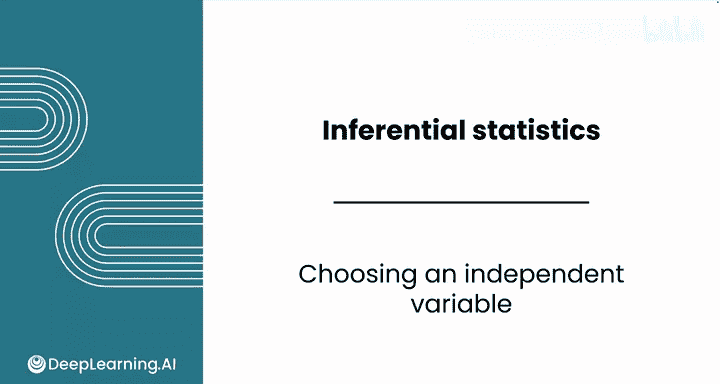
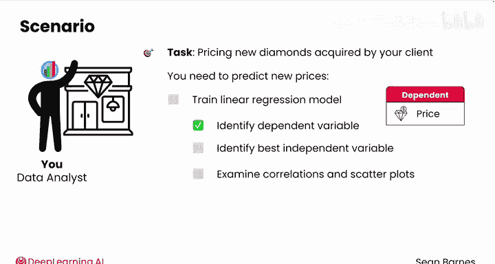
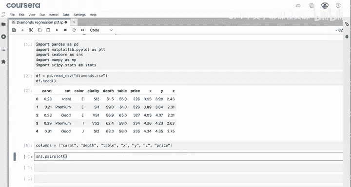
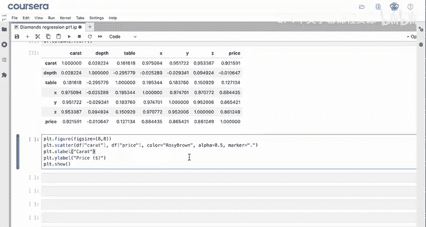
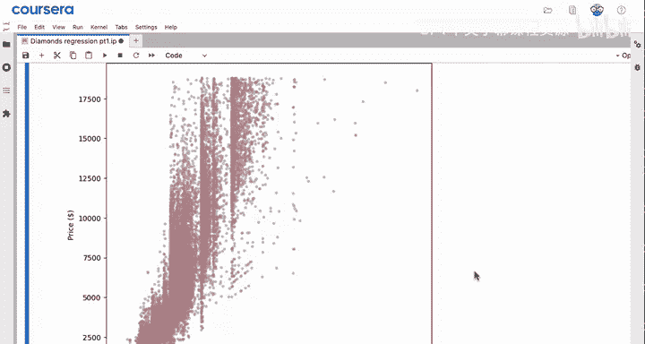
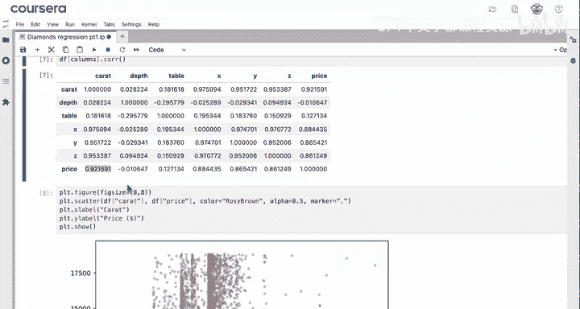
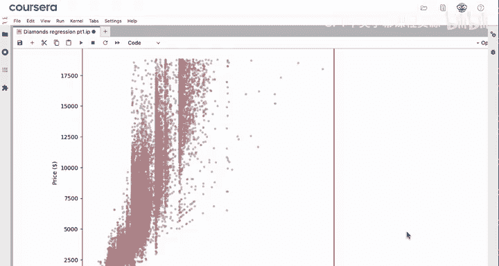
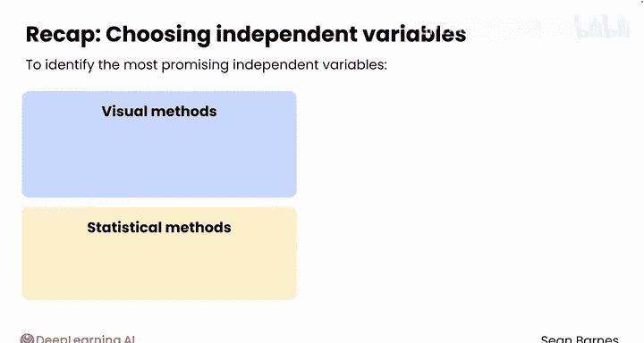

# 吴恩达《Python数据分析（数据分析第3课）｜Python for Data Analytics》中英字幕 - P69：68_自变量选择.zh_en - GPT中英字幕课程资源 - BV1rp5yzjEgn

In the last video， you explored how a linear regression model can be trained and used for prediction。

 Now you can put that knowledge into action with Python code As a recap。

 you've been tasked with pricing new diamonds acquired by your client and online jewelry retailer because you need to predict new prices not just analyze existing ones。

 You've chosen to train a linear regression model you've already identify price as your dependent variable。

 So your first step is to identify the best independent variable with which to build your simple linear regression model you'll need to examine correlations and scatterpls to achieve this goal starting fresh in a new notebook loading your typical modules Padas mapplotlib spi stats and so on。

 Then reading your diamonds data into the variable Df First select your columns of interest。

 use Dfhead to identify all the numeric columns as potential independent variables for your model。

 You'll learn how to incorporate categorical data into your models in a later video For now。

 create a list of the numeric columns of interest。😊。

Carrot， depth， table， X， Y， and Z， select price as well。 even though it's your dependent variable。

 you'll need to include it in your analysis。 That's the whole point。

 You want to understand relationships between all these features and price to select the strongest predictor for your model。

First， try using SNS do pair plotot on the selected columns Price is in the last row of the scatter plots。

 D and table don't seem to have much of a noticeable relationship with price。

 aligned line through each scatter plot is relatively vertical。

 but price seems to increase as each of carrot X， Y， and Z increases。

 They may be good candidates for independent variables， but which one is best。

Use Dfcos core to quantify the strength of these relationships。 or in other words。

 the predictive power of each independent variable。 Remember， correlation is symmetric。

 so you'll see repeated values in its table。 Again。

 focus on the price row at the bottom while x Y and z are strongly correlated with price。

 Carrot is the most strongly correlated of all these options Again。

 one way of interpreting correlation here is to say that a diamonds carrot predicts about 92% of the variability in its price。

 generate a scatter plot of carrot and price to examine this relationship in more detail。

 Use the carrot column as the first argument so that it's plotted on the x axis。 Remember。

 your independent variable should be on the x axis。

 Use price as the second argument to be plotted along the y axis。

 and why not use the color Rosy Brown。 there are tens of thousands of diamonds So you can set alpha to be 0。

5 and the marker to be points to see more of the data。 Finally。

 make the figure size a little bit larger and add axis labels。

 So it's pretty clear that as carrot goes up。 price goes up significantly。 Let me ask you。

 does this relationship。😊。

Linear or non nonlinear to you。While it's quite nonlinear， actually。

 you can tell because a curve like this would fit the data better than a straight line like this。

 even though this relationship is nonlinear， you can still use linear regression to model this data fairly accurately。

 After all， the linear correlation between these two features is quite strong。

However， you do have more sophisticated approaches available to improve your model's accuracy。

 regardless， linear regression can be a great place to start to recap。

 you use both visual and statistical methods to identify the most promising independent variables。

 The paraplot and correlation table helped you assess which independent variable with best explain changes in the dependent variable。

 You could also use more advanced visualization techniques like a heat map to quickly identify the strongest correlations。

😊。

Great work。 You've chosen the best possible independent variable for your linear regression model In the next video。

 you'll run your regression model and generate the first set of results。

