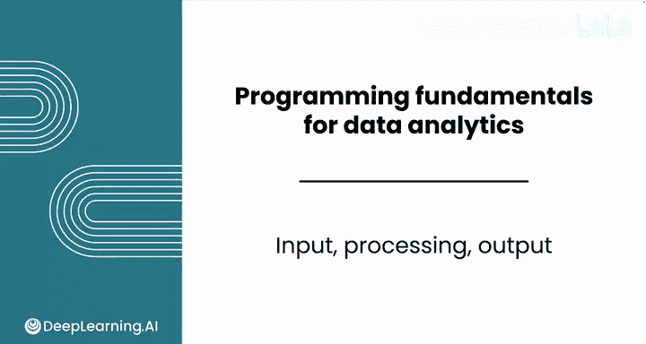
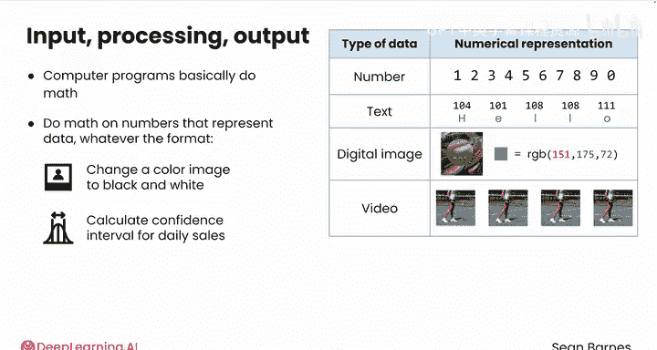
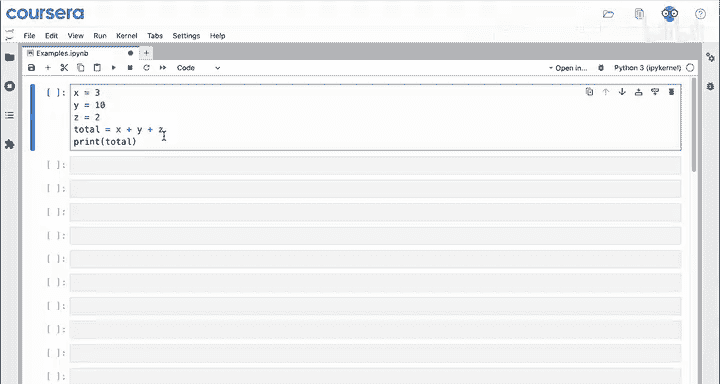
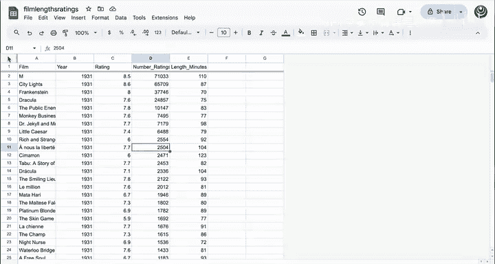
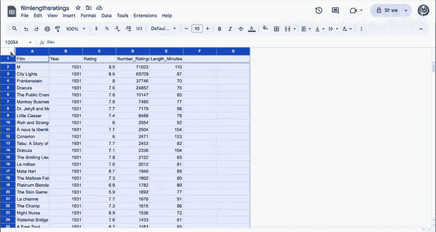
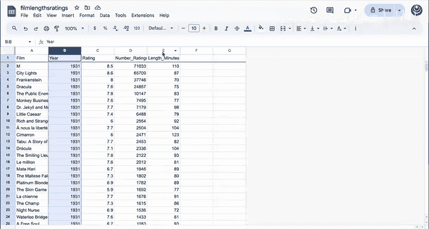
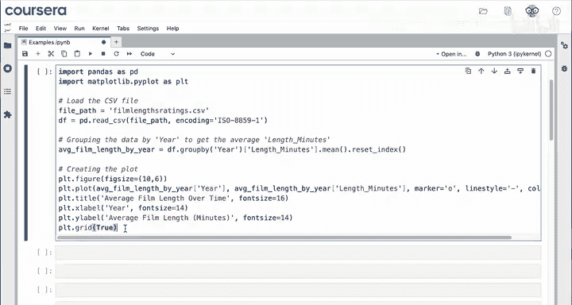
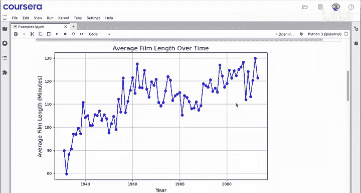
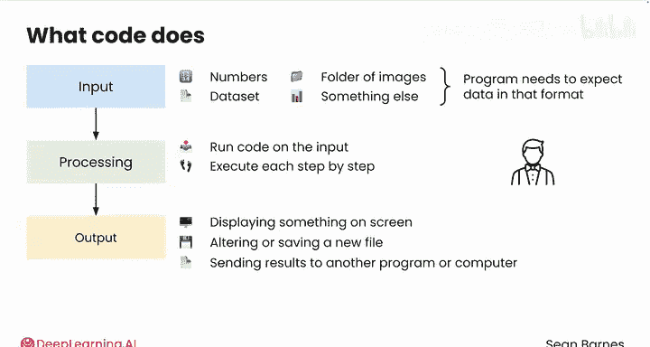

# 吴恩达《Python数据分析（数据分析第3课）｜Python for Data Analytics》中英字幕 - P6：5_输入-处理-输出模型.zh_en - GPT中英字幕课程资源 - BV1rp5yzjEgn

It can be pretty mysterious。 Just what a programming language does。

 You can think of a computer program as a sequence of input， processing and output。

 Computer programs basically do math。 Now， thankfully。

 your Python code won't just be a bunch of math。 It will look more like a hybrid of English and math。

😊。

That's convenient for you， but under the hood math is what's happening It turns out that in a computer。

 every type of data can be represented as a number。If you're working with numbers， well。

 those are already numbers。If you're working with text。

 those can be represented using a number for each character。In a digital image。

 the color of each pixel is a number representing how much red， green， and blue should be displayed。

A video is just a bunch of images in a row， plus a little extra information， and so on。

And fundamentally， what computers do is they do math on the numbers that represent your data。

 whatever the format。Now math is behind many complex and wonderful operations。

Changing a color image to a black and white one， calculating a confidence interval for daily skateboard sales。

 or determining whether a Yelp review is positive or negative。

Breaking that down， the code takes some kind of information， processes it by doing some math。

 and outputs new information， input， processing output。Let's look at a couple of examples in code。

Say you want to add some numbers Here's a program for that。 It takes three numbers。

 assigns them to variables， and then adds them together。 The input is the numbers 3，10 and 2。

 The processing involves adding them together， and as you hit shift enter。

 the output involves displaying the result of 15 to the screen here's a more sophisticated example。

 you'll explore in an upcoming module。

You may remember this movie dataset set from the previous course。

 which included the top movies in various years and how long they are。

Here's some more complex code Don't focus on the code。

 you'll understand each line here by the end of the course。

 but what it does is take the entire data set as input and process it by taking the average movie length for each year。

The output will be a visualization of this data in a chart， hitshift En to run that。

 and here's a nice line chart showing the increase in movie durations over the last 80 years or so。

 As you can imagine， each of the components can get quite complex。

 The input can appear directly in your code like the three numbers you saw earlier， It can be a data。

 a folder of images or something else。

Your program will need to be written to expect data in that format。

The processing step happens when you run code on the input。

 you've written some commands for the computer， and once you run those commands。

 the computer will execute each of them step by step。Processing can get quite mysterious。

 it happens outside of your field of view， like a magician disappearing in a cloud of smoke and reappearing a moment later in a different costume in the movie example you saw a moment ago。

 you never actually saw the movie data。You'll become more comfortable with this behind the scenes math。

 the more you code， then you have the output output can be displaying something on the screen as in the previous examples。

 it can be altering or saving a new file， or it can be sending results to another program or another computer。

Sometimes you run a program and it seems like nothing is happening。

 the computer is following your commands， but it might just be that none of the commands involve displaying things on the screen。

There's just one more video before you begin writing code yourself。

 You've seen the power of programming and how you can run code in a Jupiter notebook to take some input。

 process it and give you some output。 But when should you write a program versus use a spreadsheet。

Followums the next video to see how to choose。