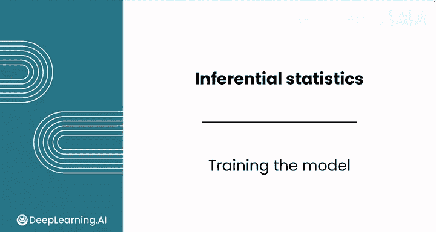
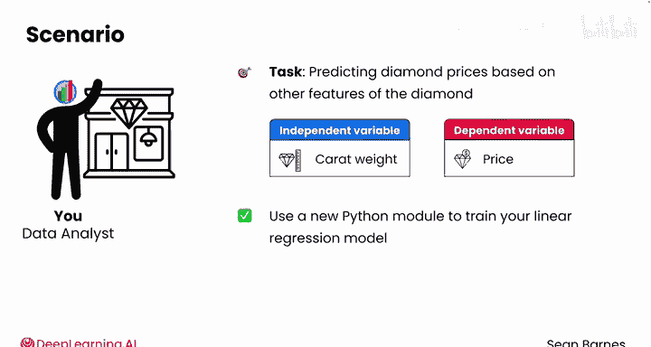
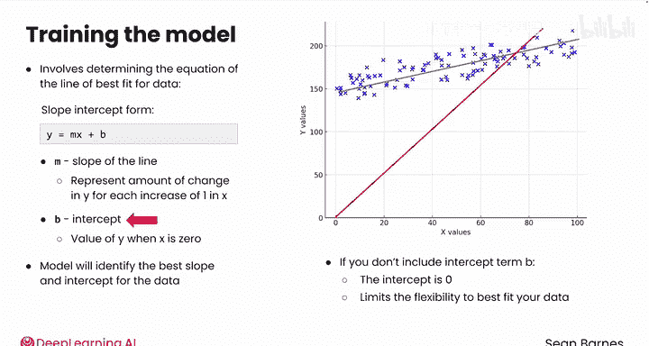
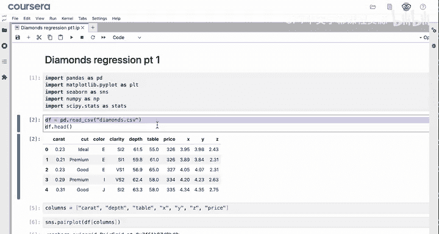
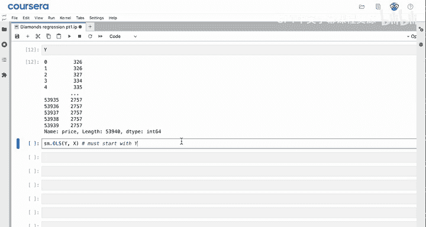
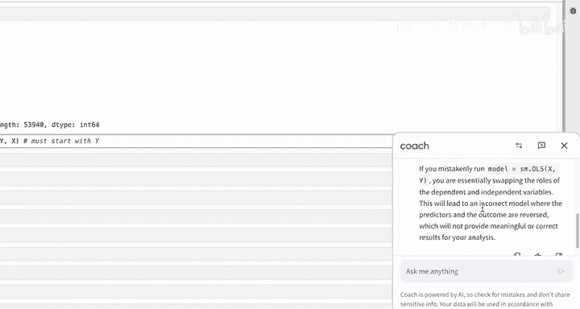
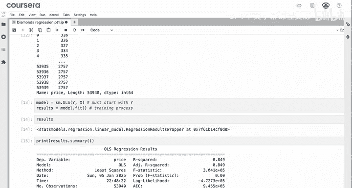
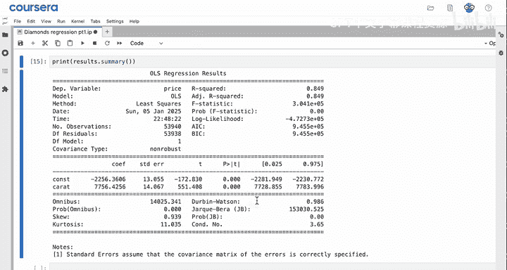
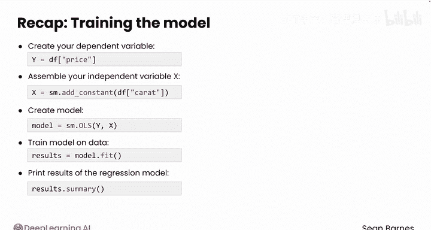

# 吴恩达《Python数据分析（数据分析第3课）｜Python for Data Analytics》中英字幕 - P70：69_模型训练.zh_en - GPT中英字幕课程资源 - BV1rp5yzjEgn

Now that you've determined both the dependent and independent variables for your linear regression model。

 you can get started on training。

As a reminder， you're working on predicting diamond prices based on other features of the diamond。

 you chose caret as the first independent variable to train your model with。

 since it had the strongest correlation with the dependent variable price。

 you can now use a new python module to train your linear regression model。

 As you saw in an earlier video Tra your model involves determining the equation of the line of best fit for your data。

 which looks like y equals M x plus B。 This form is called slope intercept form。

 M is the slope of the line， which represents the amount of change in y for each increase of1 in X B is the intercept or the value of y when x is 0。

 your model will identify the best slope and intercept for the data。

 notice that your model has two terms M and B。 even though you're only using one independent variable。

 the point of B is to give your model more flexibility。 For example， Take a look at this data。

 How would you draw the line of best fit through this data。

You might draw a line that looks something like this one。 Now。

 imagine if this line had to go through the origin at 0，0。

 which would be equivalent to a line of best fit with no interscept or B equals 0。

 How would you draw that。Maybe like this。 Well， that certainly isn't a great model for this data。

 as it would not accurately predict Y for most values of x。

 If you don't include the intercept term B， you're basically telling your model that the intercept is 0。

 keeping B at0， limits the flexibility of your model to best fit your data as a quick recap。

 you've imported your modules。 you've loaded in your data。

 and you've selected carrot as the best independent variable for your regression to start training your linear regression model。

 first import stats models API which is a common statistical modeling model。

 you'll often see the nickname S M for stats models。 then set up your x and Y variable。

 Y for your dependent variable price and X for your independent variable carrot Y is straightforward use Df price for X start with your independent variable。

 Df carrot。 you'll need a bit more than that， though。

 specifically in order to model your intercept Stats models works by developing a coefficient for each column in your x data frame。

 You want to find two coefficients M and B M corresponds with the carrot column。

 But what does B correspond。

Right now， since there's only one column in the X data frame。

 stats models will ignore B and simply set it to zero。

 That rarely leads to the most accurate model in order to make sure stats models identifies both coefficients M you'll need to use the SMM add constant function This step may seem a bit unnecessary If you're training a linear regression model of course you want both M you're just trying to get your data into the right format that stats models expects。

 you've seen similar steps with Matpllib and other functions。

 Sometimes you're just wrangling data Now that you've added this constant column。

 take a look at the resulting data frame X you have a column for the constant。

 which is the same for all rows and a column for care。 Meanwhile。

 Y is a series containing only the price to train the regression model you'll use SM which stands for orin squares It's a foundational type of regression model Stats models provides different model options for other special cases for the arguments use Y and X You must start with Y regression is not symmetric unlike correlation In fact。

You can ask your LLM what the potential consequences might be。

 What happens if you run the code model equals sm。olsxy instead of model equals sm。olsyx。

So the LLM points out that the order of inputs into the O function is important and that you should enter the Y before the X。

 If you swap the order of these two variables， that will lead to an incorrect model where the two inputs are reversed。

 Finally， fit the model This is the training process your model will use the historical data to identify the coefficients of the line of best fit In this case M and B save this value into the variable results。

 these two lines of code creating model and results are a common paradigm and stats models you'll use them again and again I'm guessing you're really interested to see the results。

 If you try printing it directly you'll get this results wrapperic to see the actual output。

 you'll need to print results summary。

You get this massive table of all kinds of interesting stuff from R square to coefficients。

 constant carrots， even something called Jaque B。 There's a lot of information here to play that back。

 you used a series of commands to train your linear regression model。

 you created your dependent variable Y by selecting the price column from your data frame。

 Then you assembled your independent variable X into a data frame by first selecting the carrot column and then using the SMm do add constant function to add a second column。

 This column allowed your model to estimate coefficients for the slope and the intercept。

 Then you created your model using the command model equals SMm o Y X This function creates an ordinary least squares regression model loaded with your x and Y data。

 The line results equals model do fit trains your model on the data。

 This step actually calculates M and Finally， you printed the results of the regression model using model summary。

 Well done creating and fitting your regression model。

 you're now ready to learn how to interpret some of the key outputs from the results summary。

 Jo me in the next video to get。😊。

Started。