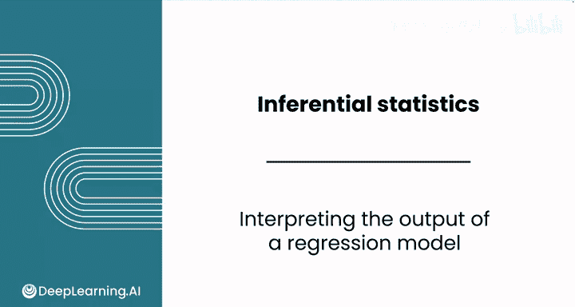
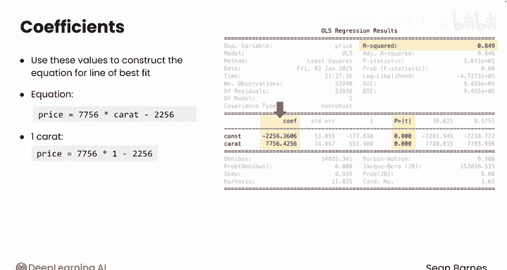
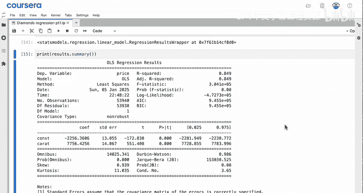
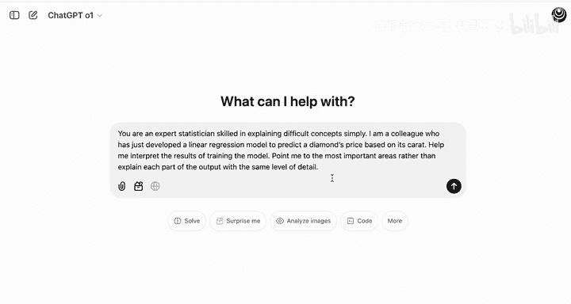
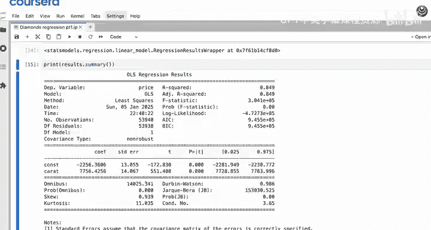
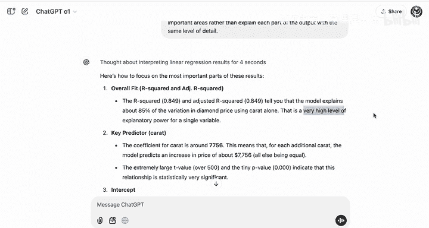
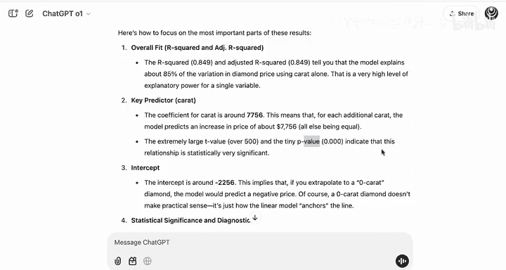
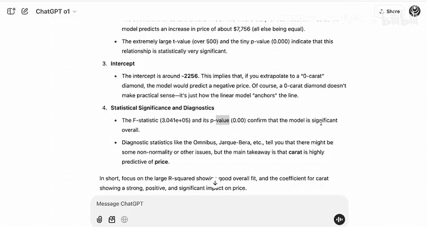
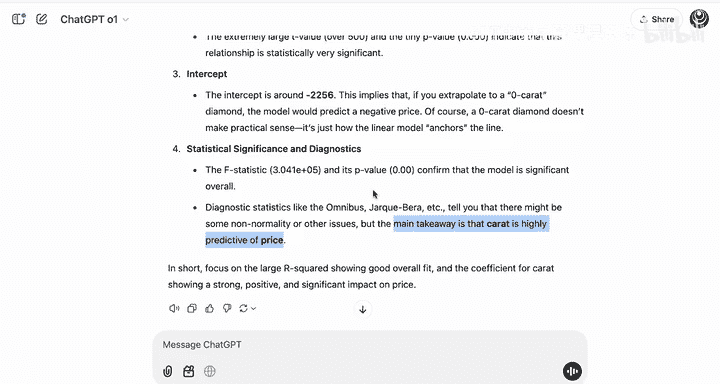

# 吴恩达《Python数据分析（数据分析第3课）｜Python for Data Analytics》中英字幕 - P71：70_回归模型输出解读.zh_en - GPT中英字幕课程资源 - BV1rp5yzjEgn

Once you've trained your linear regression model， it's time to interpret the output。

 this information will help you evaluate how well the independent variable models the behavior of the dependent variable。

 Here's a screenshot of the O regression you saw in the previous video where you trained a model to predict diamond prices using their carerot。

 You really don't need all the information here。 your I should be drawn towards a few key points。

 First， the R squared value。 Second， the p value for the coefficients。 both constant and carrot。

 And last， the values of the coefficients themselves star with R squared R squared measures the proportion of variance in the dependent variable that is predictable from the independent variable。

 That's a mouthful essentially R squared tells you how reliably carrot can predict price。

 If I only tell you a diamonds carrot and nothing else， how accurately can you predict its price。

 R squared is typically a value between 011 The higher it is the more your independent variable explains the variation in your dependent variable。

 Although there are some nuances higher is generally better。 and R squared of 0。849 is quite high。

 you can interpret this result as carrot explains 8。😊。

4。9% of the variability in price。Before you move forward with interpretation。

 take a look at the P values associated with each coefficient。

 They tell you whether the coefficients are statistically significant。

 Interter these P values the same way you interpreted them for other hypothesis tests。

 The null hypothesis is that the regression coefficient is 0。 Remember。

 both the slope and intercept or coefficients。 So the status quo is that the coefficient has no effect on the dependent variable。

 The alternate hypothesis is that the regression coefficient is not equal to 0。

 you're trying to find evidence for this outcome， because you want to show that the independent variable does。

 in fact， impact your dependent variable。 So if your data provides sufficient evidence to reject the null。

 you've identified an important feature in your model。 as with any hypothesis test。

 you'll need to choose a confidence level you're comfortable with。95% confidence with an alpha of 0。

05 is common。 If the P value for a coefficient is above alpha。

 that means that independent variable doesn't predict the dependent variable Well。

 You would not want to go forward with interpretation and prediction。 If the P value is below 0。05。

 then you can reject the null。Including that the independent variable predicts the dependent variable well In this case。

 the P values for both coefficients are close to 0， well below 0。

05 so they are statistically significant， this model will be effective in predicting the price of a diamond Now that you' verified statistical significance。

 you can take a look at the values for the coefficients2256 for the constant and 7756 for care you can use these values to construct the equation for your line of best fit。

Remember that was the whole point of linear regression。

 That equation looks like price equals 7756 times carrot2256。

 So a1 cart diamond would be priced at $7756 times12256 or around 5500。

 A two carrot diamond would be priced at $7756 times 22256 or about 13256。

 Don't worry about calculating these by hand。 you'll see how to predict many diamond prices at once in a moment using stats models。

 By the way， LLms are excellent at cutting through the noise of these complex model summaries。

 you may want to use an application like chat E to talk to your results。 In fact。

 let's use01 an openaiI model with strong reasoning skills。 Remember。

 you may have more up to dateate models available to you By the way。

 always make sure you aren't sharing any private or proprietary model results with the LLM。

 Give the model a role and a task。 So you can use a prompt like you are an expert statistician skilled in explaining difficult concept simply I am a colleague who is。

😊。

Develop a linear regression model to predict the diamonds price based on its care。

 help me interpret the results of training the model。

 point me to the most important areas rather than explain each part of the output with the same level of detail。

 then take a screenshot and paste in the results。

First， it explains the R squared of the model and states that the model explains about 85% of the variation in diamond price using carrot alone。

 It also tells you that this is a very high level of explanatory power for a single variable。

 It also highlights that carrot is your key predictor and the coefficient is around 7756。

 That means that for each additional carrot， the model predicts an increase in price of around 77，56。

 the P value is extremely small， indicating that this coefficient is statistically significant。

 It also highlights something called the F statistic and its associated P value。

 That P value is also very small， and it states that that confirms the model is significant overall。

 It also mentions some of the other diagnostic statistics。

 but it highlights that the main takeaway is that carrot is highly predictive of price。 Co。

 especially when you start adding more variables to your regression and analyzing output with a high level of rigor and LM can be an excellent thought partner for interpretation。

 Great work。 you just interpreted the results of a linear regression model in Python。

 you use the R squared value， P values and coefficient。😊。

To make meaningful conclusions about your model， follow me to the next and final video in this lesson to use your model to make predictions。

