# 吴恩达《Python数据分析（数据分析第3课）｜Python for Data Analytics》中英字幕 - P72：71_预测分析.zh_en - GPT中英字幕课程资源 - BV1rp5yzjEgn

Interpreting R squared and coefficients is a great first step when working with linear regression。

 but your ultimate goal is to predict new values。 In this case。

 predict diamond prices based on their carrot。 Let's see how prediction works conceptually and with code。

 Take a look at this line of best fit plotted over the scatter plot of diamond carrot and price。

 This plot was generated using matpllib and seaborn。

 Sa you've been asked to predict the price of a new diamond that's $1。5 carrots。

 What you're essentially doing is finding that carrot value on the x axis following this grid line up to the line of best fit。

 plotted here in red。 then locating the corresponding price on the y axis。

 This diamond looks like it might be worth around $9000 based on your model。 Of course。

 code makes this calculation much more precise。😊。

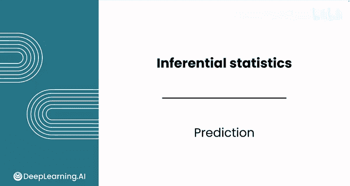

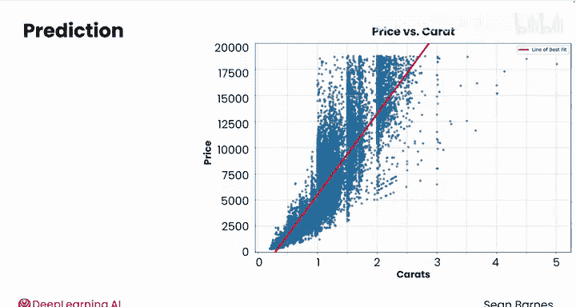

As a quick recap， you've imported your modules， you've loaded in your data and you' fit your linear regression model to predict price using Carrot。

 recall that your model coefficients can be used to create the equation of line of S fit y equals mx plus B or price equals m times carrot+ B your coefficients are stored in results do parameterss or stands for parameters Check it out What do you think the type of results do parameterss is。

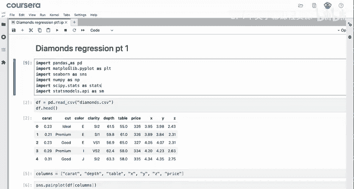

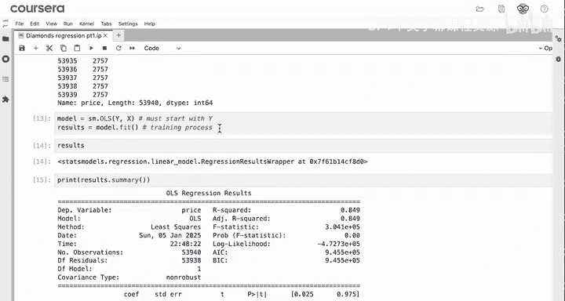

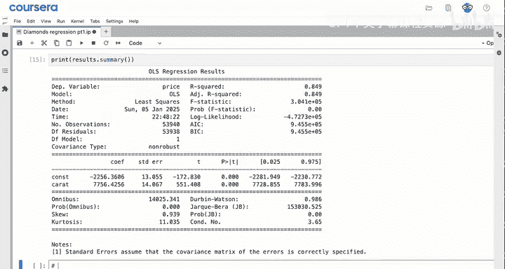

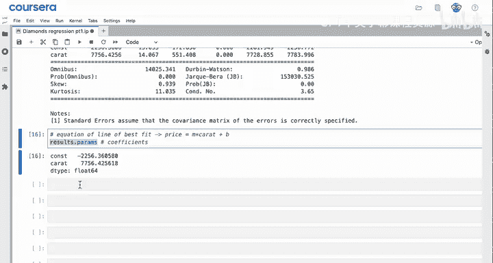

It's a series you can access these values using the index。

 so results not peramms carrot gives you M and results not parametersms con gives you B。

 If you're given a new value for carrot like 1。5， you can assign that to the variable carrot and set price equals to this equation。

M times carrot plus B。 So your model predict that this $1。

5 kat diamond will be worth $9378 to predict many values simultaneously。

 you can do this operation on an entire series at once。

 You can use simulation to generate some new possible diamonds to test your model。

 Do you remember how to generate random samples from the uniform distribution。

 You can use MP do random do uniform with the arguments low equals 0， high equals 5。

 These were the carrot sizes you had data for。 and size equals 20 to create 20 diamonds。

 If you print this variable， you get a sequence of 20 values。 The type of carroatts is a nu array。

 That's what you need。😊。

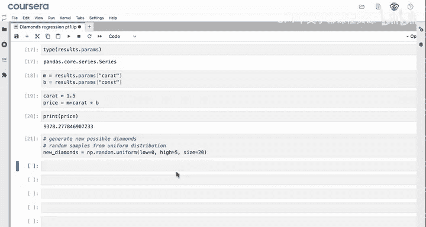

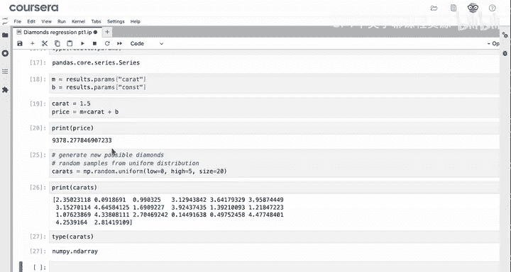

Now， apply the same equation to carrots rather than carrot and save the result and prices printnt it up。

 Now， what are you looking at here， You're looking at the estimated prices for each diamond。

 What do you think， do these prices make sense。It kind of depends on the value。

 This first price of $15973 corresponds with a diamond with $2。35 caratts。

 That makes sense since a 2。3 kat diamond is quite large。 Notice this negative value of around $1500。

 Well， a diamond can't have a negative price。 They certainly don't pay you to walk away with a diamond。

 This is a prediction for a diamond with 0。09 caratts。 That's quite a small one。

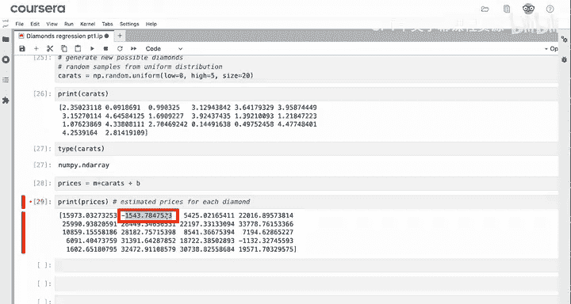

You may not be a jewel yourself， but you should have a general idea of whether these values make sense。

 Looking back at the line of best fit， you may notice that the majority of your data is between 0。

5 and 2。5 carats。 This also seems to be the region of data that your model predicts best。

 specifically， if you look at diamonds with a carrot of 3。

 you can see that the actual prices are all over the place。

 and the model is not predicting any of these diamond prices well。

 Since you know the model's limitations， you can adjust your simulation to only simulate diamonds between 0。

5 and 2。5 carats。 that way， youre using the range where the model performs best。

 Now that you've built a linear regression model with a high r square and known limitations。

 you can take it back to your client。 They can use it as a starting point to estimate prices speeding up the process for experts by giving them a general figure to start from because you've tried predictions out yourself。

 You know that very small diamonds are not well modeled by this data。

 you should be upfront about this limitation， for example， by presenting them with a simulated data。

 only between 0。5 and 2。5 carats。 This honesty will build trust with your。

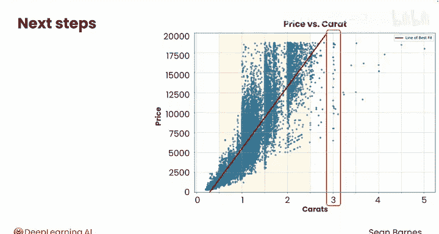

Wrapping up in this video， you use your newly generated model to predict new data points。

 you access the calculated MB values using results parameterss carrot for M and results parameterss fors is a series so you can select values using the string indices using a new value for carrot like 1。

5 you were able to predict a price with the equation m times cart plus you also saw how to predict many values by swapping a series for the single value in your formula you'll end up with a nonp array of predicted prices You also saw that you should know what kinds of outputs to expect from your model review its output and whether those outputs make sense you've learned a ton about linear regression in this lesson how it works conceptually how to train a model and make predictions using Python code Com up you'll complete the practice assignment and lab for this lesson in the practice lab you'll develop a new model to predict home prices in London Once you're done with the assignment and lab me in the next lesson to learn how to develop a linear regression。

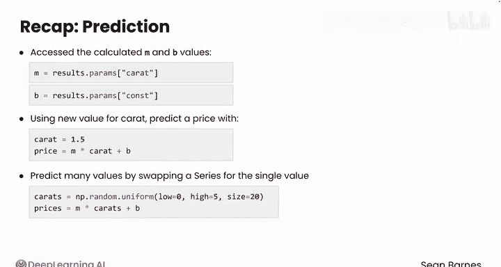

Moel with multiple variables， See there。