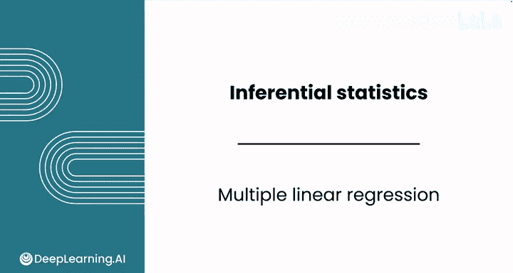
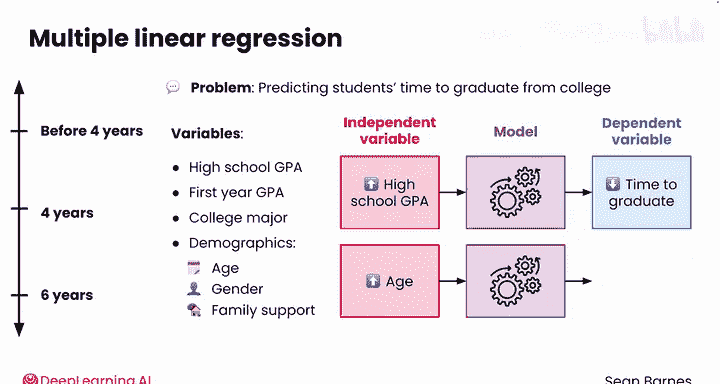
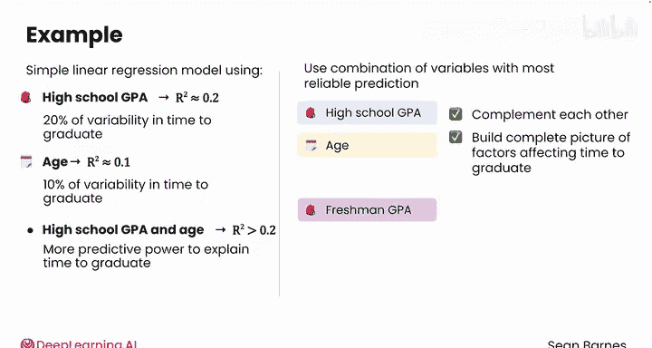
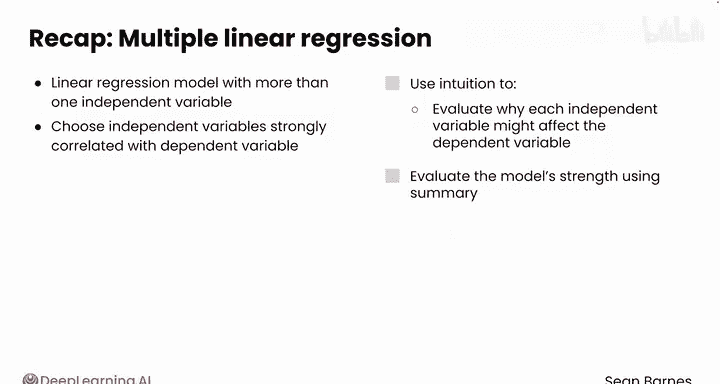

# 吴恩达《Python数据分析（数据分析第3课）｜Python for Data Analytics》中英字幕 - P73：72_多元线性回归.zh_en - GPT中英字幕课程资源 - BV1rp5yzjEgn

Linear regression is an excellent technique for modeling relationships between two variables。

 You can also expand your model beyond a single independent variable。

 creating a multiple linear regression。 Sple linear regression。

 linear regression with one independent variable is useful as a starting point and inferential analysis。

 you can choose a strong predictor to build a good baseline model。 For example。

 you saw in the previous lesson that carrot predicts about 85% of the variability in diamond prices。

 However， for many problems， using multiple independent variables significantly improves the predictive power of your model。

 Don't you want to do better than 85%， consider predicting students time to graduate from college。

 a person may graduate early， some time before the traditional fouryear mark they could graduate on time at four years or they could take several more semesters to graduate。

 say up to six years which is a common cutoff point for analysis。

 Many universities are interested in understanding what factors predict a person's time to graduate。

 It's helpful to identify students that may take longer to graduate to provide early support and identifying students who may graduate。

😊。

Earlier could help of course capacity planning What variables about a person do you think you could use to help predict their time to graduate there are a ton of options。

 but a few that might come to mind our high school GPA， first year GPA。

 college major and personal attributes like age， gender and family support Consider high school GPA for a moment as high school GPA increases what would you expect to happen to time to graduate。

On average， it should go down because the student is more likely to succeed in their coursework。

 This variable seems to largely capture the academic capability of the student。

 Consider the independent variable age， though， how might age affect a person's time to graduate。

A higher age might predict a longer time to graduate since older students often balance multiple responsibilities across work。

 family and school this relationship seems to be more about a person's life situation rather than academics Both of these variables could help you predict time to graduate and they seem to be capturing different underlying reasons why a person might take more or less time to graduate academic capability versus personal situation Imagine you created a simple linear regression model to predict time to graduate using high school GPA that model might have an R squared around 0。

2 so it explains about 20% of the variability in time to graduate you could also create a simple linear regression model using age that might have an r squared of 0。

1 explaining about 10% of the variability in time to graduate or you could create a multiple linear regression that predicts time to graduate as a function of both high school GPA and age。

 What would you hope to happen to the R squared value in the new model。

You'd hope to see an r squared value above 0。2 when combining these two variables if these two variables are truly measuring two different underlying reasons for time to graduate。

 then your model will have more predictive power to explain time to graduate when considering both factors you could extend this model further to capture even more variables like firstyear GP and even categorical variables like gender in general。

 you'll want to use a combination of variables that most reliably predicts the independent variable。

 High school GPA and age， complement each other well because they help build a more complete picture of the different factors affecting time to graduate。

 It's possible that adding freshman year GP to this model wouldn't make a huge improvement because it may explain some of the same variation in time to graduate as high school GPA does but you should try it anyway。

 experiment with different combinations of variables even potentially overlapping ones to see what works best。

 So to summarize， you can create a linear regression model with more than one independent variable This technique is called multiple linear regression As with a simple linear regression model。

 you'll want to choose independent variables。

That are strongly correlated with your dependent variable Use your intuition to evaluate why each independent variable might significantly affect the dependent variable。

 Intuition is a useful guide， though you ultimately want to evaluate the model's strength using its summary。

 remember that the best approach to analytics is combining your intuition with datadriven insights。

Now that you've seen how to design a multiple linear regression model。

 follow me to the next video to see the code in action。

