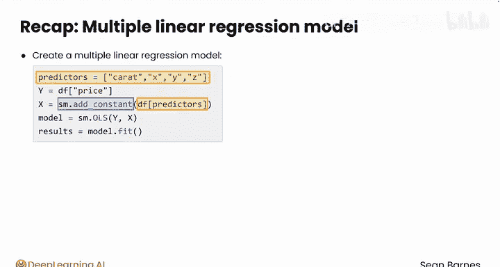

# 吴恩达《Python数据分析（数据分析第3课）｜Python for Data Analytics》中英字幕 - P74：73_多元回归模型训练.zh_en - GPT中英字幕课程资源 - BV1rp5yzjEgn

You've seen how to expand a linear regression model to use multiple independent variables as predictors。

 Let's see how to implement that designing code。Previous。

 you developed the model to predict diamond prices based on their carrot。

 your model had a reasonably high r squared around 0。

 a thought indicating that carrot explains about 85% of the variability in price。 However。

 that R squared could definitely be higher。 your client has come back to you saying that the model is somewhat useful but that they need a more accurate model in order to adopt it。

 You have other potential independent variables available to you to help improve your model。

 including the dimensions X Y and Z cut and color。 these features may provide additional accuracy for your model since they capture some aspect of style or quality that may affect the price in different ways than carrot。

 Suppose you want to add the diamonds dimensions to your model。

 X represents the length of the diamond when viewed face up。

 Y is the width face up and z is the height of the diamond when standing on its point。 Start with X。

 Now your model will estimate three coefficients。 instead of having price equals m times carrot plus B。

 you will have multiple。😊，Let's use the notation M1 and M2。

 so you might have something like price equals M1 times carrot plus M2 times x plus B。

 so your model calculates M1， M2 and B。As a recap， you've imported your modules loaded in your data and you fit your linear regression model to predict price using Carrot。

 You can start by modifying the code from the simple linear regression。 copypy it over。

 Now you can add new independent variables to X instead of a single predictor you can have a list of predictors So in addition to carrot。

 you want to add X the length of the diamond replace Dfcarrot with Df predictors in the definition of X。

 This code will select all the columns in the list predictors carrot and X you still need to use Sm do add constant so your model can estimate the intercept looking at x your data frame of independent variables Now it has three columns instead of2 Con cart and X remember that SMmols will create a coefficient for each of these independent variables Now print the results summary you can use the exact same code as before for this。

Okay youve improved your regression by a little bit， about half a percentage point。

 It seems that adding another feature X does help you predict the price of the diamond just a little better than you can do with carrot alone。

 Take a look at the P values for the three coefficients。

 They're all significant The coefficient for carrot is now in scientific notation but this value is equal to $10130 so that's higher than the previous model In a new variable adjusted the coefficients for the simple linear regression model It's all connected。

 X has a coefficient of negative $127。 and the coefficient value for the intercept also decreased to $1738。

 You'll learn more about how to interpret these coefficients in the next video。

 You can use the same code as before to predict the price of a diamond。

 check out the diamond at index 2107。 It has a care of $1。5 X of 7。

13 millm and its true price is $8580 Save the care and x into new variables。

Create a new equation to predict its price using your new model M1 is results。

 Paraams carrot and2 is results。params X B is still results。

parms const update your price equation Carrot now has the coefficient M1 Add your new independent variable M2 times x and B is the same running this cell you get a predicted price of $9605 based on your R squared you really only improve your model by a little bit you can try adding more variables like Y and Z you can just add them to your list of predictors and run the same code again。

Notice your r squared。 your model barely improved by just a 10th of a percent。

 These coefficients are significant with p values near 0。 so you can move forward with prediction。

 if you predict the price of the same diamond as before， adding y and z to your equation。

 you get a price of about 9521 so the prediction for this particular diamond didn't get more accurate。

 but don't be discouraged。  building a regression model is an iterative process you have to experiment a lot to actually find improvements in your model's accuracy to recap you can create a multiple linear regression model with almost the same code as you would use to create a simple one。

 The only difference is that you'll create a list of predictors rather than using a single one。

 So you'll have code like this with a list of several predictors and select those columns to create your x data frame。

 Don't forget you still need to add your constant column using sm add constant when interpreting your model you'll find a P value and coefficient for each independent variable in your result summary。

 you can use the p value to understand if that variable is a significant predictor in the presence of the other variables in the model。

 you can then predict new values。😊。

By modifying your equation with multiple independent variables and their associated coefficients。

Interpreting a multi linear regression model involves considering the variables in the context of the model。

 follow mes the next video to learn the nuances of responsible interpretation。

