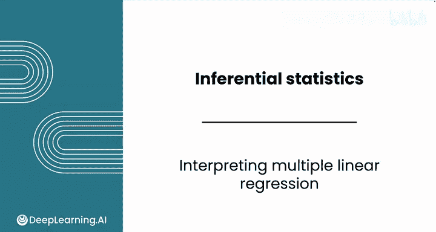
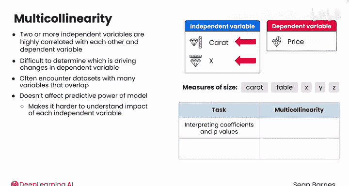

# 吴恩达《Python数据分析（数据分析第3课）｜Python for Data Analytics》中英字幕 - P75：74_多元回归结果解读.zh_en - GPT中英字幕课程资源 - BV1rp5yzjEgn

As you start adding more and more variables to your model。

 you'll need to be more careful with your interpretation in the previous video。

 you developed a multiple linear regression model to predict diamond price based on carrot X。

 Y and Z， resulting in the results summary you see here。 you already saw that your R squared of 0。

854 was just a slight improvement on the simple model that only use carrot。

 and you notice that the p values near 0 indicated that each of these predictors was significant when interpreting a multiple linear regression model。

 you must make your conclusions considering the entire context of the model。 For example。

 the R squared value here reflects the predictive power of the entire model。

 not just one variable like carrot。 Your model can explain about 85。

4% of price using these variables， but you can't come to any conclusions about how much each of these variables individually contributes to that explanatory power P values and coefficients2 should be considered in the context of the model Consider carrot for model this near0 p value indicates that carrot has a non-zero relationship with price more specifically if all these other。

😊。

Vs were held constant X， Y and Z， then changes in carrot would still affect a diamonds price。

 So if you had two diamonds with the same dimensions。

 the one with the higher weight or carrot would be pricier。

 So the coefficient for carrot explains that a diamonds price would increase by $10230 if the increase in weight by  one carrot as long as all the other variables are held constant。

 The model's coefficients help you understand the magnitude of their impact on the price。

 But why they are impacting price is difficult to interpret。 For example。

 you saw a similar graph of x on the x axis and price on the y axis in an earlier video when investigating relationships in your dataset。

 Do you see a positive or negative relationship。It's a positive relationship since its x goes up。

 price goes up。 Yet your model calculated a negative coefficient for x for every one unit increase in x。

 your model calculates that price goes down by $884。

 That coefficient doesn't match your intuition about how x and price are related。

 This mismatch occurs because both carrot and x are strongly correlated with your dependent variable price and with each other。

 A phenomenon called multicolineity。 When carrot and x moves together。

 it's hard for the model to untangle which one is actually driving up the price。

 So the model uses both variable together to capture the overall effect on the dependent variable In practice。

 this can look like one variable， having a positive coefficient and the other having a negative coefficient。

😊，Multiccollonarity occurs when two or more independent variables are highly correlated with each other。

 as well as with the dependent variable。 For example， consider the diamond dataset sets carrot and X。

 which are highly correlated。 the heavier the diamond， the larger it typically is。

 when two variables are highly correlated， it's difficult for the model to determine which variable is actually driving the changes in a dependent variable。

 D price。 I this diamond more expensive because it's heavier or because it's larger multicollinearity is common because you'll often encounter data sets with many variables that overlap in what they explain。

 the diamonds dataset set， for example， includes many measures of a diamonds weight or size。

 including carrot table， X， Y， Z and so on， which are all related to one another。

 It typically doesn't affect the overall predict the power of your model， but rather。

 it makes it harder to understand the individual impact of each independent variable。

 So when you're interpreting coefficients in P values， Multicollonarity matters。

 If you're predicting new data points， it won't matter as much。 you'll typically get a warning。

In your regression table like this one， if stats model suspects multicollonarity in your model。

 although multicollonarity can occurcur without this warning as well， to address multicollonarity。

 one option is to remove highly correlated independent variables keeping one of them you can also employ more complex solutions like creating composite features of multiple of these variables combined these solutions are out of scope for this course but just know that you have many options to address this issue。

When your multiple linear regression model doesn't improve R squared significantly。

 you can try adding categorical variables too， follow me to the next video to see a key technique for incorporating them into your regression model。

