# 吴恩达《Python数据分析（数据分析第3课）｜Python for Data Analytics》中英字幕 - P76：75_分类数据编码.zh_en - GPT中英字幕课程资源 - BV1rp5yzjEgn

You can add categorical variables to your model to help improve its performance。 However。

 these variables need some extra preprocessing steps。 The stats modelss O function。

 which you've been using to create linear regression models does not accept nonnumeric variables。

 So in order to use a categorical variable as a predictor。 you'll need to turn it into a number。

 Let's step through an example using the color feature from the diamonds dataset which includes values Dg and J D is a colorless diamond。

 It's the best possible value and diamonds get progressively more yellow moving from D to J So in your data。

 you may have 10 diamonds with these values for color the most straightforward way to encode these categories numerically is to use a pandas function called get Demies this function will create new columns one for each category and assign either a0 for that column if the diamond is not that color or a1 if the diamond is that color。

 So for the first row， you would get a1 in the color H column and a0 and all other columns One last complexity。

 notice that there's no color D column for that reason the second row only has zeros。

 This technique which involves。

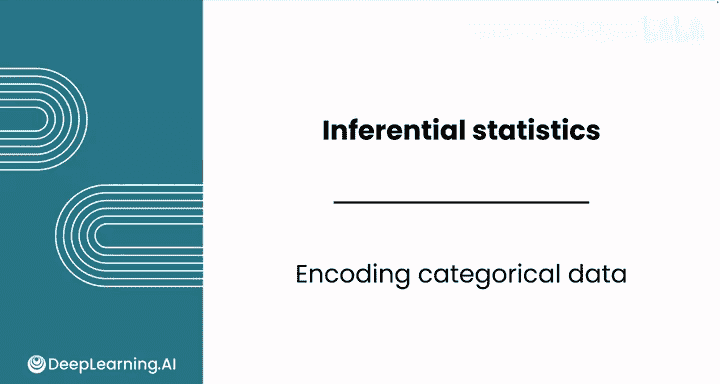

ing out one of the possible categories removes redundant information。

 You don't need to say that a diamond is color D。 If you know it's not any of the other colors。

 And if you know a diamond is any of the other colors， you know it's not colored D。

 you must complete this step to avoid an issue with fitting your model Con in this notebook you've imported your modules read your data into the variable Df and develop a multiple linear regression model for diamond price starting from that previous model。

 you want to improve its accuracy even more based on your client's request。

 Col seems like the useful potential independent variable since it may provide more additive prediction power than variables like X Y and Z which were perhaps redundant with Kt。

 you already saw that the unique colors in this data set are from D to J represented as letters One good practice would be to use a cborn and bar chart to display the relationship between the color and the price on the X axis you have the color of the diamond and its average price on the Y axis。

 you can ignore this future warning， which you've seen before。

 So just looking at this graph alone with no other information The prices for diamonds of colors D and E seem quite similar。

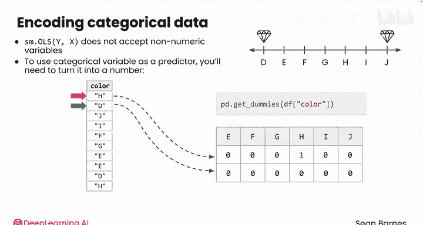

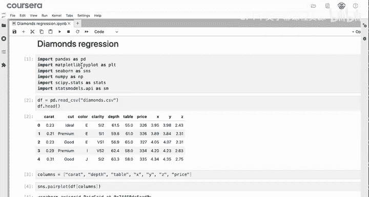

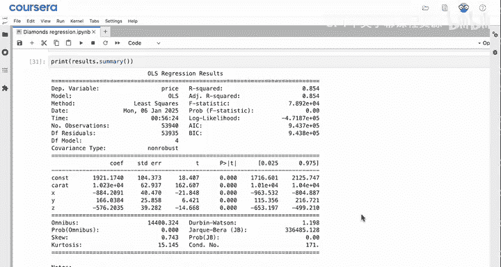

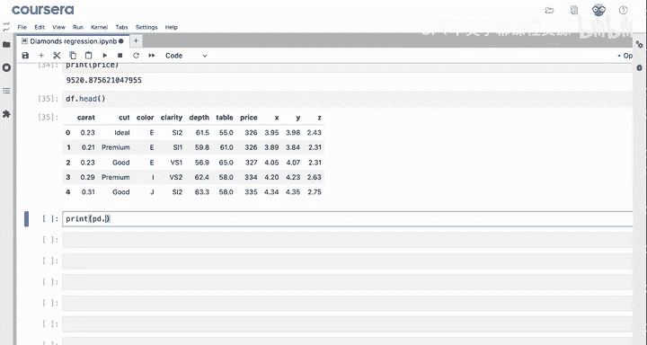

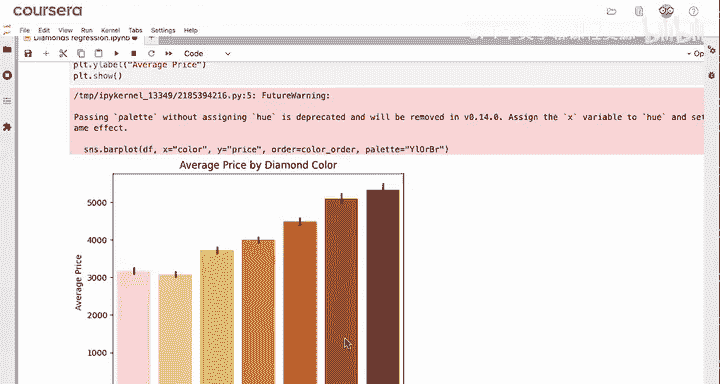

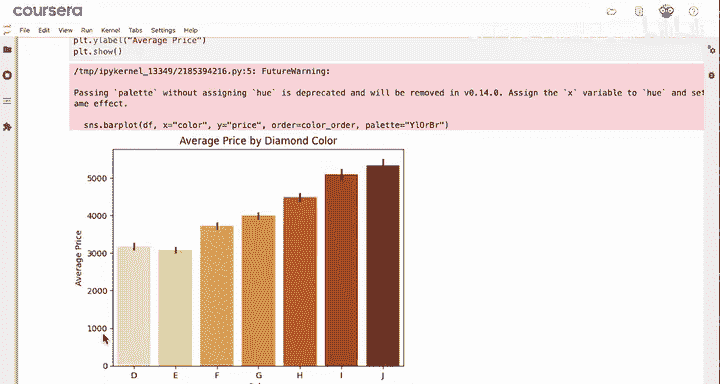

Then the prices start to go up increasing all the way until J based on what you know about color that may seem incorrect Why would a perfectly colorless diamond be worth less than a yellowwork diamond you'll want to investigate further to add your color variable to your regression model first add it to your list of predictors then you'll need to use the p。

gitmmies function SMm。 add constant a PD。git dummies with df predictors as the first argument then you'll specify the columns named argument which columns you'd like to encode any columns you don't list here will remain as is say color and you always want to use the argument droprop first equals true。

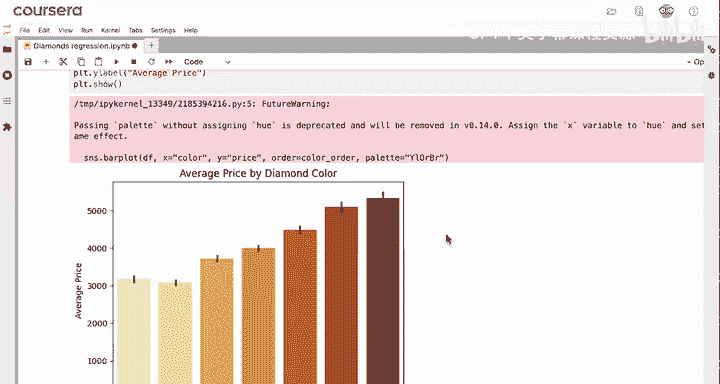

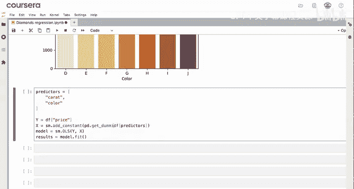

The first diamond is color E since the value for that column is true。 The second one is E。

 the fifth one is J。 and notice that there is no D column because the first category was dropped。

 So a diamond with color D would just have false for each column Not that these values are all booleions。

 So next step you should try to fit the model。 But running the model you get this error。

 It turns out SMm OLs only works with numeric data。

 That's what you're dealing with dummies in the first place。

 Let's ask the LLM for help with this task For this line of code。

 how can I get a numerical output rather than boolean for the dummies Pro multiple options。

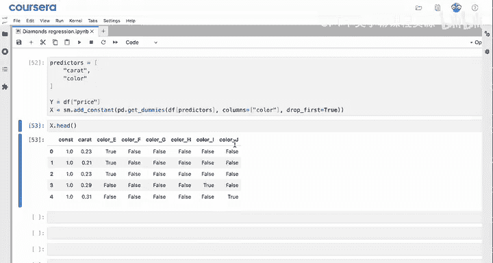

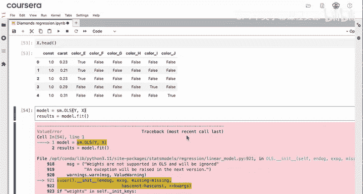

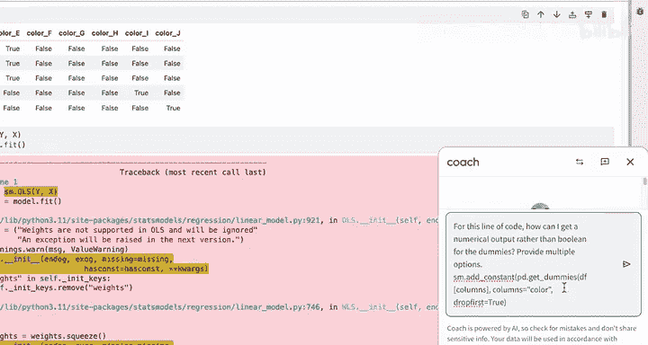

The LLM gives you a couple of options First it tells you that you can specify D type equals nt in the PD get dumies function。

 Let's just use the first option。

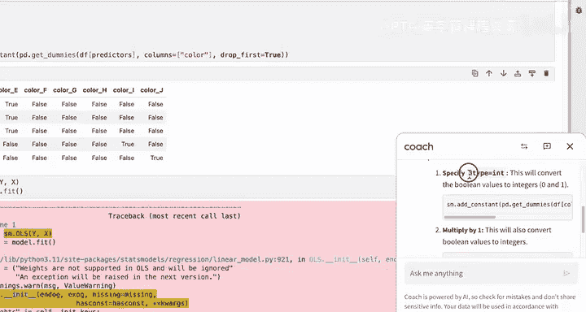

Making the change and running that code again， you now have numbers， which is exactly what you need。

 It's a little easier to read as a person too。

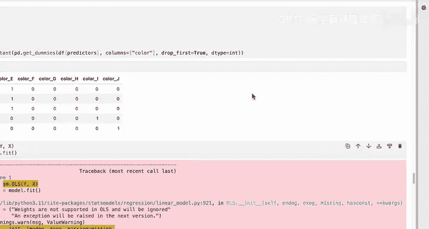

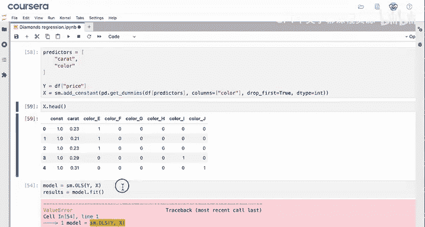

To recap， you use the PD。 gett dumies function to encode categorical data。

 you use threename arguments to get your data in the right form for regression columns with the columns you want to encode。

 droprop first equals true argument to remove redundant data。

 remember this step is necessary and finally D type equals in to gi numbers rather than booleanions in your resulting data frame now that you've set up your categorical data you've done most of the work needed to add it to your regression model。

 follow me to the next video to train your new model。

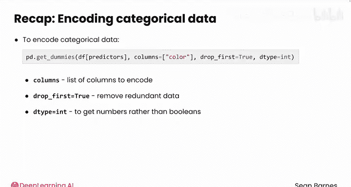